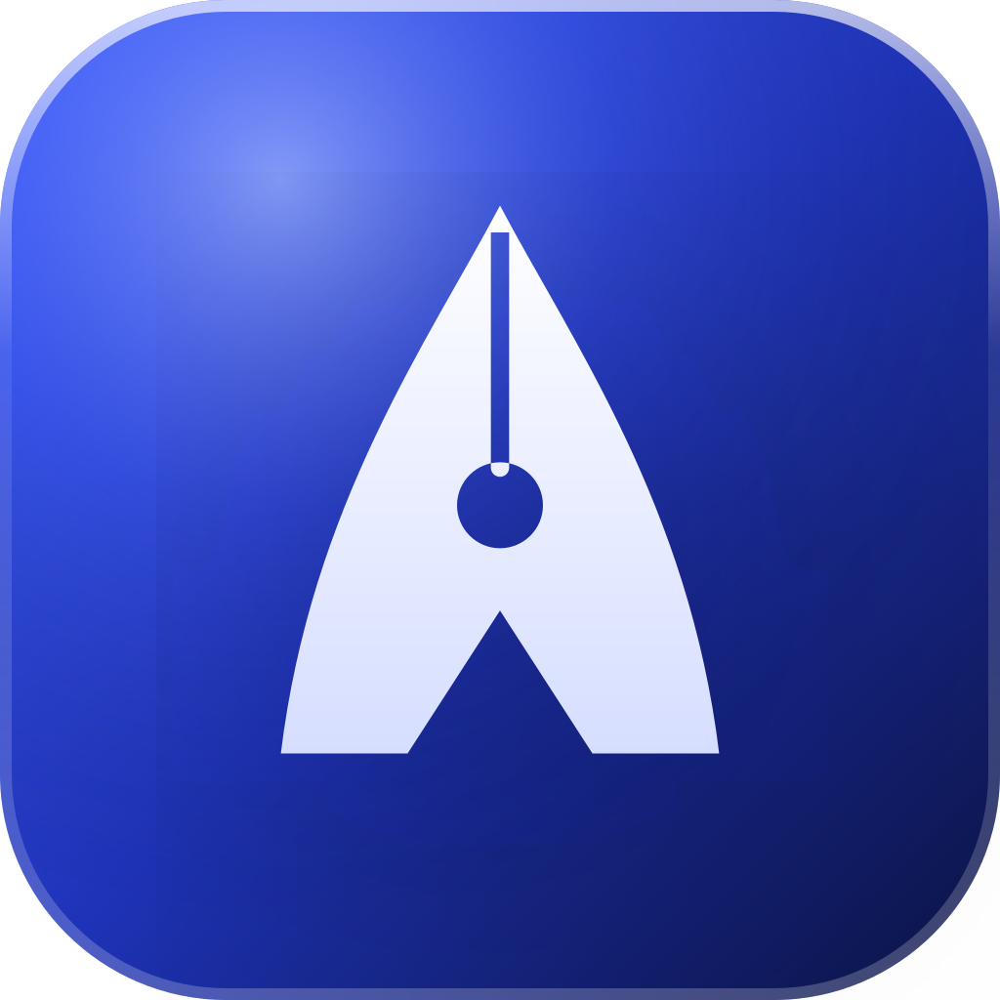

<p align="center"></p>

<h1 align="center">Apex</h1>
<p align="center"><strong>Ein Werkzeug. Volle Kontrolle.</strong> Die Kanzlei-Software, die mitdenkt.</p>

Apex ist der Prototyp einer Kanzlei-Software für deutsche Rechtsanwältinnen und Rechtsanwälte. Akten, beA und E-Mail, Fristen, Abrechnung, Forderungen und eine nachvollziehbare KI liegen in einer Oberfläche – responsiv vom Smartphone bis zum Großbildschirm, in Hell und Dunkel, gestaltet nach den Prinzipien von Apple Liquid Glass.

> **Status:** Präsentations- und Test-Prototyp (v0.9) nach fünf Usability-Iterationen mit dem Kundenavatar „Claudia Reinholz“ (SUS 65,6 → 80,6). Alle Funktionen sind klickbar, Fachlogik und KI funktionieren, mehrere Kanzleien lassen sich getrennt testen. Die Anbindungen an beA, E-Mail-Server und Bank sind simuliert und in der App so gekennzeichnet (siehe [Was ist echt, was simuliert?](#was-ist-echt-was-simuliert)).


## Inhalt

- [Produktüberblick](#produktüberblick)
- [Funktionen](#funktionen)
- [Screenshots](#screenshots)
- [Zugänge](#zugänge)
- [Betriebsarten](#betriebsarten)
- [KI](#ki)
- [Betrieb & Sicherheit](#betrieb--sicherheit)
- [Qualität](#qualität)
- [Was ist echt, was simuliert?](#was-ist-echt-was-simuliert)
- [Projektstruktur](#projektstruktur)
- [Entwicklung](#entwicklung)
- [Dokumentation](#dokumentation)

---

## Produktüberblick

Apex antwortet auf die häufigsten Klagen über klassische Kanzleisoftware: ungetestete Updates, Hotline-Warteschleifen, langsame Suche, unvollständige Forderungskonten, Einzelabrechnung, Abo-Kosten und den mühsamen Umzug. Fünf Versprechen prägen das Produkt:

1. **Ein Werkzeug, volle Kontrolle** – Akten, beA, E-Mail, Fristen, Dokumente, RVG, Forderungen und KI in einer Oberfläche.
2. **Fristen, die stimmen** – ein deterministischer, getesteter Fristenrechner mit Rechenweg, Feiertagen am Gerichtsort und Vier-Augen-Kontrolle. Das eEB lässt sich erst abgeben, wenn die Frist notiert ist.
3. **KI, die nachvollziehbar arbeitet** – die KI erkennt, der Rechenkern berechnet; zitiert wird nur aus der Fall-Datenbank; jede KI-Frist geht in die Vier-Augen-Kontrolle.
4. **Lifetime statt Abo** – einmal investieren, dauerhaft nutzen; Betrieb On-Premise oder in einer deutschen Private Cloud. Preis und Wartung regelt das Angebot.
5. **Support, der hilft** – feste Ansprechpartnerin statt Hotline, animiertes Wiki, Schnellhilfe auf jeder Seite und ein sprechender KI-Assistent.

---

## Funktionen

| Bereich | Was er tut |
|---|---|
| **Cockpit** | Der Tag auf einen Blick: KI-Briefing in drei Sätzen (auch vorgelesen), „Heute & morgen fällig“ mit Terminen, Posteingang, KI-Empfehlung, 38h-Motor und Finanzen. Umschaltbar zwischen „Ganze Kanzlei“ und „Nur meine“. |
| **Akten** | Alle Mandate mit E-Akte (Umbenennen per Doppelklick, Mehrfachauswahl, Drag & Drop, Versionen), Fristen, Beteiligten, Aktenkonto, Verlauf, Mandantenportal und KI-Fallanalyse. Die **Mandatsaufnahme** prüft Interessenkonflikte (§ 43a Abs. 4 BRAO, auch über Dubletten) und erzeugt Vollmacht, Mandatsbestätigung, Datenschutzhinweise und die Deckungsanfrage als Entwurf zur Freigabe. |
| **Posteingang** | beA und E-Mail in einem Postfach. Die KI ordnet jede Nachricht der richtigen Akte zu (mit Grund und Sicherheit), erkennt Fristen und Mandatsanfragen. Das eEB geben nur Berufsträger ab – und erst, wenn die Frist notiert ist; Fachangestellte legen es vor. Tastatur: J/K, Enter, U, E. |
| **Fristen** | Fristenkalender als Liste, Woche, Monat und **Ausgangskontrolle**, mit Vorfristen und Vier-Augen-Kontrolle. Der **Fristenrechner** nach §§ 187, 188 BGB und § 222 ZPO (dazu ArbGG, StPO, OWiG, VwGO, FamFG, BGB-Verjährung) kennt die Feiertage aller 16 Bundesländer, rechnet am Gerichtsort und zeigt jeden Schritt mit Norm. Export als .ics, Druckansicht. |
| **Apex KI** | **KI-Fallanalyse** (Einschätzung der Erfolgsaussicht, Rechtsfragen, Argumente mit Quellen, Präzedenzfälle, nächste Schritte, Schriftsatz-Entwurf), **Dokument-Analyse** (erkennt Fristen und vertragliche Ausschlussfristen) und **Schriftsatz-Entwurf** (Sachstand, Deckungsanfrage, Aufforderung, Klageerwiderung, Replik, Kostenhinweis). |
| **Fall-Datenbank** | Leitentscheidungen von BVerfG, EuGH und Bundesgerichten durchsuchen – als Stichwortsuche oder KI-Recherche. „Für Ihre Akten“ schlägt passende Entscheidungen vor; Treffer lassen sich an eine Akte heften. |
| **38h-Motor** | Zwölf Automatiken (Zuordnung, Fristerkennung, Vorfristen, eEB-Vorbereitung, Bankabgleich, Mandanten-Updates …) laufen im Hintergrund und messen ihre Zeitersparnis der letzten 7 Tage; was die Kanzlei verlässt, geht erst nach Freigabe hinaus. Mit ROI-Rechner („Ersparnis berechnen“) und der **Apex Island** in der Kopfleiste. |
| **Abrechnung** | **RVG-Rechner** je Angelegenheit (Tabellen 2025 und 2021 nach § 60 RVG, Anrechnung, Auslagenpauschale je Angelegenheit), **Sammelabrechnung** (nur entstandene Gebühren, Vorschuss nach § 9 RVG, RSV-Anteile), Rechnungen mit **Storno** und Korrekturrechnung, E-Rechnung (XRechnung/ZUGFeRD), **Bankabgleich** mit Geschäfts- und Anderkonto, **Fremdgeld-Wächter** (§ 43a Abs. 7 BRAO, SEPA-Datei), **Forderungskonto** mit taggenauen Zinsen und Verrechnung nach § 367 BGB, Zinsrechner und Zeiterfassung. |
| **Kontakte** | Mandanten, Gegner, Gerichte und Versicherungen mit verknüpften Akten, Kollisionsprüfung und Zusammenführen von Dubletten. |
| **Umzug** | Umzug in fünf Schritten aus RA-MICRO, ACTAPORT, Advoware, ReNoStar oder CSV – mit Spaltenzuordnung, Dubletten- und Plausibilitätsprüfung, Vier-Augen-Kontrolle der Fristen und Umzugsprotokoll mit „Rückgängig“. |
| **Hilfe & Support** | Feste Ansprechpartnerin mit Durchwahl und Rückruf, Systemstatus, geprüfte Updates, animiertes Wiki und die Schnellhilfe (?) neben jedem Seitentitel. |
| **Apex Assistent** | Sprechender KI-Avatar unten rechts (Sprache oder Text). Er fasst den Tag zusammen, nennt Fristen mit derselben Zählweise wie das Cockpit, berechnet Fristen und RVG, schlägt Wiedervorlagen mit Bestätigungskarte vor, findet Rechtsprechung, kennt die Ersatzeinreichung bei beA-Störung und verbindet mit der Ansprechpartnerin. |
| **Einstellungen** | Kanzleiprofil mit Briefkopf und Rechnungsangaben, Team & Zugänge (Rollen, Abwesenheit, Vertretung, Übertragung von Fristen), Lizenz, KI, Darstellung (Hell/Dunkel, Schriftgröße, Apex Island, Tastaturkürzel), Datenschutz & Verträge (§ 43e BRAO, Art. 28 DSGVO, Protokoll) und Anmeldung & Sicherheit (Zwei-Faktor, Sperre bei Inaktivität). |
| **Apex Console** | Bereich für das Apex-Team: Kundenkanzleien und Testzugänge anlegen (mit Passwortwechsel bei der Erstanmeldung), pausieren, zurücksetzen, löschen; Startpasswörter neu vergeben – jeder Eingriff steht im Protokoll der Kanzlei. |

**Strg+K** (Mac: **⌘K**) öffnet überall die globale Suche über Akten, Dokumente (Volltext), Fristen, Posteingang und Rechtsprechung – dazu Aktionen wie „Frist berechnen“, „Zinsrechner“ oder „Sammelabrechnung“. **?** zeigt alle Tastaturkürzel.

---

## Screenshots

| | |
|---|---|
|  **Landing** – Positionierung, Vorschau mit Beispieldaten, Lifetime-Lizenz |  **Posteingang** – KI-Analyse des Urteils 118/26 mit erkannten Fristen und eEB |
|  **Fristen** – Kacheln, Vier-Augen-Kontrolle, Fristenrechner |  **Akte 142/26** – Kopf, Verfahrensstand, Reiter |
|  **KI-Fallanalyse** – Einschätzung, Argumente mit Quellen, Präzedenzfälle |  **RVG-Rechner** – Gebühren je Angelegenheit mit Anrechnung |
|  **Apex Assistent** – „Was steht heute an?“ mit Werkzeug-Chips |  **Mobil** – Cockpit am iPhone mit Tab-Leiste |
|  **Dunkelmodus** – Fristenkalender |  **Cockpit** – der Tag auf einen Blick |

---

## Zugänge

| Kanzlei | Ort | Schwerpunkte | Anmeldung |
|---|---|---|---|
| Hartmann & Partner | Berlin | Arbeits-, Miet-, Verkehrs-, Erbrecht | `julia.hartmann@hartmann-partner.de` (Partnerin) · `jonas.brandt@…` (Anwalt) · `mia.becker@…` (Fachangestellte) |
| Lindner Rechtsanwälte | München | Forderungseinzug, Vertrags-, Baurecht | `stefan.lindner@lindner-recht.de` |
| Demir & Kollegen | Hamburg | Familien-, Straf-, Erbrecht | `selin.demir@demir-kollegen.de` |
| Apex Console | – | Anbieter-Verwaltung | `admin@apex-kanzlei.de` |

- Das Passwort aller Beispielzugänge ist `Apex-Demo-2026`. Weitere Personen je Kanzlei stehen in `src/core/seed/tenants.ts`. Auf der Anmeldeseite genügt für die Beispielkanzleien ein Klick auf die Karte.
- **Apex Console:** Im Browser-Demo lautet das Passwort `Apex-Console-2026`. Im Server-Betrieb gilt die Adresse aus `CONSOLE_ADMIN_EMAIL` (Standard `admin@apex-kanzlei.de`) und ausschließlich das eigene `CONSOLE_ADMIN_PASSWORD` (mindestens 12 Zeichen, kein Platzhalter, kein öffentliches Demo-Passwort) – sonst bleibt die Console deaktiviert.
- Jede Kanzlei sieht ausschließlich ihre eigenen Daten. Im Server-Betrieb erzwingt das der Server je Sitzung.
- Die Beispieldaten entstehen jeden Tag relativ zu „heute“, damit Fristen, Posteingang und Termine immer aktuell sind.

**Kunden einen eigenen Testzugang geben:**

1. In der **Apex Console** „Neuen Testzugang anlegen“ wählen.
2. Kanzlei und Stadt eintragen (das Bundesland für die Feiertage ergänzt die App), Hauptnutzerin bzw. Hauptnutzer mit E-Mail, Arbeitsplätze, Testende und Schwerpunkte wählen, „Mit Beispieldaten“ oder leer.
3. Einladung kopieren und versenden; das Startpasswort getrennt übermitteln (telefonisch oder per SMS).
4. Bei der ersten Anmeldung legt die Kanzlei ein eigenes Passwort fest.

---

## Betriebsarten

Voraussetzung ist Node.js ab 22.13.

### 1. Demo im Browser (ohne Server)

```bash
npm install
npm run dev               # http://localhost:5173 – Demo-Modus, Daten im Browser (IndexedDB), Demo-KI offline
npm run build:static      # dist-static/ – reine Browser-Demo mit Hash-Routing für GitHub Pages, Netlify oder den Präsentations-Laptop
```

### 2. Server (echte Zugänge, getrennte Kanzleidaten)

```bash
cp .env.example .env      # CONSOLE_ADMIN_PASSWORD setzen, optional ANTHROPIC_API_KEY
npm run build
set -a; source .env; set +a
npm start                 # http://localhost:8787
```

Für die Entwicklung mit Server laufen `npm run dev:server` (API auf Port 8787) und `npm run dev` (Vite leitet `/api` weiter) parallel.

**Docker (On-Premise oder Private Cloud):**

```bash
cp .env.example .env      # Werte anpassen
docker compose up -d      # http://localhost:8787 – Daten im Volume „anwaltapex-daten“ (Name bleibt nach der Umbenennung)
```

Ein Container enthält Web-App, API und SQLite; Zeitzone `Europe/Berlin`, Healthcheck auf `/api/health`.

**Render (Testumgebung für Kunden):** Das Repository mit [Render](https://render.com) verbinden – `render.yaml` wird erkannt (Region Frankfurt, persistente Platte, `COOKIE_SECURE` und `TRUST_PROXY` gesetzt). Dort `CONSOLE_ADMIN_PASSWORD` und optional `ANTHROPIC_API_KEY` eintragen.

### 3. Artefakt (eine HTML-Datei)

```bash
npm run build:artifact    # dist-artifact/anwaltapex.html – Browser-Demo als einzelne Datei (ca. 3 MB, keine externen Verweise)
```

Für die Vorschau auf claude.ai. Die Live-KI läuft dort über die Laufzeit des Artefakts nach einmaliger Freigabe; ohne Antwort binnen 45 Sekunden übernimmt die Demo-KI. Das Mikrofon ist in der Vorschau nicht verfügbar – Fragen an den Assistenten werden getippt. Details im [Demo-Skript](docs/DEMO-SKRIPT.md#hinweise-für-die-artefakt-vorschau).

---

## KI

| Betrieb | KI-Quelle |
|---|---|
| Server mit `ANTHROPIC_API_KEY` | Claude über die Anthropic API (Standard `claude-opus-5-5`, einstellbar über `AI_MODEL`). Der Browser spricht nur mit dem eigenen Server, der Schlüssel bleibt serverseitig. Streaming, Werkzeugnutzung, `output_config.effort` (low für den Assistenten, medium für Analysen), Prompt-Caching und server-seitige Fallbacks (`fallbacks: "default"`) sind aktiv. |
| Artefakt-Vorschau auf claude.ai | Claude über die Laufzeit des Artefakts. Der Betrachter gibt das einmalig frei. |
| Ohne KI-Zugang | **Demo-KI (offline)**: regelbasierte Analyse und vorbereitete Fallanalysen. Die Präsentation funktioniert so auch ohne Internet. Umschaltbar unter Einstellungen → KI-Einstellungen („Präsentationsmodus: Demo-KI verwenden“). |

Für alle KI-Funktionen gelten drei Grundsätze:

1. **Die KI erkennt, der Fristenrechner berechnet.** Fristen entstehen immer im deterministischen, getesteten Rechenkern (`src/core/fristen.ts`), nie im Sprachmodell.
2. **Nur geprüfte Quellen.** Die KI zitiert ausschließlich Entscheidungen aus der Fall-Datenbank.
3. **Nachvollziehbar.** Rechenweg, Quellen und Begründung sind immer sichtbar. KI-Fristen gehen in die Vier-Augen-Kontrolle; Änderungen an Daten nur nach Bestätigung oder mit „Rückgängig“.

Die Modellempfehlung für Entwicklung und App steht im [Masterprompt](docs/MASTERPROMPT.md#0-empfohlenes-ki-modell).

---

## Betrieb & Sicherheit

### Umgebungsvariablen (Server)

| Variable | Wirkung |
|---|---|
| `PORT`, `DATABASE_PATH` | Port (Standard 8787) und Pfad der SQLite-Datenbank (wird angelegt). |
| `CONSOLE_ADMIN_EMAIL`, `CONSOLE_ADMIN_PASSWORD` | Zugang zur Apex Console. Das Passwort braucht mindestens 12 Zeichen; Platzhalter aus `.env.example` und öffentlich bekannte Demo-Passwörter werden abgelehnt – die Console bleibt dann deaktiviert (Hinweis im Log). |
| `ANTHROPIC_API_KEY`, `AI_MODEL` | Live-KI mit Claude; ohne Schlüssel arbeitet die Demo-KI. |
| `AI_DEMO_TENANTS` | `off` schaltet die Live-KI für die eingebauten Präsentationskanzleien ab (deren Zugangsdaten sind öffentlich); dort arbeitet dann die Demo-KI. |
| `AI_MAX_TOKENS`, `AI_DAILY_REQUESTS_PER_TENANT`, `AI_DAILY_TOKENS_PER_TENANT`, `AI_DAILY_TOKENS_TOTAL` | Obergrenze je KI-Antwort und Tageskontingente je Kanzlei bzw. Server (`0` = unbegrenzt). Ist ein Kontingent erschöpft, übernimmt die Demo-KI. |
| `SEED_DEMO`, `DEMO_QUICK_LOGIN` | Präsentationskanzleien beim ersten Start anlegen und Ein-Klick-Karten auf der Anmeldeseite zeigen. |
| `COOKIE_SECURE` | Hinter HTTPS auf `true`: Sitzungs-Cookie nur über HTTPS, zusätzlich HSTS. |
| `TRUST_PROXY` | Nur hinter einem eigenen Reverse Proxy (z. B. Render) auf `true`: Die Anmeldebegrenzung nutzt dann den letzten `X-Forwarded-For`-Eintrag, sonst die Socket-Adresse. |
| `TZ` | Zeitzone für „heute“, Fristen und den Tageswechsel der Beispieldaten (Docker und Render: `Europe/Berlin`). |

### Daten, Sitzungen, Schutz

- **Mandantentrennung:** Jede Datenabfrage ist auf die Kanzlei der Sitzung begrenzt. Jede Daten-, Team- und KI-Anfrage ist zusätzlich an Kanzlei und Person des Browser-Tabs gebunden – meldet sich in einem anderen Tab jemand anderes an, weist der Server alte Anfragen ab und der Tab lädt neu.
- **Datenbestand:** Präsentationskanzleien werden jeden Tag frisch erzeugt (Änderungen während einer Präsentation bleiben bis zum Tagesende). Kunden-Kanzleien werden nur neu erzeugt, solange sie unveränderte Beispieldaten haben – sobald eine Kanzlei etwas geändert hat, löscht der Server nie automatisch, auch nicht bei einer neuen Version der Beispieldaten. „Demo-Daten zurücksetzen“ gibt es nur für Präsentations- und Beispieldaten-Kanzleien.
- **Anmeldung:** Passwörter mit scrypt, Sitzung als HttpOnly-Cookie, 12 Stunden gleitend verlängert. Startpasswörter (`Apex-XXXX-XXXX`) müssen bei der ersten Anmeldung ersetzt werden (mindestens 10 Zeichen mit Buchstaben und Ziffer). Zwei-Faktor-Anmeldung (TOTP mit Wiederherstellungscodes) je Person oder für die ganze Kanzlei als Pflicht; Sperre bei Inaktivität.
- **Zugriff entziehen:** Entfernte oder deaktivierte Personen, pausierte Kanzleien und abgelaufene Testzugänge verlieren den Zugriff sofort. Wer einen Zugang deaktiviert oder entfernt, muss über dessen offene Fristen entscheiden (Entfernen nur mit Übertragung an einen aktiven Berufsträger); das prüft auch der Server.
- **Begrenzungen:** Anfragen bis 64 KB (Dokumente und KI-Anfragen bis 3 MB), Passwörter bis 256 Zeichen, Anmeldeversuche je IP und je Zugang begrenzt; gespeicherte Dokumente werden auf Pflichtfelder geprüft. Sicherheits-Header inkl. Content-Security-Policy (nur eigene Skripte), `Cache-Control: no-store` für die API.
- **Protokoll:** Anmeldungen, Fehlversuche, Team- und Statusänderungen, Passwort-Neuvergaben und Eingriffe des Anbieters stehen im Audit-Protokoll (Tabelle `audit`) bzw. im Protokoll der Kanzlei. Die KI-Nutzung zählt der Server je Kanzlei und Tag nur als Anfragen und Tokens, ohne Inhalte (Tabelle `ki_nutzung`).
- **Keine externen Ressourcen:** Schriften liegen lokal, es gibt keine CDNs, keine Tracker und keine externen Requests aus dem Client.

---

## Qualität

| Prüfung | Stand |
|---|---|
| `npm run typecheck` | 0 Fehler (TypeScript strict) |
| `npm test` | **229 / 229** Tests grün – Fachlogik (`src/core`: Fristen, Feiertage, RVG, Zinsen, Kollisionsprüfung, Vertretung, Demodaten-Fingerabdruck), KI-Fallbacks (`src/ai`) und Seitenlogik (`src/pages`) |
| `npm run build` | Web und Server fehlerfrei |
| axe-core (WCAG 2.2 A/AA) | **0 serious, 0 critical** in 72 Ansichten der Abnahmerunde (hell, dunkel, 200 %, 320 px, iPhone) und in 68 Ansichten der Prüfung danach |
| Konsolen-Sweep | 160 Ansichten ohne `pageerror` und ohne `console.error` |
| Artefakt-Probe | Landing → Anmeldung → Cockpit → Posteingang mit KI-Analyse → Assistent im Skelett der Veröffentlichung ohne Fehler |

### Usability-Studie

In fünf End-to-End-Iterationen hat der Kundenavatar **Claudia Reinholz** (Fachanwältin für Arbeitsrecht, Paderborn, fiktiv) alle 24 Aufgaben in allen 16 Bereichen bedient. Nach jeder Runde wurden die Befunde umgesetzt und in der nächsten Runde nachgetestet. Die Werte stammen von einer simulierten Person und sind **Trendwerte**, keine Statistik.

| Kennzahl | Iteration 1 | Iteration 2 | Iteration 3 | Iteration 4 | **Iteration 5** | Ziel |
|---|---|---|---|---|---|---|
| Aufgaben ohne Umweg | 6 / 24 | 22 / 24 | 21 / 24 | 21 / 24 | **24 / 24** | 24 / 24 |
| SUS | 65,6 | 71,9 | 76,3 | 78,1 | **80,6** | ≥ 80 |
| UEQ-S pragmatisch / hedonisch | +1,13 / +1,25 | +1,44 / +1,38 | +1,63 / +1,31 | +1,63 / +1,25 | **+1,69 / +1,44** | ≥ +1,5 |
| Schulnoten-Mittel | 2,6 | 2,13 | 2,07 | 2,02 | **1,83** | ≤ 2,0 |
| Note Vertrauen | 3,5 | 2,88 | 2,25 | 2,25 | **1,63** | 1 |
| Fehlaktionen | 25 | 12 | 11 | 11 | **4** | – |
| Empfehlung (0–10) | 5,5 | 7,0 | 7,75 | 7,75 | **8,0** | – |
| axe-core serious / critical | 14 / 6 | 0 / 0 | 3 / 0 | 1 / 0 | **0 / 0** | 0 / 0 |
| Befunde (K · H · M · N) | 133 (4 · 42 · 63 · 24) | 88 (2 · 8 · 35 · 43) | 59 (0 · 8 · 23 · 28) | 52 (1 · 3 · 19 · 29) | **32 (1 · 0 · 7 · 24)** | 0 offene K und H |

Von 364 Befunden sind 362 umgesetzt, einer teilweise (Impressum – wartet auf die Anbieterdaten des Auftraggebers) und einer verworfen. Offen sind nur noch Entscheidungen des Auftraggebers (Preis, Wartung, Übertragbarkeit, Escrow, EU-Verarbeitung der Live-KI, Impressum). Berichte, Gesamtfazit und Nachweise: [docs/usability/README.md](docs/usability/README.md).

---

## Was ist echt, was simuliert?

| Echt im Prototyp | Simuliert bzw. Demo |
|---|---|
| Fristenrechner, Feiertage, RVG-Tabellen, Zinsen und § 367 BGB (mit Tests) | beA-, E-Mail- und Bank-Anbindung: Status und Abruf sind animiert, die Nachrichten kommen aus Demodaten („Simuliert verbunden“) |
| Anmeldung, Mandantentrennung, Testzugänge, Teamverwaltung, Zwei-Faktor-Anmeldung (Server) | Fall-Datenbank: Auszug echter Leitentscheidungen mit sinngemäß zusammengefassten Leitsätzen; Anbindung an Open Legal Data und NeuRIS vorbereitet |
| KI-Fallanalyse, Posteingangs-KI, Dokument-Analyse, Schriftsatz-Entwurf und Assistent live mit Claude (Server oder Artefakt) | Demo-KI ohne Schlüssel: regelbasiert, mit vorbereiteten Analysen für die Präsentationsakten |
| CSV-Import im Umzug (inkl. Windows-1252) | Formate der Altsysteme: Beispiel-Exporte (echte Importer folgen in Phase 6) |
| Sprachein- und -ausgabe (Web Speech API, Chrome/Edge/Safari) | „Ø 38 Std. pro Woche“ und die Motor-Werte: Beispielwerte aus Demodaten, keine Messung |
| | Rückruf und Bildschirmteilen der Ansprechpartnerin; Impressum (gekennzeichneter Platzhalter) |

---

## Projektstruktur

```
src/
  core/          Fachlogik ohne UI, mit Tests: Fristen (fristen.ts), Feiertage, RVG 2025/2021, Zinsen/§ 367 BGB,
                 einheitliche Fristen-Zählweise (fristenLage.ts), Kennzahlen (kennzahlen.ts), Kollisionsprüfung,
                 Vertretung, Suche, Rechtsprechung, Datenmodell (types.ts), Demodaten-Generator (seed/, relativ zu „heute“)
  ai/            KI-Zugang (llm.ts: Server-Proxy / Artefakt-Laufzeit / Demo-Fallback), Fallanalyse, Dokument-Analyse,
                 Apex Assistent mit Werkzeugen, KI-Status
  app/           Router und Navigation (nav.ts)
  components/    Designsystem (ui/), App-Hülle (shell/), Assistent und Avatar, Fallanalyse, Wiki-Player, Sicherheit
  content/       Wiki-Artikel, Lizenz- und Datenschutztexte (einheitlicher, neutraler Wortlaut)
  lib/           Backend-Schnittstelle (backend/: Demo mit IndexedDB, Server mit REST), Rollen, Zwischenablage,
                 Tastatur, Typografie, Sprache, Betriebsstatus
  pages/         Bereiche der App (cockpit, akten, posteingang, fristen, ki, falldb, motor, abrechnung, kontakte,
                 umzug, hilfe, einstellungen, console, public)
  store/         Zustand (zustand): Kanzleidaten, Sitzung, Oberfläche
  styles/        index.css mit Farb- und Material-Tokens (Hell und Dunkel)
server/          index.ts – Hono-API mit node:sqlite: Anmeldung (scrypt, HttpOnly-Cookie, TOTP), Mandantentrennung,
                 Apex Console, KI-Proxy mit Kontingenten, Audit-Protokoll
scripts/         Screenshots (shot.mjs), Prüfabläufe (flow.mjs), Artefakt-Build (build-artifact.mjs), Prüfskripte
docs/            Masterprompt, Branding, UI-Leitfaden, Demo-Skript, Kundenavatar, Usability-Studie, Wettbewerb, Screenshots
brand/           Logo und App-Icon (SVG)
```

Verwendete Technik: React 19, Vite, TypeScript, Tailwind CSS v4, motion, zustand, React Router, TanStack Table, cmdk, lucide, Hono, Node `node:sqlite` und `@anthropic-ai/sdk`. Die Schriften (Geist, Geist Mono) liegen lokal im Projekt.

Die Zielarchitektur für die Produktion beschreibt der [Masterprompt](docs/MASTERPROMPT.md): Monorepo, PostgreSQL mit Row-Level-Security, Meilisearch, BullMQ, Tauri-Desktop-Client und echte beA-, Microsoft-365- und FinTS-Anbindung.

---

## Entwicklung

| Befehl | Zweck |
|---|---|
| `npm install` | Abhängigkeiten installieren (einmalig) |
| `npm run dev` | Web-App mit Vite auf Port 5173 (Demo-Modus) |
| `npm run dev:server` | API-Server mit Neustart bei Änderungen (Port 8787) |
| `npm run typecheck` | TypeScript prüfen |
| `npm test` | alle Tests (`src/core`, `src/ai`, `src/pages`) |
| `npm run build` | Web-App (`dist/`) und Server (`dist-server/`) bauen |
| `npm start` | gebauten Server starten |
| `npm run build:demo` / `build:static` / `build:artifact` | Browser-Demo mit Memory- bzw. Hash-Router, Artefakt als eine HTML-Datei |
| `node scripts/shot.mjs <url> <ordner> /route1,/route2 [--mobile] [--dark] [--full] [--login=email]` | Screenshots zur Sichtprüfung |

**Qualitätstor vor jedem Commit:** `npm run typecheck && npm test && npm run build`. Regeln für Code und Gestaltung stehen in [CLAUDE.md](CLAUDE.md) und im [UI-Leitfaden](docs/UI-LEITFADEN.md): Fachlogik nur in `src/core`, Fristen nur aus `src/core/fristen.ts`, KI nur über `src/ai/llm.ts` mit Offline-Fallback, Farben nur über Tokens, Hell, Dunkel und 360 px prüfen.

---

## Dokumentation

| Dokument | Inhalt |
|---|---|
| [docs/MASTERPROMPT.md](docs/MASTERPROMPT.md) | Masterprompt, Modellempfehlung, Anforderungen, Phasen und Stand nach der Usability-Studie |
| [docs/DEMO-SKRIPT.md](docs/DEMO-SKRIPT.md) | Ablauf der Kundenpräsentation (ca. 23–25 Minuten), Zahlen-Logik, häufige Fragen |
| [docs/UI-LEITFADEN.md](docs/UI-LEITFADEN.md) | Design- und Coderegeln, Bausteine, gemeinsame Helfer, Barrierefreiheit |
| [docs/BRANDING.md](docs/BRANDING.md) | Marke, Farben, Schrift, Bildmarke |
| [docs/KUNDENAVATAR.md](docs/KUNDENAVATAR.md) | Kundenavatar Claudia Reinholz, Aufgaben T00–T23, Messmethode, Abnahmeziel |
| [docs/usability/README.md](docs/usability/README.md) | Usability-Studie: Übersicht, Gesamtfazit und Berichte der Iterationen 1–5 |
| [docs/WETTBEWERBSANALYSE.md](docs/WETTBEWERBSANALYSE.md) | Wettbewerbsanalyse und Antwort auf die Kundenkritik |
| [docs/WETTBEWERB-RECHERCHE.md](docs/WETTBEWERB-RECHERCHE.md) | Rohrecherche mit Quellen |
| [docs/screenshots/](docs/screenshots/) | Screenshots für dieses README |
