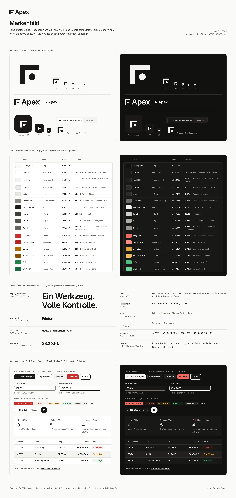

# Apex – Marke

> **Stand 18.10.2026.** Neue Marke **„Robe & Papier“** mit der Bildmarke **„Eckpunkt“**. Sie ersetzt Feder-A, Königsblau, KI-Verlauf und Liquid Glass.
>
> - **Verbindlich für die Umsetzung** (Tokens, Komponenten, Seitenaufbau): [`design/DESIGN-SYSTEM.md`](design/DESIGN-SYSTEM.md)
> - **Markenbild auf einen Blick:** [`design/brand-board.png`](design/brand-board.png)
> - **Herleitung:** [`design/RECHERCHE.md`](design/RECHERCHE.md) und [`design/logo-konzepte/KONZEPTE.md`](design/logo-konzepte/KONZEPTE.md)

## Positionierung

**Apex ist die Kanzlei-Software, die mitdenkt.** Ein Werkzeug, volle Kontrolle: Akten, beA, Fristen, Abrechnung und eine KI, die Präzedenzfälle in Sekunden findet. Sie wird einmal gekauft und ist dann für immer nutzbar.

- **Name:** *Apex* bedeutet Spitze oder Scheitelpunkt. Gemeint ist das Beste für Anwältinnen und Anwälte, ohne Superlativ-Geschrei.
- **Leitsatz:** „Ein Werkzeug. Volle Kontrolle.“
- **Zweitsatz:** „Die Kanzlei-Software, die mitdenkt.“
- **Haltung:** präzise, ruhig, verlässlich. Apex gestaltet so, wie gute Juristinnen schreiben: mit möglichst wenig möglichst viel sagen.

## Idee der Marke: Robe, Papier, Siegel

Die Marke kommt aus dem Beruf, nicht aus dem Technik-Baukasten:

| Bild | Farbe | Bedeutung in Apex |
|---|---|---|
| die **schwarze Robe** | Robenschwarz `#1A1917` | Schrift, Bildmarke, Hauptaktion, Auswahl |
| das **weiße Papier** des Schriftsatzes | Papierweiß `#FAFAF9`, Weiß `#FFFFFF` | Grund und Flächen |
| das **rote Siegel** | Siegelrot `#C8302B` | nur Notfrist, Kritisches, Löschen |

Alles andere ist warmes Grau. Farbe erscheint nur, wenn sie etwas bedeutet. Deshalb ist die Notfrist das Lauteste auf dem Bildschirm.

## Bildmarke „Eckpunkt“

Zwei gleich lange Schenkel treffen sich im rechten Winkel, in der Öffnung sitzt ein Punkt auf der Winkelhalbierenden. So kennzeichnet man im Geometrieunterricht den rechten Winkel. Das Zeichen hat vier Lesarten:

1. **Scheitel:** Der Scheitelpunkt eines Winkels heißt lateinisch *apex*. Das Zeichen trägt den Namen.
2. **Rechter Winkel:** exakt, korrekt, im Lot, und „recht“.
3. **Aktenecke:** die linke obere Ecke eines Schriftsatzes; der Punkt ist die Heftung.
4. **Eckpunkt:** der Punkt, auf den es ankommt, und der **Zeitpunkt**, an dem eine Frist endet.

**Konstruktion (32er-Raster):**

- Schenkel 20 × 5, Innenecke bei (11 | 11);
- Punkt r 3,5 bei (18,5 | 18,5), mit genau 4 Einheiten Luft zu beiden Schenkeln;
- Favicon eigens im 16er-Raster: Schenkel 3 px, Punkt 4 px, Luft 2 px.

Einfarbig, keine Verläufe, keine Rundungen außer dem Punkt.

**Wortmarke:**

- „Apex“ in Geist SemiBold (600) mit −0,02 em Laufweite, in Pfade umgewandelt;
- Bildmarke links, mittig zur Versalhöhe, Abstand etwa ein Drittel der Versalhöhe.
- Wo der Name allein unklar ist (Seitentitel, Meta-Beschreibung, Artefakt-Titel), steht **„Apex – Kanzleisoftware“**. Auf der Anmeldeseite steht die Wortmarke ohne Zusatz.

**Dateien:**

| Datei | Inhalt | Einsatz |
|---|---|---|
| `brand/logo-mark.svg` | Bildmarke in Robenschwarz | helle Flächen, Druck, Rechnungskopf, Dokumente |
| `brand/logo-mark-mono.svg` | Bildmarke in `currentColor` | auf dunklen Flächen (Textfarbe Papierweiß `#F4F3F1`), überall, wo die Farbe aus dem Umfeld kommt |
| `brand/wordmark.svg` | Bildmarke + „Apex“ in Robenschwarz | Briefkopf, Präsentationen; für Dunkel `fill` auf `#F4F3F1` setzen |
| `brand/app-icon.svg` | 1024 × 1024, Robenschwarz mit Marke in Papierweiß, Radius 228 | Startbildschirm, App-Stores, Apple-Touch-Icon (daraus PNG 180 px ableiten) |
| `public/favicon.svg` | 16er-Raster, schaltet per `prefers-color-scheme` auf Papierweiß | Browser-Tab |
| `src/assets/logo-mark.svg` | Kopie von `brand/logo-mark.svg` | Einbindung im Build |
| `src/components/Logo.tsx` | `LogoMark`, `AppIcon`, `Wordmark` | **in der App immer diese Komponenten** (sie nutzen die Tokens und passen sich Hell/Dunkel an) |

**Regeln für die Bildmarke:**

- **Schutzraum:** rundum ein Viertel der Markenhöhe.
- **Mindestgröße:** Bildmarke 16 px (darunter nur das Favicon), Wortmarke 72 px breit.
- **Farben:** nur Robenschwarz auf hellem Grund oder Papierweiß auf dunklem Grund. Das App-Icon ist immer Robenschwarz.
- **Lage:** in der Seitenleiste 20 px Marke mit „Apex“ 15 px, im Ladebildschirm 32 px Marke allein.
- **Markenrecht:** Vor einer Anmeldung DPMA/EUIPO in den Klassen 9, 42 und 45 recherchieren. Die bisherige Prüfung ist nur eine Plausibilitätsprüfung.

## Farben

| Name | Token | Hell | Dunkel | Verwendung |
|---|---|---|---|---|
| Robenschwarz / Papierweiß | `--fg`, `--ink` | `#1A1917` | `#F4F3F1` | Text, Bildmarke, Hauptaktion, Auswahl, Fokus |
| Papier (Grund) | `--bg` | `#FAFAF9` | `#111110` | App-Grund |
| Fläche | `--surface` | `#FFFFFF` | `#181816` | Tabellen, Panels, Felder |
| Grautöne Text 2–4 | `--fg-2` … `--fg-4` | `#3F3D39` · `#55524D` · `#68645E` | `#D3D1CC` · `#B0ADA7` · `#9A968F` | Fließtext, Nebentext, Metatext |
| Linie / Linie stark | `--line`, `--line-strong` | `#E6E5E2` · `#8C8882` | `#2D2C29` · `#6F6B65` | Trenner / Ränder von Bedienelementen |
| Siegelrot | `--seal` (Text `--seal-text`) | `#C8302B` (`#AE2621`) | `#F06A60` (`#FF8E85`) | Notfrist, kritisch, Fehler, Löschen |
| Bernstein | `--amber` (Text `--amber-text`) | `#B06A00` (`#875000`) | `#E0A43A` (`#F2BC5E`) | bald fällig, Warnung |
| Grün | `--green` (Text `--green-text`) | `#1F8048` (`#196B3C`) | `#4DBE7C` (`#6FD497`) | erledigt, bezahlt, verbunden |

Alle Paare sind nachgerechnet: 54 Pflichtpaare je Modus, 0 Verstöße gegen WCAG AA. Die vollständige Token-Liste samt Kontrasten steht in `DESIGN-SYSTEM.md`, Abschnitt 4. **Die KI hat keine eigene Farbe.** Sie wird mit dem Wort „KI“ und dem Symbol ✦ (`Sparkles`) gekennzeichnet.

## Schrift

- **Geist** für die gesamte Oberfläche, **Geist Mono** nur für Kennungen (Aktenzeichen, Rechnungs- und Lizenznummern, IBAN). Beträge stehen in Geist mit Tabellenziffern.
- Nur drei Gewichte: 400 (Text), 500 (Labels, Knöpfe), 600 (Titel, Werte). Keine Versalien-Zeilen, kein Verlaufstext.
- Seitentitel 24 px, Abschnitt 18 px, Text 14 px, Startseite bis 56 px. Große Titel mit leicht negativer Laufweite.
- Beide Schriften liegen im Projekt (`src/assets/fonts`, SIL Open Font License). Es gibt keine externen Font-Requests, das ist DSGVO-konform.

## Gestalt

Die Einzelheiten stehen in `DESIGN-SYSTEM.md`. Kurz gefasst:

- **Ruhige Flächen:** deckende Flächen, 1-px-Linien statt Schatten, viel Weißraum. Kein Glas, keine Verläufe, kein Leuchten.
- **Formen:** zurückhaltende Ecken (4/6/8/12 px). Rund sind nur Avatare, Schalter, Punkte und der Assistent-Knopf.
- **Icons:** lucide, 16 px, Strich 1,5, in Grau.
- **Bewegung:** kurz (100–240 ms) und ohne Federn. Im Ruhezustand bewegt sich nichts.
- **Status:** immer als Wort und Symbol, Farbe nie allein.

## Der Apex Assistent

Der Assistent-Knopf ist die Bildmarke selbst: ein runder Knopf in Robenschwarz (im Dunkeln Papierweiß) mit dem „Eckpunkt“. Lebendig ist nur der Punkt:

| Zustand | Punkt |
|---|---|
| Ruhe | steht still |
| Zuhören | wächst mit der Lautstärke der Stimme |
| Nachdenken | blendet ruhig auf und ab |
| Sprechen | wächst mit der Lautstärke der Antwort |

Bei „Bewegung reduzieren“ steht der Punkt, und das Panel nennt den Zustand als Text. Der Assistent heißt in der Oberfläche „Apex Assistent“, spricht und versteht Deutsch, siezt und antwortet knapp.

## Schreibweise, Namen, Adressen

**Schreibweise:**

- Immer „Apex“ mit großem A, ohne Zusatz. „Apex“ ist neutral und steht ohne Artikel („in Apex“, „Apex rechnet …“), nie „der Apex“.
- Zusammensetzungen mit Bindestrich: „Apex-Team“, „Apex-Wiki“, „Apex-Cockpit“.
- Untermarken bleiben unverändert: **Apex Assistent**, **Apex KI**, **Apex Island**, **Apex Console**. Ebenso die Funktionsnamen 38h-Motor, Fall-Datenbank, Umzug und Schnellhilfe.

**Adressen:** Anbieter- und Demo-Adressen enden auf `@apex-kanzlei.de` (Platzhalter-Domain, vor dem Livegang durch die echte Domain zu ersetzen), z. B. die Apex Console `admin@apex-kanzlei.de`. Lizenznummern beginnen mit `APX-`.

**Frühere Bezeichner, die bewusst bleiben** (für Nutzer unsichtbar oder nötig, damit vorhandene Daten, Links und Kalendereinträge weiter funktionieren):

| Bezeichner | Wo | Grund |
|---|---|---|
| `anwaltapex.db`, Volume `anwaltapex-daten` | Server-Standard, `.env.example`, `Dockerfile`, `docker-compose.yml`, `render.yaml` | Bestehende Installationen finden ihre Daten nur unter diesem Namen. |
| `aa:`-Schlüssel, Cookie `aa_sid` | Browser-Speicher, Sitzung | Daten und Anmeldungen im Browser bleiben erhalten. |
| `dist-artifact/anwaltapex.html` | `scripts/build-artifact.mjs`, `package.json` | Das Artefakt wird unter derselben Adresse neu veröffentlicht. |
| ICS-UID `…@anwaltapex` | `src/pages/fristen/ics.ts` | Erneut importierte Kalendereinträge werden aktualisiert statt verdoppelt. |
| `admin@anwaltapex.de`, `@anwaltapex.de`, „AnwaltApex Team“, „durch AnwaltApex“, Stoppwort `anwaltapex` | `src/core/seed/tenants.ts`, `src/core/seed/kunde.ts`, `src/lib/backend/protokoll.ts`, `src/ai/assistent.ts` | Erkennung alter Adressen, Protokolleinträge und Fragen aus der Zeit vor der Umbenennung. |
| Lizenznummern `AAX-` bereits angelegter Kundenkanzleien | Server-Datenbank | Vergebene Vertragskennungen bleiben; neue Lizenzen beginnen mit `APX-`. |
| `description` in `package.json` | `package.json` | Noch „AnwaltApex – …“; Änderung ist freizugeben (nur `name` wurde umgestellt). |

## Tonalität

- **Deutsch, klar, aktiv.** Knöpfe sagen, was passiert: „Frist übernehmen“, „eEB abgeben“, „Rechnung erstellen“. Meldungen bestätigen: „Frist eingetragen“.
- **Sachlich wie ein guter Schriftsatz.** Fachbegriffe stimmen (beA, eEB, Notfrist, Vorfrist, Gegenstandswert, Fremdgeld). Es gibt keine Marketing-Floskeln, Superlative oder Emoji.
- **Belege statt Behauptungen.** Rechenweg statt „nie wieder Fristen verpassen“; gemessene Minuten statt geschätzter Stunden; ehrlicher Status („im Prototyp simuliert“).
- **Fehler** nennen die Ursache und den nächsten Schritt.
- **Jede Funktion** bekommt einen Satz, der sie erklärt.

## Do & Don't

| Do | Don't |
|---|---|
| Bildmarke einfarbig in Robenschwarz oder Papierweiß | Bildmarke farbig, mit Verlauf, Schatten, Kontur oder Glanz |
| Marke mit Schutzraum, gerade, in Originalproportion | Marke drehen, spiegeln, stauchen, den Punkt verschieben oder einfärben |
| Rot nur für Notfrist, Kritisches, Fehler und Löschen | Rot als Schmuck, für „Neu“-Plaketten oder zur Hervorhebung |
| Status als Wort plus Symbol | farbige Punkte als einziger Statusträger |
| eine Primäraktion je Bereich, alles andere sekundär | mehrere schwarze Knöpfe nebeneinander |
| deckende Flächen, 1-px-Linien, viel Weißraum | Glas, Unschärfe, Verläufe, Leuchten, Aura, große Schatten |
| KI mit „KI“ und ✦ kennzeichnen, Mensch bestätigt | irisierende KI-Farben, „magische“ Effekte |
| echte Produktbilder aus dem Demo-Modus | Stockfotos, Justitia, Waage, Paragraf, Richterhammer, Geräte-Mockups |
| Vergleiche gegen „klassische Kanzleisoftware“ | Wettbewerber namentlich herabsetzen |
| belegte Aussagen, freigegebene Stimmen | erfundene Kundenstimmen oder Zahlen |
| Schriften und Bilder aus dem Projekt | externe Schriften, Tracking oder CDN-Ressourcen |
