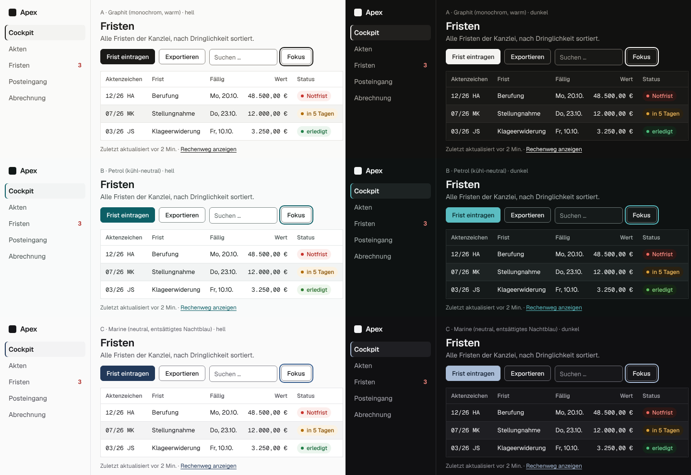

# Apex – Recherche: Best Practices für minimalistisches B2B-SaaS-Design (2025/2026)

> **Stand:** 18.10.2026 · **Zweck:** Grundlage für das Redesign nach dem Wunsch des Auftraggebers: „Die Farben und das Logo gefallen mir gar nicht. Bitte nochmal nach Best Practices für SaaS-Design schauen und ein einzigartiges Logo entwerfen. Außer Coloring komplett überarbeiten, alles viel minimalistischer.“ Dieses Dokument enthält nur Recherche und Empfehlungen, keinen Code.
>
> **Methode:** rund 65 Websuchen. Bevorzugt wurden Primärquellen: Hersteller-Blogs, Designsysteme, NN/g, Baymard, W3C, Material Design, Apple HIG. Der direkte Seitenabruf ist in dieser Umgebung gesperrt; die Aussagen stützen sich auf Suchauszüge. Werte aus Drittquellen („Design-Extraktionen“, Stilsammlungen) sind als **sekundär** markiert und zeigen nur eine Tendenz.
>
> **inordo.de** ist aus dieser Umgebung nicht erreichbar. Das Dokument macht deshalb **keine** Aussagen über inordo.de. Richtschnur ist der Wunsch „viel minimalistischer“ im Sinne ruhiger, moderner SaaS-Produkte.
>
> **Kontraste** sind per Node-Skript nach der WCAG-2-Formel berechnet (Rechenweg in Anhang A), nicht geschätzt.

---

## 0. Das Wichtigste in Kürze

1. **Die Vorbilder werden ruhiger, nicht bunter.** Linear hat seine Oberfläche 2026 bewusst beruhigt: Die Seitenleiste ist gedimmt, es gibt weniger und kleinere Icons, farbige Icon-Hintergründe sind entfernt, Kopfzeilen und Aktionen stehen überall an derselben Stelle [Q1]. Arc gilt als gescheitert an zu viel Neuem; der Nachfolger Dia soll ausdrücklich „langweilig genug“ für den Alltag sein [Q14].
2. **Der heutige Apex-Look ist der Look, der als austauschbar gilt.** Dunkler Grund, unscharfe Verläufe, leuchtende Akzente und Blau-Violett werden als „Linear-Effekt“ [Q42] und „AI-Purple-Problem“ [Q43] kritisiert, weil sie auf fast jeder neuen Produktseite stehen.
3. **Farbe trägt Bedeutung, nicht Stimmung.** Gute Systeme bestehen aus einer neutralen Skala, einem Akzent und Signalfarben (Vercel Geist, Radix, Notion, Ramp) [Q3][Q7][Q13]. In einer Fristensoftware heißt das: **Das Rot gehört der Notfrist.**
4. **Linien statt Schatten, deckende Flächen statt Glas.** Tiefe gibt es nur für schwebende Ebenen wie Menü und Dialog. Im Dunkeln entsteht Tiefe über hellere Flächen, nicht über Schatten (Apple, Material) [Q16][Q17][Q18].
5. **Minimalistisch heißt nicht unkenntlich.** Bedienelemente müssen als solche erkennbar bleiben. Laut NN/g kosten schwache Signifikanten messbar Zeit [Q25]. Rahmen von Bedienelementen brauchen 3 : 1 (WCAG 1.4.11) [Q20].
6. **Im Rechtsmarkt entsteht Vertrauen durch Präzision und Belege**, nicht durch Effekte. Harveys Leitsatz lautet sinngemäß: „design the way lawyers write – saying the most with the least“ [Q8].
7. **Farbe:** Empfohlen ist Richtung **A „Graphit“** (monochrom). **B „Petrol“** passt, wenn eine Markenfarbe gewünscht ist. **C „Marine“** ist die konservativste Option. Alle drei bestehen AA in Hell und Dunkel: 46 Pflichtpaare je Modus, 0 Verstöße.
8. **Typografie:** Geist bleibt. Sie ist selbst gehostet, variabel, und ihre Tabellenziffern sind im Browser geprüft. Es gibt nur noch drei Gewichte (400/500/600) und kleinere, ruhigere Titel.
9. **Form und Bewegung:** Radien werden kleiner (6/8/12 statt 11/16/22/28 px), Bewegung wird kürzer (100–240 ms, keine Federn) [Q29].
10. **Startseite:** Ein Satz sagt, wofür Apex da ist. Dazu kommen echte Produktbilder, Belege statt Behauptungen und eine Preisinformation. Keine Stockfotos, keine Verläufe [Q30][Q32][Q33].
11. **Logo:** einfach, unverwechselbar, passend. Es wird bei 16 px, einfarbig und mit dem „Kritzel-Test“ geprüft. Klischees wie Berg/Dreieck, Waage, Paragraf und Hammer werden gemieden [Q47][Q48].

---

## 1. Ausgangslage: Was am heutigen Stand den Best Practices widerspricht

Die Werte stammen aus `src/styles/index.css` und `docs/BRANDING.md`.

| Heute | Befund aus der Recherche | Richtung |
|---|---|---|
| Glas mit Unschärfe, Lichtkante und Mauszeiger-Reflex (`.glass`, `--glass-*`, SVG-Lichtbrechung) | Dekoration ohne Information. Sie kostet Lesbarkeit und Rechenleistung, und der Kontrast hängt vom Untergrund ab. | deckende, ruhige Flächen |
| Farbig belichteter Arbeitsgrund (`--aura-1…4`) | Die Hintergrundfarbe konkurriert mit den Signalfarben. | neutraler Grund |
| Königsblau `#2440D8` (OKLCH: Buntheit C 0,231, Farbton H 267°) und KI-Schimmer Blau → Violett → Pink → Orange | Genau das ist der heutige Standard-Look vieler KI-Produkte [Q43]. | ein ruhiger Akzent; KI ohne eigene Farbe |
| Schatten an Karten und Glas (`--glass-shadow*`) | Linien reichen. Im Dunkeln wirken Schatten kaum [Q18]. | 1-px-Linien |
| Radien 28/22/16/11 px | wirken verspielt und verschenken Platz in dichten Ansichten | 6/8/12 px |
| Federnde Animationen, gestaffelte Listen, Puls, Schimmer | Bewegung ohne Aufgabe [Q29] | kurze Übergänge, die etwas erklären |
| Violett für KI-Chips (`--violet*`) | ein zweiter Akzent | neutrale Kennzeichnung mit Wort und Symbol |
| Logo mit Verlauf in Königsblau, App-Symbol mit Glasrand | Verläufe und feine Kanten zerfallen bei 16 px [Q48]. | einfarbige Bildmarke |

### 1.1 Vorbilder aus B2B-SaaS – was sie gemeinsam haben

| Produkt | Beobachtung | Lehre für Apex |
|---|---|---|
| Linear | **2024:** Themes entstehen aus drei Variablen in LCH (Grundfarbe, Akzent, Kontrast) statt aus 98 Einzelwerten; hochkontrastige Themes ergeben sich automatisch [Q2]. **2026:** Seitenleiste gedimmt, weniger und kleinere Icons, farbige Team-Icon-Hintergründe entfernt, einheitliche Kopfzeilen; laut Suchauszug wärmeres Grau statt bläulichem [Q1]. | Ruhe durch Weglassen; Farben systematisch erzeugen statt einzeln wählen |
| Vercel (Geist) | Zwei Hintergründe (Standard und sparsam „Hintergrund 2“). Farbstufen nach Rolle: Fläche, Hover, Aktiv, Rahmen, Text. Zehn Skalen und eine eigene Schrift [Q3][Q5]. | Tokens nach Rolle benennen, nicht nach Aussehen. Das empfiehlt auch Harvey für sein neues Designsystem [Q8]. |
| Stripe | Farbsystem im wahrnehmungsgleichen Farbraum (CIELAB). Text- und Symbolfarben bestehen auch auf der hellsten Tönung jeder Farbe; Badge-Paare verschieben sich gemeinsam um eine Stufe [Q6]. | Signalfläche und Signaltext immer paarweise messen (Abschnitt 3) |
| Notion (s) | Warme Neutraltöne; ein einziger gesättigter Akzent für Aktionen [Q13]. | ein Akzent |
| Attio (s) | Fast-Weiß, Fast-Schwarz, ein Akzent; Gewicht 500 als UI-Standard; viel Weißraum [Q13]. | Hierarchie über Gewicht und Grau |
| Ramp (s) | Weiße Fläche, eine einzige Akzentfarbe für die Primäraktion, eine Schriftfamilie [Q13]. | ein Primärknopf, eine Familie |
| Mercury (s) | Dunkel als Grundzustand, eigene Schrift; hochwertig durch Ruhe statt Effekte [Q13]. | Dunkelmodus ist gleichwertig, nicht nachträglich |
| Raycast (s) | Fast-schwarzer Grund; die Akzentfarbe setzt nur Satzzeichen [Q13]. | Akzent sparsam |
| Superhuman | Geschwindigkeit als Kern, bedient über Tastatur und Befehlspalette [Q15]. | Kürzel und Strg+K bleiben (in Apex vorhanden) |
| Arc → Dia | Arc galt als ehrgeizig, aber mit steiler Lernkurve und zu vielen Funktionen. Der Nachfolger Dia soll „langweilig genug“ für den Alltag sein [Q14]. | vertraute Muster vor Originalität |
| Height | Am 24.09.2025 eingestellt, daher nicht ausgewertet [Q14]. | – |

### 1.2 Branchenvergleich Legal-Tech

| Anbieter | Beobachtung | Lehre für Apex |
|---|---|---|
| Harvey | Design als Weg zur Meisterschaft: Präzision im Design spiegle die Präzision der Kundschaft und stärke das Vertrauen. Leitsatz sinngemäß „design the way lawyers write – saying the most with the least“ [Q8]. Marke (s): kontraststarke Serife mit Grotesk, warmes Fast-Schwarz, keine dekorativen Farbakzente [Q9]. | Präzision und Zurückhaltung sind im Rechtsmarkt das Vertrauenssignal. |
| Legora | Neue Identität 2026 (Stockholm Design Lab), Website von E&W in Framer, Serifen-Display „Rhymes Display“ [Q10]. Farben (s): dunkles Grün, Off-White, warme Grautöne. Eine Stellenanzeige fordert, Legal Tech müsse nicht wie Legal Tech aussehen [Q10]. | Eine eigenständige Farbe abseits von Blau ist möglich (→ Richtung B). |
| Clio | Keine öffentliche Markenüberarbeitung 2025 gefunden. ClioCon 2025 stand im Zeichen von Funktionen (Clio Operate, Vincent, Manage AI) [Q11]. | – |
| Kleos (Wolters Kluwer) | Der Hersteller betont „Einfachheit, Sicherheit und Mobilität“ [Q12]. | Einfachheit ist auch im deutschen Markt das Verkaufsargument. |
| Actaport | Nutzerstimmen: „intuitiv und modern, sogar leicht verspielt“; ein Nutzer lobt ausschließlich das Design [Q12]. | Modernes Aussehen allein überzeugt nicht. „Verspielt“ ist im Rechtsmarkt eher ein Risiko (E). |
| Markt allgemein | Blau und Neutraltöne sind bei Kanzleien verbreitet, belegt ist das aber nur als Konvention, nicht als Studie [Q46]. Anwältinnen und Anwälte sind Berufsgeheimnisträger (§ 203 StGB, § 43e BRAO); der Serverstandort zählt [Q41]. Bei KI bremsen Vertrauen, Governance und die Pflicht zur menschlichen Prüfung [Q40]. | Belege zu Datenschutz und KI-Prüfung gehören sichtbar ins Produkt und auf die Startseite (Abschnitt 6). |

---

## 2. Prinzipien: 39 Do/Don't-Regeln

Die Kürzel [Qn] verweisen auf die Quellenliste in Abschnitt 8. „(E)“ steht für eine eigene Einschätzung, die nicht direkt belegt ist.

### 2.1 Farbe

| # | Do | Don't | Beleg |
|---|---|---|---|
| 1 | Die neutrale Skala trägt rund 90 % der Oberfläche. **Ein** Akzent ist reserviert für Primäraktion, Links und Auswahl. | Markenfarbe als großflächige Fläche, als Verlauf oder als Hintergrundstimmung | [Q3][Q7][Q13] |
| 2 | Farbe nur mit Bedeutung: Rot = Notfrist, kritisch, Löschen; Amber = bald fällig; Grün = erledigt, verbunden. | Signalfarben als Dekoration, z. B. grüne Kennzahlen oder rote „Neu“-Plaketten | [Q22][Q24] |
| 3 | Farben in einem wahrnehmungsgleichen Farbraum bauen (OKLCH/LCH). Dann ist der Kontrast je Stufe vorhersagbar, wie bei Stripe und Linear. | Abstufungen in HSL nach Gefühl. Gleiche „Helligkeit“ sieht dort je nach Farbton unterschiedlich hell aus. | [Q2][Q6] |
| 4 | Farbe nie allein: Der Status steht als Wort da, dazu ein **formcodiertes** Symbol (Notfrist = Warndreieck, bald = Uhr, erledigt = Haken). Messung: Rot und Grün unterscheiden sich bei Deuteranopie nur um 1,05–1,32 : 1 in der Helligkeit. | Farbige Punkte als einziger Statusträger | WCAG 1.4.1, Messung Anhang A |

### 2.2 Typografie

| # | Do | Don't | Beleg |
|---|---|---|---|
| 5 | Eine Schriftfamilie (Geist) für alles. Geist Mono nur für Kennungen wie Aktenzeichen, Rechnungs- und Lizenznummern. | Mehrere Familien mischen; Effekte wie Verlaufstext oder Konturschrift | [Q5][Q43] |
| 6 | Hierarchie über Größe, Gewicht (400/500/600) und Graustufe. Große Titel bekommen eine leicht negative Laufweite. | Fett (700+) und Versalien als Standard; mehr als vier Schriftgrößen je Ansicht | [Q4][Q35][Q39] |
| 7 | Lesetext 60–75 Zeichen breit, 16 px. Zahlen in Spalten mit `tabular-nums`. | Lesetext über die volle Breite; proportionale Ziffern in Spalten | [Q36][Q37] |

### 2.3 Layout und Weißraum

| # | Do | Don't | Beleg |
|---|---|---|---|
| 8 | Zuerst über Abstand gruppieren (Nähe). Linie oder Fläche erst, wenn der Abstand nicht reicht. | Jede Gruppe in eine eigene Karte mit Rahmen **und** Schatten | [Q34] |
| 9 | Festes 4-px-Raster mit wenigen Abstandsstufen (Abschnitt 5) | Freihändige Abstände wie 13, 18 oder 22 px | (E) |
| 10 | Das Wichtigste zuerst und groß; Nebeninformation erst bei Bedarf (Seitenpanel, Ausklappen) | Alle Kennzahlen gleich laut; Kachelwände | [Q24][Q22] |

### 2.4 Navigation

| # | Do | Don't | Beleg |
|---|---|---|---|
| 11 | Linke, vertikale Navigation (sinnvoll ab fünf Hauptbereichen), zurückhaltend in Text 3. Die aktive Seite ist klar markiert: Text 1, Gewicht 600 und 2-px-Balken. | Eine helle, laute Seitenleiste, die auch nach dem Ankommen Aufmerksamkeit zieht | [Q28][Q1] |
| 12 | Kopfzeile, Seitentitel und Seitenaktionen (Teilen, Export, „…“) stehen überall an derselben Stelle. | Je Seite eigene Positionen für dieselbe Aktion | [Q1] |
| 13 | Die Befehlspalette (Strg+K) dient als Abkürzung; Tastenkürzel stehen sichtbar in Menüs und Tooltips. | Die Palette als einzigen Weg zu einer Funktion | [Q15][Q24] |

### 2.5 Komponenten

| # | Do | Don't | Beleg |
|---|---|---|---|
| 14 | Bedienelemente sind erkennbar: Knöpfe haben eine Fläche oder einen Rahmen ≥ 3 : 1, Links sind unterstrichen oder deutlich abgesetzt. | Primäraktion als rahmenloser „Geisterknopf“; Links nur über Farbe | [Q25][Q20] |
| 15 | Höchstens **ein** Primärknopf je Bereich, alles andere sekundär oder ghost | Mehrere farbige Knöpfe nebeneinander | UI-Leitfaden §1.2, [Q24] |
| 16 | Weniger und kleinere Icons (16 px, Strich 1,5), nur wo sie das Erkennen beschleunigen | Ein Icon vor jedem Menüpunkt, farbige Icon-Kacheln | [Q1] |
| 17 | Auswahl und Zustand nie nur über die zarte Fläche zeigen (Fläche-2 hat nur 1,1 : 1). Dazu kommen Gewicht, Textfarbe oder ein Balken. | Aktiver Reiter nur leicht getönt | [Q20] |

### 2.6 Tabellen und Daten

| # | Do | Don't | Beleg |
|---|---|---|---|
| 18 | Tabellen für die vier Aufgaben bauen: **finden** (Filter und Sortierung sichtbar, aktive Filter erkennbar), **vergleichen** (Kopf fixiert), **Zeile ansehen** (Seitenpanel statt Modal, damit die Liste sichtbar bleibt), **Sammelaktionen** (Auswahl mit „Alle“) | Details im Modal, das die Nachbarzeilen verdeckt | [Q23] |
| 19 | Zahlen rechtsbündig, Text linksbündig, Kopf wie der Inhalt ausgerichtet. Dünne waagrechte Linien statt Gitter, gleiche Nachkommastellen. | Zebra, Gitter und Schatten gleichzeitig | [Q37] |
| 20 | Diagramme über Position oder Länge (Linie, Balken). Gitterlinien zart oder ganz weg, Werte direkt beschriften. | Torten, 3-D, Farbverläufe in Balken, Ringe als Dekoration | [Q22][Q38] |
| 21 | Umschaltbare Dichte: kompakt 36 px, Standard 44 px Zeilenhöhe (in `DataTable` vorhanden) | Eine Dichte für Profis und Gelegenheitsnutzer erzwingen | [Q23], (E) |

### 2.7 Formulare

| # | Do | Don't | Beleg |
|---|---|---|---|
| 22 | Label über dem Feld, einspaltig; der Hinweis steht außerhalb des Felds. | Platzhalter als Label: Er verschwindet beim Tippen, ist kontrastschwach und wird für einen Wert gehalten. | [Q26][Q27] |
| 23 | Prüfen beim Verlassen des Felds oder nach dem ersten Speichern. Eine Fehlermeldung verschwindet, sobald der Fehler behoben ist, und erklärt, wie es richtig geht. | Fehler anzeigen, während noch getippt wird | [Q35] |
| 24 | Eingabefelder mit Rahmen in **Linie-stark** (≥ 3 : 1). Am Telefon Schriftgröße ≥ 16 px, sonst zoomt iOS beim Antippen. | Hellgraue Haarlinie als einziger Feldrand; Zoom per `maximum-scale=1` sperren | [Q20][Q21] |

### 2.8 Dunkelmodus

| # | Do | Don't | Beleg |
|---|---|---|---|
| 25 | Dunkelgrau statt Schwarz (Grund etwa `#101010`–`#121212`). Höhere Ebenen sind heller. | `#000` mit reinem Weiß: Überstrahlen, und Tiefe ist kaum darstellbar | [Q16][Q18] |
| 26 | Akzent und Signalfarben bekommen im Dunkeln **eigene**, hellere und weniger gesättigte Werte. | Dieselben gesättigten Farben wie im Hellen oder eine einfache Umkehrung | [Q16][Q18] |
| 27 | Tiefe über die Flächenhelligkeit (Fläche → Fläche-2) und eine Linie; Schatten entfallen. | Glühen und Leuchten als Ersatz für Tiefe | [Q18][Q44] |

### 2.9 Bewegung

| # | Do | Don't | Beleg |
|---|---|---|---|
| 28 | Etwa 100 ms für einfache Zustandswechsel, 200–300 ms für Dialoge; Ease-out | Federn mit Überschwingen; Animationen über 300 ms in der App | [Q29] |
| 29 | Bewegung erklärt Herkunft und Ziel, z. B. ein Panel, das von rechts kommt. | Mauszeiger-Reflexe, Pulsieren, Schimmer im Ruhezustand | [Q29], (E) |
| 30 | Bei `prefers-reduced-motion` nur Überblenden oder gar nichts | Scroll-Einblendungen, die Inhalt verzögern (über 500 ms wirken zu langsam) | [Q29] |

### 2.10 Marketing-Seite

| # | Do | Don't | Beleg |
|---|---|---|---|
| 31 | Ganz oben in einem Satz: was, für wen, warum vertrauen. **Ein** Primär-CTA. | Schlagworte ohne Inhalt („revolutionär“, „next level“) | [Q45][Q32] |
| 32 | Echte Produktbilder als Ausschnitte nah an der Originalgröße; Bild und Text senkrecht ausgerichtet | Stockfotos, Zickzack-Layouts, Geräte-Mockups mit Leuchten | [Q30][Q31] |
| 33 | Preisinformation sichtbar, mindestens Modell und Ablauf bis zum Angebot | Den Preis komplett verstecken: In NN/g-Studien wanderten Nutzer zur Konkurrenz ab. | [Q33] |

### 2.11 Vertrauen im Rechtsmarkt

| # | Do | Don't | Beleg |
|---|---|---|---|
| 34 | Belege zeigen: den Rechenweg jeder Frist, die Quelle jeder KI-Aussage, Datenstandort und Berufsgeheimnis (§ 203 StGB, § 43e BRAO). | Unbelegte Zahlen, erfundene Kundenstimmen | [Q32][Q40][Q41] |
| 35 | KI klar, aber ruhig kennzeichnen: das Wort „KI“, ein Symbol, und der Mensch bestätigt. | Irisierende KI-Verläufe, die Ergebnisse „magisch“ statt prüfbar wirken lassen | [Q40][Q43] |
| 36 | Sachlicher Ton und präzise Typografie: „design the way lawyers write“ | Verspielte Illustrationen, Emoji, Superlative | [Q8] |

### 2.12 Logo

| # | Do | Don't | Beleg |
|---|---|---|---|
| 37 | Einfach, unverwechselbar und einprägsam, passend. Besteht den „Kritzel-Test“: Man kann es aus dem Gedächtnis zeichnen. | Details, die bei 16 px verschwinden | [Q47] |
| 38 | Funktioniert einfarbig, invertiert, als 16-px-Favicon und als App-Symbol; geprüft in echter Umgebung (Browser-Tab, Startbildschirm). | Verlauf, Glasrand, mehr als eine Farbe, Haarlinien | [Q48] |
| 39 | Eine Bildmarke abseits der Klischees: kein Berg oder Dreieck für „Apex“, keine Waage, Justitia, Paragraf, Säule oder Richterhammer. | Generisches „A im Dreieck“ | [Q49], (E) |

---

## 3. Drei Farbrichtungen

### 3.1 Gemeinsame Regeln

- **Aufbau je Richtung:** 3 Flächen (Hintergrund, Fläche, Fläche-2), 2 Linien (Linie, Linie-stark), 4 Textstufen, Akzent mit 3 Tokens (Akzent, Akzent-Hover, Text auf Akzent), Fokusring, dazu je Signal (Rot, Amber, Grün) drei Tokens: Signal (Punkt/Symbol), Text und Fläche.
- **Pflichtwerte (WCAG 2.2 AA [Q19][Q20]):**

  | Paar | Mindestwert |
  |---|---|
  | Text 1–4 auf Hintergrund, Fläche und Fläche-2 | 4,5 : 1 |
  | Akzent als Link-/Textfarbe auf allen drei Flächen | 4,5 : 1 |
  | Text auf Akzent und auf Akzent-Hover | 4,5 : 1 |
  | Fokusring auf allen drei Flächen | 3 : 1 |
  | Linie-stark (Rahmen von Bedienelementen) auf allen drei Flächen | 3 : 1 |
  | Signal-Text auf Signal-Fläche, auf Fläche und auf Hintergrund | 4,5 : 1 |
  | Signal (Punkt/Symbol) auf Fläche, Hintergrund und Signal-Fläche | 3 : 1 |
  | Text 1 auf allen Signal-Flächen | 4,5 : 1 |

- **Linie** (Trenner) liegt bewusst bei 1,2–1,4 : 1. Trenner sind keine Bedienelemente, WCAG 1.4.11 verlangt hier nichts [Q20]. Wo eine Linie ein Bedienelement erkennbar macht, wird **Linie-stark** verwendet.
- **Alle Werte sind deckend (Hex)**, ohne Transparenz. So ist der Kontrast exakt messbar, und nichts scheint durch.
- **Die Signalfarben sind in allen drei Richtungen gleich.** Nur in B ist Grün leicht ins Gelbgrüne verschoben (H 144° statt 153°), damit es sich vom Petrol-Akzent (H 204°) absetzt.
- **Der Fokusring ist der Akzent (A, B) oder eine hellere Akzentstufe (C)**, immer 2 px breit **mit 2 px Abstand** (`outline-offset: 2px`). Ohne Abstand verschmilzt er mit dem Primärknopf: Ring gegen Knopf misst 1,00 : 1 (A, B und C dunkel) bzw. 1,78 : 1 (C hell).
- **KI hat keine eigene Farbe.** `--violet*` und `--ai-1…4` entfallen oder zeigen auf neutrale Werte: Text 2 auf Fläche-2, dazu Symbol und das Wort „KI“. Die Kennzeichnung bleibt, sie wird nur ruhiger.
- **Auswahl** (aktiver Menüpunkt, Reiter, gewählte Zeile): Fläche-2, Text 1, Gewicht 600 und optional ein 2-px-Balken im Akzent – nie nur die Fläche.

### 3.2 Richtung A – „Graphit“ (monochrom, warm) · *Empfehlung*

**Charakter:** Schwarz auf warmem Papierweiß. Der Akzent ist die Textfarbe selbst: Primärknöpfe sind fast schwarz, im Dunkeln fast weiß. Farbe erscheint nur, wenn etwas Bedeutung hat. Die Notfrist ist das Lauteste auf dem Bildschirm.

**Vorbilder (als Prinzip, keine Kopie):** Vercel/Geist mit neutraler, kontrastreicher Skala [Q3]; Harvey mit warmem Fast-Schwarz, Off-White und ohne dekorative Akzente (sekundär [Q9]); Linear, das 2026 laut Suchauszug seines Beitrags von einem kühlen, bläulichen Grau zu einem wärmeren Grau wechselt [Q1].

**Stärken:** maximal ruhig und zeitlos. Keine Konkurrenz zu den Signalfarben. Nah am Papier: Schriftsätze sind schwarz auf weiß, der Druck sieht aus wie der Bildschirm. Die Marke trägt sich über Logo und Typografie.

**Risiken:** Die Richtung kann generisch wirken, weil viele Entwicklerwerkzeuge schwarz-weiß sind. Unterscheidbar wird sie erst durch die Bildmarke. Links müssen unterstrichen sein, weil sie farblich nicht abgesetzt sind. Der Fokusring braucht immer den Abstand.

**Token-Tabelle Richtung A – Graphit (monochrom, warm)**

| Rolle | CSS-Token | Hell | Kontrast hell | Dunkel | Kontrast dunkel | Einsatz |
|---|---|---|---|---|---|---|
| Hintergrund | `--bg` | `#FAFAF9` | — | `#111110` | — | App-Grund, Seitenhintergrund |
| Fläche | `--surface` | `#FFFFFF` | — | `#181816` | — | Tabellen, Panels, Dialoge, Eingabefelder |
| Fläche-2 | `--surface-2` | `#F3F3F1` | 1,11 Fläche | `#21201E` | 1,09 Fläche | Hover, Auswahl, Tabellenkopf, Seitenleiste (Info, keine Pflicht) |
| Linie | `--line` | `#E6E5E2` | 1,26 Fläche · 1,21 Grund | `#2D2C29` | 1,27 Fläche · 1,35 Grund | Trenner, Tabellenlinien, Kartenrand (dekorativ) |
| Linie-stark | `--line-strong` | `#8C8882` | 3,37 Grund · 3,52 Fläche · 3,17 Fläche-2 | `#6F6B65` | 3,57 Grund · 3,36 Fläche · 3,08 Fläche-2 | Rahmen von Eingabefeldern, Kontrollkästchen, Sekundärknöpfen (≥ 3 : 1) |
| Text 1 | `--fg` | `#1A1917` | 16,82 Grund · 17,57 Fläche · 15,81 Fläche-2 | `#F4F3F1` | 17,04 Grund · 16,03 Fläche · 14,68 Fläche-2 | Überschriften, Tabelleninhalt, Werte |
| Text 2 | `--fg-2` | `#3F3D39` | 10,38 Grund · 10,84 Fläche · 9,75 Fläche-2 | `#D3D1CC` | 12,38 Grund · 11,65 Fläche · 10,67 Fläche-2 | Fließtext |
| Text 3 | `--fg-3` | `#55524D` | 7,45 Grund · 7,78 Fläche · 7,00 Fläche-2 | `#B0ADA7` | 8,44 Grund · 7,94 Fläche · 7,27 Fläche-2 | Untertitel, Spaltenköpfe, inaktive Navigation |
| Text 4 | `--fg-4` | `#68645E` | 5,63 Grund · 5,88 Fläche · 5,29 Fläche-2 | `#9A968F` | 6,42 Grund · 6,04 Fläche · 5,53 Fläche-2 | Metatext, Platzhalter, Zeitstempel |
| Akzent | `--ink / --ink-fill` | `#1A1917` | 16,82 Grund · 17,57 Fläche · 15,81 Fläche-2 | `#F4F3F1` | 17,04 Grund · 16,03 Fläche · 14,68 Fläche-2 | Primärknopf, Links, Auswahlbalken |
| Akzent-Hover | `--ink-hover (neu)` | `#3A3834` | 11,70 Text auf Akzent | `#D9D7D2` | 12,21 Text auf Akzent | Primärknopf bei Hover/Druck |
| Text auf Akzent | `--on-ink` | `#FFFFFF` | 17,57 Akzent · 11,70 Akzent-Hover | `#1A1917` | 15,84 Akzent · 12,21 Akzent-Hover | Schrift und Symbole auf Primärknopf |
| Fokusring | `--focus` | `#1A1917` | 16,82 Grund · 17,57 Fläche · 15,81 Fläche-2 | `#F4F3F1` | 17,04 Grund · 16,03 Fläche · 14,68 Fläche-2 | 2 px, 2 px Abstand (outline-offset) |
| Rot (Signal) | `--seal` | `#C8302B` | 5,37 Fläche · 5,14 Grund · 4,75 Rot-Fläche | `#F06A60` | 5,87 Fläche · 6,24 Grund · 5,59 Rot-Fläche | Punkt/Symbol Notfrist, Löschen (≥ 3 : 1) |
| Rot-Text | `--seal-text` | `#AE2621` | 6,00 Rot-Fläche · 6,78 Fläche · 6,49 Grund | `#FF8E85` | 7,63 Rot-Fläche · 8,01 Fläche · 8,51 Grund | Schrift „Notfrist“, Fehlermeldungen |
| Rot-Fläche | `--seal-soft` | `#FCEEEC` | 15,54 Text 1 | `#2C1715` | 15,27 Text 1 | Chip-/Hinweisfläche kritisch |
| Amber (Signal) | `--amber` | `#B06A00` | 4,28 Fläche · 4,10 Grund · 3,85 Amber-Fläche | `#E0A43A` | 8,08 Fläche · 8,58 Grund · 7,20 Amber-Fläche | Punkt/Symbol „bald fällig“ |
| Amber-Text | `--amber-text` | `#875000` | 5,95 Amber-Fläche · 6,61 Fläche · 6,33 Grund | `#F2BC5E` | 9,16 Amber-Fläche · 10,27 Fläche · 10,91 Grund | Schrift Warnung |
| Amber-Fläche | `--amber-soft` | `#FBF2E2` | 15,81 Text 1 | `#2A2112` | 14,30 Text 1 | Chip-/Hinweisfläche Warnung |
| Grün (Signal) | `--green` | `#1F8048` | 4,95 Fläche · 4,74 Grund · 4,44 Grün-Fläche | `#4DBE7C` | 7,60 Fläche · 8,07 Grund · 6,87 Grün-Fläche | Punkt/Symbol erledigt/verbunden |
| Grün-Text | `--green-text` | `#196B3C` | 5,87 Grün-Fläche · 6,54 Fläche · 6,26 Grund | `#6FD497` | 8,83 Grün-Fläche · 9,77 Fläche · 10,38 Grund | Schrift Erfolg |
| Grün-Fläche | `--green-soft` | `#EBF5EE` | 15,75 Text 1 | `#132519` | 14,50 Text 1 | Chip-/Hinweisfläche Erfolg |

<sub>OKLCH: Akzent hell L 21 · C 0,004 · H 85°, dunkel L 96 · C 0,003 · H 85°; Grün hell L 53 · C 0,124 · H 153°; Rot hell L 55 · C 0,189 · H 27°; Fokus/Akzent hell 1,00, dunkel 1,00</sub>

### 3.3 Richtung B – „Petrol“ (kühl-neutral)

**Charakter:** kühles Neutralgrau mit einem Petrol-Akzent, einem tiefen Blaugrün. Seine Buntheit (OKLCH C 0,072) ist nicht einmal ein Drittel der des heutigen Blaus (0,231). Petrol erinnert an Tinte und Aktendeckel und ist im Kanzleimarkt wenig besetzt: Blau ist die Branchenkonvention, Legora arbeitet mit dunklem Grün (sekundär [Q10]).

**Stärken:** eine eigenständige Markenfarbe, die trotzdem ruhig ist. Klar unterscheidbar von Rot und Amber. Links sind farblich erkennbar.

**Risiken:** Petrol liegt nahe am Erfolgs-Grün. Deshalb ist Grün gelbgrüner gewählt (H 144°), und „erledigt“ trägt immer den Haken. Im Dunkeln wirkt das helle Petrol (`#5BBDC2`) frischer als im Hellen. Der Primärknopf hat dort dunkle Schrift, und die Kontraste sind trotzdem hoch.

**Token-Tabelle Richtung B – Petrol (kühl-neutral)**

| Rolle | CSS-Token | Hell | Kontrast hell | Dunkel | Kontrast dunkel | Einsatz |
|---|---|---|---|---|---|---|
| Hintergrund | `--bg` | `#F9FAFA` | — | `#0E1212` | — | App-Grund, Seitenhintergrund |
| Fläche | `--surface` | `#FFFFFF` | — | `#151A1A` | — | Tabellen, Panels, Dialoge, Eingabefelder |
| Fläche-2 | `--surface-2` | `#F2F4F4` | 1,10 Fläche | `#1D2323` | 1,10 Fläche | Hover, Auswahl, Tabellenkopf, Seitenleiste (Info, keine Pflicht) |
| Linie | `--line` | `#E3E7E7` | 1,25 Fläche · 1,19 Grund | `#2A3131` | 1,32 Fläche · 1,42 Grund | Trenner, Tabellenlinien, Kartenrand (dekorativ) |
| Linie-stark | `--line-strong` | `#808A89` | 3,40 Grund · 3,55 Fläche · 3,22 Fläche-2 | `#697473` | 3,90 Grund · 3,64 Fläche · 3,30 Fläche-2 | Rahmen von Eingabefeldern, Kontrollkästchen, Sekundärknöpfen (≥ 3 : 1) |
| Text 1 | `--fg` | `#111817` | 17,21 Grund · 18,00 Fläche · 16,30 Fläche-2 | `#F1F4F4` | 17,04 Grund · 15,89 Fläche · 14,42 Fläche-2 | Überschriften, Tabelleninhalt, Werte |
| Text 2 | `--fg-2` | `#36403F` | 10,24 Grund · 10,70 Fläche · 9,70 Fläche-2 | `#CFD6D5` | 12,78 Grund · 11,91 Fläche · 10,81 Fläche-2 | Fließtext |
| Text 3 | `--fg-3` | `#4A5453` | 7,48 Grund · 7,82 Fläche · 7,09 Fläche-2 | `#AAB3B2` | 8,80 Grund · 8,20 Fläche · 7,44 Fläche-2 | Untertitel, Spaltenköpfe, inaktive Navigation |
| Text 4 | `--fg-4` | `#5D6766` | 5,58 Grund · 5,84 Fläche · 5,29 Fläche-2 | `#949E9D` | 6,86 Grund · 6,39 Fläche · 5,80 Fläche-2 | Metatext, Platzhalter, Zeitstempel |
| Akzent | `--ink / --ink-fill` | `#0D5F66` | 7,06 Grund · 7,38 Fläche · 6,68 Fläche-2 | `#5BBDC2` | 8,53 Grund · 7,96 Fläche · 7,22 Fläche-2 | Primärknopf, Links, Auswahlbalken |
| Akzent-Hover | `--ink-hover (neu)` | `#0A4C52` | 9,68 Text auf Akzent | `#7CCED2` | 9,20 Text auf Akzent | Primärknopf bei Hover/Druck |
| Text auf Akzent | `--on-ink` | `#FFFFFF` | 7,38 Akzent · 9,68 Akzent-Hover | `#062224` | 7,53 Akzent · 9,20 Akzent-Hover | Schrift und Symbole auf Primärknopf |
| Fokusring | `--focus` | `#0D5F66` | 7,06 Grund · 7,38 Fläche · 6,68 Fläche-2 | `#5BBDC2` | 8,53 Grund · 7,96 Fläche · 7,22 Fläche-2 | 2 px, 2 px Abstand (outline-offset) |
| Rot (Signal) | `--seal` | `#C8302B` | 5,37 Fläche · 5,13 Grund · 4,75 Rot-Fläche | `#F06A60` | 5,81 Fläche · 6,23 Grund · 5,59 Rot-Fläche | Punkt/Symbol Notfrist, Löschen (≥ 3 : 1) |
| Rot-Text | `--seal-text` | `#AE2621` | 6,00 Rot-Fläche · 6,78 Fläche · 6,48 Grund | `#FF8E85` | 7,63 Rot-Fläche · 7,92 Fläche · 8,49 Grund | Schrift „Notfrist“, Fehlermeldungen |
| Rot-Fläche | `--seal-soft` | `#FCEEEC` | 15,92 Text 1 | `#2C1715` | 15,31 Text 1 | Chip-/Hinweisfläche kritisch |
| Amber (Signal) | `--amber` | `#B06A00` | 4,28 Fläche · 4,09 Grund · 3,85 Amber-Fläche | `#E0A43A` | 7,99 Fläche · 8,56 Grund · 7,20 Amber-Fläche | Punkt/Symbol „bald fällig“ |
| Amber-Text | `--amber-text` | `#875000` | 5,95 Amber-Fläche · 6,61 Fläche · 6,32 Grund | `#F2BC5E` | 9,16 Amber-Fläche · 10,15 Fläche · 10,89 Grund | Schrift Warnung |
| Amber-Fläche | `--amber-soft` | `#FBF2E2` | 16,20 Text 1 | `#2A2112` | 14,33 Text 1 | Chip-/Hinweisfläche Warnung |
| Grün (Signal) | `--green` | `#2E7D32` | 5,13 Fläche · 4,90 Grund · 4,64 Grün-Fläche | `#62BF5F` | 7,65 Fläche · 8,20 Grund · 6,93 Grün-Fläche | Punkt/Symbol erledigt/verbunden |
| Grün-Text | `--green-text` | `#256B29` | 5,91 Grün-Fläche · 6,53 Fläche · 6,25 Grund | `#84D480` | 8,88 Grün-Fläche · 9,80 Fläche · 10,51 Grund | Schrift Erfolg |
| Grün-Fläche | `--green-soft` | `#EDF6EC` | 16,28 Text 1 | `#152614` | 14,39 Text 1 | Chip-/Hinweisfläche Erfolg |

<sub>OKLCH: Akzent hell L 44 · C 0,072 · H 204°, dunkel L 74 · C 0,092 · H 200°; Grün hell L 52 · C 0,135 · H 144°; Rot hell L 55 · C 0,189 · H 27°; Fokus/Akzent hell 1,00, dunkel 1,00</sub>

### 3.4 Richtung C – „Marine“ (neutral, entsättigtes Nachtblau)

**Charakter:** neutrales Zinkgrau mit einem entsättigten Nachtblau als Akzent (C 0,065 statt 0,231, H 257° statt 267°). Die Richtung ist klassisch-juristisch und kommt der Branchenkonvention „Kanzlei-Blau“ am nächsten [Q46], verzichtet aber auf Leuchten und Sättigung.

**Stärken:** konservativ und vertraut, erleichtert den Umstieg. Primärknöpfe sind hell wie dunkel sehr kontrastreich (11,7 : 1 bzw. 9,0 : 1).

**Risiken:** C liegt dem heutigen Stand am nächsten. Der Auftraggeber könnte „schon wieder Blau“ empfinden, und die Abgrenzung im Markt ist schwächer. Der Fokusring ist eine hellere Stufe als der Akzent, weil der Akzent selbst sehr dunkel ist.

**Token-Tabelle Richtung C – Marine (neutral, entsättigtes Nachtblau)**

| Rolle | CSS-Token | Hell | Kontrast hell | Dunkel | Kontrast dunkel | Einsatz |
|---|---|---|---|---|---|---|
| Hintergrund | `--bg` | `#FAFAFA` | — | `#101012` | — | App-Grund, Seitenhintergrund |
| Fläche | `--surface` | `#FFFFFF` | — | `#17171A` | — | Tabellen, Panels, Dialoge, Eingabefelder |
| Fläche-2 | `--surface-2` | `#F3F3F4` | 1,11 Fläche | `#1F1F23` | 1,09 Fläche | Hover, Auswahl, Tabellenkopf, Seitenleiste (Info, keine Pflicht) |
| Linie | `--line` | `#E4E4E7` | 1,27 Fläche · 1,22 Grund | `#2C2C31` | 1,29 Fläche · 1,37 Grund | Trenner, Tabellenlinien, Kartenrand (dekorativ) |
| Linie-stark | `--line-strong` | `#898991` | 3,33 Grund · 3,47 Fläche · 3,13 Fläche-2 | `#6C6C75` | 3,66 Grund · 3,44 Fläche · 3,16 Fläche-2 | Rahmen von Eingabefeldern, Kontrollkästchen, Sekundärknöpfen (≥ 3 : 1) |
| Text 1 | `--fg` | `#16161A` | 17,29 Grund · 18,04 Fläche · 16,27 Fläche-2 | `#F3F3F5` | 17,15 Grund · 16,14 Fläche · 14,82 Fläche-2 | Überschriften, Tabelleninhalt, Werte |
| Text 2 | `--fg-2` | `#3C3C44` | 10,47 Grund · 10,93 Fläche · 9,85 Fläche-2 | `#D0D0D6` | 12,38 Grund · 11,65 Fläche · 10,70 Fläche-2 | Fließtext |
| Text 3 | `--fg-3` | `#505058` | 7,65 Grund · 7,99 Fläche · 7,20 Fläche-2 | `#ADADB5` | 8,53 Grund · 8,03 Fläche · 7,37 Fläche-2 | Untertitel, Spaltenköpfe, inaktive Navigation |
| Text 4 | `--fg-4` | `#62626B` | 5,78 Grund · 6,04 Fläche · 5,44 Fläche-2 | `#97979F` | 6,56 Grund · 6,17 Fläche · 5,67 Fläche-2 | Metatext, Platzhalter, Zeitstempel |
| Akzent | `--ink / --ink-fill` | `#22395A` | 11,17 Grund · 11,66 Fläche · 10,52 Fläche-2 | `#A9BCD6` | 9,82 Grund · 9,24 Fläche · 8,49 Fläche-2 | Primärknopf, Links, Auswahlbalken |
| Akzent-Hover | `--ink-hover (neu)` | `#182B46` | 14,26 Text auf Akzent | `#C2D1E4` | 11,17 Text auf Akzent | Primärknopf bei Hover/Druck |
| Text auf Akzent | `--on-ink` | `#FFFFFF` | 11,66 Akzent · 14,26 Akzent-Hover | `#0F1B2B` | 8,95 Akzent · 11,17 Akzent-Hover | Schrift und Symbole auf Primärknopf |
| Fokusring | `--focus` | `#3A5F8F` | 6,26 Grund · 6,54 Fläche · 5,89 Fläche-2 | `#A9BCD6` | 9,82 Grund · 9,24 Fläche · 8,49 Fläche-2 | 2 px, 2 px Abstand (outline-offset) |
| Rot (Signal) | `--seal` | `#C8302B` | 5,37 Fläche · 5,14 Grund · 4,75 Rot-Fläche | `#F06A60` | 5,91 Fläche · 6,28 Grund · 5,59 Rot-Fläche | Punkt/Symbol Notfrist, Löschen (≥ 3 : 1) |
| Rot-Text | `--seal-text` | `#AE2621` | 6,00 Rot-Fläche · 6,78 Fläche · 6,49 Grund | `#FF8E85` | 7,63 Rot-Fläche · 8,06 Fläche · 8,56 Grund | Schrift „Notfrist“, Fehlermeldungen |
| Rot-Fläche | `--seal-soft` | `#FCEEEC` | 15,97 Text 1 | `#2C1715` | 15,28 Text 1 | Chip-/Hinweisfläche kritisch |
| Amber (Signal) | `--amber` | `#B06A00` | 4,28 Fläche · 4,10 Grund · 3,85 Amber-Fläche | `#E0A43A` | 8,13 Fläche · 8,64 Grund · 7,20 Amber-Fläche | Punkt/Symbol „bald fällig“ |
| Amber-Text | `--amber-text` | `#875000` | 5,95 Amber-Fläche · 6,61 Fläche · 6,33 Grund | `#F2BC5E` | 9,16 Amber-Fläche · 10,33 Fläche · 10,98 Grund | Schrift Warnung |
| Amber-Fläche | `--amber-soft` | `#FBF2E2` | 16,24 Text 1 | `#2A2112` | 14,30 Text 1 | Chip-/Hinweisfläche Warnung |
| Grün (Signal) | `--green` | `#1F8048` | 4,95 Fläche · 4,75 Grund · 4,44 Grün-Fläche | `#4DBE7C` | 7,64 Fläche · 8,12 Grund · 6,87 Grün-Fläche | Punkt/Symbol erledigt/verbunden |
| Grün-Text | `--green-text` | `#196B3C` | 5,87 Grün-Fläche · 6,54 Fläche · 6,27 Grund | `#6FD497` | 8,83 Grün-Fläche · 9,83 Fläche · 10,44 Grund | Schrift Erfolg |
| Grün-Fläche | `--green-soft` | `#EBF5EE` | 16,18 Text 1 | `#132519` | 14,51 Text 1 | Chip-/Hinweisfläche Erfolg |

<sub>OKLCH: Akzent hell L 34 · C 0,065 · H 257°, dunkel L 79 · C 0,043 · H 256°; Grün hell L 53 · C 0,124 · H 153°; Rot hell L 55 · C 0,189 · H 27°; Fokus/Akzent hell 1,78, dunkel 1,00</sub>

### 3.5 Vorschau

Die gleiche Ansicht in allen drei Richtungen, links hell, rechts dunkel. Die Ansicht ist Geist mit Seitenleiste, Primär- und Sekundärknopf, Suchfeld, Fokusring, Tabelle mit Hover-Zeile, Status-Chips und Link:



### 3.6 Vergleich und Empfehlung

| Kriterium | A Graphit | B Petrol | C Marine |
|---|---|---|---|
| Ruhe, Minimalismus | sehr hoch | hoch | hoch |
| Abstand zum heutigen Look | sehr groß | groß | mittel |
| Eigenständigkeit der Farbe | über Logo und Typografie | hoch (wenig besetzt) | gering (Branchenkonvention) |
| Konflikt mit Signalfarben | keiner | Nähe zu Grün, gelöst über Farbton und Symbol | keiner |
| Links ohne Unterstreichung erkennbar | nein, Unterstreichung Pflicht | ja | ja |
| Dunkelmodus | sehr ruhig | etwas frischer | ruhig |
| Kleinster Kontrast eines Textpaars (hell / dunkel) | 5,29 / 5,53 | 5,29 / 5,80 | 5,44 / 5,67 |

**Empfehlung:** **A „Graphit“** als Standard. Diese Richtung erfüllt „viel minimalistischer“ am konsequentesten, setzt sich am deutlichsten vom heutigen Blau-Violett ab und macht die Notfrist zur einzigen lauten Farbe. Eine Markenfarbe gehört dann ins Logo-Umfeld, z. B. in das App-Symbol, nicht in die Oberfläche. Wenn der Auftraggeber eine erkennbare Markenfarbe in der Oberfläche möchte, ist **B „Petrol“** die bessere Wahl als C.

### 3.7 Zuordnung zu den heutigen Tokens

Die Namen bleiben, damit Komponenten nicht umbenannt werden müssen. Nur die Werte ändern sich.

| Heute | Neu |
|---|---|
| `--bg`, `--surface`, `--surface-2`, `--line`, `--line-strong`, `--fg` … `--fg-4` | Werte aus der Tabelle der gewählten Richtung |
| `--bg-deep` | = `--bg` (kein zweiter Grund mehr) |
| `--ink`, `--ink-fill`, `--ink-fill-top` | = Akzent (keine Verlaufskante mehr: `--ink-fill-top` = `--ink-fill`) |
| `--ink-bright`, `--ink-deep` | = Akzent-Hover bzw. Akzent (entfallen mittelfristig) |
| `--ink-soft`, `--ink-softer` | = `--surface-2` (Auswahl neutral statt blau getönt) |
| `--on-ink` | = Text auf Akzent |
| `--seal*`, `--amber*`, `--green*` | Werte aus der Tabelle |
| `--on-green` | hell `#FFFFFF` (4,95–5,13 : 1 auf Grün), dunkel = `--bg` (8,07–8,20 : 1 auf Grün) |
| `--violet`, `--violet-soft` | = `--fg-2` bzw. `--surface-2` (KI ohne eigene Farbe) |
| `--ai-1…4` | entfallen; `variant="ai"` wird optisch zu `secondary` mit KI-Symbol |
| `--glass*`, `--glass-rim-*`, `--glass-sheen`, `--glass-shade`, `--glow-light`, `--aura-1…4` | entfallen (Glas wird zu deckender Fläche plus Linie) |
| `--glass-shadow`, `--glass-shadow-lg` | ein einziger Schatten `--shadow-pop` nur für schwebende Ebenen im Hellen (Abschnitt 5.3) |
| `--focus` | Fokusring aus der Tabelle, immer mit `outline-offset: 2px` |
| `--radius-xl/lg/md/sm` (28/22/16/11) | 12 / 8 / 6 / 4 px (Abschnitt 5.2) |
| `--spring` | entfällt; `--ease-out: cubic-bezier(0.2, 0, 0, 1)` |

---

## 4. Typografie

### 4.1 Schriftwahl

**Empfehlung: Geist und Geist Mono bleiben.** Die Gründe:

- **Lizenz und Einbindung:** SIL Open Font License [Q5]. Die Schriften liegen bereits unter `src/assets/fonts` (latin, latin-ext, mono) und werden selbst gehostet; es gibt keinen externen Abruf.
- **Technik:** variable Gewichtsachse 100–900, im Browser geprüft. Tabellenziffern (`font-variant-numeric: tabular-nums`) funktionieren: Bei 40 px sind „11111“ und „00000“ mit `tnum` beide 120 px breit, ohne `tnum` 70 bzw. 134 px.
- **Herkunft:** gezeichnet von Vercel mit Basement Studio für Benutzeroberflächen. Als Einflüsse werden Inter, Univers, SF Pro, Suisse und ABC Diatype genannt [Q5]. Neuere Fassungen bei Bedarf über die npm-Pakete `geist` (1.8.1), `@fontsource-variable/geist` und `@fontsource-variable/geist-mono` (je 5.3.0, OFL).

**Geprüfte Alternativen, die nicht klar besser sind:**

| Alternative | Paket | Bewertung |
|---|---|---|
| Inter | `@fontsource-variable/inter` (OFL) | Hervorragende UI-Schrift, gilt inzwischen aber als „Standard-Look“ [Q43]. Gegenüber Geist kein Gewinn an Eigenständigkeit. |
| Serifenschrift für Marketing-Überschriften | `@fontsource-variable/source-serif-4`, `@fontsource/instrument-serif` (OFL) | Harvey (TWK Ghost) und Legora (Rhymes Display) nutzen lizenzpflichtige Serifen für juristische Anmutung [Q9][Q10]. Eine zweite Familie widerspricht aber „viel minimalistischer“. Nur erwägen, wenn die Wortmarke eine Serife verlangt. |

**Regeln:**

- Nur die Gewichte **400** (Text), **500** (Labels, Knöpfe, Chips) und **600** (Titel, aktive Navigation). Kein 700/800.
- **Geist Mono** nur für Kennungen (Aktenzeichen, Rechnungs- und Lizenznummern, IBAN). **Beträge** in Geist mit `tabular-nums`: ruhiger als Mono und trotzdem spaltengenau. Das ändert den heutigen Leitfaden (dort Mono auch für Beträge).
- Keine Versalien-Zeilen als Standard. Wenn eine Überzeile nötig ist: 12–13 px, Gewicht 500, Text 3, normale Schreibung.
- `font-feature-settings: "ss01", "cv11"` stammt aus der Zeit mit Inter. Bei Geist zeigte der Kurztest keine sichtbare Wirkung; prüfen und gegebenenfalls entfernen.

### 4.2 Skala Produktoberfläche

Die Laufweite wird mit wachsender Größe negativer. Als Anhalt dienen Vercels Geist-Token „heading-32“ (32/40 px, 600, −1,28 px ≈ −0,04 em; sekundär, Suchauszug aus `vercel.com/design.md` [Q4]) und Inters dynamische Metrik (16 px → −0,011 em [Q39]). Für die App sind die Werte bewusst etwas zurückhaltender.

| Stufe | heutige Klasse | Größe / Zeilenhöhe | Gewicht | Laufweite | Einsatz |
|---|---|---|---|---|---|
| Seitentitel | `title-xl` | 24 / 32 px (Telefon 22 / 28) | 600 | −0,02 em | `PageHeader` |
| Abschnitt | `title-lg` | 18 / 26 px | 600 | −0,01 em | Karten-, Dialog- und Paneltitel |
| Untertitel | `title-md` | 15 / 22 px | 600 | −0,005 em | Gruppen, Tabellenüberschrift |
| Kennzahl | `Stat` | 28 / 32 px | 600 | −0,02 em | Zahlen im Cockpit, `tabular-nums` |
| Text | Standard | 14 / 20 px (Telefon 15 / 22) | 400 | 0 | Oberfläche, Tabellen |
| Text betont | – | 14 / 20 px | 500 | 0 | Knöpfe, Labels, aktive Navigation |
| Klein | – | 13 / 18 px | 400 | 0 | Metatext, Hilfetexte unter Feldern |
| Mini | `eyebrow`, Chip | 12 / 16 px | 500 | +0,01 em | Chips, Spaltenköpfe (Untergrenze 12 px) |
| Lesetext | `prose-apex` | 16 / 26 px | 400 | 0 | Schriftsätze, Wiki; höchstens 68 Zeichen breit |
| Kennung | `mono` | 13 / 20 px | 400 | 0 | Aktenzeichen, Nummern |
| Eingabe | `Input` | 14 px, **Telefon 16 px** | 400 | 0 | verhindert den iOS-Zoom [Q21] |

### 4.3 Skala Marketing-Seite

| Stufe | Desktop | Telefon | Gewicht | Laufweite | Farbe |
|---|---|---|---|---|---|
| Display (H1) | 56 / 60 px | 36 / 40 px | 600 | −0,035 em | Text 1 |
| H2 | 36 / 44 px | 28 / 34 px | 600 | −0,025 em | Text 1 |
| H3 | 20 / 28 px | 18 / 26 px | 600 | −0,01 em | Text 1 |
| Einleitung | 18 / 28 px | 17 / 26 px | 400 | 0 | Text 2 |
| Text | 16 / 26 px | 16 / 26 px | 400 | 0 | Text 2 |
| Klein | 14 / 20 px | 14 / 20 px | 400 | 0 | Text 3 |
| Überzeile | 13 / 20 px | 13 / 20 px | 500 | 0 | Text 3 (keine Versalien) |

Lesetext ist höchstens 640–720 px breit, das sind etwa 65–75 Zeichen [Q36].

---

## 5. Raster, Abstände, Radien, Linien und Bewegung

### 5.1 Raster und Abstände

- **Basis 4 px.** Stufen: 4 · 8 · 12 · 16 · 24 · 32 · 48 · 64 · 96 · 128.
- **App:**

  | Element | Desktop | Telefon |
  |---|---|---|
  | Seitenleiste | 240 px (eingeklappt 56 px), Fläche = Hintergrund, rechts eine Linie | – |
  | Innenabstand des Inhalts | 32 px | 16 px |
  | Lesebreite | 720 px | – |
  | Tabellen | volle Breite | – |
  | Kopfzeile | 56 px, deckend, unten eine Linie | – |
  | Tabellenzeile | 44 px Standard, 36 px kompakt | – |
  | Bedienelemente | 32 px hoch, Trefferfläche ≥ 24 px | ≥ 44 × 44 px |
  | Abstände | in Gruppen 8–12 px, zwischen Gruppen 24–32 px | |

- **Marketing:** Container 1200 px, 12 Spalten, Rinne 24 px, am Telefon 16 px Seitenrand. Zwischen Abschnitten 128 px (Desktop), 96 px (Tablet), 64 px (Telefon).

### 5.2 Radien

| Radius | Elemente | heute |
|---|---|---|
| 4 px | Kontrollkästchen, `kbd`, kleine Marker | 11 px |
| 6 px | Knöpfe, Eingabefelder, Chips, Menüeinträge | 11–16 px |
| 8 px | Karten, Tabellen, Menüs, Popover | 16–22 px |
| 12 px | Dialoge, Drawer, Produktbilder auf der Startseite | 22–28 px |
| rund | nur Avatare und Schalter | Kapseln überall |

Innere Radien sind kleiner als äußere (Radius innen = Radius außen − Innenabstand), wo Elemente verschachtelt sind.

### 5.3 Linien statt Schatten

- **1 px `--line`** für Trenner, Tabellenlinien und Kartenränder; **`--line-strong`** für die Rahmen von Eingaben, Kontrollkästchen und Sekundärknöpfen.
- **Keine** `backdrop-filter`-Unschärfe, keine Verläufe, keine Lichtkanten, keine Innen-Schatten.
- **Schwebende Ebenen** (Menü, Popover, Dialog, Toast):
  - **Hell:** Fläche, 1 px Linie und **ein** weicher Schatten, z. B. `0 8px 24px -12px rgb(0 0 0 / 0.16)`.
  - **Dunkel:** kein Schatten, stattdessen Fläche-2 (heller) und eine Linie [Q18][Q16].
- **Abdunkler hinter Dialogen:** einfarbig, hell `rgb(0 0 0 / 0.32)`, dunkel `rgb(0 0 0 / 0.56)`.
- **Klebende Kopfzeile:** deckend im Hintergrund-Ton mit einer Linie unten statt Glas.
- **Dokumentvorschau (`.paper`):** weiße Seite mit Linie auf Fläche-2; im Dunkeln weiter abschaltbar abgedunkelt (`PapierSchalter`).

### 5.4 Bewegung

| Fall | Dauer | Bewegung |
|---|---|---|
| Hover, Drücken, Farbwechsel | 100–120 ms | nur Farbe |
| Menü, Popover, Tooltip | 140–160 ms | Opazität und 4 px Versatz |
| Dialog, Drawer | 200–240 ms öffnen, 150 ms schließen | Opazität und 8 px Versatz bzw. Gleiten von der Seite |
| Toast | 180 ms ein, 120 ms aus | Opazität und 8 px |
| Seitenwechsel | keiner oder 120 ms | Überblenden |
| Auswahl-Indikator (`layoutId`) | ≤ 150 ms | Gleiten ohne Überschwingen |
| `prefers-reduced-motion` | 0–120 ms | nur Opazität |

Die Kurve ist `cubic-bezier(0.2, 0, 0, 1)` (Ease-out) [Q29].

**Entfällt:**

- Federn (`stiffness 420–520`)
- gestaffelte Listen
- Puls („verbunden“): ersetzt durch einen statischen Punkt mit Text
- Schimmer: ersetzt durch statische Platzhalterflächen in Fläche-2
- Mauszeiger-Reflex
- Lichtbrechung der Tab-Leiste

---

## 6. Empfehlungen für eine minimalistische Startseite

### 6.1 Aufbau von oben nach unten

1. **Kopf:** Wortmarke links; drei bis vier Links (Funktionen, Sicherheit, Preise, Hilfe); rechts „Anmelden“ als Textlink und „Demo ansehen“ als Primärknopf. 64 px hoch, deckend, unten eine Linie.
2. **Einstieg (Hero):**
   - Die H1 ist **ein** Satz, der den Nutzen nennt. Vorhanden sind „Ein Werkzeug. Volle Kontrolle.“ und „Die Kanzlei-Software, die mitdenkt.“
   - Eine Unterzeile sagt, für wen Apex ist und was es umfasst (Akten, beA, Fristen, Abrechnung, KI).
   - Ein Primär- und ein Sekundär-CTA.
   - Darunter **ein großes, echtes Produktbild** (Cockpit oder Fristen, hell) mit 1 px Rahmen und Radius 12. Kein Schatten, kein Leuchten, kein Geräterahmen. Der Abschnitt liegt auf hellem Grund, nicht auf einer dunklen Bühne.
3. **Belegleiste statt Logowand**, solange keine freigegebenen Kundenlogos vorliegen: drei bis vier nüchterne, im Produkt nachprüfbare Fakten, z. B.:
   - „Fristen nach §§ 187 ff. BGB mit Rechenweg und Feiertagen je Bundesland“
   - „RVG-Gebühren nach Fassung 2025“
   - „Keine Anfragen an fremde Server – auch keine Schriften“
   - „Einmal kaufen, dauerhaft nutzen“
4. **Drei Kernabläufe** (Posteingang → Frist → Akte; Fristenkalender; Abrechnung): je H3, zwei Sätze und ein Bildausschnitt. Die Bilder stehen senkrecht ausgerichtet, nicht im Zickzack [Q31].
5. **„So rechnet Apex“:** ein Frist-Rechenweg Schritt für Schritt als echter UI-Ausschnitt (Zustellung → Fristbeginn → Feiertag → Fristende). Das ist der stärkste Beleg für Präzision und zeigt den Grundsatz „Die KI erkennt, der Fristenrechner berechnet.“
6. **Sicherheit und Berufsrecht:** § 203 StGB, § 43e BRAO, Mandantentrennung, Protokoll, keine externen Ressourcen. Offene Punkte stehen ehrlich mit den festen Wortlauten aus `src/content/lizenz.ts`, z. B. „Verarbeitung der Live-KI in der EU: auf Anfrage“.
7. **Preis:** das Modell erklären (Kauflizenz, Wartung optional) mit `PREIS_HINWEIS`, dazu den Weg zum Angebot in drei Schritten. Keine erfundenen Zahlen [Q33].
8. **Fragen und Antworten:** fünf bis sieben Fragen zum Aufklappen (Umzug, beA, Datenschutz, KI, Schulung).
9. **Schluss:** ein Satz und ein Knopf.
10. **Fuß:** Impressum, Datenschutz, Erklärung zur Barrierefreiheit, Kontakt.

### 6.2 Produktbilder

- Echte Oberfläche aus dem Demo-Modus im Hellmodus. **Ausschnitte statt ganzer Bildschirme**, skaliert etwa 1 : 1 bis 2 : 1, scharf in doppelter Pixeldichte.
- Demodaten statt Fantasie-Daten. Keine Namen, die wie echte Mandanten wirken.
- Ein Bild, eine Aussage. Eine Bildunterschrift sagt, was zu sehen ist, und jedes Bild hat einen Alt-Text.
- **Nicht:** Stockfotos (Hände am Laptop, Handschlag, Justitia), 3-D-Illustrationen, abstrakte Verläufe, Geräte-Mockups. Nutzer übergehen rein dekorative Bilder, echte Produkt- und Personenfotos werden betrachtet [Q30].
- Optional eine kurze, stumme Bildschirmaufnahme: höchstens 20 s, mit Bedienelementen, kein automatischer Start bei `prefers-reduced-motion`.

### 6.3 Belege statt Behauptungen

NN/g nennt vier Faktoren der Glaubwürdigkeit: Gestaltungsqualität, offene Angaben vorab, vollständige und aktuelle Inhalte, Verbindung zum übrigen Netz [Q32]. Für Apex heißt das:

| Behauptung (vermeiden) | Beleg (zeigen) |
|---|---|
| „Nie wieder Fristen verpassen“ | Rechenweg einer Berufungsbegründungsfrist mit Zustellung, Feiertag und Fristende; Vier-Augen-Kontrolle |
| „KI-gestützt“ | Posteingangs-Beispiel: erkannte Frist mit markierter Fundstelle; ein Mensch bestätigt |
| „DSGVO-konform“ | konkret: keine externen Abrufe, Mandantentrennung, Protokoll, Bezug zu § 203 StGB und § 43e BRAO |
| „Spart X Stunden pro Woche“ | Der 38h-Motor zeigt gemessene Minuten aus dem eigenen Protokoll. Auf der Seite steht keine Zahl ohne Messung. |
| „Von Anwältinnen und Anwälten geliebt“ | erst mit freigegebenen, namentlichen Stimmen |
| „beA integriert“ | ehrlicher Status: „beA · E-Mail · Bank: im Prototyp simuliert“ (`SIMULIERT_STATUS`), bis die Anbindung live ist |

### 6.4 Was die Startseite weglässt

- Glas, Verläufe, Leuchten, dunkle Hero-Bühne, animierte Hintergründe
- Zähler-Animationen, Logo-Wände ohne Freigabe, Chat-Popups
- Scroll-Effekte, die Inhalt verzögern
- mehr als ein Primär-CTA je Abschnitt

---

## 7. Logo-Briefing aus der Recherche

- **Kriterien (Sagi Haviv, Chermayeff & Geismar & Haviv):** passend, unverwechselbar und einprägsam, einfach. Das Logo muss in jeder Pixelgröße funktionieren und den „Kritzel-Test“ bestehen [Q47].
- **Prüfprotokoll:**
  - Bei 16, 24 und 32 px auf Hell und Dunkel, einfarbig (`currentColor`) und invertiert, im Browser-Tab und als App-Symbol prüfen.
  - Bei 16 px in Originalgröße in unter einer halben Sekunde erkennbar [Q48].
  - Bei 16 px keine Striche unter etwa 1,5 px und keine Zwischenräume unter 1 px.
  - Konstruktion auf einem Raster (z. B. 24 × 24).
- **Wortmarke:** „Apex“ in Geist Semibold mit −0,02 bis −0,03 em. Wenn ein eigenes Merkmal gewünscht ist, dann ein Detail im Buchstaben (z. B. ein Schnitt im A), kein Effekt.
- **Unterscheidbarkeit:** Der Name „Apex“ ist vielfach als Marke registriert, branchenübergreifend von Stahl über Autoteile und Elektronik bis Immobilien [Q49]. Unterscheidbar macht ihn deshalb die **Bildmarke**. Berg, Dreieck oder „A als Spitze“ ist die naheliegendste Lesart und daher wenig unterscheidbar (E). Vor der Festlegung DPMA und EUIPO recherchieren.
- **Branchenklischees meiden:** Waage, Justitia, Paragraf, Säulen, Richterhammer. Der Hammer ist in deutschen Gerichten nicht üblich (E). Die heutige Füllfeder ist nicht falsch, aber verbreitet und zu detailreich für 16 px.
- **Farbe:** Das Logo ist einfarbig in Text 1. Ein Akzent höchstens als Hintergrund des App-Symbols.
- **Vergleich mit dem heutigen Logo:** Der Verlauf in Königsblau, der Glasrand des App-Symbols und das Luftloch der Feder widersprechen den Prinzipien 37 und 38.

---

## 8. Quellen

Primärquellen ohne Zusatz. **(s)** = sekundär: Drittanalyse oder Stilsammlung, nur als Tendenz. Alle Abrufe am 18.10.2026 über die Websuche; ein direkter Seitenabruf war gesperrt.

**Produkte und Designsysteme**

- [Q1] Linear: *A calmer interface for a product in motion* (März 2026). https://linear.app/now/behind-the-latest-design-refresh · Changelog: https://linear.app/changelog/page/3
- [Q2] Linear: *How we redesigned the Linear UI (part II)* (2024): LCH statt HSL, drei Variablen Grundfarbe, Akzent, Kontrast. https://linear.app/now/how-we-redesigned-the-linear-ui
- [Q3] Vercel: *Geist – Colors* (Hintergrund 1/2, Farbstufen für Fläche, Hover und Aktiv; zehn Skalen). https://vercel.com/geist/colors
- [Q4] Vercel: *design.md* (Token-Datei Hellmodus, u. a. Graustufen, heading-32). https://vercel.com/design.md (Suchauszug)
- [Q5] Vercel: *Geist Font* (SIL OFL, mit Basement Studio, Einflüsse). https://github.com/vercel/geist-font · npm: https://www.npmjs.com/package/geist
- [Q6] Stripe: Daryl Koopersmith, Wilson Miner: *Designing accessible color systems* (15.10.2019). https://stripe.com/blog/accessible-color-systems
- [Q7] Radix: *Colors – Understanding the scale* (12 Stufen mit festen Rollen). https://www.radix-ui.com/colors/docs/palette-composition/understanding-the-scale
- [Q8] Harvey: Shawn Farsai, Bjørn Rostad: *How We Approach Design at Harvey* (14.11.2025). https://www.harvey.ai/blog/how-we-approach-design-at-harvey · *Rebuilding Harvey's Design System From the Ground Up* (16.01.2026). https://www.harvey.ai/blog/rebuilding-harveys-design-system-from-the-ground-up
- [Q9] (s) Fonts In Use: *Harvey* (Kampagne „Practice Made Perfect“, TWK Ghost und ABC Diatype). https://fontsinuse.com/uses/77027/harvey · (s) https://www.design-extractor.com/gallery/harvey-2cd5a19d5b
- [Q10] E&W Studio: *Legora's 2026 rebrand and new website* (Identität: Stockholm Design Lab). https://www.ew.studio/news/legora-2026-rebrand-and-website · https://www.ew.studio/work/legora-2026 · (s) Farben: https://brandfetch.com/legora.com · Iberian Lawyer: https://iberianlawyer.com/legora-unveils-new-brand-identity-and-expands-ai-platform/ · Stellenanzeige Senior Creative Director: https://recruit.se/jobb/senior-creative-director-stockholm
- [Q11] Clio: *Highlights from ClioCon 2025* (keine Markenüberarbeitung gefunden). https://www.clio.com/blog/cliocon-2025-highlights/
- [Q12] trusted.de: Bewertungen Actaport („intuitiv, modern, leicht verspielt“) und Kleos. https://trusted.de/actaport-bewertung · https://trusted.de/kleos · Wolters Kluwer zu Kleos: https://www.wolterskluwer.com/de-de/solutions/kleos/software-information
- [Q13] (s) Stilanalysen Notion, Ramp, Attio, Mercury, Raycast (neutrale Basis, ein Akzent): https://app.byq.supply/styles/brand/notion · https://styles.refero.design/style/b38702a0-75ab-474c-9106-00b624535825 · https://styles.refero.design/style/08c8700c-f278-42bc-812e-f60dc6ce996e · https://blakecrosley.com/de/guides/design/mercury · https://www.webdesignhot.com/design.md/raycast/ · Agentur-Fallstudie Ramp: https://bakkenbaeck.com/case/ramp
- [Q14] Arc/Dia: Thurrott: *The Browser Company Explains Its Vision for Dia*. https://www.thurrott.com/?p=322287 · TidBITS (2025): https://tidbits.com/2025/06/20/dia-browser-debuts-with-contextual-ai-chat-but-arc-users-feel-left-behind/ · Height (eingestellt am 24.09.2025, daher nicht ausgewertet): https://alternativeto.net/news/2025/3/height-project-management-tool-to-shut-down-by-september-2025/
- [Q15] Befehlspalette: Chameleon: *CMD+K search*. https://chameleon.io/patterns/cmd-k-search · a16z-Podcast mit Rahul Vohra (Superhuman): https://a16z.com/podcast/a16z-podcast-building-products-for-power-users/

**Plattform-Richtlinien und Barrierefreiheit**

- [Q16] Material Design 2: *Dark theme* (Dunkelgrau statt Schwarz, entsättigte Primärfarben, hellere Flächen mit der Höhe). https://m2.material.io/design/color/dark-theme
- [Q17] Material Design Blog: *Tone-based surface color in M3* (23.03.2023). https://material.io/blog/tone-based-surface-color-m3
- [Q18] Apple: *Human Interface Guidelines – Dark Mode* (Basis- und Erhöht-Hintergründe; 4,5 : 1 Minimum, 7 : 1 angestrebt). https://developer.apple.com/design/human-interface-guidelines/dark-mode
- [Q19] W3C: *What's New in WCAG 2.2* (2.4.11 Focus Not Obscured, 2.5.8 Target Size 24 px). https://www.w3.org/WAI/standards-guidelines/wcag/new-in-22/
- [Q20] W3C: *Understanding SC 1.4.11 Non-text Contrast*. https://www.w3.org/WAI/WCAG22/Understanding/non-text-contrast
- [Q21] iOS-Zoom bei Eingaben unter 16 px: https://css-tricks.com/?p=339455 · https://weblog.west-wind.com/posts/2023/Apr/17/Preventing-iOS-Textbox-Auto-Zooming-and-ViewPort-Sizing

**Forschung: NN/g und Baymard**

- [Q22] NN/g: *Dashboards: Making Charts and Graphs Easier to Understand*. https://www.nngroup.com/articles/dashboards-preattentive/
- [Q23] NN/g: *Data Tables: Four Major User Tasks*. https://www.nngroup.com/articles/data-tables/
- [Q24] NN/g: *8 Design Guidelines for Complex Applications*. https://www.nngroup.com/articles/complex-application-design/
- [Q25] NN/g: *Flat-Design Best Practices* und *Long-Term Exposure to Flat Design*. https://www.nngroup.com/articles/flat-design-best-practices/ · https://www.nngroup.com/articles/flat-design-long-exposure/
- [Q26] NN/g: *Website Forms Usability: Top 10 Recommendations*. https://www.nngroup.com/articles/web-form-design/
- [Q27] NN/g: *Placeholders in Form Fields Are Harmful*. https://www.nngroup.com/articles/form-design-placeholders/
- [Q28] NN/g: *Vertical Navigation*. https://www.nngroup.com/articles/vertical-nav/
- [Q29] NN/g: *Executing UX Animations: Duration and Motion Characteristics* (100–500 ms; etwa 100 ms für einfache Rückmeldungen; 200–300 ms für Dialoge). https://www.nngroup.com/articles/animation-duration/ · *Scroll Fading 101*: https://www.nngroup.com/articles/scroll-fading-101/
- [Q30] NN/g: *Photos as Web Content*. https://www.nngroup.com/articles/photos-as-web-content/
- [Q31] NN/g: *Zigzag Image–Text Layouts Make Scanning Less Efficient*. https://www.nngroup.com/articles/zigzag-page-layout/
- [Q32] NN/g: *Trustworthiness in Web Design: 4 Credibility Factors*. https://www.nngroup.com/articles/trustworthy-design/
- [Q33] NN/g: *Pricing information gives B2B sites a competitive advantage* und *Show Prices for Common Scenarios*. https://www.nngroup.com/articles/show-price/ · https://www.nngroup.com/articles/show-prices-for-common-scenarios/
- [Q34] NN/g: *Proximity Principle in Visual Design* und *The Principle of Common Region*. https://www.nngroup.com/articles/gestalt-proximity/ · https://www.nngroup.com/articles/common-region/
- [Q35] Baymard: *Usability Testing of Inline Form Validation* (Jan. 2024). https://baymard.com/blog/inline-form-validation · NN/g: *Visual Hierarchy in UX* (zu Prinzip 6). https://www.nngroup.com/articles/visual-hierarchy-ux-definition/
- [Q36] Baymard: *Line Length Readability* (50–75 Zeichen). https://baymard.com/blog/line-length-readability

**Tabellen, Daten und Typografie**

- [Q37] Matt Ström-Awn: *Design better data tables*. https://mattstromawn.com/writing/tables/ · Tabellengestaltung (PMC): https://pmc.ncbi.nlm.nih.gov/articles/PMC10346464
- [Q38] data.europa.eu: *Chart junk and data ink – origins* (Tufte). https://data.europa.eu/apps/data-visualisation-guide/chart-junk-and-data-ink-origins
- [Q39] rsms: *Inter – Dynamic Metrics*. https://d.rsms.me/inter-website/v3/dynmetrics/ · npm `inter-metrics`: https://npmjs.org/package/inter-metrics

**Trends, Kritik und Markt**

- [Q40] Wolters Kluwer: *Legal industry leaders explore earning and maintaining trust in an AI-driven world* (Future Ready Lawyer, April 2026). https://www.wolterskluwer.com/en/expert-insights/legal-industry-leaders-explore-earning-and-maintaining-trust-in-ai-driven-world
- [Q41] (s) Legiscope: *DSGVO-Software für Kanzleien* (§ 203 StGB, § 43e BRAO im AVV). https://www.legiscope.com/blog/dsgvo-software-kanzleien.html
- [Q42] Kritik am „Linear-Look“: LogRocket: https://blog.logrocket.com/ux-design/linear-design · Rectangle: *The Linear effect*: https://rectangle.substack.com/p/the-linear-effect · Anthony Hobday (2023): https://anthonyhobday.com/blog/20230119.html
- [Q43] „AI-Purple“: *Why Your AI Keeps Building the Same Purple Gradient Website*: https://prg.sh/ramblings/Why-Your-AI-Keeps-Building-the-Same-Purple-Gradient-Website · DEV: https://dev.to/jaainil/ai-purple-problem-make-your-ui-unmistakable-3ono
- [Q44] (s) Dunkelmodus-Leitfäden (Rahmen statt Schatten, Entsättigung): https://www.uxdesigninstitute.com/blog/dark-mode/ · https://uxplanet.org/dark-mode-ui-design-best-practices-8d3a00a83924
- [Q45] (s) B2B-Startseiten (Agentur-Blogs, nur Tendenz): https://genesysgrowth.com/blog/designing-b2b-saas-homepages · https://www.bighuman.com/blog/b2b-website-design · Trends 2026: https://www.saasui.design/blog/7-saas-ui-design-trends-2026
- [Q46] (s) Farbe bei Kanzlei-Websites (Blau und Neutraltöne als Konvention, keine belastbare Studie): https://www.findlaw.com/legalblogs/strategist/colors-and-law-firm-branding-what-lawyers-need-to-know/ · https://jurisdigital.com/guides/color-psychology-law-firm-websites/

**Logo**

- [Q47] Sagi Haviv: Interview: https://www.logodesignlove.com/sagi-haviv-interview · *The 3 Rules of Good Logo Design*: https://production-blue.amara.org/videos/Jd0UC4Jk5HxE/info/the-3-rules-of-good-logo-design
- [Q48] (s) Favicon und Skalierbarkeit (Test bei 16 px, einfarbig, keine Verläufe): https://unwrite.co/blog/favicon-design-best-practices-2025/ · https://lumance.ai/blog/logo-scalability-test-how-to-check-if-your-logo-works-at-any-size
- [Q49] Markenregister „APEX“ (Beispiele verschiedener Inhaber): https://www.trademarkelite.com/trademark/trademark-detail/88283877/APEX · https://www.trademarkelite.com/trademark/trademark-detail/76094994/APEX

**Grenzen der Recherche**

- Kein Vollzugriff auf die Seiten. Einzelne Details wie genaue Hex-Werte von Linear, Attio oder Ramp sind nur aus Drittquellen bekannt und widersprechen sich dort teilweise. Sie werden hier nicht als Fakten verwendet.
- Für Clio, Kleos und Actaport fanden sich keine öffentlichen Aussagen zur Gestaltung, nur Nutzerbewertungen.
- NN/g zum Dunkelmodus (*Dark Mode: How Users Think About It and Issues to Avoid*) ließ sich nicht abrufen.
- inordo.de: nicht erreichbar, daher nicht berücksichtigt.

---

## Anhang A – Rechenweg der Kontrastwerte

**Formel (WCAG 2.x):**

- Relative Leuchtdichte: L = 0,2126 · R + 0,7152 · G + 0,0722 · B.
- Dabei ist für jeden Kanal c = Wert/255: c ≤ 0,04045 → c/12,92, sonst ((c + 0,055)/1,055)^2,4.
- Kontrast = (L_hell + 0,05) / (L_dunkel + 0,05).
- Die Werte sind auf zwei Stellen gerundet und nicht aufgerundet.

```js
const lin = (c) => { c /= 255; return c <= 0.04045 ? c / 12.92 : ((c + 0.055) / 1.055) ** 2.4; };
const lum = (hex) => { const h = hex.slice(1); const [r, g, b] = [0, 2, 4].map((i) => parseInt(h.slice(i, i + 2), 16));
  return 0.2126 * lin(r) + 0.7152 * lin(g) + 0.0722 * lin(b); };
const kontrast = (a, b) => { const [x, y] = [lum(a), lum(b)].sort((m, n) => n - m); return (x + 0.05) / (y + 0.05); };
// Beispiel: kontrast("#68645E", "#F3F3F1") → 5,29 (Text 4 auf Fläche-2, Richtung A hell)
```

**Ergebnis:** Je Richtung und Modus wurden 46 Pflichtpaare gemessen, dazu 3 Info-Paare (Linie, Fläche-2). Bei A, B und C gibt es in Hell und Dunkel **0 Verstöße**. Ein erster Entwurf von B hatte bei Linie-stark auf Fläche-2 nur 2,97 : 1; der Wert wurde auf `#808A89` (3,22 : 1) korrigiert.

**Farbfehlsichtigkeit** (Simulation nach Machado 2009, Deuteranopie und Protanopie):

| Paar | Leuchtdichte-Kontrast | Folge |
|---|---|---|
| Rot gegen Grün | 1,05–1,32 : 1 | Beide erscheinen als ähnliches Oliv. Ohne Wort oder Symbol sind sie nicht unterscheidbar (→ Prinzip 4). |
| Rot gegen Amber | 1,25–1,38 : 1 | ebenso |

**Buntheit (OKLCH):**

| Farbe | Buntheit C | Farbton H |
|---|---|---|
| Heutiger Akzent `#2440D8` | 0,231 | 267° |
| Petrol `#0D5F66` | 0,072 | 204° |
| Marine `#22395A` | 0,065 | 257° |
| Graphit `#1A1917` | 0,004 | – |

## Anhang B – Prüfliste für die Umsetzung (aus Leitfaden und Recherche)

- [ ] Farbwerte nur über Tokens; Hell und Dunkel nach Tabelle; jede neue Paarung nachmessen (Anhang A).
- [ ] Fokusring 2 px mit 2 px Abstand und nie verdeckt (WCAG 2.4.11 [Q19]), auch unter klebender Kopfzeile und Toasts.
- [ ] Rahmen von Bedienelementen in Linie-stark (≥ 3 : 1); Auswahl nie nur über Fläche-2.
- [ ] Status immer mit Wort und formcodiertem Symbol.
- [ ] Trefferflächen am Telefon ≥ 44 px, sonst ≥ 24 px (WCAG 2.5.8 [Q19]); Eingaben am Telefon 16 px.
- [ ] Kein `backdrop-filter`, keine Verläufe, kein Leuchten; Schatten nur für schwebende Ebenen im Hellen.
- [ ] Bewegung ≤ 240 ms, keine Federn; `prefers-reduced-motion` nur Opazität.
- [ ] 320–1440 px ohne Querscrollen; 200 % Zoom; nur Tastatur; axe ohne „serious“ und „critical“ in Hell und Dunkel.
- [ ] Keine externen Ressourcen (Schriften nur aus `src/assets/fonts`).
