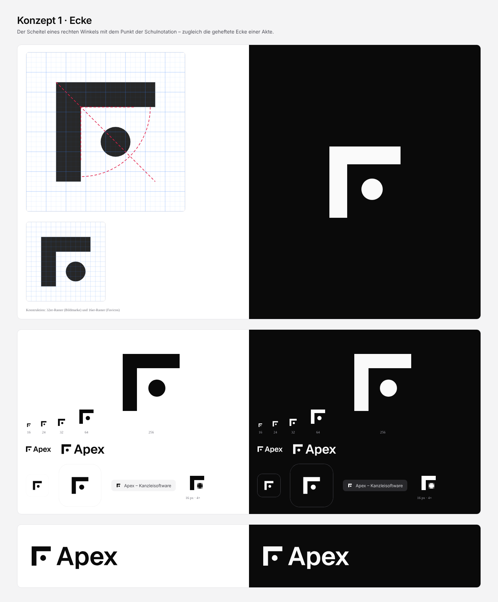
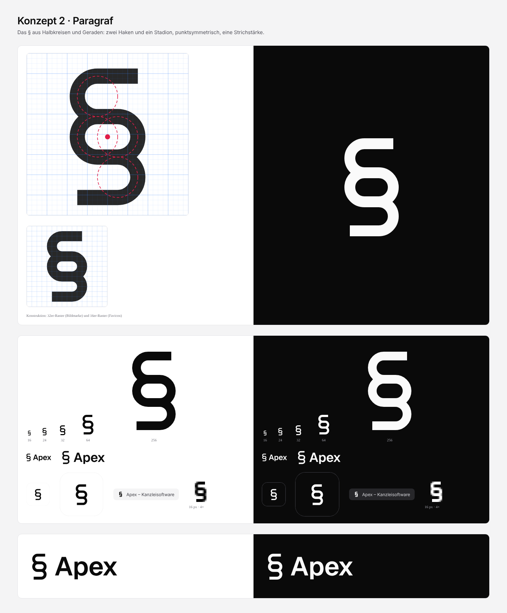
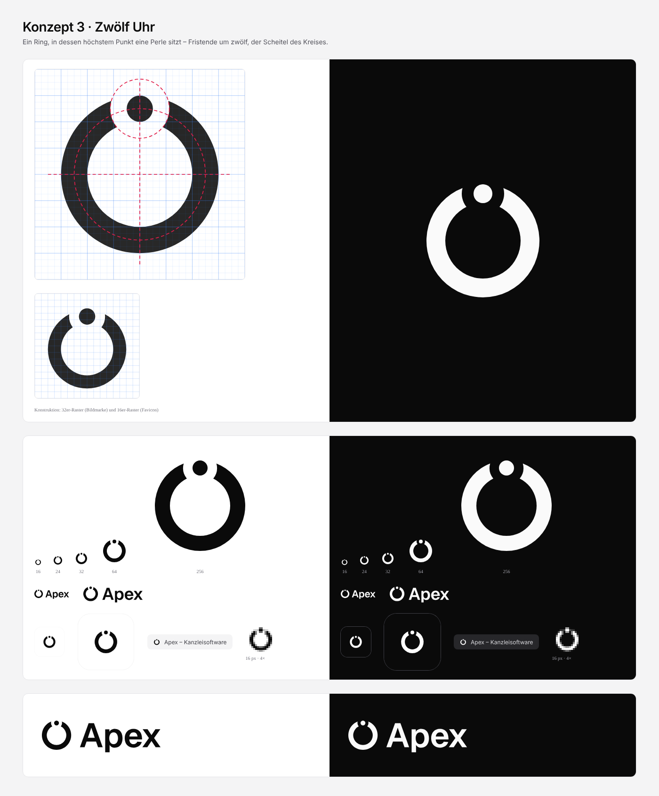
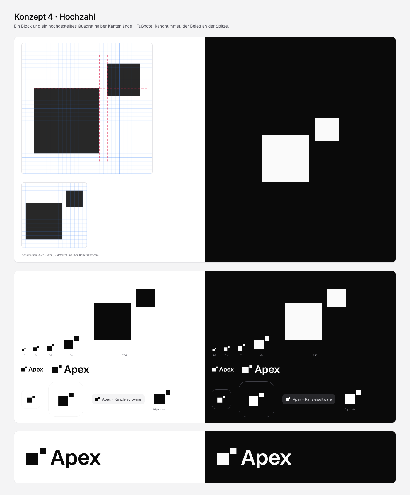
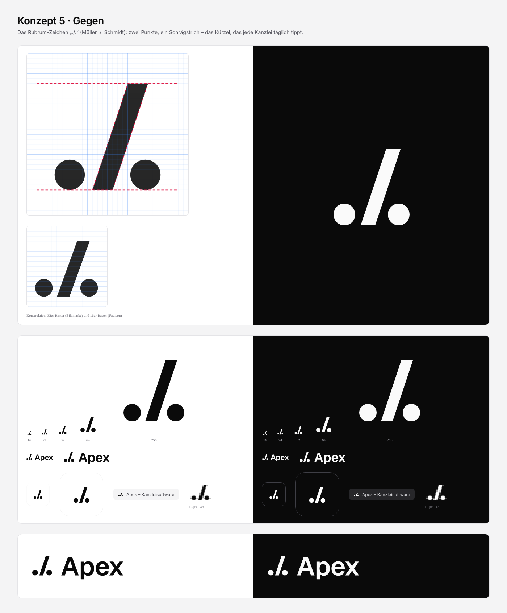
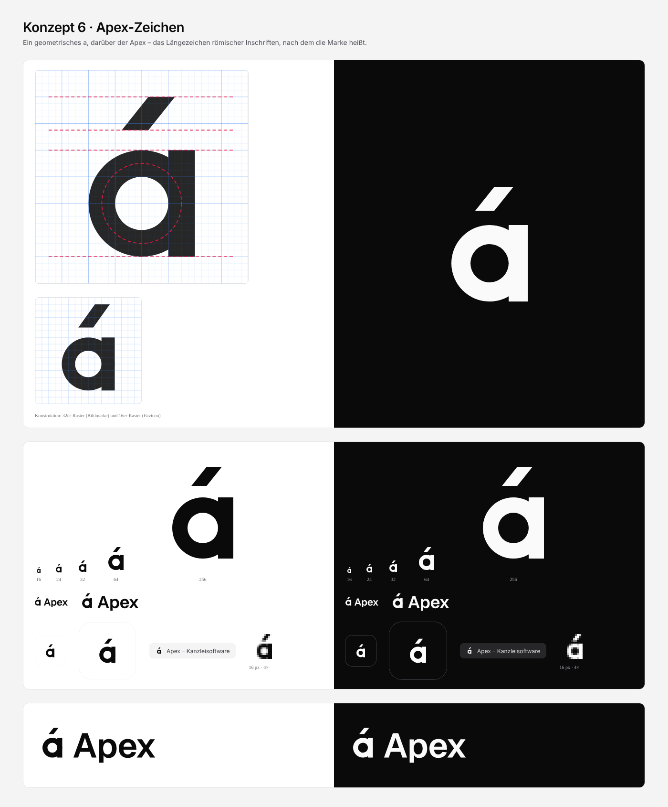

# Apex – Logo-Konzepte

> **Entscheidung (18.10.2026):** Gewählt ist **Konzept 1 „Ecke“**, verfeinert zur Bildmarke **„Eckpunkt“**: Punkt r 3,5 bei (18,5 | 18,5) statt r 3 bei (18 | 18), dazu die Fristen-Lesart aus Konzept 3. Finale Dateien liegen unter `brand/` und `public/favicon.svg`. Begründung und Designsystem: [`../DESIGN-SYSTEM.md`](../DESIGN-SYSTEM.md). Die Dateien in diesem Ordner bleiben als Entwurfsstand unverändert.

Stand: 18.10.2026 · Anlass: Der Auftraggeber lehnt die Feder-A-Marke und die blau-violetten Verläufe ab und möchte ein einzigartiges, viel minimalistischeres Zeichen.

Alle sechs Konzepte folgen denselben Leitplanken:

- **Einfarbig.** Schwarz auf Weiß und Weiß auf Schwarz. Keine Verläufe, kein Glas, kein Leuchten, keine Schatten.
- **Geometrisch.** Jede Bildmarke ist von Hand im 32er-Raster gesetzt: Kanten auf ganzen oder halben Werten, Radien als ganze Zahlen. Das Favicon ist eigens für das 16er-Raster gezeichnet und nicht bloß verkleinert.
- **Ohne Klischees.** Kein Dreieck-A, kein Berg, keine Waage, kein Hammer, keine Feder.
- **Wortmarke.** „Apex“ in Geist SemiBold (600) mit −0,02 em Laufweite, in Pfade umgewandelt. Damit sieht die Wortmarke überall gleich aus, auch ohne installierte Schrift. Die Umrisse stammen aus der statischen 600er-Instanz von Geist (SIL OFL 1.1), also aus derselben Gestaltung wie die variable Schrift in `src/assets/fonts`. Die Bildmarke steht mittig zur Versalhöhe. Bei Konzept 4, 5 und 6 steht sie auf der Schriftlinie, weil diese Zeichen typografisch gelesen werden.
- **App-Icon.** Abgerundetes Quadrat (1024 px, Radius 228 ≈ 22 %) in Fast-Schwarz `#0A0A0A` mit weißer Marke. In der Vorschau steht zusätzlich die helle Variante.

## Dateien

| Pfad | Inhalt |
|---|---|
| `<nr>-<name>/mark.svg` | Bildmarke, `currentColor` (übernimmt die Textfarbe) |
| `<nr>-<name>/wordmark.svg` | Bildmarke + „Apex“, `currentColor` |
| `<nr>-<name>/app-icon.svg` | App-Icon 1024 × 1024 |
| `<nr>-<name>/favicon.svg` | 16er-Raster; schaltet per `prefers-color-scheme` auf Weiß um |
| `<nr>-<name>/detail.html` · `detail.png` | Konstruktion (Raster und Hilfslinien), alle Größen, Wortmarke groß |
| `vorschau.html` · `uebersicht.png` | Alle Konzepte auf Weiß und Fast-Schwarz in 16/24/32/64/256 px, Wortmarke, App-Icon, Favicon im Tab und als echtes 16-px-Raster (4× vergrößert) |

Die Vorschau-Seiten sind statisch, die SVGs sind darin eingebettet. Wer ein SVG ändert, muss die Vorschau neu erzeugen. Die Schrift kommt per `@font-face` aus `src/assets/fonts`. Externe Ressourcen gibt es keine.

## Überblick und Empfehlung

| Nr. | Konzept | Einzigartigkeit | Einfachheit | Lesbarkeit 16 px | Bezug zur Marke | zeitlos | Summe |
|---|---|---|---|---|---|---|---|
| 1 | Ecke | 7 | 9 | 8 | 8 | 9 | **41** |
| 2 | Paragraf | 3 | 8 | 7 | 5 | 8 | 31 |
| 3 | Zwölf Uhr | 6 | 8 | 6 | 8 | 8 | 36 |
| 4 | Hochzahl | 6 | 10 | 9 | 6 | 9 | **40** |
| 5 | Gegen (./.) | 8 | 8 | 7 | 5 | 7 | 35 |
| 6 | Apex-Zeichen | 7 | 7 | 7 | 9 | 8 | 38 |

**Empfehlung für die Auswahl:** **1 Ecke** als Favorit. Das Zeichen ist ruhig, eigenständig und lässt drei Lesarten zu: Scheitel, rechter Winkel, Akten-Ecke. Dazu passen ein streng reduziertes Interface und feine Linien. **6 Apex-Zeichen** ist die Alternative mit der stärksten Geschichte zum Namen. **4 Hochzahl** ist die robusteste Lösung für kleine Größen. Die Bewertungen sind eine Eigenbewertung und ersetzen keinen Test mit Anwältinnen und Anwälten. Vor einer Entscheidung lohnt ein kurzer Präferenztest (5 Sekunden pro Zeichen, „Woran denken Sie?“) mit 5 bis 8 Personen aus der Zielgruppe.

---

## 1 · Ecke

**Idee.** Zwei Schenkel treffen sich im rechten Winkel, in der Winkelöffnung sitzt ein Punkt. So kennzeichnet man im deutschen Geometrieunterricht einen rechten Winkel: Bogen mit Punkt. Der Bogen entfällt, der Punkt bleibt.

**Bedeutung für Kanzleien.**

- *Scheitel*: Der Scheitelpunkt ist die Spitze eines Winkels, also „Apex“ im Wortsinn.
- *Rechter Winkel*: Der Begriff klingt nach „Recht“ und steht für exakt, korrekt, im Lot.
- *Akten-Ecke*: Die linke obere Ecke eines Schriftsatzes, an der geheftet wird. Der Punkt ist die Heftung.

**Konstruktion.** Die Schenkel sind 20 lang und 5 stark (6 bis 26), mit der Innenecke bei (11|11). Der Punkt hat r 3, liegt bei (18|18) auf der Winkelhalbierenden und hat zu beiden Schenkeln exakt 4 Abstand. Alle Werte sind ganzzahlig. Favicon: Schenkel 10 × 3 px, Punkt 4 px, Abstand 2 px.

**Stärken.** Sehr ruhig und architektonisch, passt zu einem Interface aus feinen Linien. Das Zeichen hat keine Rundungen außer dem Punkt, ist dadurch scharf im Raster und bei 16 px klar lesbar. Als Gestaltungselement trägt es weit: Die Ecke kann Karten, Zitate oder Fristen markieren.

**Schwächen.** Losgelöst kann man es als „Γ“ oder als Bildzeichen für „Zuschneiden“ lesen. Das Gewicht liegt links oben, darum braucht das Zeichen rechts unten Luft.

**Verwechslungsprüfung (Plausibilität, keine Registerrecherche).** Keine Ähnlichkeit zu den ausgeschlossenen Marken (Adobe, Apex Legends, Atlassian, Avid, Airbnb, Arc, Anthropic, Salesforce Apex). Es gibt eine Nähe zu allgemeinen Eckmarken („Crop-Marks“, Fokusrahmen) in Foto-Apps. Die Kombination aus einer einzelnen Ecke und einem Punkt ist mir als Marke im Kanzlei- oder SaaS-Umfeld nicht bekannt.

**Eigenbewertung.** Einzigartigkeit 7 · Einfachheit 9 · Lesbarkeit 16 px 8 · Bezug zur Marke 8 · zeitlos 9.

---

## 2 · Paragraf

**Idee.** Das § ist auf reine Geometrie zurückgeführt: oben ein Haken, in der Mitte ein Stadion (Rechteck mit Halbkreisenden), unten ein Haken. Alles ist punktsymmetrisch und hat eine einzige Strichstärke.

**Bedeutung für Kanzleien.** Das Paragrafenzeichen erkennt jeder sofort als Zeichen für Recht und Gesetz.

**Konstruktion.** Die Mittellinie besteht aus Halbkreisen mit r 4 und Geraden mit 4 Länge. Strich 3, Symmetriezentrum bei (16|16,5). Die Enden der Haken sind senkrecht geschnitten und stehen bündig über der Mittellinie der Gegenrundung. Favicon: r 2, Strich 2 px.

**Stärken.** Sofort verständlich, sauber konstruiert, bei 16 px noch als § zu erkennen.

**Schwächen.** Austauschbar: Das § verwenden unzählige Kanzleien, Rechts-Apps und Verlage. Es sagt „Recht“, aber nicht „Apex“. Neben der Wortmarke liest es sich leicht wie Fließtext („§ Apex“). Die Kugelenden aus der ersten Skizze wirkten verspielt und sind deshalb entfallen.

**Verwechslungsprüfung.** Keine Nähe zu den ausgeschlossenen Marken. Das Zeichen ist für Rechtsdienstleistungen und Rechtssoftware aber beschreibend. Als Marke wäre es nur schwach schutzfähig (§ 8 Abs. 2 Nr. 1 und 2 MarkenG), und es gibt viele ähnliche Kanzleilogos.

**Eigenbewertung.** Einzigartigkeit 3 · Einfachheit 8 · Lesbarkeit 16 px 7 · Bezug zur Marke 5 · zeitlos 8.

---

## 3 · Zwölf Uhr

**Idee.** Ein kräftiger Ring, in dessen höchstem Punkt, bei zwölf Uhr, eine Perle sitzt. Der Ring ist um die Perle herum ausgespart, als hätte sie sich Platz gemacht.

**Bedeutung für Kanzleien.** Eine Frist endet mit dem Ablauf des letzten Tages (§ 188 BGB), also um 24 Uhr, wenn der Zeiger auf der Zwölf steht. Der Punkt bei zwölf ist zugleich der Scheitel des Kreises. Das Zeichen verbindet so Fristenkontrolle, das Herzstück der Software, mit „Apex“.

**Konstruktion.** Ring um (16|16) mit r 12 außen und r 8 innen (Strich 4). Der Punkt hat r 2 und sitzt genau auf der Mittellinie bei (16|6). Er füllt also die Strichbreite. Die Aussparung ist ein Hof mit r 4,5 um den Punkt (Luft 2,5). Die Ringenden sind darum konkav und zum Punkt hin ausgerichtet. Die Schnittpunkte ergeben sich aus der Konstruktion und sind auf zwei Nachkommastellen gerundet. Favicon: Ring r 6/4, Punkt r 1,25, Hof r 2,75.

**Stärken.** Starke, leicht erzählbare Idee („Ihre Fristen. Auf den Punkt.“). Freundlich, rund und als Animation dankbar: Der Punkt kann umlaufen und an der Zwölf einrasten.

**Schwächen.** Bei 16 px schließt sich der Hof teilweise, dann liest man den Ring nur noch als „o mit Punkt“ („ȯ“). Außerdem erinnert das Zeichen an das Ein/Aus-Symbol (IEC 60417-5009, offener Kreis mit Strich) und an Ladekreise.

**Verwechslungsprüfung.** Keine Nähe zu den ausgeschlossenen Marken. Das Ein/Aus-Symbol ist die nächste Verwandtschaft. Der Unterschied liegt darin, dass dort ein Strich in der Lücke steht und hier ein Punkt auf der Kreislinie. Ringe mit Punkt kommen als Marken vor, im Kanzleiumfeld ist mir aber keine bekannt.

**Eigenbewertung.** Einzigartigkeit 6 · Einfachheit 8 · Lesbarkeit 16 px 6 · Bezug zur Marke 8 · zeitlos 8.

---

## 4 · Hochzahl

**Idee.** Ein Block und ein hochgestelltes Quadrat mit halber Kantenlänge, wie eine Hochzahl oder ein Fußnotenzeichen.

**Bedeutung für Kanzleien.** Hochgestellt heißt „an der Spitze“, also Apex. Die Hochzahl ist außerdem das Zeichen des Belegs: Fußnote, Fundstelle, Randnummer. Darauf ruht juristische Arbeit. Grafisch steht das Zeichen für Ordnung (Block) und den einen Schritt darüber (Hochzahl).

**Konstruktion.** Block 16 × 16 bei (3|11), Hochzahl 8 × 8 bei (21|5). Das Verhältnis ist 1 : 2, der Abstand 2, und in der Höhe überdecken sich beide um 2. Alle Werte sind ganzzahlig. Das Favicon ist pixelgenau: Block 9 px, Hochzahl 4 px, Abstand 1 px. In der Wortmarke steht der Block auf der Schriftlinie, die Hochzahl ragt über die Versalhöhe hinaus wie ein echter Exponent.

**Stärken.** Das einfachste Zeichen der Reihe. Im Raster gestochen scharf und in jeder Größe sicher lesbar, auch bei 16 px. Es lässt sich leicht als System ausbauen, etwa als Lade- oder Statusanzeige oder als Aufzählungszeichen.

**Schwächen.** Sehr abstrakt: Ohne Erklärung wirkt es wie „zwei Quadrate“, und der Bezug zum Recht erschließt sich nicht von selbst. Quadrat-Kompositionen sind im SaaS-Umfeld verbreitet.

**Verwechslungsprüfung.** Keine Nähe zu den ausgeschlossenen Marken. Zu Microsoft (vier farbige Quadrate im Raster) und Block/Square (Quadrat im Quadrat) ist der Abstand klar. Es gibt eine allgemeine Nähe zum Zeichen „x²“ und zu einfachen Quadratmarken. Eine Registerrecherche ist hier besonders wichtig, weil einfache Grundformen oft schon eingetragen sind.

**Eigenbewertung.** Einzigartigkeit 6 · Einfachheit 10 · Lesbarkeit 16 px 9 · Bezug zur Marke 6 · zeitlos 9.

---

## 5 · Gegen (./.)

**Idee.** Das Rubrum-Kürzel „./.“ für „gegen“ („Müller ./. Schmidt“): zwei Punkte auf der Grundlinie, dazwischen ein Schrägstrich.

**Bedeutung für Kanzleien.** Ein Insiderzeichen, das jede deutsche Kanzlei täglich in Aktenbezeichnungen tippt. Wer es sieht, weiß: Diese Software kommt aus der Praxis. Der Schrägstrich steigt nach rechts oben, zum höchsten Punkt.

**Konstruktion.** Der Schrägstrich ist 4 breit und hat die Steigung 3 : 1 (21 hoch, 7 versetzt, von y 6 bis 27). Die Punkte haben r 3, stehen auf der Grundlinie y 27 und haben links und rechts die gleiche waagerechte Luft von 2,5 zum Schrägstrich. Das Zeichen ist punktsymmetrisch ausgewogen. Favicon: Strich 2,5 px, Punkte 3,5 px, gleiche Luft links und rechts.

**Stärken.** Eigenständig, im deutschen Rechtsmarkt hoch wiedererkennbar und mit Augenzwinkern. Es funktioniert als Zeichen und als Satzzeichen im Text, etwa in „Apex ./. Papierakte“.

**Schwächen.** „Gegen“ betont den Streit. Für Beratung, Notariat oder Mediation passt das weniger. Außerhalb der Branche liest man es als „%“ oder als „./“ (Pfadangabe in der Programmierung). Der Bezug zum Namen Apex ist schwach.

**Verwechslungsprüfung.** Keine Nähe zu den ausgeschlossenen Marken, eine bekannte Marke mit diesem Zeichen ist mir nicht bekannt. Weil das Kürzel im juristischen Sprachgebrauch üblich ist, wäre es als reines Zeichen nur schwach schutzfähig (§ 8 Abs. 2 Nr. 3 MarkenG). Schutz entstünde eher über die konkrete grafische Ausführung zusammen mit der Wortmarke.

**Eigenbewertung.** Einzigartigkeit 8 · Einfachheit 8 · Lesbarkeit 16 px 7 · Bezug zur Marke 5 · zeitlos 7.

---

## 6 · Apex-Zeichen

**Idee.** Ein geometrisches, einstöckiges a, darüber der Apex. So heißt das Längezeichen, mit dem man in antiken lateinischen Inschriften lange Vokale markierte. Antike Grammatiker wie Quintilian beschreiben es; es sieht aus wie ein schräger Strich über dem Buchstaben.

**Bedeutung für Kanzleien.** Die Marke trägt ihren Namen wörtlich, und der Bezug führt ins Lateinische, die Sprache des römischen Rechts. Für ein Publikum, das mit „pacta sunt servanda“ aufgewachsen ist, ist das eine Geschichte, die man gern weitererzählt. Der Apex steht für Betonung und Gewicht, also für das Wesentliche.

**Konstruktion.** Ring um (16|20) mit r 8 außen und r 4 innen (Strich 4). Der Stamm ist 4 breit (x 20 bis 24) und schließt bündig mit der Außenkante des Rings ab. Der Apex ist ein Parallelogramm mit 4 Breite und 5 Höhe, (13|9)–(17|9)–(21|4)–(17|4), und hat 3 Luft zum Ring. Alle Werte sind ganzzahlig. Favicon: Ring r 4/2, Stamm 2 px, Apex 2,25 × 3,5.

**Stärken.** Der stärkste Bezug zum Namen, mit Tiefe statt Klischee. Bei 16 px klar als „á“ lesbar. Ein Buchstabe als Zeichen funktioniert gut als App-Icon.

**Schwächen.** Neben der Wortmarke wiederholt sich das a („á Apex“). Man kann den Akzent für einen spanischen, ungarischen oder tschechischen halten, und er lädt zur Aussprache „Ápex“ ein. Die Geschichte muss man erzählen, von selbst erschließt sie sich nicht. Denkbar wäre eine Wortmarke in Kleinbuchstaben mit dem Apex über dem ersten Buchstaben. Sie verändert aber das Schriftbild des Namens und ist darum hier nicht umgesetzt.

**Verwechslungsprüfung.** Keine Nähe zu den ausgeschlossenen Marken. Andere a-Monogramme (etwa das „a“ mit Lächeln eines großen Versandhändlers) sind gestalterisch weit entfernt. Einstöckige a-Zeichen sind verbreitet. Unterscheidungskraft gewinnt das Zeichen erst durch den Apex.

**Eigenbewertung.** Einzigartigkeit 7 · Einfachheit 7 · Lesbarkeit 16 px 7 · Bezug zur Marke 9 · zeitlos 8.

---

## Nächste Schritte

1. **Auswahl** von zwei Favoriten durch den Auftraggeber, danach ein kurzer Präferenztest mit der Zielgruppe.
2. **Markenrecherche** für den Favoriten: Identitäts- und Ähnlichkeitsrecherche bei DPMA, EUIPO und WIPO in den Nizza-Klassen 9 (Software), 42 (SaaS) und 45 (Rechtsdienstleistungen), am besten durch eine Markenrechtskanzlei. Die Verwechslungsprüfung oben ist nur eine Plausibilitätsprüfung.
3. **Feinschliff**: optische Korrekturen (Überhänge, Strichstärken im Verhältnis zur Wortmarke), Schutzraum und Mindestgrößen festlegen, Varianten (Marke allein, waagerechte und gestapelte Wortmarke).
4. **Ableitungen**: `public/favicon.svg`, `brand/logo-mark*.svg`, `brand/app-icon.svg`, Apple-Touch-Icon (PNG 180 px), Open-Graph-Bild, Ladebildschirm, Rechnungskopf. Danach `docs/BRANDING.md` neu fassen.
