# Iteration 1 – Usability-Bericht AnwaltApex

**Kundenavatar:** Claudia Reinholz (50), Fachanwältin für Arbeitsrecht, geschäftsführende Partnerin einer kleinen Sozietät in Paderborn (fiktiv)
**Schwerpunkt:** Erstkontakt und Baseline · **Datum:** 16.10.2026 · **Codestand:** `86d24dc`
**Betrieb:** Browser-Demo (Demo-KI offline, Daten im Browserspeicher) · Chromium (Playwright, de-DE, Europe/Berlin) · Viewports D 1440×900, L 1366×768, M 390×844 · hell, T01 zusätzlich und T15 dunkel
**Testleitung:** Avatar-Werkzeug, vier Blöcke in getrennten frischen Profilen: A Erstkontakt, Verwaltung, Hilfe und 38h-Motor · B Alltag Mandatsarbeit · C Kanzlei, Geld und KI · D Umzug, mobil, abends, Assistent und ReFa
**Rohdaten:** [Block A](iteration-1/block-A.md) · [Block B](iteration-1/block-B.md) · [Block C](iteration-1/block-C.md) · [Block D](iteration-1/block-D.md)

> Die Zahlen stammen von einer einzigen simulierten Person. SUS, UEQ-S und Noten sind deshalb **Trendwerte** und keine Statistik.

---

## 1. Kurzfazit

1. **Der Fachkern trägt.** Alle 6 Fristprüfwerte aus T18 stimmen auf den Tag genau, ebenso Berufung, Begründung und KSchG-Klagefrist aus dem Alltag. Die RVG-Prüfsätze stimmen 16 von 16, die Zinsen auf 0,00 €. Jeder Rechenweg nennt die Norm. Der Avatar sagt dazu: *„Das ist der Teil, für den ich kaufen würde.“*
2. **Vertrauen ist der Engpass** (Note 3,5, die schlechteste Dimension). Die Gründe:
   - Ein Kundentestzugang ließ sich per Kachel ohne Passwort öffnen (K).
   - Das Protokoll enthielt erfundene Einträge auf den echten Namen der Testerin.
   - Demozahlen waren nicht gekennzeichnet.
   - Automatiken versenden nach außen, ohne dass jemand freigibt.
   - KI-Verarbeitungsort und Wartung blieben unklar.
3. **Vier Befunde sind Haftungsfälle (K):**
   - Eine ReFa kann das eEB selbst abgeben.
   - Die KI überliest eine vertragliche Ausschlussfrist.
   - Das Zeithonorar lässt sich nicht zum vereinbarten Satz abrechnen.
   - Ein Testzugang öffnet sich mit einem Klick.

   Dazu fehlen die Ausgangskontrolle am Abend, eine verbindliche Kollisionsentscheidung und ein lückenloses eEB-Protokoll.
4. **Kennzahlen unter Ziel:**

   | Kennzahl | Ergebnis | Ziel |
   |---|---|---|
   | SUS | 65,6 | ≥ 80 |
   | UEQ-S | +1,13 / +1,25 | ≥ +1,5 |
   | Empfehlung | 5,5 von 10 | – |

   Kaufen würde der Avatar heute nicht; zweimal nennt er Bedingungen.
5. **Entscheidung der Testleitung:**
   - 141 Rohbefunde wurden zu **133 Befunden** zusammengeführt.
   - **132 werden umgesetzt**, 11 davon in angepasster Form.
   - **1 Befund ist verworfen**, weil er aus der Testumgebung stammt.
   - Die Umsetzung läuft in zwei parallelen Paketen mit getrennten Dateibereichen (Abschnitt 8).

---

## 2. Kennzahlen

| Kennzahl | Iteration 1 | Abnahmeziel nach Iteration 5 |
|---|---|---|
| Aufgaben erfolgreich (ohne Umweg) | **6 / 24** · mit Umweg 12 · gescheitert oder abgebrochen 6 | 24 / 24 ohne Hilfe |
| Erfolgskriterium erfüllt | **8 / 24** (T02, T04, T06, T07, T08, T09, T14, T18) | 24 / 24 |
| Fehlaktionen | **25** (A 5 · B 5 · C 10 · D 5) | – |
| SEQ-Mittel (1–7) | **4,6** (25 Einzelwerte; T18 lief in A und D) | – |
| SUS (Trendwert) | **65,6** (A 65 · B 70 · C 62,5 · D 65) | ≥ 80 |
| UEQ-S pragmatisch / hedonisch | **+1,13 / +1,25** | ≥ +1,5 / ≥ +1,5 |
| Schulnoten-Mittel | **2,6** (27 Noten) | alle ≤ 2,0; Vertrauen und Fachlich = 1 |
| Empfehlung (0–10) | **5,5** (5 · 6 · 6 · 5) | – |
| Kauf heute | **0 × ja** · 3 × „nein bzw. unter Bedingungen“ · 1 × „nein, neu prüfen“ | ja, oder Bedingungen nur noch zu Vertrag und Preis |
| axe-core serious / critical | **14 / 6**: 14 von 49 geprüften Ansichten mit Verstoß, 6 Ursachen | 0 / 0 |
| Befunde roh | 141: K 4 · H 45 · M 65 · N 27 | – |
| **Befunde nach Zusammenführung** | **133: K 4 · H 42 · M 63 · N 24** | 0 offene K und H |
| Entscheidung | 132 umsetzen (davon 11 angepasst) · 1 verworfen | – |

**Fachliche Prüfwerte**

| Aufgabe | Ergebnis |
|---|---|
| T18 | 6/6 exakt: 01.03.2027 · 30.03.2027 · 09.03.2027 (BE) · 08.03.2027 (NW) · 08.03.2027 (3a, BB) · 01.11.2027 (3b, HE) |
| T07 | 16/16 exakt. Zeithonorar falsch: 420,00 € statt 360,00 € netto |
| T09 | 0,00 € Abweichung, Satzwechsel 01.07.2026 berücksichtigt. Prüfwerte A–C nicht prüfbar, weil es keinen freien Zinsrechner gibt |
| T04 | Klagefrist Mo 02.11.2026 exakt. Den Gegenstandswert (11.400 €) rechnet der Avatar selbst |
| T11 | 0 Zeichenfehler |

**Schulnoten je Dimension** (1 = sehr gut … 6 = ungenügend)

| Dimension | A | B | C | D | Mittel |
|---|---|---|---|---|---|
| Look & Feel | 2 | 2 | 2 | 2 | **2,0** |
| Lesbarkeit | 3 | 3 | 3 | 2 | **2,75** |
| Verständlichkeit | 2 | 2 | 2 | 2 | **2,0** |
| Vertrauen und Seriosität | 4 | 3 | 3 | 4 | **3,5** |
| Tempo | 2 | 2 | 2 | 3 | **2,25** |
| Fachliche Korrektheit | 3 | 2 | 3 | 3 | **2,75** |
| Mobil | 2 | – | 3 | 3 | **2,67** |

**Aufgaben im Überblick**

| Aufgabe | Block · Viewport | Ergebnis | Erfolgskriterium | SEQ | Fehlakt. |
|---|---|---|---|---|---|
| T00 Landing | A · D, M | mit Umweg | nicht erfüllt: 3 von 5 Zielen; kein Wartungspreis, kein „Testzugang anfordern“ | 4 | 2 |
| T21 Apex Console | A · D | mit Umweg | nicht erfüllt: 22 statt ≤ 18 Aktionen; nach Passwortwechsel nur 2/4 Einladungsangaben | 5 | 0 |
| T16 Erste Anmeldung | A · L | erledigt | knapp nicht erfüllt: 2/3 Meldungen nennen den nächsten Schritt | 6 | 0 |
| T18 Fristenrechner | A (3b) + D (1, 2, 3a) · D | erledigt | **erfüllt**, 6/6 Daten. FamFG und Vertretung fehlen | 6 / 5 | 0 |
| T10 38h-Motor | A · L | mit Umweg | teilweise: eigene Zahl nur aus eigenem Wissen | 4 | 0 |
| T12 Störung, Hilfe | A · L | mit Umweg | nicht erfüllt: weder § 46g ArbGG noch § 130d ZPO | 3 | 2 |
| T13 Einstellungen | A · D | mit Umweg | nicht erfüllt: 5/7; keine Azubi-Rechte, keine Schriftgröße | 4 | 1 |
| T01 Cockpit | B · D hell + dunkel | mit Umweg | nicht erfüllt: 3/4 Angaben, beA-Status fehlt | 5 | 0 |
| T02 beA-Posteingang | B · D | erledigt | **erfüllt** | 6 | 0 |
| T03 eEB, Vier-Augen | B · D | mit Umweg | nicht erfüllt: Protokoll 2/4 | 5 | 0 |
| T04 Mandatsaufnahme | B · L | mit Umweg | **erfüllt**: 19 von ≤ 25 Aktionen | 4 | 2 |
| T05 E-Akte | B · D | mit Umweg | nicht erfüllt: Verschieben braucht 5 Aktionen | 5 | 0 |
| T17 Kontakte | B · D | abgebrochen | nicht erfüllt: keine Auskunft, kein Löschweg | 3 | 2 |
| T23 Aktenübersicht, Nachfolge | B · D | mit Umweg | nicht erfüllt: Verlauf 0/3 | 5 | 1 |
| T06 Fallanalyse, Suche | C · D | erledigt | **erfüllt**: 3/3 Entscheidungen öffnen sich | 6 | 2 |
| T07 Abrechnung | C · D (+ M) | mit Umweg | **erfüllt** (16/16), aber Zeithonorar falsch (K) | 4 | 4 |
| T08 Bankabgleich, Fremdgeld | C · L | erledigt | **erfüllt** | 5 | 2 |
| T09 Forderungskonto | C · D | erledigt | **erfüllt** | 6 | 1 |
| T19 Dokument-Analyse | C · D | abgebrochen | nicht erfüllt: Ausschlussfrist übersehen | 3 | 1 |
| T11 Umzug | D · D | gescheitert | nicht erfüllt: Dublette, Status, Archiv | 5 | 0 |
| T14 Mobil am Gericht | D · M | mit Umweg | **erfüllt mit Umweg** | 4 | 2 |
| T15 Dunkelmodus, Tagesabschluss | D · L dunkel | gescheitert | nicht erfüllt: keine Ausgangskontrolle | 3 | 1 |
| T20 Apex Assistent | D · D, M | gescheitert | nicht erfüllt: Wiedervorlage nicht rücknehmbar, „Müller“ ohne Rückfrage | 4 | 1 |
| T22 Petras Vormittag (ReFa) | D · L | gescheitert | nicht erfüllt: ReFa gibt das eEB ab | 4 | 1 |

---

## 3. Die stärksten O-Töne

**Kritik**

> „Mein eigenes Passwort ist wertlos, wenn jeder auf die Kachel klicken kann.“ – T16, Anmeldeseite

> „Das darf ich doch gar nicht, das macht die Chefin.“ – T22, als Petra Schulte nach der eEB-Abgabe

> „Eine Ausschlussfrist ist im Arbeitsrecht das, woran Ansprüche sterben. Wenn Ihre KI die überliest, brauche ich sie nicht.“ – T19

> „16:50 Uhr, Frist läuft – und er zählt mir meinen Posteingang auf.“ – T12, Assistent bei beA-Störung

> „‚Erledigt‘ ist kein Versandnachweis. Der BGH will die Ausgangskontrolle, und die finde ich hier nicht.“ – T15

> „Eine Warnung, die ich wegklicken kann, ohne es zu merken, ist keine Kollisionsprüfung.“ – T04

> „Grün heißt bei mir: Ich darf. Hier heißt Grün etwas anderes. Das ist gefährlich.“ – T17

> „Mein Arbeitgebermandat zu 240 Euro kann ich nicht abrechnen – und auf der Rechnung steht ‚laut Vereinbarung 280‘. Das ist falsch.“ – T07

> „38 Stunden? Bei mir? Zeigen Sie mir, welche – und sagen Sie dazu, dass das ein Beispiel ist.“ – T01

> „Lifetime klingt gut. Lifetime von wem? Und was kostet mich das nach dem ersten Jahr? Steht nirgends.“ – T00

**Lob**

> „Das ist der Teil, für den ich kaufen würde. Rechenweg mit Norm, Feiertag beim Namen, ‚abweichend vom Kanzleisitz‘.“ – T18

> „RVG und Zinsen rechnen Sie mir auf den Cent richtig vor – mit Tabelle, Fassung und Zinsabschnitten. Das kann RA-MICRO nicht schöner.“ – Block C

> „Der Dunkelmodus ist der beste, den ich in einer Kanzleisoftware gesehen habe. Ruhig, gut lesbar.“ – T15

---

## 4. Was gut war

- **Fristen**
  - Alle geprüften Daten sind exakt, mit Rechenweg und Norm.
  - Feiertage stehen beim Namen („Ostermontag“, „Internationaler Frauentag (Berlin)“).
  - Der Rechner weist auf „Abweichend vom Kanzleisitz“ hin, dazu auf Notfrist und Wiedereinsetzung.
  - In der Akte steht „Gerichtsort laut Akte“.
- **eEB-Schutz**
  - „Erst Frist notieren, dann eEB“ mit verständlichem Grund.
  - Fristübernahme mit 1 Klick und „Rückgängig“; ein Doppelklick erzeugt keine zweite Abgabe.
  - Das Vier-Augen-Prinzip ist korrekt umgesetzt: Niemand kann sich selbst kontrollieren.
- **Geld**
  - RVG 16/16, die Tabelle folgt dem Auftragsdatum (§ 60 RVG).
  - Forderungskonto mit act/365, Zinsabschnitten und § 367 BGB, druckreife Forderungsaufstellung.
  - Die Stornorechnung erhält eine eigene Nummer, nichts wird gelöscht.
  - Der Bankabgleich erklärt seine Sicherheitsstufen und bucht nichts unter 90 % ohne Bestätigung.
- **KI-Disziplin**
  - Keine erfundene Fundstelle; Präzedenzfälle kommen nur aus der Fall-Datenbank und lassen sich anklicken.
  - Fristen kommen „vom Fristenrechner – nicht von der KI“.
  - Entwürfe werden als Entwurf mit Version gespeichert.
  - Strg+K findet Akte, Volltext und Rechtsprechung in 5 ms.
- **Mandatsaufnahme**
  - Das Paket entsteht automatisch: Vollmacht, Art. 13 DSGVO, § 49b Abs. 5 BRAO, § 12a ArbGG, Deckungsanfrage mit Wiedervorlage.
  - Die Kollisionswarnung erscheint vor der Aktenanlage.
- **Erstkontakt**
  - Die Console zeigt über die Kanzlei nur Zahlen (K-Probe bestanden).
  - Die Einladung ist vollständig.
  - Beim ersten Anmelden muss ein eigenes Passwort gesetzt werden.
  - Abmelden ist sauber, und Browser-Zurück zeigt danach keine Daten.
  - Die Beispielakten passen zu Paderborn (0 falsche Gerichtsorte).
- **Umzug**
  - Windows-1252 wird automatisch erkannt: 0 Zeichenfehler, Beträge und Daten korrekt.
  - Vor der Übernahme gibt es eine Vorschau, dazu einen klaren Rückgängig-Dialog.
- **Darstellung**
  - Der Dunkelmodus ist ruhig und kontrastreich.
  - Mobil ist die Akte in 3 Taps offen, und das PDF ist ohne Zoom lesbar.
  - Die Landing hat auf 390 px kein Querscrollen.
  - Ohne axe-Befund: Console, Login, Cockpit, Fristen, 38h-Motor, Hilfe, Einstellungen, Kontakte, Abrechnung.
- **Hilfe**
  - Die Ansprechpartnerin mit Name, Durchwahl und Rückruf ist 1 Klick entfernt, der Systemstatus ebenfalls.
  - Das Wiki lässt sich anhalten.
  - Der 38h-Motor ist exakt nachrechenbar und lässt sich mit 1 Klick abschalten.

---

## 5. Befunde nach Bereich

**So sind die Tabellen zu lesen:**

- **S** ist der Schweregrad: **K** kritisch, **H** hoch, **M** mittel, **N** niedrig.
- **Paket A** heißt „Rahmen, Design, Einstieg, Logik & Daten“, **Paket B** heißt „Fachseiten“.
- **Zusammengeführte Duplikate** behalten ihre ID für den Nachtest und verweisen auf den führenden Befund.
- **ID-Kollision aufgelöst:** Block A und Block D haben beide `I1-T18-01` und `I1-T18-02` vergeben. Die Befunde aus Block D heißen jetzt **I1-T18-07** (FamFG, vorher D-I1-T18-01) und **I1-T18-08** (Vertretung, vorher D-I1-T18-02).

**Befunde je Bereich und Schwere** (nach Zusammenführung)

| Bereich | K | H | M | N | gesamt |
|---|---|---|---|---|---|
| Landing | – | 3 | 3 | 1 | 7 |
| Anmeldung und Zugang | 1 | 1 | 1 | – | 3 |
| Apex Console | – | 1 | 3 | 2 | 6 |
| Rahmen: Kopfleiste, Apex Island, Cockpit, Meldungen | – | 1 | 8 | 2 | 11 |
| Akten | – | 7 | 10 | 8 | 25 |
| Kontakte | – | 2 | 1 | – | 3 |
| Posteingang und eEB | 1 | 2 | 3 | 2 | 8 |
| Fristen und Fristenrechner | – | 2 | 6 | 2 | 10 |
| Apex KI und Fall-Datenbank | 1 | 4 | 6 | – | 11 |
| 38h-Motor | – | 2 | 4 | 1 | 7 |
| Abrechnung | 1 | 6 | 8 | 3 | 18 |
| Umzug | – | 2 | 2 | 1 | 5 |
| Hilfe und Support | – | – | 1 | 1 | 2 |
| Einstellungen | – | 5 | 5 | 1 | 11 |
| Apex Assistent | – | 4 | 2 | – | 6 |
| **Summe** | **4** | **42** | **63** | **24** | **133** |

### 5.1 Landing (`/willkommen`)

| ID | S | Kategorie | Befund | Entscheidung | Paket |
|---|---|---|---|---|---|
| I1-T00-01 | H | Vertrauen | Kein Preis- und Wartungsmodell. Die 5-Jahres-Kostenkurve „Lifetime“ bleibt trotz Wartung flach. „Angebot in 24 Std.“ steht neben dem Knopf „Demo starten“. | **umsetzen** – einheitliches Wartungsmodell, zweite Kurve, Knopf „Angebot anfordern“ | A |
| I1-T00-02 | H | Bedienbarkeit | Kein „Testzugang anfordern“, kein Kontakt mit Name und Telefon, Impressum nur Platzhalter. | **umsetzen, angepasst** – Anfrageformular und Kontaktblock kommen. Das Impressum bleibt Platzhalter, bis echte Anbieterdaten vorliegen; fiktive Angaben im Impressum wären irreführend. | A |
| I1-T00-03 | M | Fehler | Die Vorschau zeigt sekundenlang „Erfolgsaussicht 0 %“. | **umsetzen** – verbale Einschätzung statt Prozent (wie I1-T06-01) | A |
| I1-T00-04 | M | Vertrauen | Der Stundensatz 19,74 € ist aus dem Werbeziel zurückgerechnet, ein Zirkelschluss. | **umsetzen, angepasst** – Der Zielwert 36.000 € steht im Briefing (Masterprompt) und bleibt. Die Herleitung wird offen als bewusst niedriger Ansatz ausgewiesen. Die Rechner rechnen mit Personalkosten (50.000 € ÷ 1.920 Std. = 26,04 €/Std. → ≈ 47.500 €). | A (+ B im Rechner) |
| I1-T00-05 | N | Verständlichkeit | 10 Anglizismen (On-Premise, Private Cloud, Live-Vorschau, Hotline …). | **umsetzen, angepasst** – Allgemeine Begriffe werden eingedeutscht. Die Produktnamen aus dem Masterprompt (Lifetime-Lizenz, Apex …, 38h-Motor) bleiben und werden deutsch erklärt. | A |
| I1-T00-06 | H | Barrierefreiheit | axe serious `aria-prohibited-attr`, 18 Knoten im Vergleich | **umsetzen** | A |
| I1-T00-07 | M | Barrierefreiheit | Die Fußnoten mit der Herleitung sind sehr klein und grau. | **umsetzen** | A |

### 5.2 Anmeldung und Zugang (`/login`)

| ID | S | Kategorie | Befund | Entscheidung | Paket |
|---|---|---|---|---|---|
| I1-T16-01 | **K** | Vertrauen | Der Kundentestzugang erscheint als Ein-Klick-Kachel und meldet trotz eigenem Passwort ohne Passwort an. | **umsetzen** – Ursache im Demo-Backend bestätigt (`schnellLogins` listet alle Kanzleien). Der Server gibt laut Code nur Präsentationskanzleien mit gültigem Demo-Passwort aus. | A |
| I1-T16-04 | H | Vertrauen | Keine Zwei-Faktor-Anmeldung, keine Sperre bei Inaktivität. Der Masterprompt sieht MFA vor. | **umsetzen** (TOTP, Inaktivitätssperre) | A |
| I1-T16-05 | M | Bedienbarkeit | Kein „Passwort vergessen?“. „Die beiden Eingaben stimmen nicht überein.“ nennt keinen nächsten Schritt. | **umsetzen** | A |

### 5.3 Apex Console (`/console`)

| ID | S | Kategorie | Befund | Entscheidung | Paket |
|---|---|---|---|---|---|
| I1-T21-01 | H | Vertrauen | Eine Passwortvergabe durch den Anbieter erscheint nicht im Kanzleiprotokoll. Der Dialog verschweigt, dass die Kanzlei den Vorgang sieht. | **umsetzen** | A |
| I1-T21-02 | M | Bedienbarkeit | Nach einem neuen Passwort gibt es nur einen Kurztext, keine vollständige Einladung. | **umsetzen** | A |
| I1-T21-03 | M | Verständlichkeit | „Paderborn“ wird nicht erkannt, und das Bundesland bleibt auf der Vorbelegung Berlin. | **umsetzen** – Die Ortsliste in `core/feiertage.ts` kennt Paderborn bereits; die Console nutzt eine eigene, kürzere Liste. | A |
| I1-T21-04 | M | Vertrauen | Die Einladung enthält das Startpasswort im E-Mail-Text, der Team-Dialog rät davon ab. | **umsetzen** | A |
| I1-T21-05 | N | Verständlichkeit | „Guten Tag Claudia Reinholz,“, „Partner“, „Hauptnutzer“ | **umsetzen** | A |
| I1-T21-06 | N | Fehler | Beim Laden steht kurz „3 Kanzleien / 9 Nutzer“. „Letzte Aktivität“ stammt aus Demo-Einträgen. | **umsetzen** | A |

### 5.4 Rahmen: Kopfleiste, Apex Island, Cockpit, Meldungen

| ID | S | Kategorie | Befund | Entscheidung | Paket |
|---|---|---|---|---|---|
| I1-T01-01 | H | Vertrauen | Apex Island und die Cockpit-Karte zeigen Demowerte ohne Kennzeichnung (38,3–39,7 Std., ≈ 37.000 € ohne Herleitung). | **umsetzen**; führt I1-T16-03 | A |
| I1-T16-03 | H | Vertrauen | Ein frischer Testzugang zeigt sofort „38,3 Std. gespart“. | Duplikat → I1-T01-01 | A |
| I1-T01-02 | M | Verständlichkeit | Das Cockpit zeigt nur „Verbunden“, keinen beA- oder E-Mail-Status. Der Sprung zu `#status` wurde ebenfalls bemängelt. | **umsetzen, angepasst** – Der Status kommt ins Cockpit. Die Sprungmarke funktioniert im Nachstellen (Cockpit → „Verbunden“ → Systemstatus oben); das ist kein Fehler. | A |
| I1-T01-03 | M | Bedienbarkeit | Apex Island klappt aus und ein, die Zahl springt, keine Erklärung, nicht abschaltbar. | **umsetzen** | A |
| I1-T01-04 | M | Bedienbarkeit | Keine Zeile „Termine heute“ | **umsetzen** | A |
| I1-T01-05 | M | Barrierefreiheit | Die Assistent-Kugel verdeckt Inhalte (WCAG 2.4.11). | **umsetzen** (inkl. Kugel-Anteile aus I1-T07-08, I1-T14-08) | A |
| I1-T01-07 | M | Look & Feel | Metatexte sind etwa 11 px groß und grau. | **umsetzen** (A: Tokens und Rahmen; B: Fachseiten) | A + B |
| I1-T16-07 | M | Look & Feel | Text schimmert durch die gläserne Kopfleiste. | **umsetzen**; führt I1-T06-06 und I1-T15-04 | A |
| I1-T06-06 | M | Look & Feel | Inhalt scheint beim Scrollen durch die Kopfleiste. | Duplikat → I1-T16-07 | A |
| I1-T15-04 | N | Look & Feel | Text läuft unter der Kopfleiste durch (Fristen). | Duplikat → I1-T16-07 | A |
| I1-T16-06 | N | Verständlichkeit | Anrede mit Vornamen („Guten Tag, Claudia“) | **umsetzen**; führt I1-T01-06 und I1-T20-05 | A |
| I1-T01-06 | N | Verständlichkeit | „Guten Tag, Julia“ | Duplikat → I1-T16-06 | A |
| I1-T20-05 | N | Verständlichkeit | „Hallo Julia“ trotz Siezen | Duplikat → I1-T16-06 | A |
| I1-T03-03 | N | Look & Feel | Meldungen verdecken Suchfeld und Seitentitel. | **umsetzen** | A |
| I1-T07-06 | M | Look & Feel | Geldbeträge zählen hoch, Zwischenwerte sind sichtbar (36,93 € statt 40,00 €). | **umsetzen**; führt I1-T22-04 | A |
| I1-T22-04 | M | Vertrauen | Kennzahlen zeigen kurz falsche Beträge (6.075 € statt 6.120 €). | Duplikat → I1-T07-06 | A |
| I1-T22-03 | M | Tempo | Kein Tastaturkürzel für Wiedervorlage oder Frist; „?“ zeigt keine Kürzel. | **umsetzen** (A: global; B: Anzeige an den Knöpfen) | A + B |

### 5.5 Akten (`/akten`)

| ID | S | Kategorie | Befund | Entscheidung | Paket |
|---|---|---|---|---|---|
| I1-T04-01 | H | Fachlich | Die Kollisionswarnung (§ 43a Abs. 4 BRAO) lässt sich ohne Entscheidung und Vermerk übergehen. | **umsetzen** | B |
| I1-T04-02 | H | Fehler | Escape oder „Abbrechen“ verwirft die Mandatsaufnahme ohne Rückfrage. | **umsetzen** | B |
| I1-T04-03 | M | Tempo | Keine Felder für Zugang der Kündigung und Bruttomonatsentgelt; Klagefrist und Gegenstandswert kommen erst nachträglich. | **umsetzen** | B |
| I1-T04-04 | M | Fachlich | Die Schadennummer lässt sich nicht nachtragen; kein Vorschuss nach § 9 RVG, drebis nicht erwähnt. | **umsetzen, angepasst** – Schadennummer, Vorschuss und der Hinweis „drebis: nicht angebunden“ kommen. Eine echte drebis-Anbindung liegt außerhalb des Prototyps. | B |
| I1-T04-05 | N | Bedienbarkeit | Die Beschriftung des RSV-Schalters ist nicht klickbar. | **umsetzen** | B |
| I1-T04-06 | N | Fachlich | Normbeispiel „§ 42 StPO“ bei der KSchG-Frist; Datum in der Form „10/10/2026“. | **umsetzen, angepasst** – Der Normhinweis wird korrigiert. Das Datumsformat stammt aus der Testumgebung (siehe I1-T07-07). | B |
| I1-T04-07 | N | Verständlichkeit | Die Selbstbeteiligung fehlt in der Zusammenfassung, die Deckungsanfrage ist als „Schriftsatz“ typisiert, der Gegnername ist abgeschnitten. | **umsetzen** | B |
| I1-T04-08 | M | Bedienbarkeit | Kein Dublettenhinweis, wenn die Firma schon als Kontakt existiert. | **umsetzen** | B |
| I1-T05-01 | M | Bedienbarkeit | Umbenennen und Verschieben haben kein „Rückgängig“ und landen nicht im Verlauf; die Meldung bleibt nur etwa 4 s stehen. | **umsetzen** (B: E-Akte; A: Meldungsdauer) | B + A |
| I1-T05-02 | M | Tempo | 3 Dokumente verschieben braucht 5 Aktionen. | **umsetzen** | B |
| I1-T05-03 | M | Bedienbarkeit | Kein Diktat an Notizfeldern | **umsetzen** | B |
| I1-T05-04 | N | Fachlich | Betreff „Ihr Zeichen/Unser Zeichen“ an einen Privatmandanten; Anlage ohne Version. | **umsetzen** | B |
| I1-T05-05 | M | Look & Feel | Der Aktenkopf belegt den Bildschirm, die Dokumentliste beginnt erst bei y ≈ 760. | **umsetzen** | B |
| I1-T05-06 | H | Barrierefreiheit | axe serious „list“ bei Verfahrensstand und Verlauf | **umsetzen**; führt I1-T14-06 | B |
| I1-T14-06 | H | Barrierefreiheit | axe serious „list“ (Akte, mobil) | Duplikat → I1-T05-06 | B |
| I1-T14-01 | H | Fachlich | „Frei bestimmte Frist“ hat kein Dauerfeld und rechnet still mit 10 Tagen. | **umsetzen** | B |
| I1-T14-03 | H | Bedienbarkeit | Die Aktensuche verliert Zeichen beim Tippen („Weber“ wird zu „r“). | **umsetzen** – Ursache im Code bestätigt: Der Feldwert wird direkt aus der URL gesetzt. | B |
| I1-T14-05 | M | Mobil | 13 von 26 Bedienflächen sind kleiner als 44 px; Frist und Notiz liegen nicht im Daumenbereich. | **umsetzen** | B |
| I1-T14-07 | M | Fachlich | Kein nächster Termin und kein gerichtliches Aktenzeichen im Aktenkopf. | **umsetzen** (B: Kopf; A: Demodaten 142/26) | B + A |
| I1-T14-08 | N | Mobil | Segmente und Kennzahlen sind abgeschnitten, die Kugel verdeckt Listeneinträge. | **umsetzen** | B + A |
| I1-T16-08 | N | Fachlich | Die Paderborner Beispielakten tragen Großstadt-Kammernummern. | **umsetzen** | A |
| I1-T16-09 | N | Bedienbarkeit | Keine Spalte „Gericht“ in der Aktenliste. | **umsetzen** | B |
| I1-T23-01 | H | Vertrauen | Ein Bearbeiterwechsel per Sammeländerung erscheint nicht im Verlauf (0 von 3 Akten). | **umsetzen** | B |
| I1-T23-02 | M | Vertrauen | Das Mandantenportal wird ohne Rückfrage freigeschaltet, es gibt keine Mandantenvorschau, und die Voreinstellung ist „an“, auch ohne E-Mail. | **umsetzen** | B |
| I1-T23-04 | N | Look & Feel | Aktenbezeichnungen und Suchplatzhalter sind abgeschnitten. | **umsetzen** | B |
| I1-T23-05 | H | Barrierefreiheit | axe serious `aria-prohibited-attr` an der Phasenanzeige, 30 Knoten | **umsetzen** | B |

### 5.6 Kontakte (`/kontakte`)

| ID | S | Kategorie | Befund | Entscheidung | Paket |
|---|---|---|---|---|---|
| I1-T17-01 | H | Fachlich | Keine Auskunft nach Art. 15/20 DSGVO und kein Löschweg mit Sperrbegründung (§ 50 BRAO). | **umsetzen** | B |
| I1-T17-02 | H | Vertrauen | Die grüne Anzeige „keine widerstreitenden Rollen“ liest sich als Entwarnung; eine Prüfung „als neues Mandat“ fehlt. | **umsetzen** | B |
| I1-T17-03 | M | Fachlich | Die Rolle „Versicherung“ hat keine eigenen Felder; der Dublettenhinweis hat keinen Link und spricht bei einer Firma von „dieselbe Person“. | **umsetzen** | B |

### 5.7 Posteingang und eEB (`/posteingang`)

| ID | S | Kategorie | Befund | Entscheidung | Paket |
|---|---|---|---|---|---|
| I1-T22-01 | **K** | Fachlich | Die ReFa kann das eEB selbst abgeben; es gibt kein „Zur Abgabe vorlegen“, die Abgabe läuft auch bei offener Vier-Augen-Kontrolle. | **umsetzen, angepasst** – Abgabe nur durch Berufsträger, für die ReFa „Zur Abgabe vorlegen“. Bei offener Vier-Augen-Kontrolle gibt es eine Warnung mit Pflichtbestätigung statt einer harten Sperre. Die Rechtsprechung verlangt die Notierung vor dem eEB; eine harte Sperre würde die Anwältin am Fristtag blockieren, wenn niemand zur Kontrolle da ist. | B (+ A: Rechte-Tabelle) |
| I1-T03-01 | H | Vertrauen | Das eEB-Protokoll nennt nur Wer und Wann; Zustellungsdatum und erster Lesezeitpunkt fehlen. | **umsetzen** | B |
| I1-T03-02 | M | Fachlich | Das Zustellungsdatum im eEB steht fest auf dem Eingangstag und ist nicht änderbar. | **umsetzen** | B |
| I1-T02-01 | M | Fachlich | Die Zusammenfassung des Urteils lässt Kostenquote 25/75 und „überwiegend erfolgreich“ weg. | **umsetzen** | B |
| I1-T02-02 | M | Fachlich | Weder das Berufungsgericht (Kammergericht) noch der geprüfte Feiertagsort werden genannt. | **umsetzen** | B |
| I1-T02-03 | H | Barrierefreiheit | axe critical `aria-required-children`/`-parent`, serious `listitem` in der Nachrichtenliste | **umsetzen**; führt I1-T15-03 | B |
| I1-T15-03 | H | Barrierefreiheit | Dieselben axe-Verstöße hell und dunkel auf L | Duplikat → I1-T02-03 | B |
| I1-T22-06 | N | Barrierefreiheit | Die Zusatzzeilen der KI-Karte sind klein, grau und abgeschnitten. | **umsetzen** | B |
| I1-T22-07 | N | Bedienbarkeit | Die KI-Karte ist mal auf-, mal zugeklappt. | **umsetzen** | B |

### 5.8 Fristen und Fristenrechner (`/fristen`)

| ID | S | Kategorie | Befund | Entscheidung | Paket |
|---|---|---|---|---|---|
| I1-T15-01 | H | Fachlich | Es gibt keine Ausgangskontrolle. „Erledigt“ schließt die Frist ohne Nachweis oder Grund, auch bei offener Vier-Augen-Kontrolle. | **umsetzen** (Nachweis bzw. Grund als Pflicht; Warnung bei offener Kontrolle) | B |
| I1-T15-02 | M | Bedienbarkeit | Die Fristenliste lässt sich weder drucken noch als PDF speichern. | **umsetzen** | B |
| I1-T18-01 | M | Fachlich | Der Gerichtsort ist nur als Bundesland wählbar und mit dem Kanzleisitz vorbelegt (ergibt Di 02.11. statt Mo 01.11.2027). | **umsetzen** | B |
| I1-T18-02 | N | Verständlichkeit | Der Rechenweg nennt den nur am Kanzleisitz geltenden Feiertag nicht (Allerheiligen). | **umsetzen** | B |
| I1-T18-04 | M | Vertrauen | Das Bundesland erscheint im Rechenweg nur, wenn sich die Frist verschiebt. | **umsetzen** | B |
| I1-T18-05 | N | Verständlichkeit | Im Rechenweg zu Fall 1 steht der 28.02. vor der Erklärung nach § 188 Abs. 3 BGB; der Rechenweg baut sich animiert auf. | **umsetzen** | B |
| I1-T18-06 | M | Verständlichkeit | Bei „Keine Fristart gefunden“ bleibt das alte Ergebnis stehen. | **umsetzen** | B |
| I1-T18-07 | H | Fachlich | Die FamFG-Fristen fehlen (§ 63 Abs. 1, § 117 Abs. 1 S. 3 FamFG). *Block D: I1-T18-01* | **umsetzen** | B |
| I1-T14-02 | M | Fachlich | Es gibt keine Fristart für einen Widerrufsvergleich oder eine vereinbarte Frist; Notbehelf „Richterliche Frist“. | **umsetzen** | B |
| I1-T14-04 | M | Mobil | Termine und Fristen lassen sich nicht in den iPhone- oder Exchange-Kalender übernehmen. | **umsetzen, angepasst** – `.ics`-Export je Eintrag und gesammelt. Ein Kalender-Abo braucht einen öffentlich erreichbaren Server mit Zugangsschlüssel und liegt außerhalb des Prototyps (Browser-Demo). | B |

### 5.9 Apex KI und Fall-Datenbank (`/ki`, `/fall-datenbank`)

| ID | S | Kategorie | Befund | Entscheidung | Paket |
|---|---|---|---|---|---|
| I1-T19-01 | **K** | Fachlich | Die Ausschlussfrist im Arbeitsvertrag („drei Monate ab Fälligkeit“) wird nur zitiert; es gibt keinen Vorschlag für Frist oder Wiedervorlage. | **umsetzen** | B |
| I1-T19-02 | M | Tempo | Ein Dokument lässt sich nicht direkt aus der E-Akte analysieren (Umweg über etwa 8 Aktionen). | **umsetzen** | B |
| I1-T19-03 | M | Verständlichkeit | Es gibt kein „Verwerfen“ mit Wirkungssatz. | **umsetzen** | B |
| I1-T19-04 | H | Barrierefreiheit | axe serious `scrollable-region-focusable` in der Schriftsatz-Vorschau | **umsetzen** | B |
| I1-T06-01 | H | Vertrauen | „78 % Erfolgsaussicht“ ohne Herleitung; nur 1 von 5 Faktoren hat eine Quelle; Präzedenz-Prozente sind unbeschriftet. | **umsetzen** | A (+ B: Liste) |
| I1-T06-02 | H | Vertrauen | „KI gespart“ zählt jede Wiederholung derselben Analyse (7,2 → 13,0 Std.). | **umsetzen** | A + B |
| I1-T06-03 | M | Bedienbarkeit | Die Analyse ist nach einem Seitenwechsel weg und muss neu laufen. | **umsetzen** | A |
| I1-T06-04 | M | Fehler | Erneutes Speichern legt eine Dublette mit „Version 1“ an. | **umsetzen** | A |
| I1-T06-05 | M | Vertrauen | Die Fall-Datenbank hat kein Stand-Datum, die Zitierform keine Fundstelle. | **umsetzen, angepasst** – Das Stand-Datum kommt. Fundstellen werden nicht ungeprüft ergänzt, weil sonst erfundene Zitate drohen; Gericht, Datum und Aktenzeichen sind zitierfähig. | B |
| I1-T06-07 | M | Vertrauen | „Anfrage an Nordlicht läuft automatisch“ – ob ohne Freigabe versandt wurde, ist unklar. | **umsetzen** | A |
| I1-T06-08 | H | Barrierefreiheit | axe serious `scrollable-region-focusable` beim Entwurf der Fallanalyse | **umsetzen** | A |

### 5.10 38h-Motor (`/automatisierung`)

| ID | S | Kategorie | Befund | Entscheidung | Paket |
|---|---|---|---|---|---|
| I1-T10-01 | H | Vertrauen | Automatiken versenden ohne anwaltliche Freigabe (Deckungsanfrage, Zahlungserinnerung, Unterschriftsanfrage, Mandanten-Update „optional“). | **umsetzen** (A: Definition und Texte; B: Freigabezeile auf jeder Karte) | A + B |
| I1-T10-02 | H | Vertrauen | Hauptzahl, „102 % des Wochenziels“ und die Liste „Live“ tragen keine Demo-Kennzeichnung. | **umsetzen** | B |
| I1-T10-03 | M | Fachlich | Die Ersparnis wird je Lauf statt je Vorgang gezählt (Bankabgleich 91 × 8 Min. = 12,1 Std. pro Woche). | **umsetzen** | A (+ B: Anzeige) |
| I1-T10-04 | M | Vertrauen | „Umsatzpotenzial ≈ 520.000 €“ bewertet ReFa-Zeit mit dem Anwaltsstundensatz. | **umsetzen** | B |
| I1-T10-05 | M | Bedienbarkeit | Eigene Vorgänge je Automatik lassen sich nicht eingeben; es gibt kein Feld für Personalkosten. | **umsetzen** | B |
| I1-T10-06 | N | Fachlich | 149.760 € erscheint als „≈ 149.000 €“ (abgeschnitten statt gerundet). | **umsetzen** | B |
| I1-T10-07 | M | Vertrauen | Das Abo ist mit dem Höchstpreis als „typischer Marktpreis“ angesetzt, die Lifetime-Lizenz ohne Wartung. | **umsetzen** | B |

### 5.11 Abrechnung (`/abrechnung`)

| ID | S | Kategorie | Befund | Entscheidung | Paket |
|---|---|---|---|---|---|
| I1-T07-01 | **K** | Fachlich | Der vereinbarte Stundensatz (240 €) lässt sich nicht abrechnen; die Rechnung nennt 280 € „lt. Vergütungsvereinbarung“. | **umsetzen** – Das Feld `verguetungsvereinbarung.stundensatz` gibt es im Typ schon; die Oberfläche erfasst es nicht. | B |
| I1-T07-02 | H | Fachlich | Bei einer RSV-Akte gibt es keine Aufteilung in RSV-Anteil und Selbstbeteiligung; die Sammelabrechnung zeigt keinen RSV-Status. | **umsetzen, angepasst** – Die Rechnung bleibt an den Mandanten (Leistungsempfänger und Vergütungsschuldner) adressiert, mit Ausweis „RSV trägt X € · Ihre Selbstbeteiligung 150 €“, dazu ein Abrechnungsschreiben an die RSV mit Schadennummer. Den Versicherer als Rechnungsempfänger einzusetzen ist verworfen (§ 10 RVG, § 14 UStG). | B |
| I1-T07-03 | H | Fachlich | E-Rechnung gibt es nur in der Sammelabrechnung, ohne Hinweis auf die Ausstellungspflicht (B2B ab 01.01.2027 bzw. 01.01.2028). | **umsetzen** | B |
| I1-T07-04 | M | Bedienbarkeit | Die Stornorechnung fehlt in der Rechnungsliste; es gibt kein „Korrigieren“ mit Bezug. | **umsetzen** | B |
| I1-T07-05 | M | Bedienbarkeit | Die Sammelabrechnung stellt sofort, die Einzelrechnung landet als Entwurf. | **umsetzen** | B |
| I1-T07-07 | N | Look & Feel | Datumsfelder zeigen „10/16/2026“. | **verworfen** – Das liegt an der Testumgebung: Native Datumsfelder folgen der Systemsprache des Browsers. Nachgestellt mit Chromium und `LANG=de_DE.UTF-8`: Anzeige „16.10.2026“. | – |
| I1-T07-08 | M | Bedienbarkeit | „Aus Zeiten abrechnen“ ist bei 900 px unten abgeschnitten; die Kugel verdeckt einen Betrag. | **umsetzen** | B (+ A: Kugel) |
| I1-T07-09 | M | Fachlich | Die Zeitrechnung hat keinen Tätigkeitsnachweis und einen falschen Unterzeichner. | **umsetzen** | B |
| I1-T07-10 | N | Bedienbarkeit | Eingaben gehen beim Neuladen verloren; Nr. 1003 steht unter „Allgemein“. | **umsetzen** | B |
| I1-T08-01 | H | Vertrauen | Automatische Buchungen lassen sich nicht zurücknehmen und sind nach dem Neuladen nicht mehr einsehbar. | **umsetzen** | B |
| I1-T08-02 | H | Verständlichkeit | Fremdgeld lässt sich mit 1 Klick „weiterleiten“, ohne Empfänger, IBAN und klare Wirkung. | **umsetzen** | B |
| I1-T08-03 | M | Fachlich | Fremdgeld ist im Bankabgleich keine eigene Kategorie. | **umsetzen** | B |
| I1-T08-04 | M | Vertrauen | Simulierte Umsätze sind nicht gekennzeichnet; „8 Min. gespart“ steht ohne Herleitung. | **umsetzen** | B |
| I1-T08-05 | M | Look & Feel | Zahler, Verwendungszweck und Begründung sind abgeschnitten. | **umsetzen** | B |
| I1-T08-06 | N | Verständlichkeit | „1 Rechnungen“ | **umsetzen** | B |
| I1-T09-01 | H | Fachlich | Ein Schalter überschreibt den titulierten Zinssatz (9 PP und 40 € statt 5 PP im Vollstreckungsbescheid). | **umsetzen** | B |
| I1-T09-02 | M | Tempo | Es gibt keinen frei bedienbaren Zinsrechner. | **umsetzen** (B: Reiter; A: Strg+K) | B + A |
| I1-T11-04 | H | Vertrauen | Importierte Akten stehen sofort vorausgewählt in der Sammelabrechnung (23 von 23, 24.684,18 €). | **umsetzen** | B |

### 5.12 Umzug (`/umzug`)

| ID | S | Kategorie | Befund | Entscheidung | Paket |
|---|---|---|---|---|---|
| I1-T11-01 | H | Fehler | Die Dublette 12/26 ↔ 14/26 innerhalb der Datei wird nicht gemeldet; Akte und Notfrist landen doppelt im Bestand. | **umsetzen** | B |
| I1-T11-02 | H | Fachlich | Der Status lässt sich nicht übernehmen: 87/18 „abgelegt“ wird zur offenen Akte. Es gibt keine Auswahl für 6 Jahre bzw. Archiv (§ 50 BRAO). | **umsetzen** | B |
| I1-T11-03 | M | Vertrauen | „Rückgängig“ gibt es nur auf der Fertig-Seite; nach dem Neuladen ist kein Lauf mehr umkehrbar. | **umsetzen** | B |
| I1-T11-05 | M | Verständlichkeit | „Was zieht um?“ ist unvollständig, und es gibt keinen Zeitplan für den echten Umzug. | **umsetzen** | B |
| I1-T11-06 | N | Verständlichkeit | „Umzug mit einem Klick“ bei 5 Schritten | **umsetzen** (B: Umzug-Seite; A: übrige Stellen über I1-T12-03) | B + A |

### 5.13 Hilfe und Support (`/hilfe`)

| ID | S | Kategorie | Befund | Entscheidung | Paket |
|---|---|---|---|---|---|
| I1-T12-02 | M | Vertrauen | „Unser Ziel: 30 Minuten“ ist keine Zusage; die Bestätigung sagt „so bald wie möglich“; das Thema ist vorbelegt. | **umsetzen** | A |
| I1-T12-03 | N | Vertrauen | Das Wiki verspricht „Umzug mit einem Klick … vollständig“ und „Standard-Schriftsätze laufen autonom“. | **umsetzen** | A |

### 5.14 Einstellungen (`/einstellungen`)

| ID | S | Kategorie | Befund | Entscheidung | Paket |
|---|---|---|---|---|---|
| I1-T16-02 | H | Vertrauen | Das Protokoll eines frischen Zugangs enthält erfundene Einträge auf den echten Namen; Anmeldung, Passwortwechsel und Anbieter-Eingriffe fehlen. | **umsetzen** | A |
| I1-T13-01 | H | Bedienbarkeit | Es gibt keine Rolle „Auszubildende“ und keine Einzelrechte; Fremdgeld, Lizenz und Team sind nicht sperrbar. | **umsetzen** (neue Rolle `azubi`) | A (+ B) |
| I1-T13-02 | H | Vertrauen | Der KI-Verarbeitungsort wird nicht genannt. | **umsetzen, angepasst** – Der Ort wird wahrheitsgemäß genannt. Eine „EU-Zusage“, gegen die der Text verstoßen könnte, gibt es im Produkt nicht. Solange der Server die Anthropic-API direkt anspricht, darf keine EU-Verarbeitung behauptet werden. | A |
| I1-T13-03 | H | Vertrauen | Der Lizenz-Tab („keine laufenden Gebühren, alle Updates“) widerspricht der Landing (optionale Wartung); Übertragbarkeit und Quellcode-Hinterlegung bleiben offen. | **umsetzen** | A |
| I1-T13-04 | M | Barrierefreiheit | Die Schriftgröße ist nicht einstellbar. | **umsetzen** | A |
| I1-T13-05 | M | Vertrauen | Die Verträge nach § 43e BRAO und Art. 28 DSGVO sind nicht abrufbar; es gibt keine Liste der Unterauftragnehmer und nur ein dünnes Löschkonzept. | **umsetzen** | A |
| I1-T13-06 | N | Verständlichkeit | Katrin Wiese erscheint als „Fachangestellter“, weil der Titel „…angestellte/r“ als männlich ausgewertet wird. | **umsetzen** | A |
| I1-T18-03 | M | Fachlich | Der Kanzlei-Tab sagt „Fristen berücksichtigen die Feiertage dieses Bundeslands“; maßgeblich ist aber der Gerichtsort. | **umsetzen** | A |
| I1-T18-08 | H | Fachlich | Es gibt keine Abwesenheit und Vertretung (§ 53 BRAO). *Block D: I1-T18-02* | **umsetzen** | A + B |
| I1-T22-02 | M | Vertrauen | Die ReFa sieht Lizenznummer und alle Zugänge mit E-Mail. | **umsetzen** | A |
| I1-T23-03 | M | Verständlichkeit | Es gibt nur „Zugang entfernen“; die Folgen für offene Akten und Fristen bleiben unklar. | **umsetzen** | A |

### 5.15 Apex Assistent

| ID | S | Kategorie | Befund | Entscheidung | Paket |
|---|---|---|---|---|---|
| I1-T12-01 | H | Fachlich | Auf die Frage nach der beA-Störung antwortet der Assistent mit dem Posteingang; § 46g ArbGG, § 130d ZPO, Ersatzeinreichung und Glaubhaftmachung fehlen. | **umsetzen** | A |
| I1-T20-01 | H | Fehler | „Öffne die Akte Müller“ öffnet still eine von 3 Akten. | **umsetzen** | A |
| I1-T20-02 | H | Vertrauen | Die Wiedervorlage wird ohne Bestätigung eingetragen; sie lässt sich nicht rückgängig machen und in Fristen nicht streichen. | **umsetzen** (A: Bestätigung und Rückgängig; B: Streichen mit Grund) | A + B |
| I1-T20-03 | M | Verständlichkeit | Etikett „Von KI erkannt“ statt „Durch Assistent angelegt“; der Auftragstext geht verloren. | **umsetzen** | A + B |
| I1-T20-04 | M | Bedienbarkeit | Die Kugel ist nicht ausblendbar; ohne Mikrofon steht endlos „Ich höre zu“. | **umsetzen** | A |
| I1-T22-05 | H | Vertrauen | Simuliertes beA, E-Mail, Bank und Rückruf erscheinen als „verbunden“ und ohne Demo-Kennzeichnung. | **umsetzen** | A + B |

### 5.16 Kein Befund, aber vermerkt

- **Block A, Hinweis an die Testleitung:** Englische Pflichtfeld-Meldung („Please fill out this field.“) und Datumsfelder im US-Format. Ursache ist dieselbe wie bei I1-T07-07 (Systemsprache der Testumgebung), deshalb kein Befund.
- **I1-T16-01 im Server-Betrieb:** Laut Code (`/api/auth/schnell`) gibt der Server nur Präsentationskanzleien aus, deren öffentliches Demo-Passwort noch gilt. Der Fehler betrifft nur den Browser-Demo-Betrieb. In Iteration 2 wird er trotzdem im Server-Betrieb gegengeprüft.

---

## 6. Bilder

| Bild | Was es zeigt |
|---|---|
| 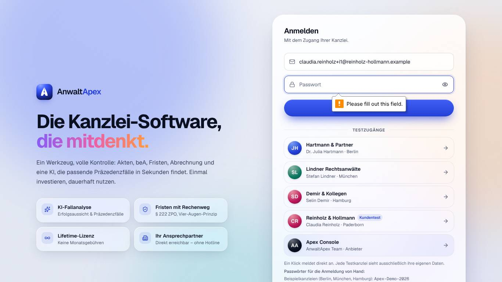 | **I1-T16-01 (K)** – Der Kundentestzugang „Reinholz & Hollmann · Kundentest“ steht als Ein-Klick-Kachel auf der Anmeldeseite (L). |
| 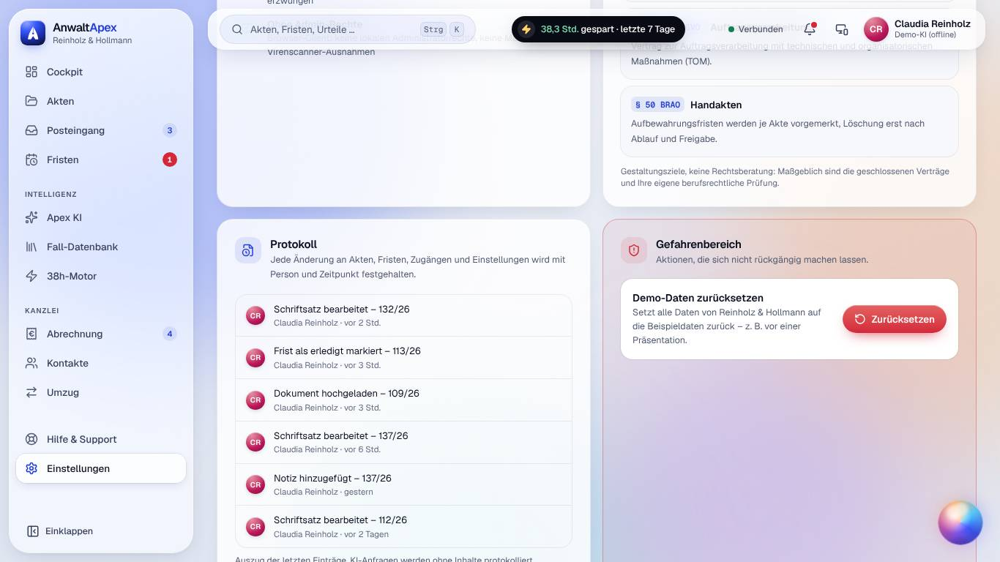 | **I1-T16-02 (H)** – Ein 10 Minuten alter Zugang: Protokolleinträge auf „Claudia Reinholz“, die nie stattfanden. |
| 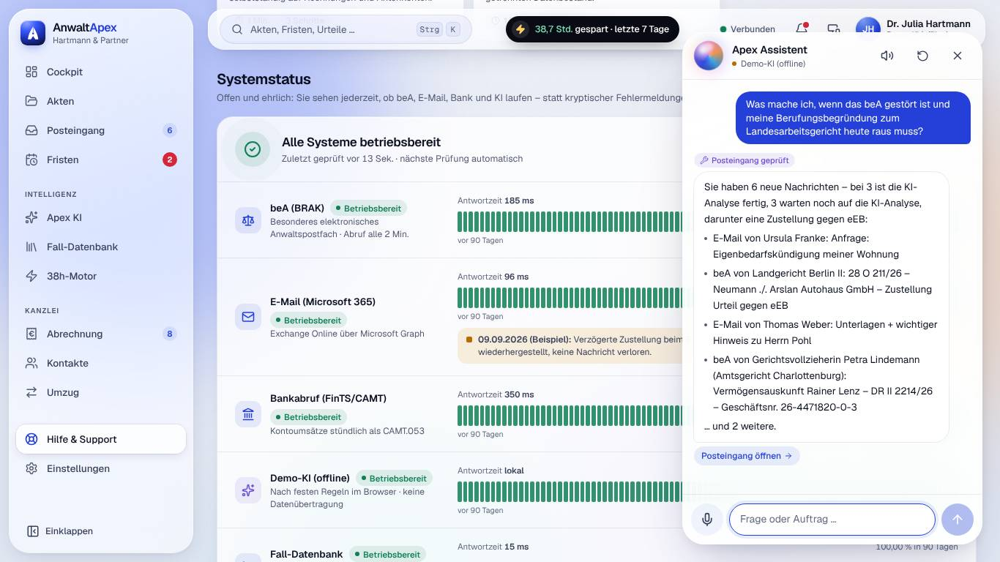 | **I1-T12-01 (H)** – Die Frage nach der beA-Störung beantwortet der Assistent mit „Posteingang geprüft – 6 neue Nachrichten“. |
| 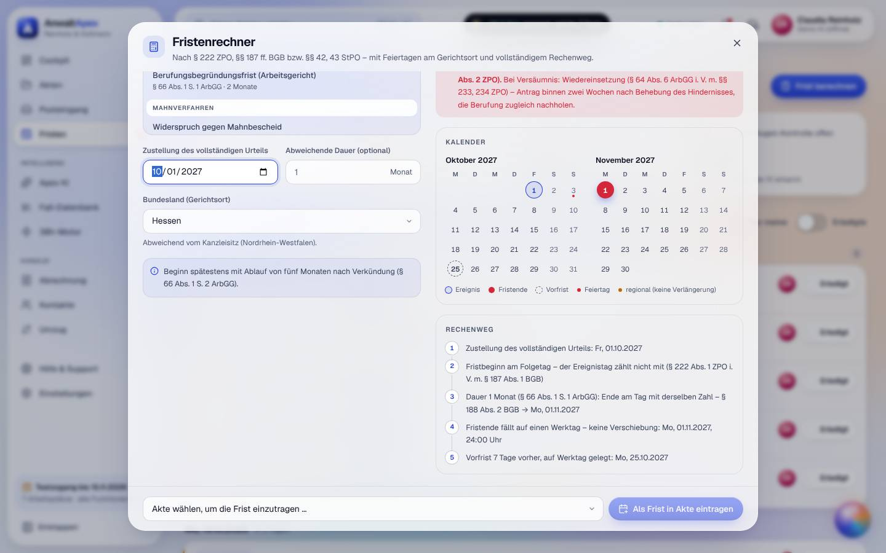 | **Positiv, T18 Fall 3b** – Mo 01.11.2027 mit Bundesland Hessen und Hinweis „Abweichend vom Kanzleisitz“; Allerheiligen fehlt im Rechenweg (I1-T18-02). |
| 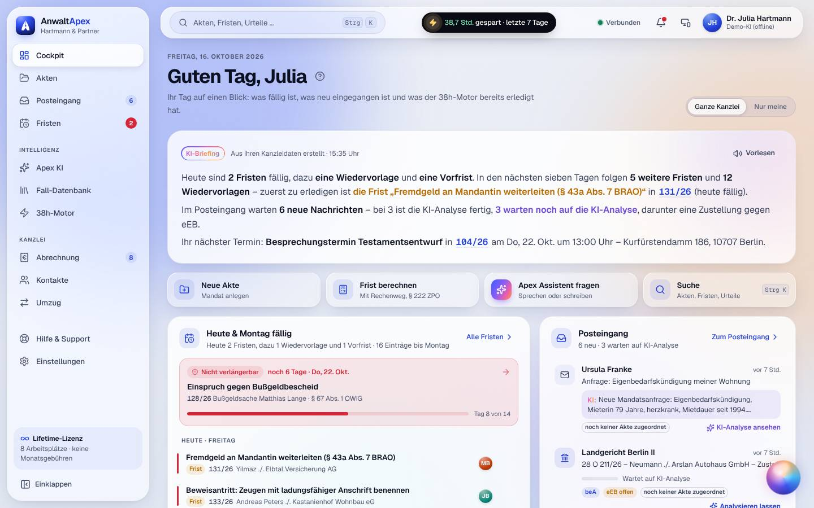 | **I1-T01-01 (H)** – Cockpit mit „38,9 Std. gespart“ in Apex Island, ohne Kennzeichnung als Beispielwert (D hell). |
| 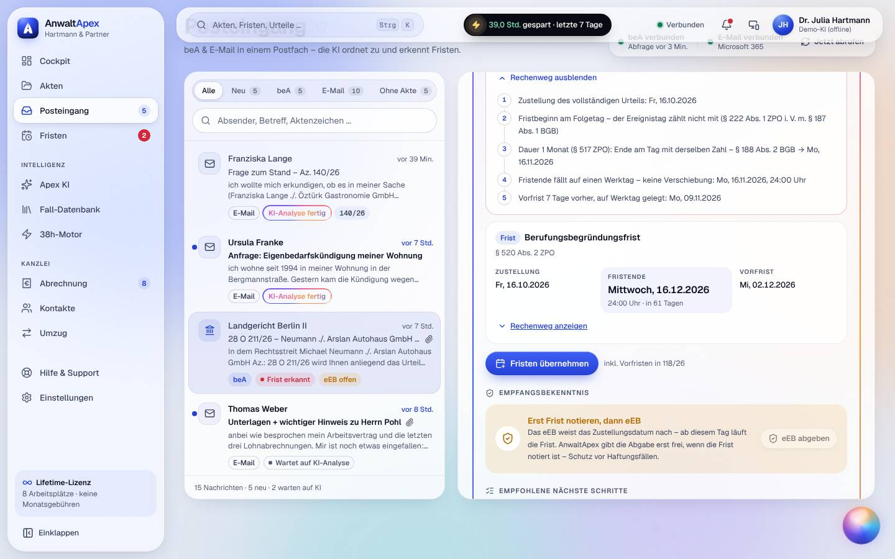 | **Positiv, T02** – Urteil 28 O 211/26: Akte 118/26 erkannt, Berufung Mo 16.11.2026 und Begründung Mi 16.12.2026 mit Rechenweg. |
| 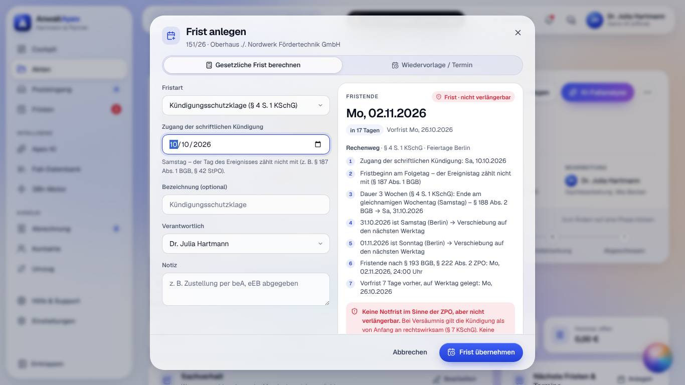 | **Positiv, T04** – Klagefrist Mo 02.11.2026 mit Rechenweg (§ 4 S. 1 KSchG, §§ 187, 188, 193 BGB). |
| 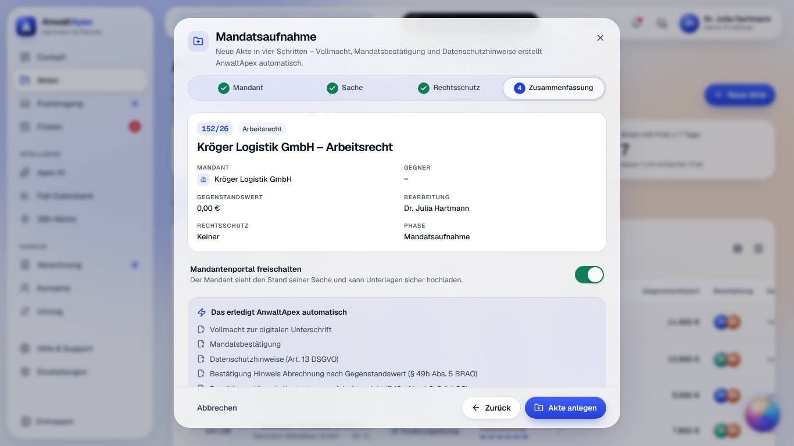 | **I1-T04-01 (H)** – Kollisionswarnung „Gegner in 142/26“; „Weiter“ und „Akte anlegen“ gehen ohne Entscheidung und Vermerk. |
| 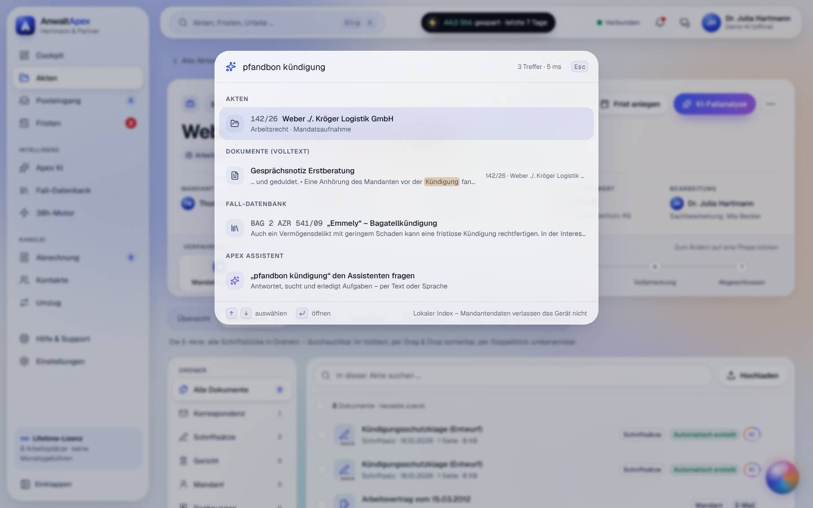 | **Positiv, T06** – Strg+K findet Akte, Notiz und BAG 2 AZR 541/09 („Emmely“) in 5 ms. |
| 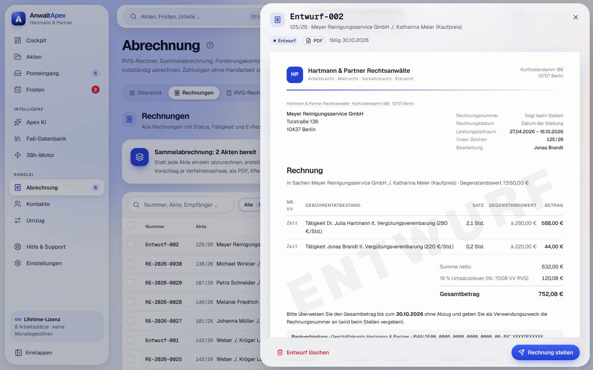 | **I1-T07-01 (K)** – Zeitrechnung zu 280 €/Std. „lt. Vergütungsvereinbarung“, vereinbart sind 240 €. |
| 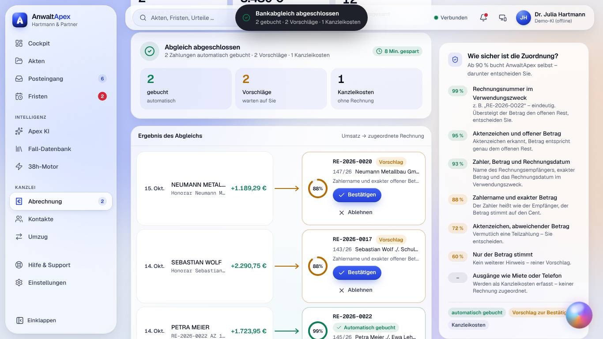 | **I1-T08-01 (H), I1-T08-05 (M)** – Ergebnis des Bankabgleichs ohne „Zuordnung lösen“, Begründungen abgeschnitten. |
| 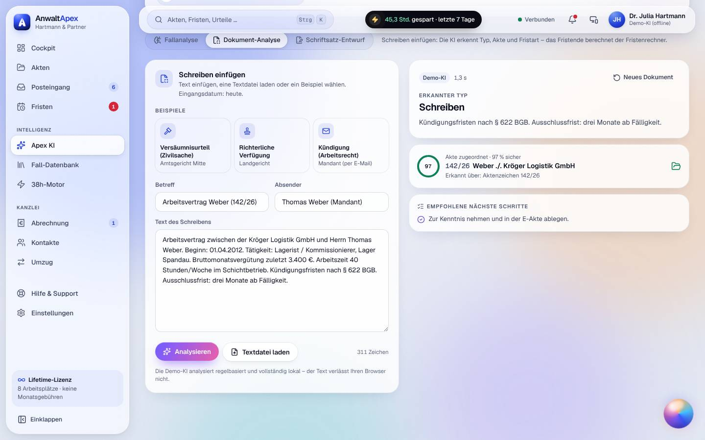 | **I1-T19-01 (K)** – Arbeitsvertrag Weber: Die Ausschlussfrist wird nur zitiert, die Empfehlung lautet „Zur Kenntnis nehmen“. |
| 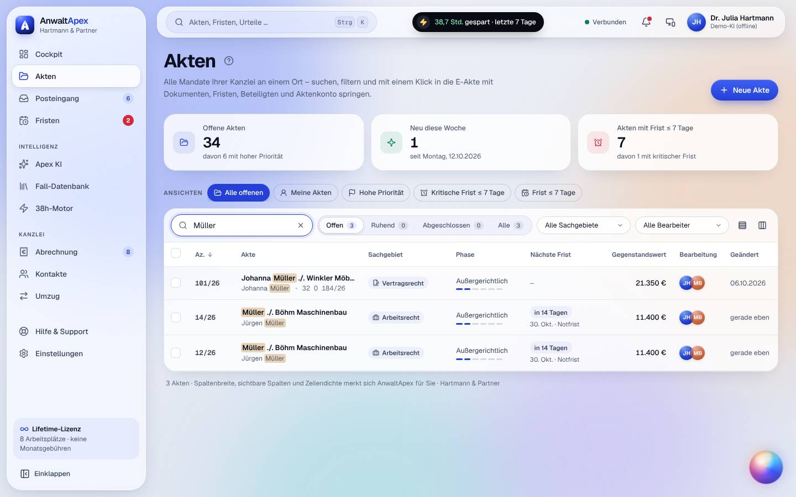 | **I1-T11-01 (H)** – 12/26 und 14/26 sind beide importiert, die Notfrist 30.10.2026 steht doppelt in der Vier-Augen-Kontrolle. |
| 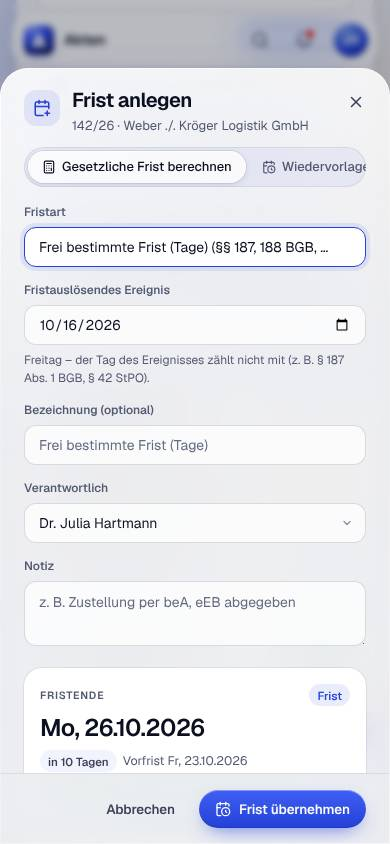 | **I1-T14-01 (H)** – „Frei bestimmte Frist“ ohne Dauerfeld, still mit 10 Tagen gerechnet (M). |
| 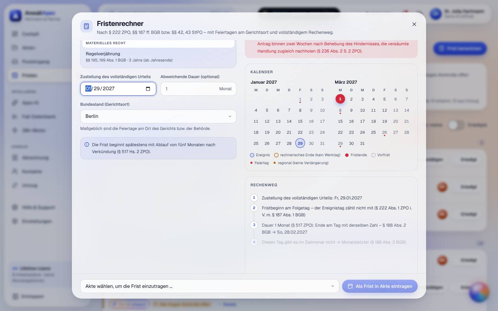 | **Positiv, T18 Fall 1** – Berufung Mo 01.03.2027 (§ 188 Abs. 3 BGB, § 222 Abs. 2 ZPO), Begründung Di 30.03.2027 (29.03. ist Ostermontag); zum Wortlaut von Schritt 3 und 4 siehe I1-T18-05. |
| 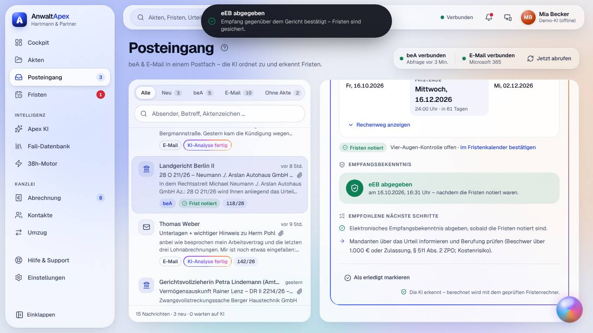 | **I1-T22-01 (K)** – Als Mia Becker (ReFa): „eEB abgegeben – Fristen sind gesichert“. |

---

## 7. Verworfen oder angepasst

| ID | Teil | Entscheidung | Grund |
|---|---|---|---|
| I1-T07-07 | ganz | verworfen | Ursache ist die Testumgebung: Native Datumsfelder folgen der Systemsprache, mit deutscher Systemsprache zeigt Chromium TT.MM.JJJJ (nachgestellt). |
| I1-T04-06 | Datumsformat | verworfen | wie I1-T07-07; der Normhinweis wird umgesetzt |
| I1-T01-02 | Sprungmarke `#status` | verworfen | nicht reproduzierbar: Cockpit → „Verbunden“ springt zum Systemstatus |
| I1-T00-02 | Impressum mit echten Menschen | zurückgestellt | Das Impressum braucht echte Anbieterdaten; fiktive Angaben wären irreführend. Anfrageformular und Kontaktblock werden umgesetzt. |
| I1-T00-04 | Werbezahl 36.000 € ersetzen | angepasst | Der Zielwert steht im Briefing (Masterprompt). Er bleibt und wird als bewusst niedriger Ansatz hergeleitet; die Rechner rechnen mit Personalkosten. |
| I1-T00-05 | Produktnamen eindeutschen | angepasst | Lifetime-Lizenz, Apex …, 38h-Motor sind Produktnamen laut Briefing; sie bleiben und werden deutsch erklärt. |
| I1-T04-04 | echte drebis-Anbindung | außerhalb des Prototyps | Es kommt der ehrliche Hinweis „drebis: nicht angebunden“; Schadennummer und Vorschuss werden umgesetzt. |
| I1-T06-05 | Fundstellen (z. B. NZA) | fachlich verworfen | Ungeprüft ergänzte Fundstellen bergen die Gefahr erfundener Zitate. Fundstellen kommen nur nach Prüfung am Original; das Stand-Datum wird umgesetzt. |
| I1-T07-02 | Rechnung an den Versicherer | fachlich angepasst | Leistungsempfänger und Vergütungsschuldner ist der Mandant. Er erhält die Rechnung mit Aufteilung, die RSV ein Abrechnungsschreiben. |
| I1-T13-02 | „Widerspruch zur EU-Zusage“ | Missverständnis | Im Produkt gibt es keine EU-Zusage. Der Verarbeitungsort wird wahrheitsgemäß genannt, ohne EU-Verarbeitung zu behaupten. |
| I1-T14-04 | Kalender-Abo | außerhalb des Prototyps | Das Abo braucht einen öffentlich erreichbaren Server mit Zugangsschlüssel; der `.ics`-Export wird umgesetzt. |
| I1-T22-01 | harte Sperre bei offener Vier-Augen-Kontrolle | angepasst | Es kommt eine Warnung mit Pflichtbestätigung und Protokoll statt einer Sperre, damit das eEB am Fristtag nicht blockiert ist. Die Rollensperre wird vollständig umgesetzt. |

---

## 8. Umsetzungsplan

Zwei Fixer arbeiten parallel, ihre Dateibereiche überschneiden sich nicht.

| Paket | Name | Dateibereich |
|---|---|---|
| **A** | Rahmen, Design, Einstieg, Logik & Daten | `src/components`, `src/styles`, `src/app`, `src/lib`, `src/store`, `src/core`, `src/ai`, `src/content`, `server`, Cockpit, Landing und Login, Hilfe, Einstellungen, Console |
| **B** | Fachseiten | Akten, Kontakte, Posteingang, Fristen, Abrechnung, KI-Seiten, Fall-Datenbank, Motor, Umzug |

**Dateien, die Paket B aus dem Bereich A übernimmt** (Paket A ändert sie in dieser Runde nicht):

- `src/core/fristen.ts`
- `src/core/feiertage.ts`
- `src/ai/dokumentAnalyse.ts`
- `src/ai/analyse.test.ts`
- neue Testdateien `src/core/fristen.i1.test.ts` und `src/ai/dokumentAnalyse.i1.test.ts`

Die gemeinsamen Datentypen (`src/core/types.ts`) erweitert **nur Paket A**, und zwar zuerst (Auftrag A-00). Paket B nutzt die dort festgelegten Feldnamen.

**Reihenfolge innerhalb der Pakete:** zuerst die Schnittstellen (A-00), dann die K-Befunde, dann H, M, N.

**Paket A (23 Aufträge)**

| Nr. | Befunde | Inhalt |
|---|---|---|
| A-00 | – | Typ-Vertrag: neue optionale Felder, `vertreteneIds`, Testskript |
| A-01 | I1-T16-01 (K) | Keine Ein-Klick-Kacheln für Kundentests |
| A-02 | I1-T16-02, I1-T21-01 | Ehrliches Protokoll, Anbieter-Eingriffe offenlegen |
| A-03 | I1-T21-02/-03/-04/-05/-06 | Console: Einladung, Ortserkennung, Anrede, Kennzahlen |
| A-04 | I1-T16-04 | Zwei-Faktor-Anmeldung (TOTP), Sperre bei Inaktivität |
| A-05 | I1-T16-05 | „Passwort vergessen?“, Meldungen mit nächstem Schritt |
| A-06 | I1-T01-01 (+ T16-03), I1-T22-05 | Demowerte und simulierte Anbindungen kennzeichnen (Rahmen) |
| A-07 | I1-T01-02/-03/-04 | beA-Status, ruhige Apex Island, Termine heute |
| A-08 | I1-T16-07 (+ T06-06, T15-04), I1-T01-07, I1-T13-04 | Deckende Kopfleiste, Kontrast, Schriftgröße |
| A-09 | I1-T01-05, I1-T20-04 | Kugel verdeckt nichts, ausblendbar, Mikrofonmeldung |
| A-10 | I1-T07-06 (+ T22-04), I1-T03-03 (+ Dauer für T05-01) | Keine Zählanimation, Meldungen |
| A-11 | I1-T16-06 (+ T01-06, T20-05), I1-T13-06 | Förmliche Anrede, Rollenbezeichnung |
| A-12 | I1-T13-01, I1-T22-02 | Rolle Auszubildende, Rechte, eEB-Zeile |
| A-13 | I1-T18-08, I1-T23-03 | Abwesenheit und Vertretung, Deaktivieren |
| A-14 | I1-T13-02, I1-T13-05 | KI-Verarbeitungsort, Verträge, Unterauftragnehmer, Löschkonzept |
| A-15 | I1-T13-03, I1-T00-01 | Einheitliches Wartungs- und Lizenzmodell |
| A-16 | I1-T00-02/-03/-05/-06/-07 | Landing |
| A-17 | I1-T10-01, I1-T10-03, I1-T00-04 | 38h-Motor: Freigabe, Zählweise, Kostensatz |
| A-18 | I1-T12-01/-02/-03 (+ Texte zu T11-06) | beA-Störung, Rückruf, Werbesätze |
| A-19 | I1-T20-01/-02/-03 | Assistent: Rückfrage, Bestätigung, Rückgängig |
| A-20 | I1-T06-01/-02/-03/-04/-07/-08 | Fallanalyse |
| A-21 | I1-T22-03, I1-T09-02 | Tastaturkürzel |
| A-22 | I1-T18-03, I1-T16-08, I1-T14-07 | Kanzlei-Text, Demodaten |

**Paket B (22 Aufträge)**

| Nr. | Befunde | Inhalt |
|---|---|---|
| B-01 | I1-T22-01 (K), I1-T03-01, I1-T03-02 | eEB-Rolle, eEB-Protokoll, Zustellungsdatum |
| B-02 | I1-T02-01/-02/-03 (+ T15-03), I1-T22-06/-07, I1-T22-05 | Posteingang |
| B-03 | I1-T19-01 (K), I1-T19-02/-03/-04 | Ausschlussfrist, Analyse aus der E-Akte, Verwerfen |
| B-04 | I1-T18-07, I1-T14-02, I1-T18-02/-04/-05, I1-T02-02 | Fristen-Rechenkern |
| B-05 | I1-T18-01, I1-T18-06 | Fristenrechner: Gerichtsauswahl |
| B-06 | I1-T15-01/-02, I1-T14-04, I1-T20-02/-03, I1-T18-08, I1-T22-03 | Ausgangskontrolle, Druck, `.ics`, Vertretung |
| B-07 | I1-T14-01, I1-T04-06, I1-T14-08 | Frist anlegen |
| B-08 | I1-T04-01/-02/-03/-05/-07/-08, I1-T23-02 | Mandatsaufnahme |
| B-09 | I1-T04-04 | RSV in der Akte |
| B-10 | I1-T14-03, I1-T23-01/-04/-05, I1-T16-09 | Aktenliste |
| B-11 | I1-T05-06 (+ T14-06), I1-T05-05, I1-T14-05/-07, I1-T23-02 | Akte-Detail |
| B-12 | I1-T05-01/-02/-03/-04 | E-Akte |
| B-13 | I1-T17-01/-02/-03 | Kontakte |
| B-14 | I1-T07-01 (K), I1-T07-09 | Zeithonorar |
| B-15 | I1-T07-02/-03/-04/-05, I1-T11-04 | RSV-Abrechnung, E-Rechnung, Storno, Sammelabrechnung |
| B-16 | I1-T08-01 … I1-T08-06 | Bankabgleich und Fremdgeld |
| B-17 | I1-T09-01/-02 | Titelzins, Zinsrechner |
| B-18 | I1-T07-08, I1-T07-10 | Abrechnung, Rest |
| B-19 | I1-T10-01/-02/-03/-04/-05/-06/-07, I1-T00-04 | 38h-Motor-Seite |
| B-20 | I1-T06-02, I1-T06-01, I1-T06-05 | KI-Status, Fallanalyse-Liste, Fall-Datenbank |
| B-21 | I1-T11-01/-02/-03/-05/-06 | Umzug |
| B-22 | I1-T01-07 | Lesbarkeit der Fachseiten |

**Abnahme der Umsetzung:**

1. `npm run typecheck && npm test && npm run build` laufen grün.
2. axe-core zeigt in allen Ansichten aus Abschnitt 2 keinen serious- oder critical-Verstoß.
3. Die Prüfwerte werden erneut nachgerechnet: T07 inklusive Zeithonorar 360,00 €, T09 inklusive der Prüfwerte A–C (43,23 € · 26,79 € · 42,72 €), T18 (6 Daten).
4. Iteration 2 beginnt mit dem Nachtest aller 133 Befund-IDs (behoben · teilweise · nicht behoben).

**Was der Auftraggeber vor externer Nutzung bestätigen muss:**

- Wartung: Richtwert 15 % des Lizenzpreises pro Jahr, das erste Jahr enthalten.
- Übertragbarkeit der Lizenz und Quellcode-Hinterlegung: beides als „vorgesehen“ formuliert.
- Ein Impressum mit echten Anbieterdaten.
- Ob eine EU-Verarbeitung der Live-KI (z. B. über einen EU-Cloud-Zugang des KI-Anbieters) vertraglich eingerichtet werden soll.
- Die Unterauftragnehmer für das Hosting.

**Testumgebung ab Iteration 2:**

- Chromium mit deutscher Systemsprache starten (`LANG=de_DE.UTF-8`, `LANGUAGE=de`). Dann zeigen Datumsfelder und Pflichtfeld-Meldungen das, was die Persona im deutschen Chrome sieht.
- I1-T16-01 zusätzlich im Server-Betrieb gegenprüfen.
- Schwerpunkt von Iteration 2 laut Avatar (1.10): Effizienz und Tastatur.

---

## 9. Umsetzung & Nachweis

**Stand:** 16.10.2026, nach der Umsetzung der Pakete A und B und der bereichsübergreifenden Restpunkte
**Betrieb:** Browser-Demo (Demo-KI offline) · Chromium (Playwright, de-DE, Europe/Berlin) · Avatar-Werkzeug mit Profil `pruefung-i1` und frische Browserprofile je Prüfskript · Viewports D 1440×900, L 1366×768, M 390×844, klein 360×740 · hell und dunkel wie angegeben

### 9.1 Ergebnis

| Schwere | Befunde (zusammengeführt) | umgesetzt | davon angepasst | teilweise | offen | verworfen |
|---|---|---|---|---|---|---|
| K | 4 | **4** | 1 | – | – | – |
| H | 42 | **42** | 3 | – | – | – |
| M | 63 | **62** | 5 | 1 | – | – |
| N | 24 | **23** | 2 | – | – | 1 |
| **Summe** | **133** | **131** | 11 | **1** | **0** | **1** |

- **Alle K- und H-Befunde sind umgesetzt.** Jede K- und H-Änderung wurde in dieser Abnahme im Browser nachgestellt; die axe-Befunde wurden mit axe-core nachgemessen. Wo es Fachlogik betrifft, belegen zusätzlich automatische Tests die Änderung (Spalte „Nachweis“).
- **Teilweise:** I1-T14-07. Der Aktenkopf zeigt Gerichts-Az. und nächsten Termin, die Präsentationsakte 142/26 hat aber beides nicht (siehe 9.4).
- **Verworfen:** I1-T07-07 (Testumgebung, siehe Abschnitt 7).
- Die Stichproben zu M und N sind in der Tabelle als „Prüfung“ vermerkt; alle anderen M- und N-Befunde stützen sich auf die Selbstprüfung der Fixer.

**So ist die Spalte „Nachweis“ zu lesen:**

- **Prüfung** – in dieser Abnahme im Browser nachgestellt (Viewport und Modus stehen dabei).
- **Fixer A / Fixer B** – Selbstprüfung des Fixers laut Rückmeldung; in der Abnahme nicht erneut nachgestellt.
- **Test** – automatischer Test in `npm test`.
- Die Kürzel in Klammern (A-01 … B-22) verweisen auf die Aufträge in Abschnitt 8.

### 9.2 In der Prüfung nachgeholt

Die Fixer haben bereichsübergreifende Wünsche gemeldet, die außerhalb ihres Dateibereichs lagen. Sie sind in der Abnahme umgesetzt:

| Herkunft | Punkt | Umsetzung |
|---|---|---|
| B-08, B-13 | Escape schloss alle gestapelten Dialoge | Gemeinsamer Ebenen-Stapel für `Modal`, `Drawer` und `Menu` (`useEscEbene`): Escape schließt nur die oberste Ebene. Dazu: Inhaltsbereich scrollbarer Dialoge fokussierbar, Fokus springt beim Öffnen in den Dialog, Dialoge sind über `aria-labelledby` benannt, `confirmDialog` nimmt eine eigene Beschriftung für „Abbrechen“ an (`abbrechen`). |
| B-07, B-22 | Segmente bei 360 px, Trefferfläche | `Segmented` mit Option `wrap` und Mindestfläche 24 × 24 px (WCAG 2.5.8). |
| B-10 | Spalte „Gericht“ anfangs ausgeblendet | `DataTable` mit `defaultHidden`; der Behelf in `AktenListe.tsx` ist entfernt. |
| B-16, B-22, A-08 | Kontrast der Chips, Schriftgröße | Eigene Text-Token für rote, gelbe und grüne Chips im Hellmodus (≥ 4,5:1 auf der Tönung), Chips zentral 12 px. |
| B-16 | Wer und Wann einer Zuordnung | `Transaktion.zuordnung.am/von` wird beim Buchen gesetzt; „Gebucht“ liest es dort, ältere Einträge weiter aus dem Protokoll. |
| B-21 | Umzugsprotokoll nur im Browserspeicher | Neue Sammlung `umzugLaeufe` im Datenbestand der Kanzlei (Typ, Server-Schema, Demo-Backend, Store). Protokolle aus dem früheren Browserspeicher werden einmalig übernommen. |
| B-16 | Fremdgeld in der Demo nicht erlebbar | Offener Versicherer-Umsatz auf eine Verkehrsrechts-Akte („Schaden-Nr. … / Ihr Az. …“). Der Vorschlag „RSV zahlt auf 142/26“ wurde nicht übernommen: Zahlt die Rechtsschutzversicherung die Vergütung, ist das Honorar und kein Fremdgeld. |
| B-02 | Tenor ohne vorläufige Vollstreckbarkeit | Demotext 28 O 211 ergänzt; die Zusammenfassung nennt „Vorläufige Vollstreckbarkeit: …“. |
| B-04 | Assistent ohne Gerichtsort | `frist_berechnen` rechnet mit dem Gerichtsort laut Akte und nennt ihn; Kanzleisitz als Vergleich. |
| B-08 … B-16 | Seitenlogik ohne Tests | Neu `src/core/kontaktpruefung.ts` (Dubletten, Rollen, Kollision, Löschsperre) und `src/core/abrechnung.ts` (Summen, RSV-Aufteilung, Vorschuss, IBAN, Fremdgeld-Regel) mit 11 Tests; die Seiten reichen die Funktionen weiter. |
| A-20 | Freigabe der Deckungsanfrage fehlte | Reiter Beteiligte: „Deckungsanfrage: Entwurf – wartet auf Ihre Freigabe“ mit „Entwurf ansehen“ und „Freigeben und versenden“ (nur Berufsträger, Rückfrage, Protokoll). Neue Akten mit Rechtsschutz und 142/26 stehen bis zum Versand auf „Deckung offen“. |
| A-20 | Stufen-Wörter | Die Fallanalyse-Liste nutzt `stufeWort` aus `src/core/einschaetzung.ts` statt einer eigenen Kopie. |
| A-13 | „Nur meine“ per Link | `/fristen?nur=meine` schaltet „Nur meine (+ Vertretung)“ ein; der Vertretungshinweis im Cockpit verlinkt dorthin. |
| A-12 | Rechte-Helfer | Posteingang und Akte nutzen `darfEebAbgeben` bzw. `darfAbrechnung` aus `@/lib/backend`. |
| A-06 | Wortlaut „simuliert“ | `SIMULIERT_STATUS` und der Abruftakt liegen in `src/lib/betriebsstatus.ts`; der Posteingang zeigt denselben 2-Minuten-Takt wie Cockpit und Systemstatus. |
| A-17 | ROI-Rechner | Kennzeichnung „Richtwert/Entwurf der Lizenzbedingungen – verbindlich im Angebot“ aus `src/content/lizenz.ts`. Freigabe- und Vorgangsangaben waren durch B-19 bereits vorhanden. |
| A-19 | Etikett der Assistent-Einträge | Vorhanden (B-06); der Wiki-Text nennt jetzt auch „Durch Assistent angelegt“. |
| A-08 | Schriftgröße auf Fachseiten | Geprüft: 360 px mit 125 % ohne Querscrollen auf 10 Hauptrouten; keine Änderung nötig. |
| A-20 | `docs/DEMO-SKRIPT.md` | Einschätzung statt „78 %“, „Simuliert verbunden“, Apex Island, Bestätigungskarte des Assistenten; dazu weitere veraltete Stellen (Ein-Klick-Kacheln, eEB-Rolle, Fremdgeld, Umzugsprotokoll, Datenschutz-FAQ, Wartung). |

**Funde der Abnahme, gleich behoben:**

- Protokoll: Vorgänge durch AnwaltApex (Zugang angelegt, Startpasswort vergeben) zeigten die betroffene Person als Akteurin. Jetzt steht dort „AnwaltApex (System)“ (I1-T16-02, I1-T21-01).
- Einstellungen → Team: Die Rechte-Matrix lief bei 1440 px über (Spalte „Administration“) und ergab axe serious `scrollable-region-focusable`. Abstände angepasst, Bereich fokussierbar; axe danach 0.
- Akte: Durch den festen Kurzkopf schimmerten beim Scrollen die Reiter darunter durch. Er ist jetzt deckend wie die Kopfleiste (I1-T16-07).
- Rechtsschutz: Rechnung, Vorschuss und Zahlungsaufforderung sprachen auch ohne erteilte Deckung von „Davon übernimmt …“ bzw. „Auf Grundlage Ihrer Deckungszusage“. Jetzt „Vorbehaltlich der Deckungszusage …“ und die Bitte um Zusage (`Rechnung.rsv.zugesagt`, Test) (I1-T07-02).
- Wortlaut: „mit einem Klick“ in Rechnungen, KI-Karte des Posteingangs und Umzug durch zutreffende Formulierungen ersetzt (I1-T12-03); „1 Wiedervorlagen/Termine“ im Umzug korrigiert.
- `SEED_VERSION` 9: Unveränderte Demodaten werden beim nächsten Laden neu erzeugt.

### 9.3 Qualitätstor und Prüfwerte

| Prüfung | Ergebnis |
|---|---|
| `npx tsc --noEmit` | 0 Fehler |
| `npm test` | **105 / 105** grün (vorher 94; neu 5 in `kontaktpruefung.test.ts`, 6 in `abrechnung.test.ts`) |
| `npm run build` | Web und Server fehlerfrei (nur der bekannte Hinweis zur Größe von `index.js`) |
| Server-Probe (`dist-server`) | Anmeldung, `/api/data` mit `umzugLaeufe`, Schreiben 204, ungültiges Dokument 400 |
| Konsolen-Sweep, Login Dr. Hartmann | **36 Routen × hell und dunkel: 0 pageerrors, 0 console.errors** (500 auf `/api/info` ausgenommen) |
| axe-core (WCAG 2.2 A/AA) | **22 Ansichten, 0 serious/critical** nach der Behebung in Einstellungen → Team. Ein Treffer `target-size` in KI → Schriftsatz entstand nur, weil die Seite gescrollt und das Element von der Kopfleiste verdeckt war; ungescrollt 0. |
| Querscrollen | 360 px mit 125 % Schrift: 10 Hauptrouten ohne; Landing 390 px ohne |

| Prüfwert | Soll | Ist |
|---|---|---|
| T07 Zeithonorar | 1,5 Std. × 240 € = 360,00 € netto | **360,00 €** · 68,40 € USt. · 428,40 € brutto (Browser) |
| T09 A / B / C | 43,23 € · 26,79 € · 42,72 € | **43,23 € · 26,79 € · 42,72 €** (`verzugszinsen` in `src/core/zinsen.ts`, auf dem der Zinsrechner aufsetzt) |
| T18 Fall 1 | Mo 01.03.2027 · Di 30.03.2027 | **01.03.2027 · 30.03.2027** |
| T18 Fall 2 | Berlin Di 09.03.2027 · NRW Mo 08.03.2027 | **09.03.2027 · 08.03.2027** |
| T18 Fall 3a | Mo 08.03.2027 (Gerichtsort Brandenburg) | **08.03.2027** |

### 9.4 Offen und Empfehlung für Iteration 2

- **I1-T14-07 (teilweise), Demodaten 142/26:** Ein Gütetermin und ein Gerichts-Az. setzen eine eingereichte Klage voraus. Die Präsentationsgeschichte von 142/26 lebt aber von der noch offenen Klagefrist nach § 4 KSchG und dem KI-Entwurf der Klage (Demo-Skript Schritt 5, Tests von Paket B). Beides zusammen wäre fachlich widersprüchlich. Zu entscheiden sind zwei Wege:
  - T14 auf eine eigene ArbG-Präsentationsakte im Güteverfahren umstellen (Az., Gütetermin, Saal).
  - Oder 142/26 insgesamt auf „Klage eingereicht“ umstellen (Klagefrist erledigt mit Nachweis, Entwurf → Klagebegründung, Demo-Skript anpassen).

  Bis dahin zeigt der Aktenkopf ehrlich „Gerichtl. Az. –“ und „kein Termin“. Akte 137/26 hat beides.
- **Außerhalb des Prototyps (wie beschlossen):** echte drebis-Anbindung (B-09) und ZUGFeRD als PDF/A-3-Container mit eingebettetem XML (B-15). Für den PDF-Container bräuchte es eine Bibliothek, und `npm install` war nicht erlaubt. XRechnung und ZUGFeRD-XML (CII) liegen vor.
- **Beobachtungen ohne Befundstatus, zum Nachtest in Iteration 2:**
  - Rückruf mit „Frist läuft heute ab“ am Freitagabend wird ehrlich für Montag 8:30 Uhr zugesagt. Ein Hinweis auf die Ersatzeinreichung (Wissenskarte beA-Störung) wäre an dieser Stelle hilfreich.
  - Auszubildende sehen den Bereich „Umzug“ in der Navigation. Ob das gewollt ist, sollte die Rechte-Matrix ausweisen.
  - Bei 1366 px liegt die Assistent-Kugel über dem Aktionsknopf der letzten sichtbaren Listenzeile. Sie lässt sich einklappen, und beim Scrollen gibt der Inhalt unten Platz frei.
- **Nachtest:** Iteration 2 beginnt laut Abschnitt 8 mit allen 133 Befund-IDs, in einem frischen Profil mit deutscher Systemsprache. Die Präsentationsdaten erzeugt `SEED_VERSION` 9 dann neu.

### 9.5 Befunde einzeln

| ID | S | Status | Was geändert | Nachweis |
|---|---|---|---|---|
| | | | **5.1 Landing** | |
| I1-T00-01 | H | umgesetzt | Einheitliches Wartungsmodell aus `src/content/lizenz.ts`, Kostenkurve mit zweiter Linie „Lifetime inkl. Wartung“, Knopf „Angebot anfordern“ (A-15) | Prüfung D hell und M dunkel: „Lifetime inkl. Wartung“, „Ausgeglichen inkl. Wartung“, „Angebot anfordern“ |
| I1-T00-02 | H | umgesetzt (angepasst) | „Testzugang anfordern“ in Hero und Schluss, Anfrageformular ohne externe Dienste, Kontaktblock Lena Vogt; das Impressum bleibt gekennzeichneter Platzhalter (A-16) | Prüfung D hell und M dunkel; [Bild](iteration-1/bilder/nachweis/T00-02-testzugang-anfordern-M-dunkel.jpg) |
| I1-T00-03 | M | umgesetzt | Vorschau „Analyse läuft …“ → „Gute Aussichten (Beispiel)“ statt „0 %“ (A-16) | Fixer A |
| I1-T00-04 | M | umgesetzt (angepasst) | Zielwert 19,74 €/Std. offen als bewusst niedriger Ansatz hergeleitet; Rechner mit Personalkosten (26,04 €/Std. → ≈ 47.500 €) (A-17, B-19) | Test `automationen.i1.test.ts`; Fixer A und B |
| I1-T00-05 | N | umgesetzt (angepasst) | Allgemeine Anglizismen ersetzt, Produktnamen deutsch erklärt (A-16) | Prüfung D: keiner der Prüfbegriffe (On-Premise, Private Cloud, Live-Vorschau, Hotline …) auf der Landing |
| I1-T00-06 | H | umgesetzt | Vergleich ohne `aria-label` an Spans (`aria-hidden` + sr-only „Vorteil:/Nachteil:“) (A-16) | Prüfung: axe D hell und M dunkel 0 serious/critical |
| I1-T00-07 | M | umgesetzt | Fußnoten mit Herleitung 13 px in fg-2 (A-16) | Fixer A |
| | | | **5.2 Anmeldung und Zugang** | |
| I1-T16-01 | **K** | umgesetzt | Ein-Klick-Kacheln nur noch für öffentliche Präsentationskanzleien und den Anbieterzugang; Server prüft Demo-Passwort, 2FA und Deaktivierung (A-01) | Prüfung D: Kundentest „Reinholz & Hollmann“ angelegt → keine Kachel; [Bild](iteration-1/bilder/nachweis/T16-01-login-ohne-kundentest-kachel-D.jpg) |
| I1-T16-04 | H | umgesetzt | TOTP nach RFC 6238 mit Wiederherstellungscodes, „Zwei-Faktor für alle Pflicht“, Sperre bei Inaktivität 5–30 Min. (A-04) | Test `totp.test.ts` (RFC-Testvektoren); Prüfung L dunkel: Einrichtung mit Base32-Schlüssel und Einrichtungslink |
| I1-T16-05 | M | umgesetzt | „Passwort vergessen?“ mit fester Ansprechpartnerin; jede Meldung nennt den nächsten Schritt (A-05) | Prüfung D: „Die beiden Eingaben stimmen nicht überein. Bitte geben Sie das neue Passwort in beiden Feldern gleich ein.“ |
| | | | **5.3 Apex Console** | |
| I1-T21-01 | H | umgesetzt | Anbieter-Eingriffe stehen im Kanzleiprotokoll; der Dialog nennt das (A-02). In der Prüfung korrigiert: Akteur solcher Einträge ist „AnwaltApex (System)“, nicht die betroffene Person | Prüfung D: „Startpasswort … durch AnwaltApex (Apex Console) neu vergeben · AnwaltApex (System)“; [Bild](iteration-1/bilder/nachweis/T16-02-protokoll-system-und-beispiel-D.jpg) |
| I1-T21-02 | M | umgesetzt | Vollständige Einladung auch nach einem neuen Passwort, „Einladung kopieren“ je Person (A-03) | Fixer A; Prüfung D: Einladung mit Rolle, Testende und Ansprechpartnerin |
| I1-T21-03 | M | umgesetzt | Ortserkennung über `bundeslandAusOrt`, Bundesland Pflichtfeld (A-03) | Prüfung D: „Paderborn“ → Nordrhein-Westfalen |
| I1-T21-04 | M | umgesetzt | Einladung ohne Passwort; Startpasswort getrennt mit Kopierknopf (A-03) | Prüfung D: Einladungstext ohne Passwort, Hinweis „getrennt übermitteln“ |
| I1-T21-05 | N | umgesetzt | „Sehr geehrte Frau Reinholz“, „Partnerin (Hauptnutzerin der Kanzlei)“ (A-03, A-11) | Prüfung D |
| I1-T21-06 | N | umgesetzt | Kennzahlen ohne Zählanimation; „Letzte Aktivität“ nur aus echten Vorgängen (A-02, A-03) | Fixer A; Prüfung D: „Letzte Aktivität gerade eben“ nach dem Anlegen |
| | | | **5.4 Rahmen: Kopfleiste, Apex Island, Cockpit, Meldungen** | |
| I1-T01-01 | H | umgesetzt | Apex Island mit Plakette „Beispiel“, Motorkarte „Beispielwerte (Demo)“ mit Herleitung „× 48 Wochen × 19,74 €/Std. – So rechnen wir“ (A-06) | Prüfung D; [Bild](iteration-1/bilder/nachweis/T01-01-cockpit-beispielwerte-D.jpg) |
| I1-T16-03 | H | wie I1-T01-01 | – | Prüfung D: frischer Kundentest zeigt die Plakette „Beispiel“ |
| I1-T01-02 | M | umgesetzt (angepasst) | Statuszeile „beA ✓ · E-Mail ✓ · letzte Abfrage … (simuliert)“ (A-07). In der Prüfung ergänzt: Der Posteingang nutzt denselben 2-Minuten-Takt wie Cockpit und Systemstatus | Prüfung D: Cockpit „letzte Abfrage gerade eben (simuliert)“, Posteingang „Abfrage gerade eben“ |
| I1-T01-03 | M | umgesetzt | Apex Island ruhig, Tooltip, höchstens 1 Meldung je 90 s, abschaltbar (A-07) | Fixer A |
| I1-T01-04 | M | umgesetzt | Block „Termine heute“ in „Heute & … fällig“ (A-07) | Prüfung D: „Termine heute · Heute keine Termine.“ |
| I1-T01-05 | M | umgesetzt | Kugel einklappbar und ausblendbar, Abstand unten und `scroll-padding` (A-09) | Fixer A |
| I1-T01-07 | M | umgesetzt | Metatexte ≥ 12,5 px, fg-3/fg-4 dunkler (A-08, B-22). In der Prüfung ergänzt: Chips zentral 12 px, eigene Text-Token für rote, gelbe und grüne Chips (≥ 4,5:1) | Prüfung: axe ohne `color-contrast`-Befund in 22 Ansichten, hell und dunkel |
| I1-T16-07 | M | umgesetzt | Kopfleiste beim Scrollen deckend (A-08). In der Prüfung ergänzt: Kurzkopf der Akte ebenfalls deckend | Prüfung L hell und dunkel: kein Text schimmert durch Kopfleiste oder Kurzkopf |
| I1-T06-06 | M | wie I1-T16-07 | – | – |
| I1-T15-04 | N | wie I1-T16-07 | – | – |
| I1-T16-06 | N | umgesetzt | Förmliche Anrede in Cockpit, Assistent und Benutzermenü (A-11) | Prüfung D: „Guten Abend, Frau Dr. Hartmann“, „Guten Abend, Frau Reinholz“ |
| I1-T01-06 | N | wie I1-T16-06 | – | – |
| I1-T20-05 | N | wie I1-T16-06 | – | – |
| I1-T03-03 | N | umgesetzt | Meldungen unten rechts, pausieren bei Hover/Fokus, Schließen-Knopf, 9 s mit Aktion (A-10) | Prüfung D |
| I1-T07-06 | M | umgesetzt | Keine Zählanimation; Endwert sofort (A-10) | Fixer A |
| I1-T22-04 | M | wie I1-T07-06 | – | – |
| I1-T22-03 | M | umgesetzt | Kürzel W, F, ?; Strg+K-Aktionen mit Kürzel; Anzeige an den Knöpfen (A-21, B-06) | Prüfung L: „Wiedervorlage W“, „Frist berechnen F“ in Fristen |
| | | | **5.5 Akten** | |
| I1-T04-01 | H | umgesetzt | Verbindliche Entscheidung „Mandat trotzdem übernehmen“ (Begründung Pflicht) oder „Mandat ablehnen“; Vermerk in Akte und Verlauf (B-08) | Prüfung L: „Akte anlegen“ ohne Entscheidung → Hinweis; [Bild](iteration-1/bilder/nachweis/T04-01-kollision-entscheidung-L.jpg) |
| I1-T04-02 | H | umgesetzt | Rückfrage „Eingaben verwerfen?“, Entwurf bleibt erhalten (B-08). In der Prüfung ergänzt: Escape schließt nur die oberste Ebene (Dialog, Seitenpanel, Menü) | Prüfung L: Escape → „Eingaben verwerfen?“; Kontakt-Drawer + Auskunft: 1. Escape schließt nur die Auskunft |
| I1-T04-03 | M | umgesetzt | Felder Zugang der Kündigung und Bruttomonatsentgelt; Klagefrist vom Fristenkern, Vierteljahresentgelt (B-08) | Fixer B (Klagefrist 02.11.2026, 11.400 €) |
| I1-T04-04 | M | umgesetzt (angepasst) | Schadennummer nachtragen, Vorschuss nach § 9 RVG, Hinweis „drebis: im Prototyp nicht angebunden“ (B-09) | Prüfung D (Reiter Beteiligte); Test `abrechnung.test.ts` (`vorschussVorschlag`) |
| I1-T04-05 | N | umgesetzt | Beschriftung des RSV-Schalters klickbar (B-08) | Fixer B |
| I1-T04-06 | N | umgesetzt (angepasst) | Normhinweis passt zur Regel; Datumsformat stammt aus der Testumgebung (B-07) | Fixer B |
| I1-T04-07 | N | umgesetzt | Zusammenfassung mit Selbstbeteiligung und Schadennummer, Deckungsanfrage als Brief (B-08) | Fixer B |
| I1-T04-08 | M | umgesetzt | Dublettenprüfung „Bestehenden Kontakt verwenden“ (B-08); Logik in der Prüfung nach `src/core/kontaktpruefung.ts` verschoben | Test `kontaktpruefung.test.ts`; Prüfung L: Kröger → Treffer „Gegner in 142/26“ |
| I1-T05-01 | M | umgesetzt | Verschieben, Löschen und Umbenennen mit Verlaufseintrag und „Rückgängig“; Meldungen 9 s (B-12, A-10) | Fixer B |
| I1-T05-02 | M | umgesetzt | Verschieben in höchstens 3 Aktionen (B-12) | Fixer B |
| I1-T05-03 | M | umgesetzt | Diktat in der Akte, im Verlauf protokolliert (B-12) | Fixer B |
| I1-T05-04 | N | umgesetzt | Betreff je Empfängerrolle (B-12) | Fixer B |
| I1-T05-05 | M | umgesetzt | Kompakter Aktenkopf, fester Kurzkopf beim Scrollen (B-11) | Prüfung D und L |
| I1-T05-06 | H | umgesetzt | Verlauf und Verfahrensstand als echte Listen (B-11) | Prüfung: axe Akte Übersicht (D), Verlauf (D), Beteiligte (L dunkel), mobil (M) 0 |
| I1-T14-06 | H | wie I1-T05-06 | – | Prüfung: axe Akte M hell 0 |
| I1-T14-01 | H | umgesetzt | Dauer Pflicht, kein stiller Standardwert (B-07) | Prüfung M: Feld leer, „… AnwaltApex nimmt keinen Standardwert an.“ |
| I1-T14-03 | H | umgesetzt | Suche hält den Wert lokal, URL folgt entprellt (B-10) | Prüfung D: „Weber“ getippt → Feld „Weber“, Adresse `q=Weber` |
| I1-T14-05 | M | umgesetzt | Mobile Aktionsleiste mit 44-px-Flächen (B-11) | Fixer B; Prüfung: axe `target-size` mobil 0 |
| I1-T14-07 | M | **teilweise** | Aktenkopf zeigt „Gerichts-Az.“ und „Nächster Termin“ (B-11). Offen: Die Präsentationsakte 142/26 hat weder Gütetermin noch Gerichts-Az. (A-22 (3), siehe 9.4) | Prüfung D: 142/26 „Gerichtl. Az. –“, „kein Termin“; 137/26 mit Az. und Termin (Fixer A) |
| I1-T14-08 | N | umgesetzt | Segmente brechen um, Kugel in der Tab-Leiste (B-07, A-09); `Segmented` hat jetzt die Option `wrap` | Prüfung 360 px mit 125 %: 10 Routen ohne Querscrollen |
| I1-T16-08 | N | umgesetzt | Kammer- und Abteilungsnummern nach Gerichtsgröße (A-22 (2)) | Fixer A |
| I1-T16-09 | N | umgesetzt | Spalte „Gericht“ (B-10), anfangs ausgeblendet über die neue `DataTable`-Option `defaultHidden` | Prüfung D: Spalte standardmäßig aus, unter „Spalten“ wählbar |
| I1-T23-01 | H | umgesetzt | Sammelaktion „Bearbeiter ändern“ mit Verlaufseintrag je Akte, Fristen übertragen, Wiedervorlage (B-10) | Prüfung D: 149/26 „Bearbeitung von Dr. Julia Hartmann an Jonas Brandt übergeben · durch Dr. Julia Hartmann · 1 offene Frist übertragen“ |
| I1-T23-02 | M | umgesetzt | Mandantenportal ohne E-Mail standardmäßig aus, Rückfrage und Vorschau (B-08, B-11) | Prüfung L: Schalter „Mandantenportal freischalten“ in der Zusammenfassung |
| I1-T23-04 | N | umgesetzt | Titel zweizeilig, Platzhalter „Az., Name, Stichwort“ (B-10) | Fixer B |
| I1-T23-05 | H | umgesetzt | Phasenanzeige `role=img` mit `aria-label` (B-10) | Prüfung: axe Aktenliste D 0 |
| | | | **5.6 Kontakte** | |
| I1-T17-01 | H | umgesetzt | Auskunft Art. 15/20 DSGVO (HTML und JSON), Löschsperre nach § 50 BRAO am Knopf (B-13); Löschsperre in der Prüfung nach `src/core` verschoben | Prüfung D: „Löschen gesperrt … (1 Akte noch offen)“, Auskunft-Dialog; Test `kontaktpruefung.test.ts` |
| I1-T17-02 | H | umgesetzt | Kollisionsprüfung „als Mandant/als Gegner“ getrennt von „Derzeitige Rollen“ (B-13) | Prüfung D (Kröger Logistik GmbH) |
| I1-T17-03 | M | umgesetzt | Felder für Versicherungen, Dublettenhinweis mit „Bestehenden Kontakt öffnen“ (B-13) | Fixer B |
| | | | **5.7 Posteingang und eEB** | |
| I1-T22-01 | **K** | umgesetzt (angepasst) | eEB geben nur Partner und Anwälte ab; alle anderen „Zur eEB-Abgabe vorlegen“ mit Wiedervorlage für heute; bei offener Vier-Augen-Kontrolle Warnung mit Pflichtbestätigung (B-01, A-12) | Prüfung D: Mia Becker sieht nur „Zur eEB-Abgabe vorlegen“; Dr. Hartmann erhält „eEB abgeben – 28 O 211/26 (vorgelegt von Mia Becker)“; [Bild](iteration-1/bilder/nachweis/T22-01-refa-zur-eeb-abgabe-vorlegen-D.jpg) |
| I1-T03-01 | H | umgesetzt | Protokoll mit Wer, Wann, Zustellungsdatum und erstem Lesezeitpunkt (B-01) | Prüfung D: 4 von 4 Angaben; [Bild](iteration-1/bilder/nachweis/T03-01-eeb-protokoll-vier-angaben-D.jpg) |
| I1-T03-02 | M | umgesetzt | Zustellungsdatum änderbar, Fristen werden neu berechnet (B-01) | Prüfung D: Feld „Zustellungsdatum (Tag der Kenntnisnahme)“ |
| I1-T02-01 | M | umgesetzt | Tenor vollständig (B-02). In der Prüfung ergänzt: Demotext 28 O 211 mit Satz zur vorläufigen Vollstreckbarkeit, Zusammenfassung „Vorläufige Vollstreckbarkeit: …“ | Test `dokumentAnalyse.i1.test.ts` |
| I1-T02-02 | M | umgesetzt | Rechtsmittelgericht aus dem Instanzenzug, Gerichtsort im Rechenweg (B-02, B-04) | Test `dokumentAnalyse.i1.test.ts` |
| I1-T02-03 | H | umgesetzt | Nachrichtenliste als `ul`/`li` (B-02) | Prüfung: axe Posteingang D hell (Mia) und L dunkel 0 |
| I1-T15-03 | H | wie I1-T02-03 | – | – |
| I1-T22-06 | N | umgesetzt | KI-Karte lesbar, Umbruch statt Abschneiden (B-02) | Prüfung D (siehe Bild zu I1-T22-01) |
| I1-T22-07 | N | umgesetzt | KI-Karte oben und einheitlich (B-02) | Fixer B |
| | | | **5.8 Fristen und Fristenrechner** | |
| I1-T15-01 | H | umgesetzt | Ausgangskontrolle mit Nachweis je Frist; „Erledigt“ nur mit Nachweis oder Grund; Warnung bei offener Kontrolle (B-06) | Prüfung L: Ansicht „Ausgangskontrolle“, Dialog „Wie wurde die Frist gewahrt?“, axe 0; [Bild](iteration-1/bilder/nachweis/T15-01-ausgangskontrolle-L.jpg) |
| I1-T15-02 | M | umgesetzt | Druckansicht als Vorschau-Dialog (B-06) | Prüfung L: Knöpfe „Drucken“ |
| I1-T18-01 | M | umgesetzt | Feld „Gericht (Gerichtsort)“, keine stille Vorbelegung mit dem Kanzleisitz (B-05) | Fixer B |
| I1-T18-02 | N | umgesetzt | Feiertag am Kanzleisitz im Rechenweg (B-04) | Test `fristen.i1.test.ts` |
| I1-T18-04 | M | umgesetzt | Bundesland immer im Rechenweg (B-04). In der Prüfung ergänzt: auch der Assistent rechnet mit dem Gerichtsort laut Akte | Test `fristen.i1.test.ts` |
| I1-T18-05 | N | umgesetzt | Reihenfolge im Rechenweg, Aufbau ohne Animation (B-04, B-05) | Fixer B |
| I1-T18-06 | M | umgesetzt | Altes Ergebnis verschwindet bei geänderten Eingaben (B-05) | Fixer B |
| I1-T18-07 | H | umgesetzt | FamFG-Fristen (§ 63 Abs. 1 und 2, § 117 Abs. 1 S. 3 FamFG) (B-04) | Test `fristen.i1.test.ts`; Prüfung D: drei FamFG-Fristarten im Rechner |
| I1-T14-02 | M | umgesetzt | Widerrufsfrist beim Vergleich (Dauer oder festes Datum), vereinbarte Frist (B-04, B-07) | Prüfung M: beide Varianten in „Frist anlegen“ |
| I1-T14-04 | M | umgesetzt (angepasst) | `.ics` je Eintrag und gesammelt; kein Kalender-Abo (B-06) | Prüfung L: „Meine Fristen als .ics“ |
| | | | **5.9 Apex KI und Fall-Datenbank** | |
| I1-T19-01 | **K** | umgesetzt | Vertragliche Ausschlussfrist erkannt, Fälligkeit wird erfragt, Fristende nur vom Fristenkern (B-03) | Prüfung D: „Ausschlussfrist erkannt: 3 Monate ab Fälligkeit (Arbeitsvertrag)“; Test `dokumentAnalyse.i1.test.ts`; [Bild](iteration-1/bilder/nachweis/T19-01-ausschlussfrist-erkannt-D.jpg) |
| I1-T19-02 | M | umgesetzt | „Mit KI analysieren“ direkt aus der E-Akte (B-03) | Prüfung D: Akte → Dokument → Analyse |
| I1-T19-03 | M | umgesetzt | „Vorschlag verwerfen“ mit Wirkungssatz (B-03) | Prüfung D: „Es wird nichts gespeichert – Akte, Fristen und Dokumente bleiben unverändert.“ |
| I1-T19-04 | H | umgesetzt | Schriftsatz-Vorschau fokussierbar (B-03) | Prüfung: axe KI-Schriftsatz D 0 |
| I1-T06-01 | H | umgesetzt | Verbale Einschätzung, KI-Schätzwert nur in „Wie entsteht die Einschätzung?“, Quelle je Faktor (A-20, B-20). In der Prüfung: Fallanalyse-Liste nutzt `stufeWort` aus `src/core` | Prüfung D; Test `einschaetzung.test.ts`; [Bild](iteration-1/bilder/nachweis/T06-01-einschaetzung-mit-herleitung-D.jpg) |
| I1-T06-02 | H | umgesetzt | Minuten nur bei der ersten Analyse je Akte (A-20) | Prüfung D: zwei Läufe → „KI gespart“ +0,8 Std. statt +1,6 Std., Verlauf „… erneut erstellt – Zeitersparnis zählt nur bei der ersten Analyse“ |
| I1-T06-03 | M | umgesetzt | Ergebnis an der Akte gespeichert und wieder angezeigt (A-20) | Fixer A |
| I1-T06-04 | M | umgesetzt | „Als neue Version speichern?“ → Version 2 (A-20) | Fixer A |
| I1-T06-05 | M | umgesetzt (angepasst) | Stand-Datum der Fall-Datenbank; keine ungeprüften Fundstellen (B-20) | Fixer B |
| I1-T06-07 | M | umgesetzt | Echter Deckungsstatus in der Analyse (A-20). In der Prüfung ergänzt: „Freigeben und versenden“ der Deckungsanfrage im Reiter Beteiligte mit Rückfrage und Protokoll; Deckung bleibt „offen“, bis versandt ist | Prüfung D: Entwurf → Freigabe → „versandt am 16.10.2026, 20:02 Uhr von Dr. Julia Hartmann“, die Fallanalyse übernimmt das; [Bild](iteration-1/bilder/nachweis/T06-07-deckungsanfrage-versandt-D.jpg) |
| I1-T06-08 | H | umgesetzt | Entwurf fokussierbar mit `role=region` (A-20) | Prüfung: axe Fallanalyse mit Entwurf D 0 |
| | | | **5.10 38h-Motor** | |
| I1-T10-01 | H | umgesetzt | Freigabe je Automatik in Definition, Texten und Karten (A-17, B-19) | Test `automationen.i1.test.ts`; Prüfung D: 13 Freigabe-Zeilen, kein „je Lauf“ |
| I1-T10-02 | H | umgesetzt | Demo-Band, Chips „Beispielwerte“, „Zuletzt erledigt (simuliert)“ (B-19) | Prüfung D; axe 0 |
| I1-T10-03 | M | umgesetzt | Ersparnis je bearbeitetem Vorgang (A-17, B-19) | Test `automationen.i1.test.ts` |
| I1-T10-04 | M | umgesetzt | „Bearbeitete Vorgänge“ statt „Umsatzpotenzial“ (B-19) | Prüfung D: „520.000“ kommt nicht vor |
| I1-T10-05 | M | umgesetzt | Eigene Mengen je Automatik, Personalkosten und Jahresstunden (B-19) | Fixer B |
| I1-T10-06 | N | umgesetzt | Kaufmännisch gerundet (B-19) | Fixer B |
| I1-T10-07 | M | umgesetzt | Abo 80 € mit Marktspanne, Wartung zuschaltbar (B-19); in der Prüfung Kennzeichnung „Richtwert/Entwurf der Lizenzbedingungen – verbindlich im Angebot“ ergänzt | Fixer B |
| | | | **5.11 Abrechnung** | |
| I1-T07-01 | **K** | umgesetzt | Abrechnung zum vereinbarten Stundensatz der Akte, Tätigkeitsnachweis (B-14) | Prüfung D: 1,5 Std. × 240 € = 360,00 € netto, 68,40 € USt., 428,40 € brutto; [Bild](iteration-1/bilder/nachweis/T07-01-zeithonorar-240-eur-D.jpg) |
| I1-T07-02 | H | umgesetzt (angepasst) | RSV-Aufteilung auf der Rechnung an den Mandanten, Abrechnungsschreiben an die RSV (B-15). In der Prüfung ergänzt: Solange die Deckung nicht erteilt ist, heißt es „Vorbehaltlich der Deckungszusage übernimmt …“, und das Schreiben bittet um die Zusage, statt sich auf sie zu berufen | Prüfung D: Vorschuss 142/26 „Vorbehaltlich der Deckungszusage übernimmt Nordlicht … 967,53 €; Ihre Selbstbeteiligung: 150,00 €“, Rechnungsentwurf mit Block und Zahlungszeile; 137/26 (Deckung erteilt) „Davon übernimmt …“; Test `abrechnung.test.ts` |
| I1-T07-03 | H | umgesetzt | E-Rechnung bei jeder Rechnung mit Pflichthinweis; XRechnung (UBL 2.1) und ZUGFeRD als CII-XML, ohne PDF/A-3-Container (B-15) | Prüfung L: Pflichthinweis und Formate in der Sammelabrechnung; Fixer B |
| I1-T07-04 | M | umgesetzt | Stornos als eigene Zeilen, „Korrigieren“ mit Bezug (B-15) | Prüfung L: Filter „Storniert“ |
| I1-T07-05 | M | umgesetzt | Sammelabrechnung legt Entwürfe an; „Sofort stellen“ nur mit Rückfrage (B-15) | Prüfung L: „Standard: Entwürfe zur Prüfung“ |
| I1-T07-07 | N | verworfen | Testumgebung (Systemsprache des Browsers), siehe Abschnitt 7 | – |
| I1-T07-08 | M | umgesetzt | Zeiterfassung ohne abgeschnittene Spalte; Kugel verdeckt nichts (B-18, A-09) | Prüfung D (siehe Bild zu I1-T07-01) |
| I1-T07-09 | M | umgesetzt | Tätigkeitsnachweis, Unterzeichner = Bearbeitung der Akte (B-14) | Fixer B |
| I1-T07-10 | N | umgesetzt | RVG-Eingaben bleiben erhalten, Nr. 1003 im gerichtlichen Abschnitt (B-18) | Fixer B |
| I1-T08-01 | H | umgesetzt | Ansicht „Gebucht“ mit Wer und Wann, „Zuordnung lösen“ (B-16). In der Prüfung: Wer und Wann stehen jetzt an der Zuordnung selbst (`zuordnung.am/von`) | Prüfung L: „38h-Motor (automatisch) · 16.10.2026, 20:04 Uhr“ mit „Zuordnung lösen“; axe 0 |
| I1-T08-02 | H | umgesetzt | Weiterleitungsdialog mit Empfänger, IBAN mit Prüfziffer, Betrag und Wirkung (B-16) | Prüfung D (131/26, Aktenkonto): Dialog mit Pflichtfeldern und Wirkung, falsche IBAN → „Prüfziffer oder Länge stimmt nicht“; Test `abrechnung.test.ts` (`ibanGueltig`) |
| I1-T08-03 | M | umgesetzt | Regel „Fremdgeld“ (B-16). In der Prüfung ergänzt: offener Versicherer-Umsatz in den Demodaten, Regel nach `src/core/abrechnung.ts` verschoben | Test `abrechnung.test.ts`; Prüfung L: Umsatz „Ihr Az. 107/26“ als Fremdgeld vorgeschlagen |
| I1-T08-04 | M | umgesetzt | „Beispielumsätze (simuliert)“, Herleitung der Ersparnis (B-16) | Prüfung L |
| I1-T08-05 | M | umgesetzt | Zeilen brechen um (B-16) | Prüfung L |
| I1-T08-06 | N | umgesetzt | Singular und Plural (B-16) | Fixer B |
| I1-T09-01 | H | umgesetzt | Titulierter Zinssatz gesperrt, Abweichen nur mit Warnung (B-17) | Prüfung L: „laut Titel: 5 Prozentpunkte über dem Basiszins“ |
| I1-T09-02 | M | umgesetzt | Reiter „Zinsrechner“, Strg+K (B-17, A-21) | Prüfwerte nachgerechnet (9.3); Sweep ohne Fehler |
| I1-T11-04 | H | umgesetzt | Umzugsakten nicht vorausgewählt, Knopf „geprüft“ (B-15) | Prüfung D: nach dem Umzug „6 von 9 Akten ausgewählt“, drei Akten „Abrechnungsstand unbekannt (Umzug)“ |
| | | | **5.12 Umzug** | |
| I1-T11-01 | H | umgesetzt | Dubletten innerhalb der Datei erkannt und wählbar (B-21) | Prüfung D mit der T11-Datei: „1 Dublette(n) der Datei zusammengeführt“, 4 Akten; [Bild](iteration-1/bilder/nachweis/T11-01-umzug-datei-dublette-archiv-D.jpg) |
| I1-T11-02 | H | umgesetzt | Status übernommen, abgeschlossene Akten archiviert, Umfang wählbar (B-21) | Prüfung D: „1 als abgeschlossen (Archiv)“ |
| I1-T11-03 | M | umgesetzt | Umzugsprotokoll mit „Rückgängig“ (B-21). In der Prüfung: Protokoll liegt jetzt im Datenbestand der Kanzlei (Sammlung `umzugLaeufe`, Demo und Server) statt im Browserspeicher | Prüfung D: Protokoll nach dem Neuladen, „rückgängig am 16.10.2026 von Dr. Julia Hartmann“; Server: Schreiben 204, ungültiges Dokument 400 |
| I1-T11-05 | M | umgesetzt | „Was zieht um?“ vollständig, Zeitplan (B-21) | Prüfung D |
| I1-T11-06 | N | umgesetzt | „Umzug in fünf Schritten – mit Vorschau und Rückgängig“ (B-21, A-18) | Prüfung D |
| | | | **5.13 Hilfe und Support** | |
| I1-T12-02 | M | umgesetzt | Zusage mit Uhrzeit, Thema Pflicht, Priorität, Simulationshinweis (A-18) | Prüfung D: „Rückruf am Mo, 19.10.2026 bis spätestens 8:30 Uhr“, „Im Prototyp simuliert – es ruft niemand an.“ |
| I1-T12-03 | N | umgesetzt | Werbesätze korrigiert (A-18); in der Prüfung drei weitere „mit einem Klick“-Stellen ersetzt | Prüfung: Textsuche im Quellcode |
| | | | **5.14 Einstellungen** | |
| I1-T16-02 | H | umgesetzt | Beispielaktivitäten gekennzeichnet, echte Vorgänge protokolliert (A-02); Akteur bei Anbieter-Vorgängen in der Prüfung korrigiert | Prüfung D (Kundentest); [Bild](iteration-1/bilder/nachweis/T16-02-protokoll-system-und-beispiel-D.jpg) |
| I1-T13-01 | H | umgesetzt | Rolle Auszubildende mit Rechten in Oberfläche, Demo-Backend und Server (A-12) | Prüfung D: Azubi ohne Abrechnung, `/abrechnung` „Kein Zugriff für Ihre Rolle“, Akte ohne Aktenkonto; [Bild](iteration-1/bilder/nachweis/T13-01-azubi-kein-zugriff-abrechnung-D.jpg) |
| I1-T13-02 | H | umgesetzt (angepasst) | Verarbeitungsort wahrheitsgemäß in Einstellungen und Landing (A-14) | Prüfung D: „Live-KI: Anthropic, PBC (USA) …“ |
| I1-T13-03 | H | umgesetzt | Lizenz-Tab mit Wartung, Übertragbarkeit und Escrow (A-15) | Prüfung D |
| I1-T13-04 | M | umgesetzt | Schriftgröße 100/112/125 % (A-08) | Prüfung 360 px mit 125 %: 10 Routen ohne Querscrollen |
| I1-T13-05 | M | umgesetzt | Muster § 43e BRAO und Art. 28 DSGVO, Unterauftragnehmer, Löschkonzept (A-14) | Prüfung D |
| I1-T13-06 | N | umgesetzt | Geschlechtsneutrale Auswertung von Titeln (A-11) | Fixer A |
| I1-T18-03 | M | umgesetzt | Kanzlei-Tab: maßgeblich ist der Gerichtsort (A-22 (1)) | Fixer A |
| I1-T18-08 | H | umgesetzt | Abwesenheit und Vertretung, Kennzeichnung in Cockpit und Fristen, „Nur meine“ samt Vertretung (A-13, B-06). In der Prüfung: Deep-Link `/fristen?nur=meine`, das Cockpit verlinkt ihn | Prüfung D: „Sie vertreten heute Jonas Brandt – 3 Fristen …“, „Vertretung für Herrn Brandt“; Test `vertretung.test.ts`; [Bild](iteration-1/bilder/nachweis/T18-08-cockpit-vertretung-D.jpg) |
| I1-T22-02 | M | umgesetzt | Lizenznummer und Teamliste nur für Partner und Administration (A-12) | Prüfung D: Azubi sieht „Ihr Zugang“ ohne Lizenznummer |
| I1-T23-03 | M | umgesetzt | „Deaktivieren (umkehrbar)“ mit Übertragung offener Akten und Fristen (A-13) | Fixer A |
| | | | **5.15 Apex Assistent** | |
| I1-T12-01 | H | umgesetzt | Wissenskarte „beA-Störung – was tun?“ mit Gerichtsbarkeiten (A-18) | Prüfung D: § 46g S. 3, 4 ArbGG, § 130d S. 2, 3 ZPO, Glaubhaftmachung; Test `assistent.i1.test.ts` |
| I1-T20-01 | H | umgesetzt | Rückfrage mit Auswahlknöpfen bei mehrdeutigen Akten (A-19) | Prüfung D: „Zu „schneider“ passen 4 Akten. Welche soll ich öffnen?“ (in den aktuellen Demodaten gibt es nur eine Akte Müller); Test `assistent.i1.test.ts` |
| I1-T20-02 | H | umgesetzt | Bestätigungskarte, danach „Rückgängig“; Streichen mit Grund in Fristen (A-19, B-06) | Prüfung D: Karte → „Eintragen“ → „Rückgängig“; [Bild](iteration-1/bilder/nachweis/T20-02-assistent-bestaetigungskarte-D.jpg) |
| I1-T20-03 | M | umgesetzt | Etikett „Durch Assistent angelegt“, Auftrag in der Notiz (A-19, B-06) | Test `assistent.i1.test.ts`; Fixer B |
| I1-T20-04 | M | umgesetzt | Kugel ausblendbar, Mikrofon-Wachhund mit Meldung (A-09) | Fixer A |
| I1-T22-05 | H | umgesetzt | „Simuliert verbunden“ und „(simuliert)“ an beA, E-Mail, Bank und Rückruf (A-06, B-02, B-16); einheitliche Konstante `SIMULIERT_STATUS` in `src/lib/betriebsstatus.ts` | Prüfung D und L: Kopfleiste, Posteingang, Bankabgleich, Rückruf |
### 9.6 Bilder zum Nachweis

| Bild | Was es zeigt |
|---|---|
| 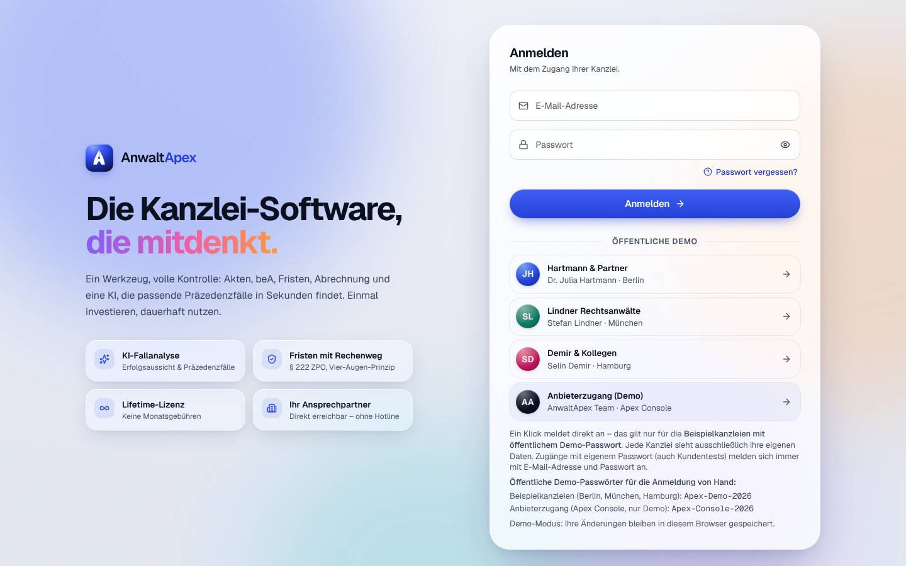 | **I1-T16-01 (K)** – Nach dem Anlegen des Kundentests „Reinholz & Hollmann“: nur Präsentationskanzleien und Anbieterzugang als Kachel (D). |
| 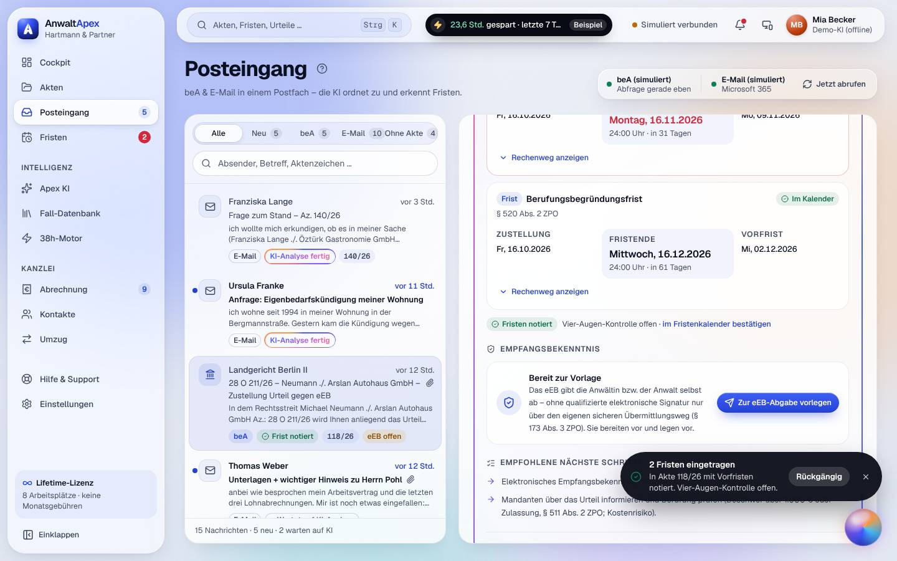 | **I1-T22-01 (K)** – Mia Becker (ReFa): „Zur eEB-Abgabe vorlegen“ statt „eEB abgeben“, Erklärsatz zu § 173 Abs. 3 ZPO (D). |
| 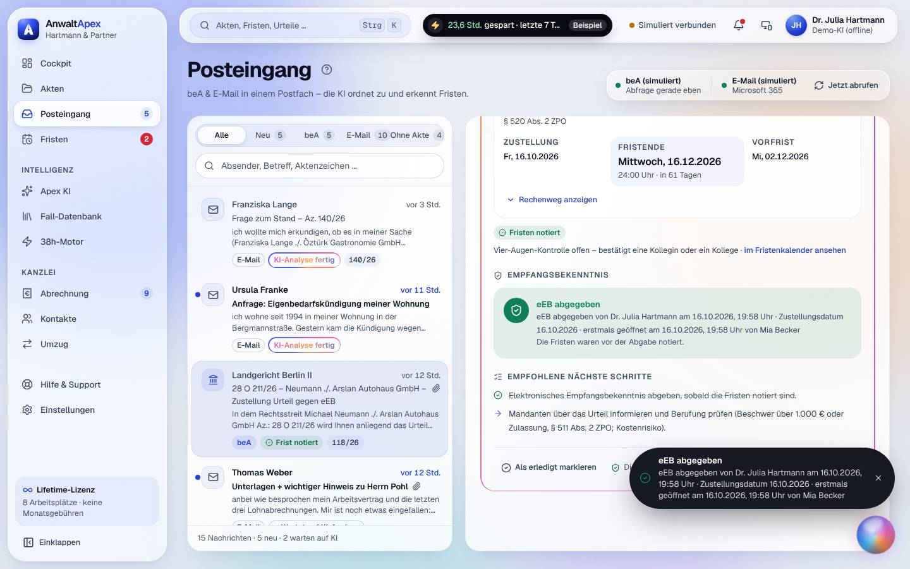 | **I1-T03-01 (H)** – eEB abgegeben von Dr. Hartmann: Wer, Wann, Zustellungsdatum, erster Lesezeitpunkt (D). |
| 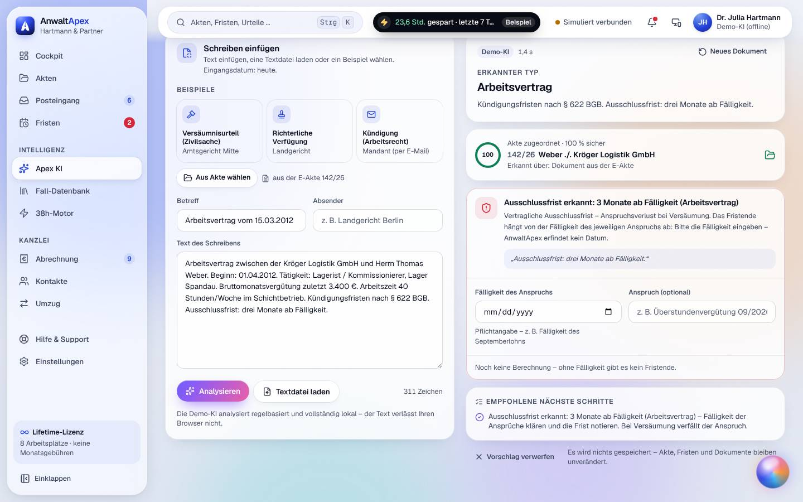 | **I1-T19-01 (K)** – Arbeitsvertrag Weber: „Ausschlussfrist erkannt: 3 Monate ab Fälligkeit“, Fälligkeit als Pflichtangabe (D). |
| 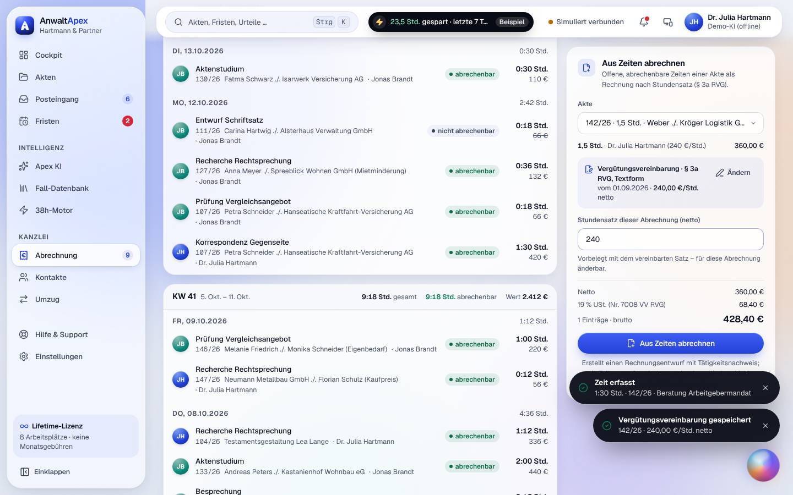 | **I1-T07-01 (K)** – 1,5 Std. zu 240 €/Std. laut Vergütungsvereinbarung: 360,00 € netto, 428,40 € brutto (D). |
| 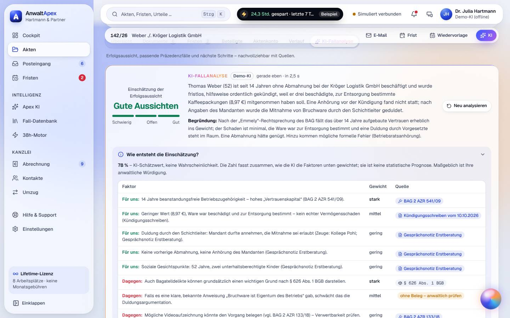 | **I1-T06-01 (H)** – „Gute Aussichten“, der Schätzwert nur in der Herleitung, Quelle je Faktor (D). |
| 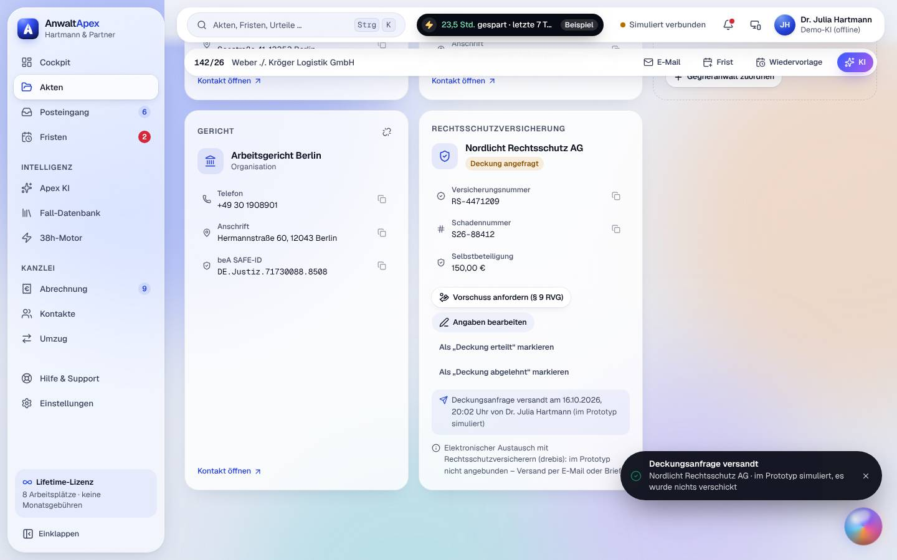 | **I1-T06-07** – Deckungsanfrage nach Freigabe: „versandt am … von Dr. Julia Hartmann (im Prototyp simuliert)“ (D). |
| 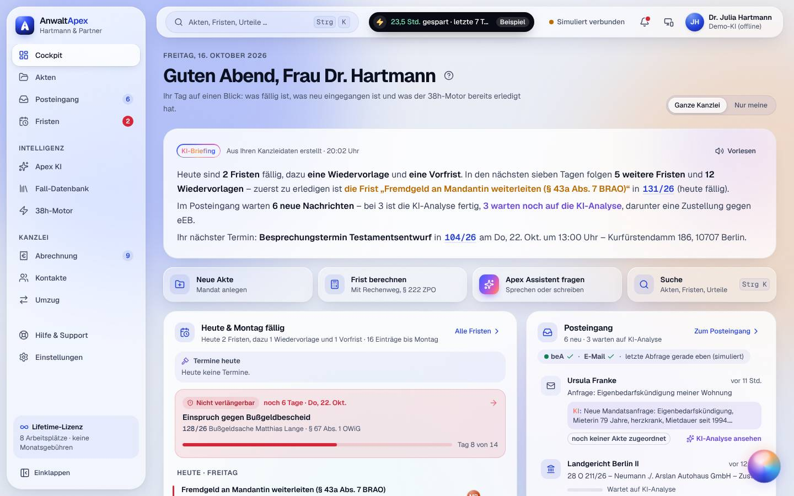 | **I1-T01-01 (H)** – Apex Island mit Plakette „Beispiel“, „Termine heute“, beA-Statuszeile (D). |
| 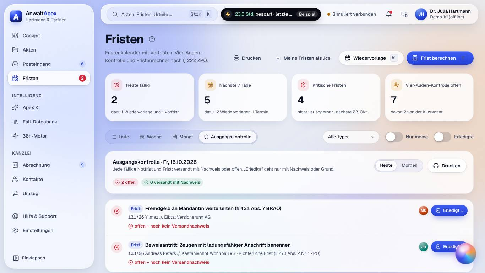 | **I1-T15-01 (H)** – Ausgangskontrolle: je Frist „offen – noch kein Versandnachweis“, „Erledigt …“ nur mit Nachweis (L). |
| 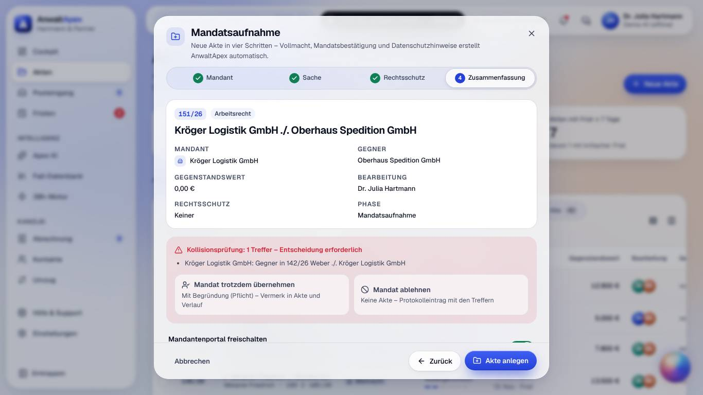 | **I1-T04-01 (H)** – Kollisionstreffer „Gegner in 142/26“ mit Pflichtentscheidung vor dem Anlegen (L). |
| 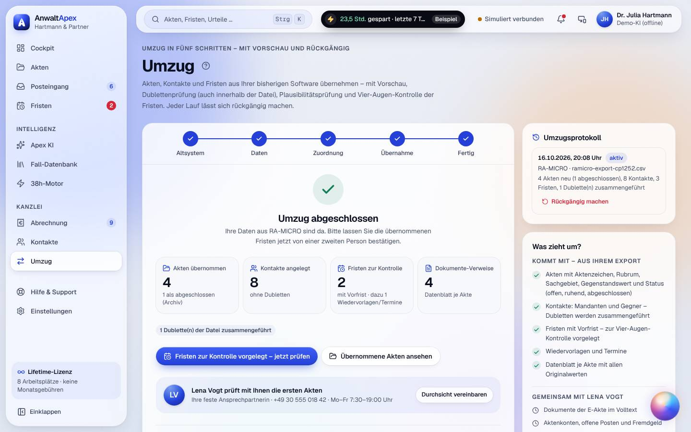 | **I1-T11-01/-02 (H)** – T11-Datei: 4 Akten, 1 als abgeschlossen (Archiv), 1 Datei-Dublette zusammengeführt (D). |
| 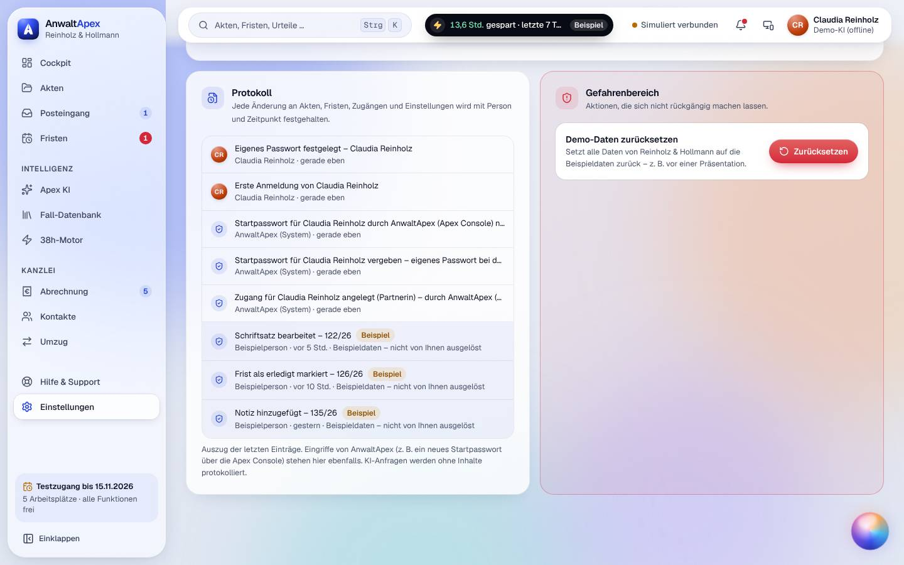 | **I1-T16-02, I1-T21-01 (H)** – Kundentest-Protokoll: echte Vorgänge, Anbieter-Eingriffe als „AnwaltApex (System)“, Beispieleinträge gekennzeichnet (D). |
| 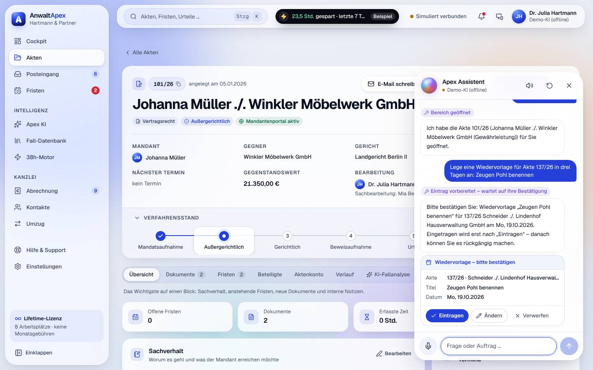 | **I1-T20-02 (H)** – Wiedervorlage über den Assistenten: Bestätigungskarte mit „Eintragen“ und „Verwerfen“ (D). |
| 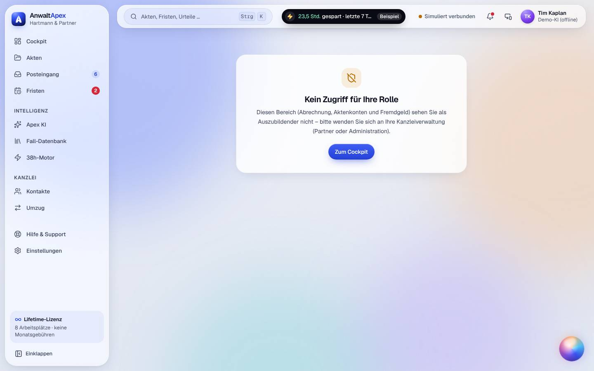 | **I1-T13-01 (H)** – Auszubildender: „Kein Zugriff für Ihre Rolle“ unter `/abrechnung` (D). |
| 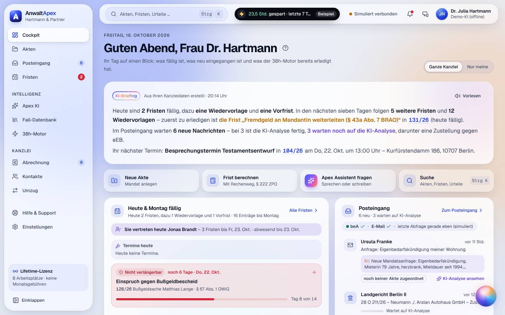 | **I1-T18-08 (H)** – Jonas Brandt abwesend: „Sie vertreten heute Jonas Brandt“, Fristen „Vertretung für Herrn Brandt“ (D). |
|  | **I1-T00-02 (H)** – „Testzugang anfordern“ mit Kontaktblock, mobil dunkel (M). |
