# Iteration 2 – Usability-Bericht AnwaltApex

**Kundenavatar:** Claudia Reinholz (50), Fachanwältin für Arbeitsrecht, geschäftsführende Partnerin einer kleinen Sozietät in Paderborn (fiktiv)
**Schwerpunkt:** Effizienz und Tastatur · **Datum:** 16.10.2026 (Freitag, ca. 20:45–21:50 Uhr) · **Codestand:** nach Umsetzung von Iteration 1 (`SEED_VERSION` 9)
**Betrieb:** Browser-Demo (Demo-KI offline, Daten im Browserspeicher) · Chromium (Playwright, de-DE, Europe/Berlin) · Viewports D 1440×900, L 1366×768, M 390×844 · hell; T01 zusätzlich dunkel, T10 und T13 teilweise dunkel, T15 dunkel
**Testleitung:** Avatar-Werkzeug, vier Blöcke in getrennten frischen Profilen (`i2-A` … `i2-D`): A Erstkontakt, Verwaltung, Hilfe und 38h-Motor · B Alltag Mandatsarbeit · C Kanzlei, Geld und KI · D Umzug, mobil, abends, Assistent und ReFa
**Rohdaten:** [Block A](iteration-2/block-A.md) · [Block B](iteration-2/block-B.md) · [Block C](iteration-2/block-C.md) · [Block D](iteration-2/block-D.md) · Vorrunde: [Iteration 1](iteration-1.md)

> Die Zahlen stammen von einer einzigen simulierten Person. SUS, UEQ-S und Noten sind deshalb **Trendwerte** und keine Statistik.

---

## 1. Kurzfazit

1. **Deutlich besser als die Vorrunde.**
   - 22 von 24 Aufgaben gelangen ohne Umweg (Iteration 1: 6), das Erfolgskriterium ist bei **24 von 24** erfüllt (Iteration 1: 8). Keine Aufgabe wurde abgebrochen (Iteration 1: 6).
   - SUS steigt von 65,6 auf **71,9**, die Empfehlung von 5,5 auf **7,0**. axe-core meldet in 51 Ansichten **0 serious und 0 critical** (Iteration 1: 20 Verstöße).
   - Im Nachtest sind **124 der 141 Befund-IDs behoben**, 15 teilweise, 1 nicht. Alle 4 K-Befunde der Vorrunde sind behoben.
   - Der Avatar sagt: *„Gegenüber der ersten Runde ein anderes Produkt – ehrlich gekennzeichnet, Fristen und Normen stimmen, der Anbieter-Eingriff steht im Protokoll.“*
2. **Der Fachkern ist exakt.** T18 6 von 6 Daten plus FamFG (§ 63, § 117) und Vertretung; T07 16 von 16 Werten plus Zeithonorar 360,00 €; T09 0,00 € Abweichung und die Zinsrechner-Prüfwerte A–C auf den Cent (erstmals prüfbar); T04 Klagefrist und 11.400 € automatisch; T11 0 Zeichenfehler. Die Note „Fachliche Korrektheit“ verbessert sich von 2,75 auf **1,88**.
3. **Zwei neue K-Befunde:**
   - **Posteingang (Verschwiegenheit):** Wer eine Fehlzuordnung zurücknimmt, lässt das Urteil eines Mandanten in der fremden Akte liegen. Dort erscheint es im aktiven Mandantenportal eines anderen Mandanten (§ 43a Abs. 2 BRAO, § 203 StGB). Die Ursache ist im Code bestätigt.
   - **Zeithonorar (Gebühren):** Für dieselben Zeiteinträge zeigt die Zeitliste 220 €/Std., die Abrechnungsvorschau 280 €/Std. Die Ursache ist im Code bestätigt.
4. **Vertrauen bleibt der Engpass** (Note 2,88; Abnahmeziel 1). Die Gründe:
   - Das Mandantenportal zeigt einen nicht freigegebenen KI-Entwurf.
   - „Freigeben und versenden“ nennt kein Dokument und warnt nicht vor 3 offenen Platzhaltern.
   - Die Ausgangskontrolle nennt die Protokollzeit als beA-Versandzeit.
   - Der Fristenrechner rechnet still mit Berliner Feiertagen für das OLG Hamm.
   - Der Rückruf am Freitagabend bei „Frist läuft heute ab“ verweist nicht auf die Ersatzeinreichung.
   - Dialoge halten den Tastaturfokus nicht.
5. **Tastatur (Schwerpunkt dieser Runde):** Strg+K, F, W und ? helfen. Es fehlen eine wortweise Fristart-Suche mit Pfeiltasten, Kürzel im Posteingang, ein abschaltbares Einzeltasten-Kürzel (WCAG 2.1.4), Strg+K für Einstellungen und Zeiterfassung sowie der richtige Fokus im Wiedervorlage-Dialog.
6. **Entscheidung der Testleitung:**
   - 90 Rohbefunde wurden zu **88 Befunden** zusammengeführt: **K 2 · H 8 · M 35 · N 43**. Zwei Befunde sind neu eingestuft (I2-T01-02 N → M, I2-T14-01 M → H).
   - **Alle 88 werden umgesetzt**, 4 davon angepasst. Kein Befund ist ganz verworfen; Teile von 4 Befunden sind verworfen oder an den Auftraggeber verwiesen (Abschnitt 9).
   - Dazu kommen 9 offene Befunde der Vorrunde mit eigenem Auftrag und die zwei Vorgaben der Projektleitung (Abschnitt 9.2).
   - Die Umsetzung läuft in zwei parallelen Paketen mit getrennten Dateibereichen: A mit 21 Aufträgen, B mit 19 (Abschnitt 10).
   - **Ergebnis der Umsetzung:** alle 88 Befunde umgesetzt (4 angepasst), dazu die 9 Vorrunden-IDs; beide K- und alle 8 H-Befunde im Browser nachgestellt; Qualitätstor grün (Abschnitt 11).
7. **Kauf heute:** 4 × „unter Bedingungen“ (Iteration 1: kein Ja, dreimal Nein bzw. Bedingungen). Die Bedingungen sind jetzt überwiegend konkrete Produktpunkte (K und H dieser Runde). Dazu kommen ein schriftliches Angebot mit Preis und eine Lösung für die KI-Verarbeitung; beides entscheidet der Auftraggeber.

---

## 2. Kennzahlen

| Kennzahl | Iteration 2 | Abnahmeziel nach Iteration 5 |
|---|---|---|
| Aufgaben erfolgreich (ohne Umweg) | **22 / 24** · mit Umweg 2 (T07, T18 Fall 3b) · mit Hilfe 0 · abgebrochen 0 | 24 / 24 ohne Hilfe |
| Erfolgskriterium erfüllt | **24 / 24** | 24 / 24 |
| Fachlich korrekt (je Aufgabe) | 22 / 24 – nein bei T07 (Stundensatz) und T15 (Nachweiszeit) | alle Prüfwerte exakt |
| Fehlaktionen | **12** (A 3 · B 4 · C 3 · D 2) | – |
| SEQ-Mittel (1–7) | **5,8** (25 Einzelwerte; T18 lief in A und D) · A 5,7 · B 5,9 · C 6,0 · D 5,8 | – |
| SUS (Trendwert) | **71,9** (A 75,0 · B 70,0 · C 70,0 · D 72,5) | ≥ 80 |
| UEQ-S pragmatisch / hedonisch | **+1,44 / +1,38** (A +1,5/+1,5 · B +1,5/+1,25 · C +1,25/+1,5 · D +1,5/+1,25) | ≥ +1,5 / ≥ +1,5 |
| Schulnoten-Mittel | **2,13** (26 Noten) | alle ≤ 2,0; Vertrauen und Fachlich = 1 |
| Empfehlung (0–10) | **7,0** (7 · 7 · 7 · 7) | – |
| Kauf heute | **4 × „unter Bedingungen“** · 0 × nein | ja, oder Bedingungen nur noch zu Vertrag und Preis |
| axe-core serious / critical | **0 / 0** in 51 Ansichten (A 18 · B 12 · C 10 · D 11; hell und dunkel, D/L/M) | 0 / 0 |
| Befunde roh | 90: K 2 · H 7 · M 36 · N 45 | – |
| **Befunde nach Zusammenführung** | **88: K 2 · H 8 · M 35 · N 43** | 0 offene K und H |
| Entscheidung | 88 umsetzen (davon 4 angepasst) · 0 ganz verworfen | – |
| Nachtest Vorrunde | 141 IDs: **124 behoben** · 15 teilweise · 1 nicht behoben · 1 weiter verworfen | – |

**Fachliche Prüfwerte**

| Aufgabe | Ergebnis |
|---|---|
| T18 | **6/6 exakt:** 01.03.2027 · 30.03.2027 (Ostermontag) · 09.03.2027 (BE, Frauentag) · 08.03.2027 (NW) · 08.03.2027 (3a, OLG Brandenburg) · 01.11.2027 (3b, Hessisches LAG, Allerheiligen beim Namen). FamFG § 63 → 09.03.2027, § 117 → 08.04.2027 |
| T07 | **16/16 exakt** (2.968,46 € / 2.797,69 €); Zeithonorar 1:30 Std. × 240 € = **360,00 €**. Aber: Stundensatz von Jonas Brandt widersprüchlich (220 € gegen 280 €, K) und Einträge nicht einzeln abrechenbar |
| T09 | **0,00 € Abweichung**, Satzwechsel 01.07.2026 berücksichtigt; Zinsrechner **A 43,23 € · B 26,79 € · C 42,72 €** |
| T04 | Klagefrist **Mo 02.11.2026** mit Rechenweg; Gegenstandswert **11.400 €** automatisch (3 × 3.800 €) |
| T11 | **0 Zeichenfehler** (Windows-1252 erkannt) |
| T10 | eigene Zahl 15,5 Std./Woche ≈ 19.000 €/Jahr nachvollziehbar; die angezeigte Formel weicht um ≈ 20 € ab (I2-T10-02) |

**Schulnoten je Dimension** (1 = sehr gut … 6 = ungenügend)

| Dimension | A | B | C | D | Mittel | Iteration 1 |
|---|---|---|---|---|---|---|
| Look & Feel | 2 | 2 | 2 | 2 | **2,0** | 2,0 |
| Lesbarkeit | 2 | 2 | 2 | 2 | **2,0** | 2,75 |
| Verständlichkeit | 2 | 2 | 2 | 2 | **2,0** | 2,0 |
| Vertrauen und Seriosität | 2,5 | 3,5 | 2,5 | 3 | **2,88** | 3,5 |
| Tempo | 2,5 | 2 | 2 | 2 | **2,13** | 2,25 |
| Fachliche Korrektheit | 1,5 | 1,5 | 2,5 | 2 | **1,88** | 2,75 |
| Mobil | 2 | – | – | 2 | **2,0** | 2,67 |

**Aufgaben im Überblick**

| Aufgabe | Block · Viewport | Ergebnis | Erfolgskriterium | SEQ | Fehlakt. |
|---|---|---|---|---|---|
| T00 Landing | A · D, M | erledigt | **erfüllt:** 5 von 5 Zielen in je ≤ 2 Aktionen; Preis ohne Eurobetrag | 6 | 0 |
| T21 Apex Console | A · D | erledigt | **erfüllt:** 18 / 18 Aktionen, Einladung 4/4 ohne Passwort, Paderborn → NRW | 6 | 0 |
| T16 Erste Anmeldung | A · L | erledigt | **erfüllt:** 6 / 8 Aktionen, 3 von 3 Fehlermeldungen mit nächstem Schritt | 6 | 0 |
| T18 Fristenrechner | A (3b) + D (1, 2, 3a, 4, 5) · D | 3b mit Umweg, sonst erledigt | **erfüllt:** 6/6 Daten, FamFG, Vertretung | 5 / 6 | 2 / 0 |
| T10 38h-Motor | A · L (+ dunkel) | erledigt | **erfüllt:** eigene Zahl aus eigenen Mengen; Werte werden nicht gemerkt | 6 | 0 |
| T12 Störung, Hilfe | A · L | erledigt | **erfüllt:** § 46g S. 3, 4 ArbGG und § 130d S. 2, 3 ZPO; Rückruf in 1 Aktion | 6 | 0 |
| T13 Einstellungen | A · D | erledigt | **erfüllt:** 7 von 7 in ≤ 3 Aktionen; Bundesland nicht änderbar | 5 | 1 |
| T01 Cockpit | B · D hell + dunkel, L | erledigt | **erfüllt:** 4 von 4 ohne Scrollen | 6 | 0 |
| T02 beA-Posteingang | B · D, L | erledigt | **erfüllt:** 118/26 zu 99 %, beide Rechenwege in 3 Aktionen; Umzuordnung lässt das Urteil in fremder Akte (K) | 6 | 0 |
| T03 eEB, Vier-Augen | B · D, Tastatur | erledigt | **erfüllt:** Protokoll 4/4, Fristübernahme 1 Aktion; Fokus verlässt den Dialog (H) | 6 | 1 |
| T04 Mandatsaufnahme | B · L | erledigt | **erfüllt:** 20 / 25 Aktionen, Kollision vor Anlage | 6 | 0 |
| T05 E-Akte | B · D, L | erledigt | **erfüllt:** Verschieben in 4 Aktionen, Verbleib in der Akte | 6 | 1 |
| T17 Kontakte | B · D | erledigt | **erfüllt:** Dublette und Löschsperre (§ 50 BRAO) | 6 | 1 |
| T23 Aktenübersicht, Nachfolge | B · D | erledigt | **erfüllt:** 3 Akten in 4 Aktionen übergeben, Verlauf 3/3; Portal zeigt Entwurf (H) | 5 | 1 |
| T06 Fallanalyse, Suche | C · D | erledigt | **erfüllt:** 3/3 Entscheidungen öffnen sich | 6 | 0 |
| T07 Abrechnung | C · D, L | mit Umweg | **erfüllt** (16/16, 360,00 €), aber Stundensatz-Widerspruch (K) | 5 | 2 |
| T08 Bankabgleich, Fremdgeld | C · L | erledigt | **erfüllt:** 0 Buchungen unter 90 % ohne Bestätigung | 6 | 1 |
| T09 Forderungskonto | C · D | erledigt | **erfüllt:** 0,00 €, A–C exakt | 7 | 0 |
| T19 Dokument-Analyse | C · D | erledigt | **erfüllt:** Ausschlussfrist erkannt, Fristende vom Fristenrechner | 6 | 0 |
| T11 Umzug | D · D | erledigt | **erfüllt:** 0 Zeichenfehler, Dublette vor dem Import | 6 | 0 |
| T14 Mobil am Gericht | D · M | erledigt | **erfüllt:** 3 Taps + 7 Aktionen; Termin und Gerichts-Az. fehlen (Demodaten) | 6 | 0 |
| T15 Dunkelmodus, Tagesabschluss | D · L dunkel | erledigt | **erfüllt:** 0 heute fällige Fristen ohne Kennzeichnung; Nachweiszeit falsch (H) | 5 | 1 |
| T20 Apex Assistent | D · D, M | erledigt | **erfüllt:** 5/5 Befehle, Wiedervorlage erst nach Bestätigung | 6 | 0 |
| T22 Petras Vormittag (ReFa) | D · L | erledigt | **erfüllt:** ReFa nur „Zur eEB-Abgabe vorlegen“; Petra 5/5 ohne Schulung | 6 | 1 |

*Hinweis zu den Rohdaten:* Im strukturierten Ergebnis von Block C steht im Feld „seq“ die laufende Nummer der Aufgabe. Die SEQ-Werte oben stammen aus der Tabelle in [Block C](iteration-2/block-C.md) (6 · 5 · 6 · 7 · 6).

---

## 3. Vergleich zur Vorrunde

| Kennzahl | Iteration 1 | Iteration 2 | Veränderung | Ziel nach Iteration 5 |
|---|---|---|---|---|
| Aufgaben ohne Umweg | 6 / 24 | **22 / 24** | +16 | 24 / 24 |
| Erfolgskriterium erfüllt | 8 / 24 | **24 / 24** | +16 | 24 / 24 |
| Gescheitert oder abgebrochen | 6 | **0** | −6 | 0 |
| Fehlaktionen | 25 | **12** | −13 | – |
| SEQ-Mittel | 4,6 | **5,8** | +1,2 | – |
| SUS (Trendwert) | 65,6 | **71,9** | +6,3 | ≥ 80 |
| UEQ-S pragmatisch | +1,13 | **+1,44** | +0,31 | ≥ +1,5 |
| UEQ-S hedonisch | +1,25 | **+1,38** | +0,13 | ≥ +1,5 |
| Schulnoten-Mittel | 2,6 | **2,13** | −0,47 (besser) | alle ≤ 2,0 |
| Note Vertrauen | 3,5 | **2,88** | −0,62 | 1 |
| Note Fachliche Korrektheit | 2,75 | **1,88** | −0,87 | 1 |
| Empfehlung (0–10) | 5,5 | **7,0** | +1,5 | – |
| Kauf heute | 0 × ja, 3 × nein bzw. Bedingungen, 1 × nein | **4 × unter Bedingungen** | besser | ja bzw. nur Vertrag und Preis |
| axe-core serious / critical | 14 / 6 in 49 Ansichten | **0 / 0 in 51 Ansichten** | −20 | 0 / 0 |
| Befunde nach Zusammenführung | 133 (K 4 · H 42 · M 63 · N 24) | **88 (K 2 · H 8 · M 35 · N 43)** | −45; H −34 | 0 offene K und H |
| Prüfwerte T09 A–C | nicht prüfbar | **exakt** | neu prüfbar | exakt |

Die Gewichte haben sich verschoben: Es gibt viel weniger schwere Befunde, dafür mehr niedrige. Der Avatar arbeitet nicht mehr an den Grundfunktionen, sondern an Feinheiten der Bedienung, an Kennzeichnungen und an Grenzfällen.

---

## 4. Nachtest-Ergebnisse

Geprüft wurden **alle 141 Befund-IDs** der Vorrunde. Das sind 133 Befunde nach Zusammenführung; zusammengeführte Duplikate behalten ihre ID. Einige IDs liefen in zwei Blöcken (z. B. I1-T18-01 … -06 in A und D); gezählt ist je ID das bessere belegte Ergebnis.

| Status | IDs | Anteil |
|---|---|---|
| behoben | **124** | 88 % |
| teilweise | **15** | 11 % |
| nicht behoben | **1** | 1 % |
| weiter verworfen (Testumgebung) | 1 | – |

- **Alle 4 K-Befunde der Vorrunde sind behoben:**
  - I1-T16-01: keine Ein-Klick-Kachel für Kundentests.
  - I1-T22-01: Die ReFa kann das eEB nicht mehr abgeben.
  - I1-T19-01: Die Ausschlussfrist wird erkannt.
  - I1-T07-01: Das Zeithonorar wird zum vereinbarten Satz von 240 € abgerechnet.
- **H-Befunde:** Alle sind behoben bis auf den bewusst zurückgestellten Impressum-Teil von I1-T00-02.

**Nicht vollständig behoben**

| ID | S | Status | Was fehlt noch | weiter in |
|---|---|---|---|---|
| I1-T00-02 | H | teilweise | Das Impressum ist weiter ein gekennzeichneter Platzhalter. Es braucht echte Anbieterdaten (Entscheidung des Auftraggebers). | Auftraggeber |
| I1-T01-03 | M | teilweise | Die Apex Island lässt sich nur über die Einstellungen abschalten (3 Aktionen). | I2-T01-01 (A-11) |
| I1-T01-05 | M | teilweise | Die Assistent-Kugel überdeckt im Cockpit die Posteingang-Karte. | I2-T01-02 (A-11) |
| I1-T05-05 | M | teilweise | Auf L beginnt der Arbeitsbereich der Akte erst bei y ≈ 667. | I2-T05-03 (B-17) |
| I1-T06-07 | M | teilweise | Die Fallanalyse nennt zwei verschiedene Deckungsstände. | I2-T06-01 (A-16) |
| I1-T07-08 | M | teilweise | Auf L verdeckt die Kugel Netto/USt im RVG-Ergebnis und „Erfassen“. | I2-T01-02 (A-11) |
| I1-T14-04 | M | teilweise | Die `.ics`-Datei gibt es nur gesammelt; je Termin aus der Akte ist sie nicht auffindbar. | B-17 |
| I1-T14-05 | M | teilweise | 10 von 19 Bedienflächen sind kleiner als 44 px; Frist und Notiz liegen nicht im Daumenbereich. | B-17 |
| I1-T14-07 | M | teilweise | 142/26 hat weder Termin noch Gerichts-Az. – Entscheidung der Projektleitung: eigene Akte für T14 | A-17 |
| I1-T20-03 | M | teilweise | Die Wiedervorlage heißt nur „Wiedervorlage“ statt nach dem Auftragstext. | A-13 |
| I1-T20-04 | M | teilweise | „Ich höre zu …“ bleibt neben der Mikrofon-Meldung stehen. | A-13 |
| I1-T00-05 | N | teilweise | Noch 6 Anglizismen; „ohne Hotline“ auf der Anmeldeseite | A-07 |
| I1-T04-07 | N | teilweise | Die Deckungsanfrage in der Demoakte 142/26 ist noch als „Schriftsatz“ typisiert. | I2-T04-05 (A-17) |
| I1-T07-10 | N | teilweise | Die RVG-Eingaben überstehen einen Reiterwechsel, aber kein Neuladen. | B-05 |
| I1-T11-06 | N | teilweise | In Schritt 4 steht weiter „Ein Klick übernimmt alles aus RA-MICRO.“ | B-15 |
| I1-T23-04 | N | **nicht behoben** | Aktenbezeichnungen sind bei 1440 px weiter abgeschnitten. | B-18 |
| I1-T07-07 | N | verworfen | Datumsfelder im US-Format: Das Testwerkzeug startet Chromium ohne deutsche Systemsprache. | Testleitung (Abschnitt 10.6) |

*I1-T11-04* war in Block C „nicht prüfbar“ (kein Umzug im Profil), in Block D „behoben“ und zählt als behoben.

---

## 5. Die stärksten O-Töne

**Kritik**

> „Das ist kein Schönheitsfehler, das ist § 203 StGB.“ – T02, Urteil von Herrn Neumann im Mandantenportal von Herrn Albrecht

> „Welcher Satz gilt denn nun für Herrn Brandt – 220 oder 280?“ – T07, Zeitliste gegen Abrechnungsvorschau

> „Was ich nicht freigegeben habe, sieht der Mandant nicht. Punkt.“ – T23, Entwurf der Deckungsanfrage im Portal

> „Was ich sehe, muss das sein, was rausgeht.“ – T19, Freigabe ohne Dokumentangabe bei offenen Platzhaltern

> „Um 21:39 habe ich nichts verschickt, das war mein Klick.“ – T15, Nachweis in der Ausgangskontrolle

> „Wenn ich ‚Frist läuft heute ab‘ ankreuze und Sie mir Montag halb neun anbieten, muss da stehen: Faxen Sie jetzt.“ – T12, Rückruf am Freitagabend

> „Wenn ich ‚OLG Hamm‘ eintrage und dann Berlin auswähle, rechnet er kommentarlos mit Berliner Feiertagen für Hamm. Das darf nicht still gehen.“ – T18

> „Wo ist mein Cursor? Hinter dem Nebel.“ – T03, Fokus verlässt den eEB-Dialog

> „In RA-MICRO tippe ich zwei Buchstaben.“ – T02 und T22, Tastatur

> „Lifetime klingt gut. Aber 15 % von was?“ – T00

**Lob**

> „Gegenüber der ersten Runde ein anderes Produkt – ehrlich gekennzeichnet, Fristen und Normen stimmen, der Anbieter-Eingriff steht im Protokoll.“ – Block A, Gesamteindruck

> „Erst Frist, dann eEB – genau so. Das Protokoll mit Lesezeitpunkt lege ich jedem Senat vor.“ – T03

> „43,23, 26,79, 42,72 – alles auf den Cent, und der Titelzins ist geschützt. Diese Aufstellung gebe ich so zum Gerichtsvollzieher.“ – T09

> „Zwei Fristen, keine Termine, sechs Nachrichten, beA grün – ohne Scrollen, hell wie dunkel. So will ich morgens anfangen.“ – T01

> „Endlich eine Ausgangskontrolle, und ‚Erledigt‘ geht nur mit Nachweis – so will es der BGH.“ – T15

> „Das ist ein Umzug, wie ich ihn mir vorstelle: Vorschau, Dublette gemeldet, die Akte von 2018 geht ins Archiv, und den Probelauf kann ich auch nach dem Neuladen zurücknehmen.“ – T11

> „Drei Akten in vier Klicks übergeben, mit Verlauf und Fristen – so stelle ich mir Nachfolge vor.“ – T23

---

## 6. Was gut war

- **Fristen**
  - Alle Prüfdaten sind exakt. Der Gerichtsort wird aus dem Gericht erkannt (Hessisches LAG, Kammergericht, OLG Brandenburg, OLG Hamm).
  - Feiertage stehen beim Namen (Allerheiligen, Ostermontag, Frauentag).
  - FamFG-Fristen sind vorhanden.
  - Vertretung mit Anzeige im Cockpit und „Nur meine (+ Vertretung)“.
  - Kürzel F öffnet den Rechner.
- **eEB und Posteingang**
  - Das eEB ist gesperrt, bis die Frist notiert ist.
  - Zustellungsdatum mit Grenzen; Protokoll mit erstem Lesezeitpunkt; ein Doppelklick erzeugt kein doppeltes eEB.
  - Das Urteil wird mit Tenor, Kostenquote 25/75 und Vollstreckbarkeit zusammengefasst.
  - Die Zuordnung ist über das Gerichtsaktenzeichen begründet. Satz in der Oberfläche: „Die KI erkennt – berechnet wird mit dem geprüften Fristenrechner.“
- **Ausgangskontrolle und Druck**
  - Anzeige „x offen · y versandt mit Nachweis“.
  - „Erledigt“ geht nur mit Nachweis oder Grund.
  - Die Druckansicht ist papierweiß und hat eine Unterschriftenzeile.
- **Mandatsaufnahme**
  - Klagefrist und 11.400 € entstehen aus Zugang und Entgelt.
  - Hinweise nach § 12a ArbGG und § 49b Abs. 5 BRAO.
  - Rechtsschutz mit Vorschuss nach § 9 RVG und ehrlichem drebis-Hinweis.
  - Die Kollisionsprüfung kommt vor der Anlage und verlangt eine Entscheidung.
- **Geld**
  - RVG 16/16 mit Begründung nach § 60 RVG; Selbstbeteiligung getrennt ausgewiesen.
  - Storno mit eigener Nummer.
  - Zeithonorar laut Vergütungsvereinbarung (§ 3a RVG); XRechnung automatisch.
  - Fremdgeld mit IBAN-Prüfung und SEPA-Datei; Forderungskonto und Zinsrechner auf den Cent.
- **KI-Disziplin**
  - Die Ausschlussfrist wird erkannt, die Fälligkeit erfragt („AnwaltApex erfindet kein Datum“).
  - Das Fristende kommt vom Fristenrechner.
  - „Vorschlag verwerfen“ ändert nichts.
  - Drei echte BAG-Urteile mit Aktenzeichen.
- **Erstkontakt und Verwaltung**
  - Die Console erkennt Paderborn → NRW.
  - Die Einladung enthält kein Passwort; das Startpasswort kommt getrennt.
  - Der Eingriff des Anbieters steht im Kanzleiprotokoll.
  - Zwei-Faktor-Anmeldung und Inaktivitätssperre sind vorhanden.
  - Muster nach § 43e BRAO und Art. 28 DSGVO, Löschkonzept mit Normen.
  - Rolle „Auszubildende“, Schriftgröße bis 125 %.
- **Nachfolge und Kontakte**
  - Sammelübergabe in 4 Aktionen mit Fristübertragung und Verlauf.
  - Dublettenwarnung; Löschsperre mit § 50 BRAO.
  - Auskunft als HTML und JSON.
- **Umzug**
  - Windows-1252 wird erkannt.
  - Die Dublette wird vor dem Import gemeldet.
  - Archiv-Option.
  - Rücknahme auch nach dem Neuladen.
- **Assistent:** Er fragt bei zwei Akten „Müller“ nach. Die Wiedervorlage entsteht erst nach „Eintragen“ und lässt sich rückgängig machen. Er siezt.
- **Barrierefreiheit:** axe-core 0/0 in 51 Ansichten. Schriftgröße und Dunkelmodus wirken sofort. Kennzahlen zählen nicht mehr hoch.

---

## 7. Befunde nach Bereich

**So sind die Tabellen zu lesen:**

- **S** ist der Schweregrad: **K** kritisch, **H** hoch, **M** mittel, **N** niedrig.
- „↑“ heißt: von der Testleitung höher eingestuft.
- **Paket A** heißt „Rahmen, Design, Einstieg, Logik & Daten“, **Paket B** heißt „Fachseiten“. Die Nummer verweist auf den Auftrag in Abschnitt 10.
- Zeilen mit einer **I1-ID** sind offene Befunde der Vorrunde. Sie behalten ihre ID, laufen mit und sind in den Summen nicht enthalten.

**ID-Kollision aufgelöst:** Block A und Block D haben beide `I2-T18-01` und `I2-T18-02` vergeben. Die Befunde aus Block D heißen jetzt:

- **I2-T18-04** (OLG Hamm mit Berliner Feiertagen, vorher D-I2-T18-01)
- **I2-T18-05** (Vertretung durch ReFa, vorher D-I2-T18-02)

`I2-T18-03` aus Block D bleibt.

**Zusammengeführt:**

- I2-T14-03 → I2-T05-01 (Kanzleikopf auf eingegangenen Dokumenten, mobil wie Desktop).
- I2-T15-04 → I2-T01-02 (Assistent-Kugel verdeckt Inhalte).

**Befunde je Bereich und Schwere** (nach Zusammenführung)

| Bereich | K | H | M | N | gesamt |
|---|---|---|---|---|---|
| Landing | – | – | 1 | 1 | 2 |
| Anmeldung und Zugang | – | – | 1 | 2 | 3 |
| Apex Console | – | – | 2 | 1 | 3 |
| Rahmen: Dialoge, Tastatur, Strg+K, Kopfleiste, Kugel, Cockpit | – | 1 | 7 | 3 | 11 |
| Akten (Liste, Akte, E-Akte, Portal, Mandatsaufnahme, Demodaten) | – | 3 | 1 | 10 | 14 |
| Kontakte | – | – | 1 | 1 | 2 |
| Posteingang und eEB | 1 | – | 2 | 4 | 7 |
| Fristen und Fristenrechner | – | 2 | 6 | 2 | 10 |
| Apex KI und Fall-Datenbank | – | – | 2 | 2 | 4 |
| 38h-Motor | – | – | 3 | 1 | 4 |
| Abrechnung | 1 | 1 | 3 | 4 | 9 |
| Umzug | – | – | 1 | 3 | 4 |
| Hilfe und Support | – | 1 | – | 2 | 3 |
| Einstellungen | – | – | 4 | 3 | 7 |
| Apex Assistent | – | – | 1 | 4 | 5 |
| **Summe** | **2** | **8** | **35** | **43** | **88** |

### 7.1 Landing (`/willkommen`)

| ID | S | Kategorie | Befund | Entscheidung | Paket |
|---|---|---|---|---|---|
| I2-T00-01 | M | Vertrauen | Das Preismodell ist klar, aber es gibt keinen Eurobetrag. Im 38h-Rechner steht „Lifetime je Platz 2.490 € – Annahme“ als Platzhalter. | **umsetzen, angepasst** – Preise und Wartungssatz legt der Auftraggeber fest (Vorgabe der Projektleitung); ein Richtpreis wird nicht erfunden. Landing, Lizenz-Tab und Rechner sagen einheitlich „Preis auf Anfrage – verbindlich im Angebot“. Der Platzhalterpreis entfällt. Der Rechner rechnet die 5-Jahres-Kosten für 7 Plätze mit den Werten aus dem eigenen Angebot. | A-03, B-13 |
| I2-T00-02 | N | Vertrauen | „Sekunden bis zum passenden Präzedenzfall“ ist die einzige Kennzahl ohne Beleg. Der Rechenweg der Vorschau baut sich blassgrau auf. | **umsetzen** | A-07 |
| I1-T00-05 | N | Verständlichkeit | Noch 6 Anglizismen (Updates, Support, Cloud, Tracking, Live-KI, „vs.“). | **weiter umsetzen** – allgemeine Begriffe eindeutschen; die Produktnamen bleiben (Entscheidung aus Iteration 1). | A-07 |

### 7.2 Anmeldung und Zugang (`/login`)

| ID | S | Kategorie | Befund | Entscheidung | Paket |
|---|---|---|---|---|---|
| I2-T16-01 | M | Vertrauen | Das Protokoll enthält keine Anmeldungen, Abmeldungen oder Fehlversuche (altes Startpasswort, falsches Passwort). Das Löschkonzept nennt aber „Protokolle (Anmeldungen …)“. | **umsetzen** | A-06 |
| I2-T16-02 | N | Verständlichkeit | Die Kachel heißt „Ihr Ansprechpartner – Direkt erreichbar – ohne Hotline“; sonst steht überall „Ihre Ansprechpartnerin Lena Vogt“. | **umsetzen** (auch „Hotline-Warteschleife“ in der Hilfe) | A-07 |
| I2-T16-03 | N | Barrierefreiheit | Die Passwortfelder haben keine sichtbare Beschriftung (WCAG 3.3.2). | **umsetzen** | A-07 |

### 7.3 Apex Console (`/console`)

| ID | S | Kategorie | Befund | Entscheidung | Paket |
|---|---|---|---|---|---|
| I2-T21-01 | M | Bedienbarkeit | Escape im Formular „Neuen Testzugang anlegen“ verwirft die Eingaben ohne Rückfrage. | **umsetzen** | A-08 |
| I2-T21-02 | M | Vertrauen | Die Einladung sagt „… nur Ihr Team hat Zugriff“. Der Anbieter kann aber ein neues Startpasswort setzen und sich damit anmelden. | **umsetzen** | A-08 |
| I2-T21-03 | N | Verständlichkeit | Der Knopf „Standard“ ist nicht erklärt; Rollen und E-Mails sind abgeschnitten. | **umsetzen** | A-08 |

### 7.4 Rahmen: Dialoge, Tastatur, Strg+K, Kopfleiste, Kugel, Cockpit

| ID | S | Kategorie | Befund | Entscheidung | Paket |
|---|---|---|---|---|---|
| I2-T03-01 | H | Barrierefreiheit | Der Fokus verlässt modale Dialoge (eEB, Mandatsaufnahme) und verschwindet hinter dem Weichzeichner (WCAG 2.4.3, 2.4.11). Im Code bestätigt: `Modal.tsx` hat keine Fokusfalle. | **umsetzen** – Fokusfalle zentral in Modal und Drawer | A-01 |
| I2-T05-02 | M | Barrierefreiheit | Einzeltasten-Kürzel (W, F, ?) lösen aus, wenn man neben ein Feld tippt, und lassen sich nicht abschalten (WCAG 2.1.4). | **umsetzen** | A-10 |
| I2-T22-01 | M | Tempo | W öffnet die Wiedervorlage mit dem Fokus im schon vorbelegten Aktenfeld. Bis zum Text braucht es 5 × Tab; im ersten Versuch landete der Text im Datum. | **umsetzen** | A-10 |
| I2-T13-04 | M | Tempo | Strg+K findet „Lizenz“ nur als „Einstellungen“, „43e“ und „Passwort“ gar nicht. | **umsetzen** | A-09 |
| I2-T07-04 | M | Tempo | Eine Zeit erfassen kostet 6 Aktionen. Strg+K „zeit erfassen“ bietet nur den Assistenten an. | **umsetzen** – Aktion „Zeit erfassen“ in Strg+K und Kürzel Z (Akte vorbelegt) | A-09 |
| I2-T01-01 | M | Bedienbarkeit | Die Apex Island lässt sich nur über die Einstellungen abschalten (3 Aktionen); der Schalter heißt anders als das Element (Rest von I1-T01-03). | **umsetzen** | A-11 |
| I2-T01-02 | M ↑ | Look & Feel | Die Assistent-Kugel verdeckt Inhalte: die Posteingang-Karte im Cockpit (D, L), „Erledigt …“ in der Ausgangskontrolle, Netto/USt im RVG-Ergebnis und „Erfassen“ (L). Zusammengeführt mit I2-T15-04; Rest von I1-T01-05 und I1-T07-08. | **umsetzen** – auf M angehoben, weil sie in vier Ansichten Bedienelemente verdeckt (wie I1-T01-05, M). | A-11 |
| I2-T14-02 | M | Look & Feel | Die mobile Tab-Leiste ist durchscheinend; Text läuft sichtbar darunter durch. | **umsetzen** | A-12 |
| I2-T01-03 | N | Look & Feel | Der Text der Apex Island ist abgeschnitten („letzte 7 T…“). | **umsetzen** | A-11 |
| I2-T18-03 | N | Verständlichkeit | Der Vertretungshinweis im Cockpit zählt nur 7 Tage; die Abwesenheit läuft bis 30.10. (Frist 26.10. in 144/26 fehlt). | **umsetzen** | A-19 |
| I2-T22-02 | N | Tempo | Strg+K „Sammelabrechnung“ öffnet nur die Übersicht. | **umsetzen** – Direktlink `/abrechnung?aktion=sammelabrechnung` | B-05 (+ A-09) |

### 7.5 Akten (`/akten`): Liste, Akte, E-Akte, Mandantenportal, Mandatsaufnahme, Demodaten

| ID | S | Kategorie | Befund | Entscheidung | Paket |
|---|---|---|---|---|---|
| I2-T23-01 | H | Vertrauen | Die Mandantenvorschau von 142/26 zeigt die automatisch erstellte, nicht freigegebene Deckungsanfrage. Im Code bestätigt: Das Portal filtert nur nach Ordner, Dokumente haben keinen Freigabestatus. | **umsetzen** – Das Portal zeigt nur ausdrücklich freigegebene Dokumente. | B-02 (+ A-00, A-17) |
| I2-T19-01 | H | Vertrauen | „Freigeben und versenden“ der Deckungsanfrage nennt weder Dokument noch Version, zeigt keine Vorschau und warnt nicht vor 3 offenen Platzhaltern. In der Akte liegen zwei Deckungsanfragen. | **umsetzen** | B-04 |
| I2-T14-01 | H ↑ | Fachlich | Frist anlegen aus der Akte: Fristart „Kündigungsschutzklage“ und Ereignis „heute“ sind still vorbelegt. Ein schneller Tipp legt eine zweite, 4 Tage zu späte Klagefrist an, ohne Warnung. | **umsetzen** – auf H angehoben: Still vorbelegte Fristwerte sind wie I1-T14-01 (H) ein Fristenrisiko. | B-08 |
| I2-T05-01 | M | Vertrauen | Die Vorschau eingegangener Schreiben (Kündigung der Kröger Logistik) trägt den Kanzleikopf „Hartmann & Partner · Az. 142/26“, auf D wie am iPhone. Zusammengeführt mit I2-T14-03. | **umsetzen** | B-10 |
| I2-T05-03 | N | Look & Feel | Auf L füllen Aktenkopf und Verfahrensstand den Bildschirm bis y ≈ 630, die Reiter beginnen bei y ≈ 667 (Rest von I1-T05-05). | **umsetzen** | B-17 |
| I2-T23-03 | N | Bedienbarkeit | „Mandantenportal sperren“ wirkt sofort und ohne Rückfrage. | **umsetzen** | B-02 |
| I2-T23-04 | N | Verständlichkeit | „Es sind noch 1 offene Wiedervorlage eingetragen …“; der Abschließen-Dialog nennt keinen offenen Saldo. | **umsetzen** | B-17 |
| I2-T04-03 | N | Bedienbarkeit | Nach dem Neuladen beginnt die Mandatsaufnahme leer. | **umsetzen** | B-16 |
| I2-T04-04 | N | Tempo | Schritt „Bestehender Kontakt“: rund 40 Tab-Stopps, die Pfeiltasten wählen nicht. | **umsetzen** | B-16 |
| I2-T16-04 | N | Look & Feel | Mit der Spalte „Gericht“ ist die Aktenliste bei 1366 px breiter als der Inhaltsbereich. | **umsetzen** | B-18 |
| I2-T11-03 | N | Fachlich | Die Liste zeigt 45/25 mit „2.181 €“, die Akte richtig mit 2.180,50 €. | **umsetzen** | B-18 |
| I2-T14-04 | N | Mobil | Am iPhone erscheinen Desktop-Hinweise (Umschalt-Klick, Drag & Drop, ⌘/Strg + Enter). | **umsetzen** | B-17 |
| I2-T04-05 | N | Fachlich | Demoakte 142/26: Die Deckungsanfrage ist weiter als „Schriftsatz“ typisiert (Rest von I1-T04-07). | **umsetzen** | A-17 |
| I2-T23-05 | N | Fachlich | 150/26, 146/26 und 144/26 haben ein gerichtliches Aktenzeichen, stehen aber in Phase „Außergerichtlich“. | **umsetzen, angepasst** – Bei vorgerichtlichen Phasen wird das Gerichts-Az. entfernt, die Phase bleibt. Die Phase steuert die Gebührenpositionen der Sammelabrechnung. | A-17 |
| I1-T23-04 | N | Look & Feel | Aktenbezeichnungen sind bei 1440 px abgeschnitten (nicht behoben). | **weiter umsetzen** | B-18 |
| I1-T14-05 | M | Mobil | 10 von 19 Bedienflächen sind kleiner als 44 px; Frist und Notiz liegen nicht im Daumenbereich (teilweise). | **weiter umsetzen** | B-17 |
| I1-T14-04 | M | Mobil | Die `.ics`-Datei je Termin ist aus der Akte nicht auffindbar (teilweise). | **weiter umsetzen** | B-17 |
| I1-T14-07 | M | Fachlich | 142/26 ohne Gütetermin und Gerichts-Az. (teilweise). | **umsetzen nach Vorgabe der Projektleitung** – 142/26 bleibt; für T14 kommt eine eigene ArbG-Akte mit Gütetermin. | A-17 |

### 7.6 Kontakte (`/kontakte`)

| ID | S | Kategorie | Befund | Entscheidung | Paket |
|---|---|---|---|---|---|
| I2-T17-01 | M | Fachlich | Die Rolle „Mandant“ ist vorbelegt. Eine Versicherung wird still zugleich Mandant und erscheint in der Mandantenauswahl. | **umsetzen** | B-14 |
| I2-T17-02 | N | Verständlichkeit | „1 Akte · 0 offen“ steht zerstückelt neben der Aktenliste. | **umsetzen** | B-14 |

### 7.7 Posteingang und eEB (`/posteingang`)

| ID | S | Kategorie | Befund | Entscheidung | Paket |
|---|---|---|---|---|---|
| I2-T02-01 | **K** | Fehler | Eine Fehlzuordnung wurde zurückgenommen. Das Urteil 28 O 211/26 (Neumann) bleibt trotzdem in 150/26 und ist im aktiven Mandantenportal von Stefan Albrecht sichtbar. Der Verlauf von 150/26 kennt keine Rücknahme. Im Code bestätigt: `anhaengeAblegen` prüft nur, ob das Anhang-Dokument existiert, nicht, in welcher Akte es liegt. | **umsetzen** | B-01 |
| I2-T02-02 | M | Vertrauen | Nach der Handzuordnung zeigt die Kopfzeile weiter „Akte 118/26 (99 %)“. Es gibt keine Warnung, dass das Gerichts-Az. nicht zur gewählten Akte passt, bevor eine Notfrist dort landet. | **umsetzen** | B-01 |
| I2-T02-05 | M | Tempo | Keine Kürzel für nächste/vorige Nachricht, „Fristen übernehmen“ oder eEB. Jede Nachricht ist ein Tab-Stopp, es gibt kein „Zum Inhalt springen“; bis „Fristen übernehmen“ braucht es ≈ 45 × Tab. | **umsetzen** | B-11 (+ A-10) |
| I2-T02-03 | N | Fachlich | Der Rechenweg nennt „Berlin (Landgericht Berlin II)“ statt des Berufungsgerichts (Kammergericht) und „§ 520 Abs. 2 ZPO“ statt „S. 1“. | **umsetzen** | A-15 |
| I2-T02-04 | N | Look & Feel | In der Filterleiste stehen „E-Mail 10 Ohne Akte 5“ ohne Abstand. | **umsetzen** | B-11 |
| I2-T03-03 | N | Verständlichkeit | Nach der eEB-Abgabe empfiehlt die KI-Karte weiter „eEB abgeben, sobald …“. | **umsetzen** | B-01 |
| I2-T22-03 | N | Fachlich | „Zur eEB-Abgabe vorlegen an“ bietet den abwesenden Jonas Brandt ohne Hinweis an. | **umsetzen** | B-01 |

### 7.8 Fristen und Fristenrechner (`/fristen`)

| ID | S | Kategorie | Befund | Entscheidung | Paket |
|---|---|---|---|---|---|
| I2-T15-01 | H | Vertrauen | Ausgangskontrolle und Ausdruck zeigen „versandt – Nachweis: beA 21:39 Uhr“. Das ist die Protokollzeit; versandt wurde um 18:05 Uhr. | **umsetzen** | B-06 |
| I2-T18-04 | H | Fachlich | Gericht „Oberlandesgericht Hamm“, danach Bundesland von Hand „Berlin“ → Di 09.03. statt Mo 08.03.2027. Der einzige Hinweis ist der Kleintext „Von Hand gewählt“. (In Block D: I2-T18-01) | **umsetzen** | B-07 |
| I2-T15-02 | M | Verständlichkeit | Am Freitagabend zeigt „Morgen“ den Samstag; der Montag fehlt in Ausgangskontrolle und Druck. | **umsetzen** | B-06 |
| I2-T15-03 | M | Fachlich | Für die Weiterleitungsfrist Fremdgeld gibt es nur Nachweise für Schriftsätze, keine „Überweisung“. Der Hinweis zum beA steht doppelt im Dialog. | **umsetzen** | B-06 |
| I2-T18-01 | M | Bedienbarkeit | Die Fristart-Suche findet „Berufung Arbeitsgericht“ und „Berufung ArbG“ nicht; „LAG“ liefert Klagefristen. | **umsetzen** | B-07 |
| I2-T18-02 | M | Bedienbarkeit | In der Trefferliste der Fristart wählen weder Enter noch ↓ + Enter. | **umsetzen** | B-07 |
| I2-T03-02 | M | Fachlich | Eine notierte Frist lässt sich nicht korrigieren, nur streichen. Die Kontrolleurin kann keine Korrektur anfordern. | **umsetzen** | B-09 (+ A-00) |
| I2-T04-01 | M | Fachlich | Die Klagefrist nach § 4 KSchG steht im Kalender blau und ist nicht als kritisch erkennbar. | **umsetzen, angepasst** – Nachgestellt im Profil `i2-B`: Liste, Akte und „Kritische Fristen“ führen die Frist bereits rot mit Schild und zählen sie (151/26 in „Kritische Fristen · 6“). Blau ist sie nur in Woche und Monat. Dort und am Chip kommt der sichtbare Text „nicht verlängerbar“. § 17 TzBfG und § 61b ArbGG werden als Fristarten ergänzt. | B-09, A-15 |
| I2-T04-02 | N | Verständlichkeit | „Feiertage am Gerichtsort geprüft: Berlin (Kanzleisitz)“ ist widersprüchlich, denn ein Gericht gibt es noch nicht. | **umsetzen** | A-15 |
| I2-T20-05 | N | Bedienbarkeit | „Streichen – mit Grund“ gibt es nur in der Akte, nicht in der Fristenliste. | **umsetzen** | B-09 |

### 7.9 Apex KI und Fall-Datenbank (`/ki`, `/fall-datenbank`)

| ID | S | Kategorie | Befund | Entscheidung | Paket |
|---|---|---|---|---|---|
| I2-T19-02 | M | Bedienbarkeit | Die KI-Deckungsanfrage wird als zweites Dokument gespeichert statt als Version 2; der Name enthält kein „Entwurf“. | **umsetzen** | B-04 |
| I2-T06-01 | M | Verständlichkeit | Die Fallanalyse nennt die Deckungsanfrage einmal „Entwurf – wartet auf Freigabe“, einmal „Rechtsschutz angefragt“ (Rest von I1-T06-07). | **umsetzen** | A-16 |
| I2-T06-02 | N | Vertrauen | Die Abdeckungszeile nennt keine Arbeitsgerichte; „Stand“ ist das heutige Datum. | **umsetzen** | B-19 |
| I2-T06-03 | N | Verständlichkeit | Der Zeuge „Herr Pohl“ ist mit Claudias ReFa verwechselbar (Namensregel). | **umsetzen** – Der Zeuge heißt künftig „Herr Seifert“ (Name im Bestand frei). | A-16, A-17 (+ B-19) |

### 7.10 38h-Motor (`/automatisierung`)

| ID | S | Kategorie | Befund | Entscheidung | Paket |
|---|---|---|---|---|---|
| I2-T10-01 | M | Bedienbarkeit | Eigene Mengen im Rechner sind nach einem Seitenwechsel weg; es gibt keine Druckansicht. | **umsetzen** | B-13 |
| I2-T10-02 | M | Fachlich | Die Formel „15,5 Std. × 48 × 26,04 € = 19.354 €“ ergibt nachgerechnet 19.373,76 €; das Ergebnis rechnet mit ungerundeten Werten. | **umsetzen** | B-13 |
| I2-T10-03 | M | Look & Feel | Die Fußzeilen der Karten überlagern sich; die Meldung „pausiert“ liegt über dem gerade bedienten Schalter. | **umsetzen** | B-13 |
| I2-T10-04 | N | Verständlichkeit | „Automation“ und „Automatik“ stehen für dieselbe Sache. | **umsetzen** – durchgängig „Automatik“ | B-13 (+ A-20) |

### 7.11 Abrechnung (`/abrechnung`)

| ID | S | Kategorie | Befund | Entscheidung | Paket |
|---|---|---|---|---|---|
| I2-T07-01 | **K** | Fachlich | Stundensatz Jonas Brandt: Die Zeitliste rechnet 220 €/Std., „Aus Zeiten abrechnen“ 280 €/Std. (924,00 € netto). Im Code bestätigt: Ohne Vereinbarung gilt der Satz der angemeldeten Person für alle Einträge. Dazu kommen Beträge aus auf zwei Stellen gerundeten Stunden. | **umsetzen** | B-03 |
| I2-T07-02 | H | Vertrauen | Die Karte „Was der 38h-Motor hier automatisiert“ zeigt ≈ 77,6 Std. und 387 Läufe ohne Kennzeichnung als Beispielwert. Jeder Lauf zählt 3 Min., auch ein leerer. | **umsetzen** | B-05 |
| I2-T07-03 | M | Bedienbarkeit | Zeiteinträge lassen sich nicht einzeln abrechnen (552,00 € statt 360,00 €). | **umsetzen** | B-03 |
| I2-T07-05 | M | Fehler | Der RVG-Rechner legt doppelte Rechnungsentwürfe ohne Hinweis an. | **umsetzen** | B-05 |
| I2-T08-01 | M | Bedienbarkeit | Die Vorschläge des Bankabgleichs sind nach einem Reiterwechsel oder Neuladen weg. Offene Umsätze lassen sich nicht von Hand zuordnen, abgelehnte Vorschläge kommen wieder. | **umsetzen** | B-12 (+ A-00) |
| I2-T07-06 | N | Fachlich | Leistungszeitraum 27.04.–16.10. statt der abgerechneten Tage; Gegenstandswert im Kopf einer reinen Zeitrechnung. | **umsetzen** | B-03 |
| I2-T07-07 | N | Fachlich | Die Demodaten haben nur eine abrechenbare RSV-Akte; „4 RSV-Akten in einem Durchgang“ (T07) lässt sich nicht nachstellen. | **umsetzen** | A-17 |
| I2-T08-02 | N | Verständlichkeit | „100 % · Manuell zugeordnet“ bzw. „85 % · manuell“: ein Prozentwert bei einer menschlichen Entscheidung. | **umsetzen** | B-12 |
| I2-T22-04 | N | Vertrauen | Die Sammelabrechnung meldet „≈ 36 Min. gespart“ ohne Herleitung und ohne Kennzeichnung. | **umsetzen** | B-05 |
| I1-T07-10 | N | Bedienbarkeit | Die RVG-Eingaben überstehen kein Neuladen (teilweise). | **weiter umsetzen** | B-05 |

### 7.12 Umzug (`/umzug`)

| ID | S | Kategorie | Befund | Entscheidung | Paket |
|---|---|---|---|---|---|
| I2-T11-01 | M | Bedienbarkeit | In der Vorschau sind Gegenstandswert und Frist nur nach Querscrollen zu sehen. | **umsetzen** | B-15 |
| I2-T11-02 | N | Verständlichkeit | Die Zähler sind vor und nach der Zusammenführung uneinheitlich; „1 Dublette der Datei werden zusammengeführt“. | **umsetzen** | B-15 |
| I2-T11-04 | N | Verständlichkeit | Der Umfang „letzte 6 Jahre“ nennt kein Bezugsdatum; eine Akte ohne Abschlussdatum wird still ausgeschlossen. | **umsetzen** | B-15 |
| I2-T11-05 | N | Bedienbarkeit | Nach dem Neuladen beginnt der Assistent bei Schritt 1. Ein abgebrochener Lauf erscheint ohne Hinweis. | **umsetzen** | B-15 |
| I1-T11-06 | N | Verständlichkeit | In Schritt 4 steht „Ein Klick übernimmt alles aus RA-MICRO.“ (teilweise). | **weiter umsetzen** | B-15 |

### 7.13 Hilfe und Support (`/hilfe`)

| ID | S | Kategorie | Befund | Entscheidung | Paket |
|---|---|---|---|---|---|
| I2-T12-01 | H | Vertrauen | Freitag 21 Uhr, „Frist läuft heute ab“ angekreuzt: Die Zusage lautet „Mo 8:30 Uhr“, „Sofort“ ist vorausgewählt. Es fehlt der Hinweis, dass der Rückruf nach Fristablauf kommt, und der Verweis auf die Ersatzeinreichung. | **umsetzen, angepasst** – Hinweiskasten mit Wissenskarte „beA-Störung“ und Ersatzeinreichung; „Sofort“ ist außerhalb der Servicezeit gesperrt. Eine Notfallnummer gibt es erst, wenn der Auftraggeber eine Erreichbarkeit außerhalb der Servicezeit zusagt. | A-02 |
| I2-T12-03 | N | Vertrauen | Die Wiki-Animation im Artikel „beA-Störung – was tun?“ zeigt „beA verbunden“ ohne „simuliert“. | **umsetzen** | A-18 |
| I2-T12-04 | N | Bedienbarkeit | Die Pflichtfeldmeldung steht am Ende des Dialogs; der Sprung zum Systemstatus kommt erst nach ≈ 2 s. | **umsetzen** | A-02 |

### 7.14 Einstellungen (`/einstellungen`)

| ID | S | Kategorie | Befund | Entscheidung | Paket |
|---|---|---|---|---|---|
| I2-T13-01 | M | Verständlichkeit | Das Bundesland ist nur Anzeige, nicht änderbar und nicht erklärt; die Stadt ist änderbar. Im Code bestätigt: Das Profil speichert kein Bundesland. | **umsetzen** | A-05 |
| I2-T13-02 | M | Fachlich | „Die Drittlandübermittlung ist vertraglich nach Art. 44 ff. DSGVO und § 43e Abs. 4 BRAO geregelt.“ – § 43e Abs. 4 BRAO verlangt einen vergleichbaren Geheimnisschutz im Ausland. Das ist eine Voraussetzung, keine Vertragsklausel. | **umsetzen** | A-04 |
| I2-T23-02 | M | Fachlich | Deaktivieren → „Jetzt übertragen an“ bietet die Fachangestellte für Bearbeitung und Fristverantwortung an. | **umsetzen** | A-14 |
| I2-T18-05 | M | Fachlich | „Abwesenheit & Vertretung“ bietet die Fachangestellte als Vertretung an, obwohl der Dialog § 53 BRAO zitiert. (In Block D: I2-T18-02) | **umsetzen** | A-14 |
| I2-T13-03 | N | Verständlichkeit | Der Einladen-Dialog nennt keine Folgen der gewählten Rolle. | **umsetzen** | A-14 |
| I2-T13-05 | N | Fachlich | Löschkonzept „6 Jahre nach Ende des Mandats“ – die Frist beginnt mit Ablauf des Kalenderjahres, in dem der Auftrag endete (§ 50 Abs. 1 S. 3 BRAO). | **umsetzen** | A-04 |
| I2-T13-06 | N | Verständlichkeit | „KI-Schimmer“ statt Kennzeichnung; blassgraue inaktive Kästen; „⌘K“ vor Strg+K. | **umsetzen** | A-04 |

### 7.15 Apex Assistent

| ID | S | Kategorie | Befund | Entscheidung | Paket |
|---|---|---|---|---|---|
| I2-T20-01 | M | Look & Feel | Die Rückfrage mit Auswahlkarten läuft über den Rand des Panels (D, am iPhone nur „Ö“ sichtbar). | **umsetzen** | A-13 |
| I2-T12-02 | N | Fehler | Nach dem Neuladen ist der Gesprächsverlauf weg; „Berufung zum OLG?“ ohne Vorfrage bleibt unbeantwortet. | **umsetzen** | A-13 |
| I2-T20-02 | N | Verständlichkeit | Der Chip „Bereich geöffnet“ erscheint vor der Auswahl. | **umsetzen** | A-13 |
| I2-T20-03 | N | Vertrauen | Fr 21:48: „Lena Vogt – direkt erreichbar …“, obwohl die Servicezeit vorbei ist. | **umsetzen** | A-02 |
| I2-T20-04 | N | Bedienbarkeit | Der Link zum Bankabgleich führt ins Wiki, nicht in die Abrechnung. | **umsetzen** | A-13 |
| I1-T20-03 | M | Verständlichkeit | Die Wiedervorlage trägt nur „Wiedervorlage“ statt des Auftragstexts (teilweise). | **weiter umsetzen** | A-13 |
| I1-T20-04 | M | Bedienbarkeit | „Ich höre zu …“ bleibt neben der Meldung „kein Mikrofon“ stehen (teilweise). | **weiter umsetzen** | A-13 |

---

## 8. Bilder

| Bild | Was es zeigt |
|---|---|
| 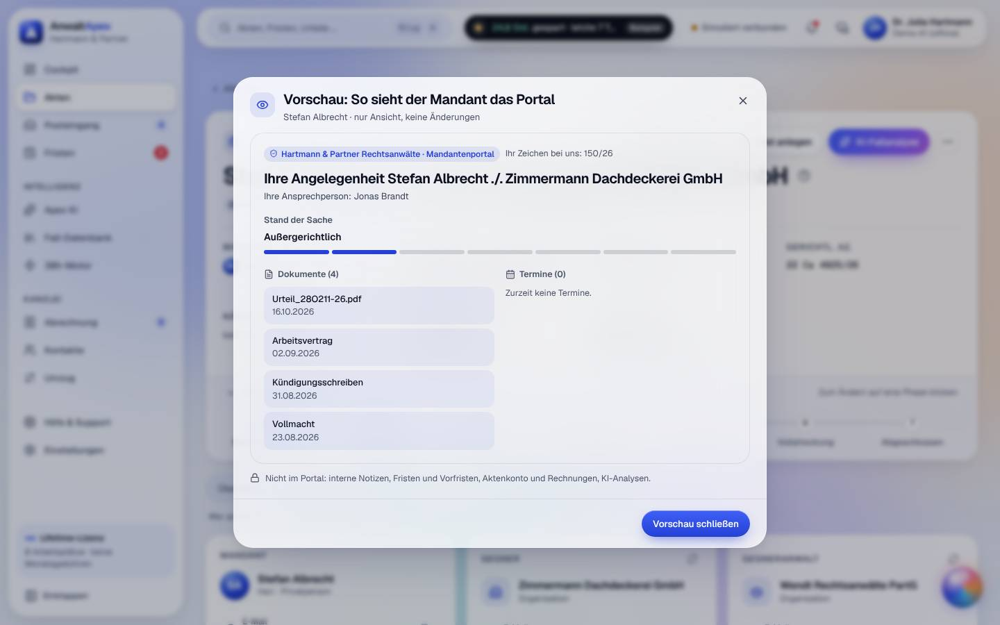 | **I2-T02-01 (K)** – Mandantenvorschau 150/26 (Stefan Albrecht) mit „Urteil_28O211-26.pdf“ aus Neumann ./. Arslan (D hell). |
| 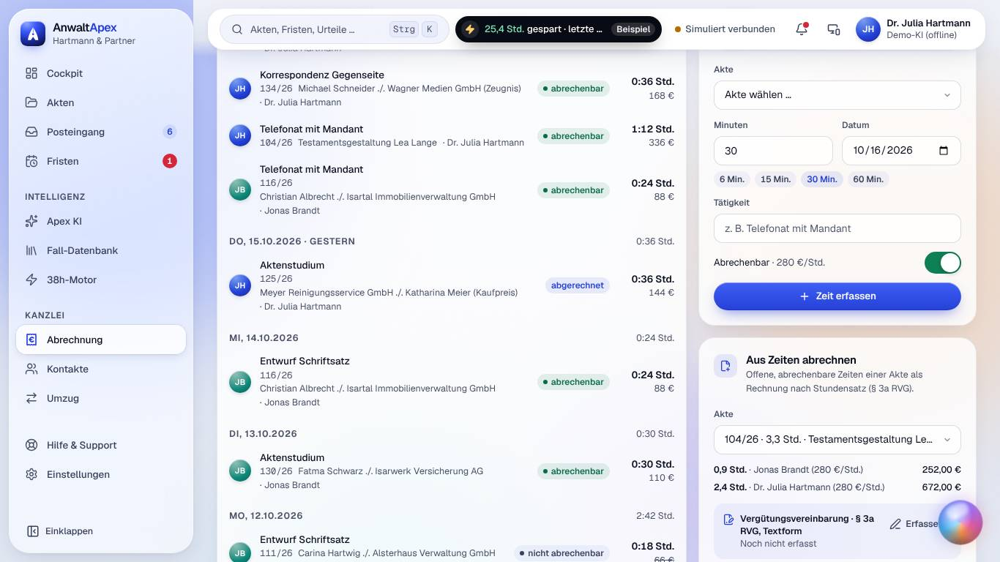 | **I2-T07-01 (K)** – „Aus Zeiten abrechnen“: Jonas Brandt zu 280 €/Std., die Zeitliste rechnet 220 €/Std. (L hell). |
| 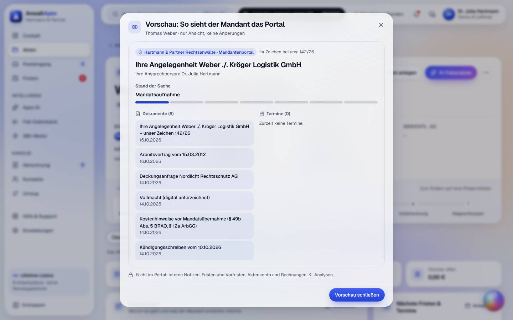 | **I2-T23-01 (H)** – Mandantenvorschau 142/26 zeigt die nicht freigegebene Deckungsanfrage (D hell). |
| 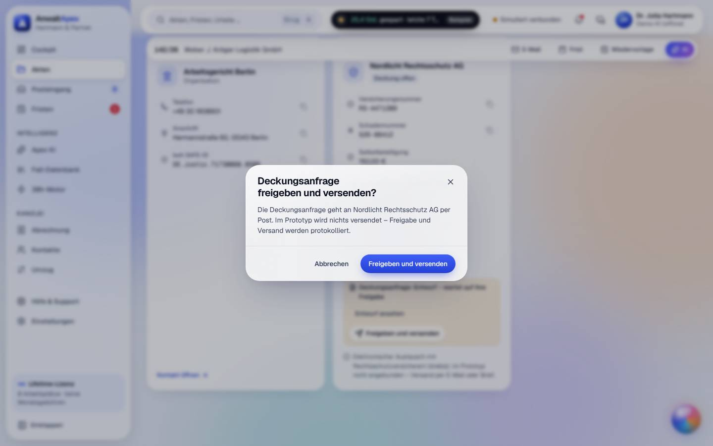 | **I2-T19-01 (H)** – „Deckungsanfrage freigeben und versenden?“ ohne Dokument, Version und Warnung vor offenen Platzhaltern (D hell). |
| 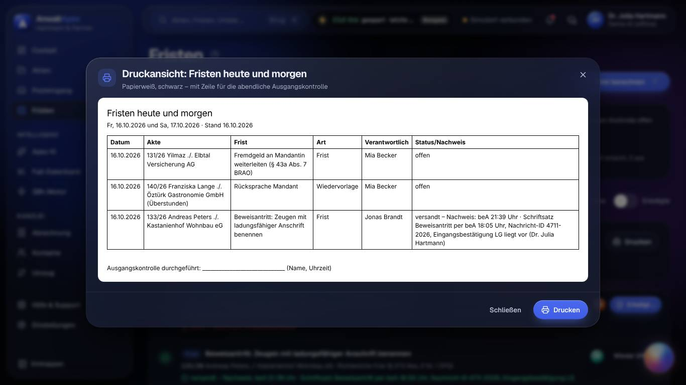 | **I2-T15-01 (H)** – Druckansicht der Ausgangskontrolle: „Nachweis: beA 21:39 Uhr“ für einen Versand um 18:05 Uhr (L dunkel). |
| 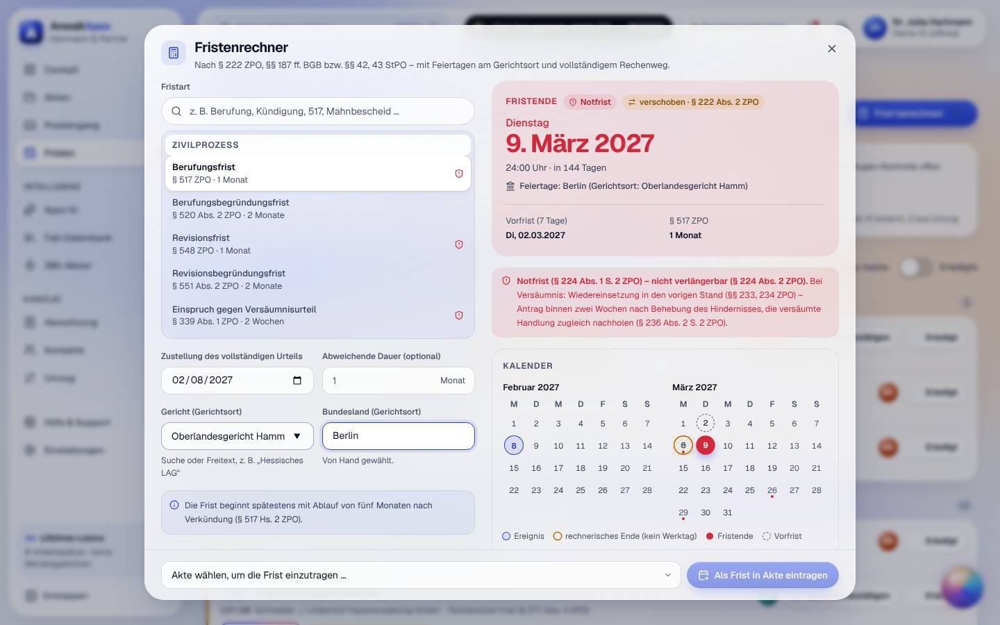 | **I2-T18-04 (H)** – Fristenrechner: „Oberlandesgericht Hamm“ mit Bundesland Berlin → Di 09.03.2027 (D hell). |
| 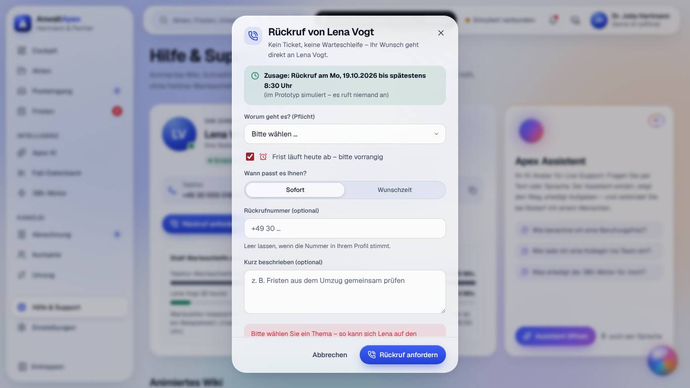 | **I2-T12-01 (H)** – „Frist läuft heute ab“ angekreuzt, Rückruf erst Montag 8:30 Uhr, kein Hinweis auf die Ersatzeinreichung (L hell). |
| 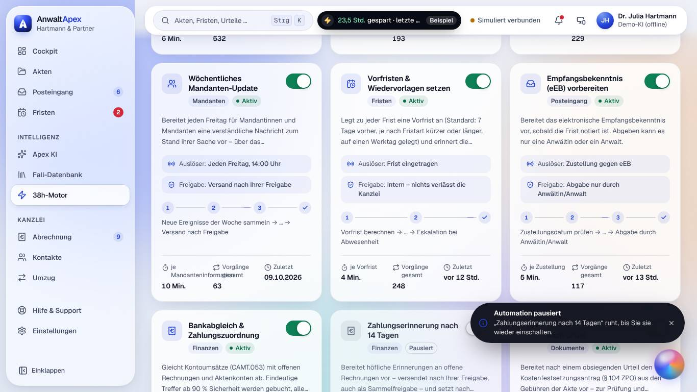 | **I2-T10-03 (M)** – 38h-Motor: Die Meldung „Automation pausiert“ liegt über dem Schalter, die Fußzeile der Karte überlappt (L hell). |
|  | **I2-T20-01 (M)** – Assistent am iPhone: richtige Rückfrage bei zwei Akten „Müller“, aber Frage und Karten rechts abgeschnitten (M hell). |
| 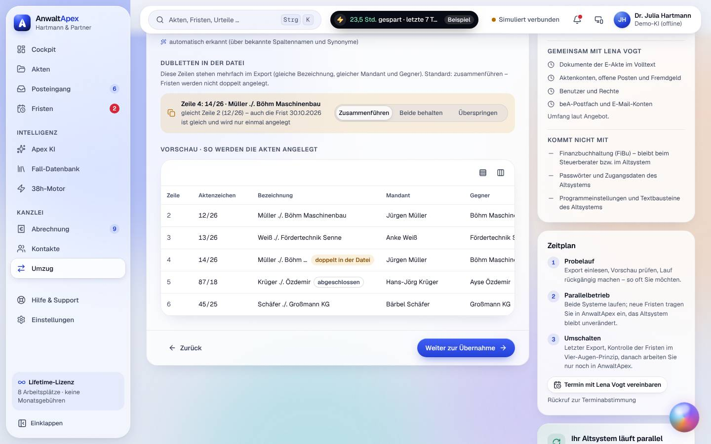 | **Positiv, T11, und I2-T11-01 (M)** – Umzug: „Dubletten in der Datei“ mit Zusammenführen; die Vorschau rechts ist angeschnitten (D hell). |
| 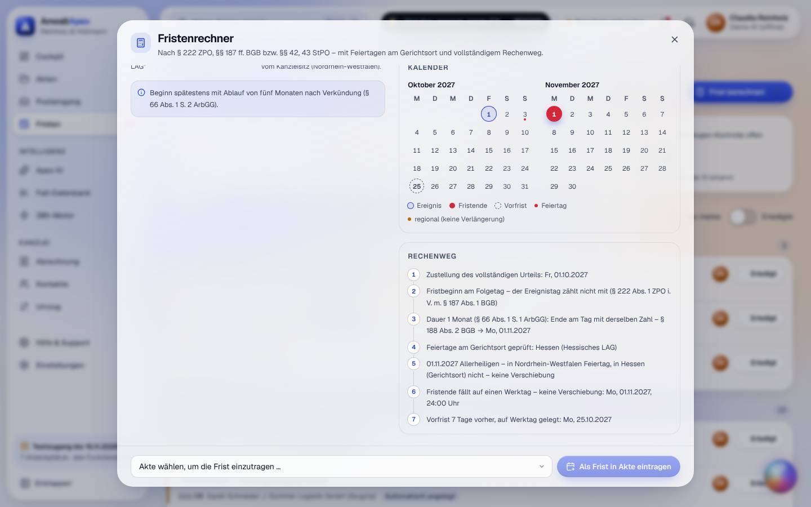 | **Positiv, T18 Fall 3b** – Mo 01.11.2027, Gerichtsort Hessen, Allerheiligen im Rechenweg beim Namen (D hell). |
| 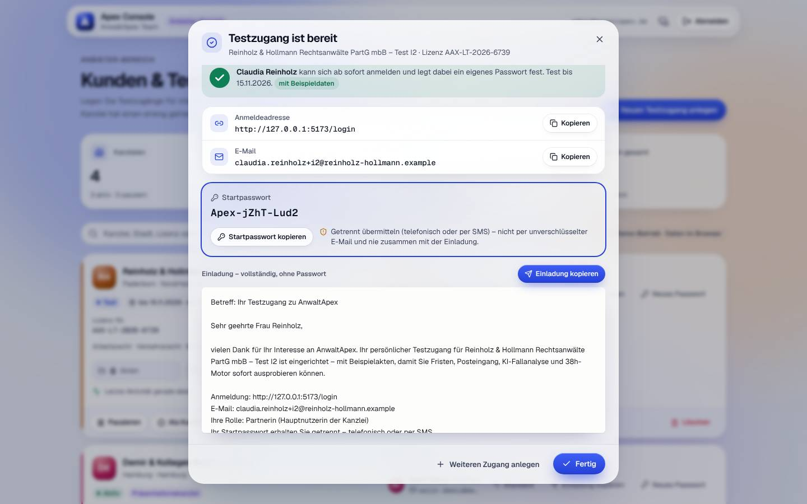 | **Positiv, T21** – Console: Einladung ohne Passwort, Startpasswort getrennt, Hinweis auf das Kanzleiprotokoll (D hell). |
| 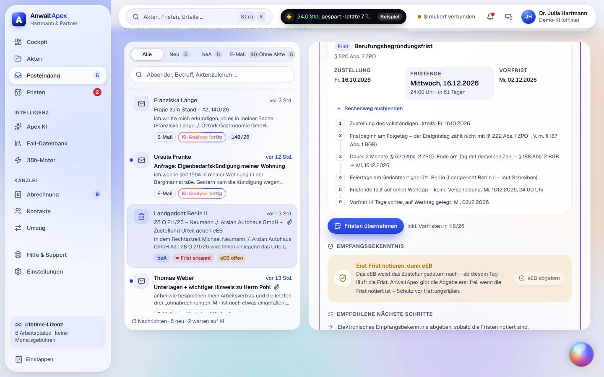 | **Positiv, T02/T03** – Berufungsbegründungsfrist mit Rechenweg; eEB gesperrt: „Erst Frist notieren, dann eEB“ (D hell). |
| 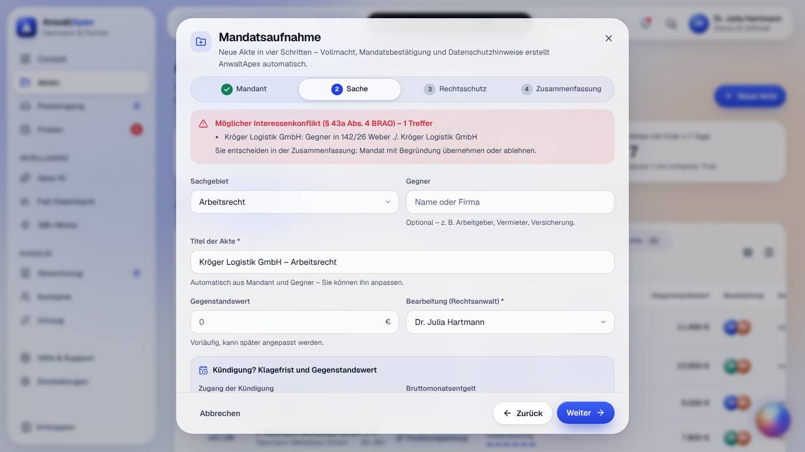 | **Positiv, T04** – Mandatsaufnahme: Kollisionstreffer „Kröger Logistik“ vor der Aktenanlage mit Pflichtentscheidung (L hell). |
| 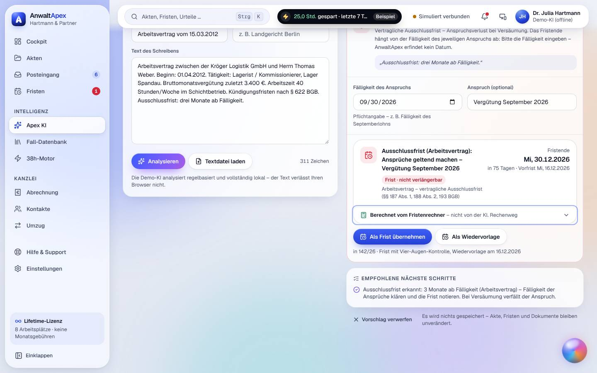 | **Positiv, T19** – Ausschlussfrist erkannt, Fälligkeit erfragt, Fristende Mi 30.12.2026 vom Fristenrechner (D hell). |
| 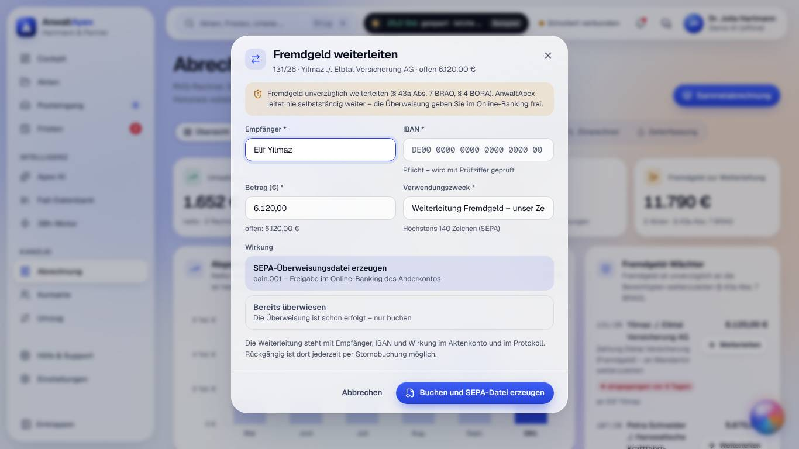 | **Positiv, T08** – Fremdgeld weiterleiten mit IBAN-Prüfung, Wirkung, SEPA-Datei und Rückgängig (L hell). |

---

## 9. Verworfen, angepasst, zusammengeführt – und Vorgaben der Projektleitung

### 9.1 Entscheidungen der Testleitung

| ID | Teil | Entscheidung | Grund |
|---|---|---|---|
| I2-T00-01 | Richtpreis bzw. Preisspanne | angepasst | Preise und Wartung entscheidet der Auftraggeber (Vorgabe der Projektleitung). Umgesetzt wird eine einheitliche neutrale Formulierung; der Rechner rechnet mit den Werten aus dem eigenen Angebot. |
| I2-T12-01 | Notfallkontakt bzw. Notfallnummer | an den Auftraggeber verwiesen | Eine Erreichbarkeit außerhalb der Servicezeit ist eine geschäftliche Zusage. Umgesetzt werden Hinweiskasten, Verweis auf die Ersatzeinreichung und das gesperrte „Sofort“. |
| I2-T04-01 | „Kritische Fristen zählt die Klagefrist nicht“ | nicht reproduzierbar | Im Profil `i2-B` steht 151/26 in „Kritische Fristen · 6“, in Liste und Akte rot mit Schild. Umgesetzt werden Woche/Monat und der sichtbare Text „nicht verlängerbar“. |
| I2-T23-05 | Phase auf „Gerichtlich“ setzen | angepasst | Die Phase steuert die Gebührenpositionen der Sammelabrechnung. Stattdessen entfällt bei vorgerichtlichen Phasen das Gerichts-Az. |
| I2-T14-03 | ganz | zusammengeführt | Duplikat von I2-T05-01 (dieselbe Vorschau, mobil) |
| I2-T15-04 | ganz | zusammengeführt | Duplikat von I2-T01-02 (Assistent-Kugel) |
| I2-T01-02 | Schweregrad | N → M | Verdeckt Bedienelemente in vier Ansichten; Rest von I1-T01-05 (M) |
| I2-T14-01 | Schweregrad | M → H | Still vorbelegte Fristwerte erzeugen eine zu späte Frist; gleiche Einstufung wie I1-T14-01 (H) |
| I1-T00-02 | Impressum | an den Auftraggeber verwiesen | Es bleibt ein gekennzeichneter Platzhalter, bis echte Anbieterdaten vorliegen. |
| I1-T07-07 | US-Datumsformat | weiter verworfen | Ursache ist die Testumgebung. Die Testleitung startet Iteration 3 mit deutscher Systemsprache (Abschnitt 10.6). |

### 9.2 Vorgaben der Projektleitung (verbindlich)

1. **I1-T14-07 / T14:**
   - 142/26 bleibt unverändert; die Demo-Geschichte lebt von der offenen Klagefrist.
   - Für T14 (mobil am Gericht) kommt eine **eigene arbeitsgerichtliche Präsentationsakte** der Kanzlei Hartmann & Partner in die Demodaten: Klage eingereicht, Gerichtsaktenzeichen, Gütetermin am Arbeitsgericht Berlin in den nächsten Tagen, passende Dokumente.
   - Andere Präsentationsabläufe ändern sich nicht. `SEED_VERSION` wird erhöht (Auftrag A-17).
2. **Geschäftliche Zusagen:**
   - Wartungssatz pro Jahr, Übertragbarkeit der Lizenz, Quellcode-Hinterlegung (Escrow), Impressum und eine EU-Option der Live-KI entscheidet der Auftraggeber.
   - Im Produkt steht dazu nur Neutrales („im Angebot geregelt“ bzw. „auf Anfrage“), ohne erfundene Zusagen.
   - Das betrifft auch Texte aus Iteration 1, z. B. „Richtwert 15 %“, „(vorgesehen)“ und „EU-Verarbeitung auf Wunsch möglich“ (Aufträge A-03, B-13).

### 9.3 Offene Entscheidungen des Auftraggebers

Diese Punkte nennt der Avatar als Kaufbedingung. Sie lassen sich im Produkt nicht lösen:

- Lizenzpreis und Wartung für 7 Arbeitsplätze in einem schriftlichen Angebot (Blöcke A, C, D)
- KI-Verarbeitung in der EU oder eine nach § 43e Abs. 4 BRAO tragfähige Lösung; bis dahin nutzt der Avatar nur die Offline-KI (Blöcke A, C)
- Übertragbarkeit der Lizenz und Quellcode-Hinterlegung
- Impressum mit echten Anbieterdaten
- Erreichbarkeit außerhalb der Servicezeit (Notfallkontakt)

---

## 10. Umsetzungsplan

### 10.1 Pakete und Dateibereiche

Zwei Fixer arbeiten parallel. Ihre Dateibereiche überschneiden sich nicht.

| Paket | Name | Dateibereich |
|---|---|---|
| **A** | Rahmen, Design, Einstieg, Logik & Daten | `src/components/**`, `src/styles/**`, `src/app/**`, `src/App.tsx`, `src/main.tsx`, `src/lib/**`, `src/store/**`, `src/core/**`, `src/ai/**`, `src/content/**`, `server/**`, `src/pages/Cockpit.tsx`, `src/pages/cockpit/**`, `src/pages/public/**`, `src/pages/hilfe/**`, `src/pages/einstellungen/**`, `src/pages/console/**` |
| **B** | Fachseiten | `src/pages/akten/**`, `src/pages/kontakte/**`, `src/pages/posteingang/**`, `src/pages/fristen/**`, `src/pages/abrechnung/**`, `src/pages/ki/**`, `src/pages/falldb/**`, `src/pages/motor/**`, `src/pages/umzug/**` |

**Dateien außerhalb beider Bereiche:**

- Paket A übernimmt `package.json` (nur das Testskript) sowie `docs/KUNDENAVATAR.md` und `docs/DEMO-SKRIPT.md` (neue T14-Akte, neutrale Lizenztexte).
- Berührt ein Befund beide Bereiche, ist er nach der Hauptdatei zugeordnet. Der Auftrag nennt die mitbetroffene Datei; der andere Fixer fasst sie dafür nicht an.
- Was bereichsübergreifend offen bleibt, zieht die Prüfung nach.

### 10.2 Schnittstellenvertrag (A-00, zuerst)

Paket A legt vor allen anderen Aufträgen die gemeinsamen Schnittstellen an. Paket B programmiert gegen diese Namen.

- **`src/core/types.ts`** – nur optionale Felder:
  - `Dokument.status?: "entwurf" | "freigegeben" | "versandt"` und `Dokument.portal?: { am; vonId }`. Nur Dokumente mit `portal` sind im Mandantenportal sichtbar.
  - `Frist.erledigtNachweis.art` um `"ueberweisung"` erweitern, dazu `erledigtNachweis.versandAm?` und `erledigtNachweis.transaktionId?`.
  - `Frist.korrekturAngefordert?` und `Frist.korrekturen?`.
  - `Transaktion.vorschlag?` und `Transaktion.abgelehnt?`.
- **`src/core/feiertage.ts`:** `naechsterArbeitstag(datum, land)`.
- **`src/core/vertretung.ts`:** `istBerufstraeger(u)` und `vertretungFuer(team, userId, heute)`.
- **`src/lib/tastatur.ts`** (neu): `einzeltasteErlaubt(e)`, dazu die Einstellung `einzeltastenKuerzel` in `src/store/ui.ts`.
- **`src/content/lizenz.ts`:**
  - Neu: `PREIS_HINWEIS`, `WARTUNG_HINWEIS`, `UEBERTRAGBARKEIT_HINWEIS`, `ESCROW_HINWEIS` und `kostenLifetime(lizenzpreis, wartungJahr, jahre)`.
  - Die alten Exporte bleiben als veraltet stehen, bis B-13 umgestellt hat.
- **Adressen und Kürzel:**
  - `/abrechnung?aktion=sammelabrechnung` öffnet die Sammelabrechnung.
  - Posteingang-Kürzel: J/K (nächste/vorige), Enter (öffnen), U (Fristen übernehmen), E (eEB).
  - Z: Zeit erfassen.
- **Testskript:** `npm test` schließt auch `src/pages/**/*.test.ts` ein.

### 10.3 Reihenfolge

1. A-00
2. K-Befunde (B-01, B-03)
3. H-Befunde (A-01, A-02, B-02, B-04, B-05, B-06, B-07, B-08)
4. M-Befunde
5. N-Befunde

Paket B beginnt mit B-03 und B-07, denn sie hängen nicht von A-00 ab.

### 10.4 Aufträge

**Paket A (21 Aufträge)**

| Nr. | Befunde | Inhalt |
|---|---|---|
| A-00 | – (Grundlage für B-01, B-02, B-06, B-09, B-11, B-12, B-13) | Typ- und Schnittstellenvertrag, Hilfsfunktionen, Testskript |
| A-01 | I2-T03-01 (H) | Fokusfalle in Modal und Drawer, Autofokus über `data-autofocus` |
| A-02 | I2-T12-01 (H), I2-T20-03, I2-T12-04 | Rückruf bei „Frist läuft heute ab“, Erreichbarkeit außerhalb der Servicezeit |
| A-03 | Vorgabe PL, I2-T00-01 | Geschäftliche Zusagen neutral (Wartung, Übertragbarkeit, Escrow, EU-KI, Preis) |
| A-04 | I2-T13-02, I2-T13-05, I2-T13-06 | Datenschutz- und KI-Texte (§ 43e Abs. 4, § 50 Abs. 1 BRAO, KI-Etikett) |
| A-05 | I2-T13-01 | Bundesland der Kanzlei änderbar |
| A-06 | I2-T16-01 | Anmeldungen, Abmeldungen und Fehlversuche protokollieren |
| A-07 | I2-T00-02, I2-T16-02, I2-T16-03, I1-T00-05 | Landing, Anmeldeseite, Wortlaut |
| A-08 | I2-T21-01, I2-T21-02, I2-T21-03 | Apex Console |
| A-09 | I2-T13-04, I2-T07-04 (+ I2-T22-02) | Strg+K vollständig, „Zeit erfassen“ mit Kürzel Z |
| A-10 | I2-T05-02, I2-T22-01 (+ I2-T02-05) | Einzeltasten abschaltbar, Wiedervorlage per Tastatur, „Zum Inhalt springen“ |
| A-11 | I2-T01-01, I2-T01-02, I2-T01-03 | Apex Island und Assistent-Kugel |
| A-12 | I2-T14-02 | Mobile Tab-Leiste deckend |
| A-13 | I2-T20-01, I2-T12-02, I2-T20-02, I2-T20-04, I1-T20-03, I1-T20-04 | Apex Assistent |
| A-14 | I2-T23-02, I2-T18-05, I2-T13-03 | Team: nur Berufsträger, Folgen der Rolle |
| A-15 | I2-T02-03, I2-T04-02, I2-T04-01 (Kern) | Fristen-Kern: Gerichtsort, Normzitat, § 17 TzBfG, § 61b ArbGG |
| A-16 | I2-T06-01, I2-T06-03 | Fallanalyse: ein Deckungsstatus, Zeuge „Seifert“ |
| A-17 | Vorgabe PL (I1-T14-07), I2-T07-07, I2-T04-05, I2-T23-05, I2-T06-03 | Demodaten: ArbG-Akte mit Gütetermin, 4 RSV-Akten, Portal-Freigaben, `SEED_VERSION` 10 |
| A-18 | I2-T12-03 | Wiki-Bild zur beA-Störung |
| A-19 | I2-T18-03 | Vertretungshinweis im Cockpit über die ganze Abwesenheit |
| A-20 | (I2-T10-04) | „Automatik“ statt „Automation“ in den Texten von Paket A |

**Paket B (19 Aufträge)**

| Nr. | Befunde | Inhalt |
|---|---|---|
| B-01 | **I2-T02-01 (K)**, I2-T02-02, I2-T03-03, I2-T22-03 | Posteingang: Umzuordnung vollständig, Warnung, Empfehlungen, Abwesende |
| B-02 | I2-T23-01 (H), I2-T23-03 | Mandantenportal nur mit freigegebenen Dokumenten |
| B-03 | **I2-T07-01 (K)**, I2-T07-03, I2-T07-06 | Zeithonorar: ein Stundensatz je Eintrag, Einzelauswahl, Leistungszeitraum |
| B-04 | I2-T19-01 (H), I2-T19-02 | Freigabe mit Dokument, Version und Platzhalterprüfung, Versionierung |
| B-05 | I2-T07-02 (H), I2-T22-04, I2-T22-02, I2-T07-05, I1-T07-10 | Abrechnung: ehrliche Zahlen, Direktlink, Dubletten, RVG-Eingaben |
| B-06 | I2-T15-01 (H), I2-T15-02, I2-T15-03 | Ausgangskontrolle: Versandzeit, nächster Arbeitstag, Überweisung |
| B-07 | I2-T18-04 (H), I2-T18-01, I2-T18-02 | Fristenrechner: Gericht vor Bundesland, wortweise Suche, Tastatur |
| B-08 | I2-T14-01 (H) | Frist anlegen ohne stille Vorbelegung, Dublettenwarnung |
| B-09 | I2-T03-02, I2-T20-05, I2-T04-01 | Frist korrigieren, Streichen in der Liste, kritische Fristen im Kalender |
| B-10 | I2-T05-01 (+ I2-T14-03) | Eingegangene Dokumente ohne Kanzleikopf |
| B-11 | I2-T02-05, I2-T02-04 | Posteingang mit der Tastatur |
| B-12 | I2-T08-01, I2-T08-02 | Bankabgleich: Vorschläge bleiben, Handzuordnung |
| B-13 | I2-T10-01, I2-T10-02, I2-T10-03, I2-T10-04, I2-T00-01 (Rechner) | 38h-Rechner und Karten |
| B-14 | I2-T17-01, I2-T17-02 | Kontakte |
| B-15 | I2-T11-01, I2-T11-02, I2-T11-04, I2-T11-05, I1-T11-06 | Umzug |
| B-16 | I2-T04-03, I2-T04-04 | Mandatsaufnahme |
| B-17 | I2-T05-03, I2-T23-04, I2-T14-04, I1-T14-05, I1-T14-04 | Akte: Kopf, mobil, Kalender |
| B-18 | I2-T16-04, I2-T11-03, I1-T23-04 | Aktenliste |
| B-19 | I2-T06-02 (+ I2-T06-03) | Fall-Datenbank, Platzhaltertext Schriftsatz |

### 10.5 Abnahme der Umsetzung

1. `npm run typecheck && npm test && npm run build` laufen grün. Neue Tests decken mindestens ab:
   - Zuordnung hin und zurück (B-01)
   - „Zeitliste = Abrechnungsvorschau“ und den Fall 20 Min. × 240 € = 80,00 € (B-03)
   - `naechsterArbeitstag`, `vertretungFuer`, Rückruf nach Fristende (A-00, A-02)
   - die neuen Fristarten (A-15)
   - unveränderte Aktenzeichen und IDs der übrigen Demodaten (A-17)
2. Die beiden K-Befunde und alle H-Befunde werden in der Prüfung im Browser nachgestellt, mit Bild je Befund.
3. axe-core bleibt in allen Ansichten aus Abschnitt 2 bei 0 serious und 0 critical; neu geprüft werden Dialoge mit Fokusfalle und die mobile Tab-Leiste.
4. Die Prüfwerte werden erneut nachgerechnet:
   - T07: 16 Werte, Zeithonorar 360,00 €, Brandt in Liste und Vorschau gleich
   - T09: A–C
   - T18: 6 Daten plus FamFG
   - T04: 02.11.2026 und 11.400 €
5. Die Texte werden per `grep` geprüft: keine Reste von „Richtwert 15 %“, „(vorgesehen)“, „EU-Cloud“ und „Pohl“, kein sichtbares „Automation“.

### 10.6 Hinweise für Iteration 3 (Testleitung)

- **Schwerpunkt laut Avatar (1.10): Mobil und Tablet.**
  - T01, T02, T03, T05, T12 und T20 zusätzlich auf M.
  - T14 zusätzlich auf Th.
  - T06 und T23 zusätzlich auf Tq.
  - In T20 die Gegenprobe mit Deniz Kaplan.
- **T14 läuft auf der neuen ArbG-Akte** aus A-17. Die Testleitung übernimmt Aktenzeichen und Gütetermin aus `docs/KUNDENAVATAR.md` (A-17 trägt sie dort ein) in den Prompt.
- **T04:** Durch die neuen Demoakten bekommt die neue Akte aus der Mandatsaufnahme eine höhere Nummer als 151/26. Geprüft wird der Ablauf, nicht die Nummer.
- **Deutsche Systemsprache:** Das Avatar-Werkzeug startet Chromium bisher nur mit `locale: "de-DE"`. Datumsfelder erscheinen deshalb im US-Format (I1-T07-07). Für Iteration 3 Chromium zusätzlich mit `--lang=de-DE` bzw. `LANG=de_DE.UTF-8` starten.
- **Werkzeug lädt je Aufruf neu:** Das Avatar-Werkzeug startet den Browser bei jedem Aufruf neu. Befunde zu „nach Neuladen weg“ werden zusätzlich per Navigation in der App gegengeprüft, so wie bei I2-T10-01.
- **Nachtest:** Iteration 3 beginnt mit allen 88 Befunden dieser Runde und den 16 offenen IDs der Vorrunde (Abschnitt 4), in einem frischen Profil mit `SEED_VERSION` 10.

---

## 11. Umsetzung & Nachweis

**Stand:** 17.10.2026 (Nacht nach dem Test), nach der Umsetzung der Pakete A und B und der bereichsübergreifenden Restpunkte
**Betrieb:** Browser-Demo (Demo-KI offline) · Chromium (Playwright, de-DE, Europe/Berlin) · eigene Prüfskripte mit frischem Browserprofil je Lauf, dazu das Avatar-Werkzeug mit Profil `pruefung-i2` · Viewports D 1440×900, L 1366×768, M 390×844, klein 360×740 · hell und dunkel wie angegeben
**Uhrzeit der Prüfung:** Samstag, 17.10.2026, ab 0:15 Uhr. Wochenend- und Servicezeit-Fälle (nächster Arbeitstag, Rückruf) liefen deshalb in echter Randlage; der Rückruf wurde zusätzlich mit fest gesetzter Seitenuhr Fr 16.10.2026, 21:05 Uhr nachgestellt.

### 11.1 Ergebnis

| Schwere | Befunde (zusammengeführt) | umgesetzt | davon angepasst | teilweise | offen | im Browser nachgestellt |
|---|---|---|---|---|---|---|
| K | 2 | **2** | – | – | – | 2 |
| H | 8 | **8** | 1 | – | – | 8 |
| M | 35 | **35** | 2 | – | – | 22 |
| N | 43 | **43** | 1 | – | – | 19 |
| **Summe** | **88** | **88** | **4** | **0** | **0** | **51** |

- **Alle K- und H-Befunde sind umgesetzt und in dieser Abnahme im Browser nachgestellt**, mit Bild je Befund (11.6). Wo Fachlogik betroffen ist, belegen zusätzlich automatische Tests die Änderung.
- **Angepasst** (wie in Abschnitt 9.1 beschlossen): I2-T00-01 (neutrale Preisformulierung statt Richtpreis), I2-T12-01 (keine Notfallnummer ohne Zusage des Auftraggebers), I2-T04-01 (rote Kennzeichnung in Woche und Monat, der Zähler war nicht fehlerhaft), I2-T23-05 (Gerichts-Az. entfällt, die Phase bleibt).
- **Offene Befunde der Vorrunde mit eigenem Auftrag:** 9 von 9 umgesetzt (I1-T00-05, I1-T14-04, I1-T14-05, I1-T14-07, I1-T23-04, I1-T07-10, I1-T11-06, I1-T20-03, I1-T20-04). Weiter beim Auftraggeber: das Impressum aus I1-T00-02. Weiter verworfen: I1-T07-07 (Testumgebung).
- Die übrigen M- und N-Befunde stützen sich auf die Selbstprüfung der Fixer bzw. auf Tests (Spalte „Nachweis“ in 11.5).

**So ist die Spalte „Nachweis“ zu lesen:**

- **Prüfung** – in dieser Abnahme im Browser nachgestellt (Viewport und Modus stehen dabei).
- **Fixer A / Fixer B** – Selbstprüfung des Fixers laut Rückmeldung; in der Abnahme nicht erneut nachgestellt.
- **Test** – automatischer Test in `npm test`.
- **Server-Probe** – Anfrage gegen den gebauten Server (`dist-server`) mit eigener Datenbank.
- Die Kürzel in Klammern (A-00 … B-19) verweisen auf die Aufträge in Abschnitt 10.4.

### 11.2 In der Prüfung nachgeholt

**Bereichsübergreifende Restpunkte der Fixer:**

| Herkunft | Punkt | Umsetzung |
|---|---|---|
| A-12 | Schnellaktionsleiste der Akte scheint durch | Die Leiste „Notiz · Frist · Wiedervorlage“ trägt jetzt `tabbar-deckend` wie die Tab-Leiste. Geprüft auf M hell und dunkel an 151/26: kein Text scheint durch. |
| A-14 | „Verantwortlich“ für Fristen | „Frist anlegen“ bietet bei „Frist berechnen“ und bei freien Fristen nur Partner und Anwälte an (`istBerufstraeger`), mit Hinweis „Fristen verantworten Partner und Anwälte (Berufsträger).“ Wiedervorlagen und Termine dürfen weiter Fachangestellte verantworten. Die Bearbeitung einer Akte war schon begrenzt (Mandatsaufnahme `anwaelte`, Sammelübergabe `kannBearbeiten`); dort war nichts zu ändern. |
| A-01 | Anfangsfokus auf der sicheren Wahl | In den Prüfskripten berücksichtigt: Bestätigungen per Klick auf den Bestätigungsknopf. Gegenprobe: Enter in der Löschen-Rückfrage löscht nichts. |
| B-02, B-04 | KI-Entwurf aus der Fallanalyse | `FallanalysePanel`: Ein neuer Entwurf entsteht mit `status: "entwurf"`, eine neue Version setzt den Status wieder auf Entwurf und nimmt die Portalfreigabe zurück – wie im Schriftsatz-Reiter. |
| B-15 | Kennzeichen abgebrochener Umzugsläufe | Neues Feld `UmzugLauf.abgebrochen` (Typ, optionale Server-Prüfung). `protokolliereAbbruch` setzt es und trägt als „von“ die Person ein, deren Lauf unterbrochen wurde. Ältere Protokolle mit dem Sonderwert bleiben erkennbar. Neuer Test. |
| B-16 | Suchfeld für Comboboxen | `SearchField` reicht weitere Eingabe-Attribute durch (`onKeyDown`, `role`, `aria-*`, `autoComplete` …) und kennt `leerenFokussierbar`. Kontakt- und Fristart-Auswahl nutzen es statt eigener Kopien. |
| B-02 | Gesperrte Menüeinträge | `MenuItem.disabled` und `title`: „Im Portal bereitstellen (Entwurf – erst nach Freigabe)“ steht grau mit `aria-disabled` im Menü, ein Klick bewirkt nichts. |
| B-17 | Kopfleiste am Telefon unter 44 px | Unter 640 px sind Suchen, Benachrichtigungen und Benutzermenü 44 × 44 px; „Zum Inhalt springen“ ist mit Fokus mindestens 44 px hoch. Gemessen auf M und 360 px, hell und dunkel. |
| B-17 | Segmente am Telefon | `Segmented` mit Option `mobilGross` (44 px unter 640 px). Akten-Reiter und „Offen/Erledigt“ nutzen sie statt einer Klasse von außen. |
| B-17 | Abstand über „Alle Akten“ auf L | Nicht geändert: Die Reiter beginnen bei 1366×768 schon bei y = 509 (Ziel erreicht); ein kleinerer Abstand würde jede Seite verschieben. |

**Funde der Abnahme, gleich behoben:**

- **Assistent-Kugel (I2-T01-02):** Nach einer animierten Listenänderung blieb die Kugel stehen. Beispiel: In der Ausgangskontrolle wurde eine Frist erledigt, danach lag die Kugel über „Erledigt …“ der nächsten Zeile (L dunkel). Sie prüft jetzt nach dem Nachgleiten der Liste erneut und weicht als Griff aus.
- **Menüs am Telefon:** Das Menü „⋯“ eines Dokuments öffnete sich unter die schwebende Aktionsleiste und die Tab-Leiste; „Verschieben“ und „Löschen“ waren verdeckt. Menüs öffnen sich jetzt nach oben, wenn unten zu wenig Platz ist, und scrollen in sich, statt aus dem Bild zu ragen (M und D geprüft).
- **Rechnung bei reiner Zeitrechnung (I2-T07-06):** In der Spalte „Gegenstandswert“ stand „à 240,00 €“. Die Spalten heißen bei reiner Zeitrechnung jetzt „Art · Leistung · Zeit · Stundensatz · Betrag“.
- **38h-Motor (I2-T10-02):** „Hochgerechnet pro Jahr“ rechnete 734,33 € × 48 = 35.247,84 €, der Rechner 28,20 Std. × 48 × 26,04 € = 35.247,74 €. Beide nutzen jetzt dieselbe Rechenfolge und zeigen 35.247,74 €.
- **Demodaten:** Fällt der Tag der Erzeugung auf ein Wochenende, lagen Zeiteinträge „heute“ auf dem folgenden Montag, also in der Zukunft (in der Zeitliste „19. Okt.“). Zeiteinträge nehmen jetzt den letzten Werktag davor. Aktenzeichen, Fristen und Nachrichten bleiben gleich (Test der Fingerabdrücke grün). `SEED_VERSION` bleibt 10; die Änderung wirkt bei neu erzeugten Daten, also im frischen Profil von Iteration 3.
- **Kontaktauswahl der Mandatsaufnahme:** axe meldete `scrollable-region-focusable` (serious, D hell und dunkel). Der scrollbare Bereich ist jetzt selbst die Listbox wie bei der Fristart-Auswahl; ein Tab-Stopp, ↑/↓ und Enter wie vorher. axe danach 0.

### 11.3 Qualitätstor und Prüfwerte

| Prüfung | Ergebnis |
|---|---|
| `npx tsc --noEmit` | 0 Fehler |
| `npm test` | **141 / 141** grün (vor der Abnahme 140; neu: Abbruchkennzeichen im Umzugsprotokoll) |
| `npm run build` | Web und Server fehlerfrei (nur die bekannten Größenhinweise zu `index.js` und `dist-server/index.js`) |
| Server-Probe (`dist-server`) | Fehlversuch 401 und im Protokoll „Anmeldung fehlgeschlagen (falsches Passwort)“; Anmeldung 200 mit „Erste Anmeldung“; `/api/data` mit 44 Akten und `umzugLaeufe`; Lauf mit `abgebrochen: true` 204, mit `"ja"` 400; Dokumentstatus „fertig“ 400; Bundesland „XX“ 400; ReFa als Vertretung 400 („… Mia Becker kann stattdessen die Sachbearbeitung übernehmen.“), Partnerin als Vertretung mit ReFa als Sachbearbeitung 200; Sperre 200 und „Sperre wegen Inaktivität“ im Protokoll |
| Konsolen-Sweep, Login Dr. Hartmann | **106 Ansichten: 0 pageerrors, 0 console.errors** (500 auf `/api/info` ausgenommen). 38 Routen und Reiter auf D hell und D dunkel, 25 davon auf M hell, Landing und Anmeldung hell und dunkel, Apex Console |
| axe-core (WCAG 2.2 A/AA) | **18 neue bzw. geänderte Ansichten: 0 serious/critical** nach der Behebung in der Mandatsaufnahme – Akte 151/26, „Frist anlegen“ und Menü mit gesperrtem Eintrag je auf M hell, M dunkel und 360 px dunkel; Mandatsaufnahme, Fristenrechner, 38h-Motor und Rechnungsvorschau je auf D hell und dunkel; Akte 151/26 auf 360 px dunkel mit dem Avatar-Werkzeug |
| Querscrollen | 360 px: keines (Cockpit, Akte 151/26); Aktenliste bei 1366 px mit Spalte „Gericht“: `scrollWidth` = `clientWidth` |
| Texte (`grep`) | Keine Reste von „Richtwert 15 %“, „(vorgesehen)“, „EU-Cloud“ und „Pohl“; „Automation“ nur noch in Typ- und Komponentennamen |

| Prüfwert | Soll | Ist |
|---|---|---|
| T07 RVG 2025 | 919,10 · 848,40 · 707,00 · 20,00 · netto 2.494,50 · USt 473,96 · **2.968,46 €** | **exakt** (`berechneRvg`) |
| T07 RVG 2021 | 865,80 · 799,20 · 666,00 · 20,00 · netto 2.351,00 · USt 446,69 · **2.797,69 €** | **exakt** (`berechneRvg`) |
| T07 Zeithonorar | 1:30 Std. × 240 € = 360,00 € netto · 68,40 € · 428,40 € | **360,00 € · 68,40 € · 428,40 €** (Browser, 1 von 3 Einträgen gewählt) |
| T07 Stundensatz Brandt | Zeitliste = Abrechnung | **220 €/Std. in beiden** (104/26: 0:36 = 132,00 €, 0:18 = 66,00 €; 0,9 Std. = 198,00 €) |
| T09 A / B / C | 43,23 € · 26,79 € · 42,72 € | **43,23 € · 26,79 € · 42,72 €** (`verzugszinsen`) |
| T18 Fall 2 | Berlin Di 09.03.2027 · NRW Mo 08.03.2027 | **09.03.2027** (nur nach Schalter, Warnung und Pflichtbestätigung) · **08.03.2027** (OLG Hamm, NRW gesperrt) – Browser |
| T18 Fall 3a | Mo 08.03.2027 (OLG Brandenburg) | **08.03.2027** – Browser |
| T18 Fall 1, 3b, FamFG | 01.03. und 30.03.2027 · 01.11.2027 · § 63, § 117 FamFG | **exakt** (Test `fristen.i1.test.ts`) |
| T04 Klagefrist | Mo 02.11.2026 | **02.11.2026** (Dublettenwarnung in 142/26); Gegenstandswert 3 × 3.800 € = 11.400 € unverändert, nicht erneut im Browser nachgestellt |

### 11.4 Offen und Hinweise für Iteration 3

- **Entscheidungen des Auftraggebers (unverändert, Abschnitt 9.3):** Preis und Wartung im Angebot, KI-Verarbeitung in der EU, Übertragbarkeit und Escrow, Impressum (Rest von I1-T00-02), Erreichbarkeit außerhalb der Servicezeit.
- **Demodaten – Fristverantwortung der Fachangestellten:** Generierte Fristen führen weiter Mia Becker als „verantwortlich“, z. B. „Fremdgeld an Mandantin weiterleiten“ in 131/26. Neu angelegte Fristen verlangen dagegen Partner oder Anwälte. Der Avatar könnte das als Widerspruch melden. Eine Umstellung würde Petras Vormittag (T22, „Nur meine“) verändern und ist deshalb eine Entscheidung der Projektleitung (`SEED_VERSION` 11).
- **Uhrzeit des Nachtests:** Der Nachtest dieser Abnahme lief an einem Samstag; Fristen „heute“ gibt es dann nur eine (Fremdgeld 131/26). Iteration 3 sollte wie geplant an einem Werktag und mit deutscher Systemsprache laufen (Abschnitt 10.6). Datumsfelder erscheinen im Prüfbrowser weiter im US-Format (I1-T07-07, Testumgebung).
- **Nachtest:** alle 88 Befunde dieser Runde und die 16 offenen IDs der Vorrunde, im frischen Profil mit `SEED_VERSION` 10.

### 11.5 Befunde einzeln

| ID | S | Status | Was geändert | Nachweis |
|---|---|---|---|---|
| | | | **7.1 Landing** | |
| I2-T00-01 | M | umgesetzt (angepasst) | Wartung, Übertragbarkeit, Escrow, EU-KI und Preis neutral („im Angebot geregelt“ bzw. „auf Anfrage“); kein Platzhalterpreis; der Rechner rechnet mit den Werten aus dem eigenen Angebot (A-03, B-13) | Prüfung L: Rechner „Lizenzpreis je Platz laut Angebot … leer = ohne Wartung“, „Preis auf Anfrage“; grep ohne „Richtwert 15 %“; Test `lizenz.test.ts` |
| I2-T00-02 | N | umgesetzt | Fußnote zur Kennzahl, Rechenweg der Vorschau voll lesbar (A-07) | Fixer A (axe 0) |
| I1-T00-05 | N | umgesetzt | Anglizismen ersetzt, „ohne Nutzungsverfolgung“, „Strg+K (Mac: ⌘K)“ (A-07) | Fixer A |
| | | | **7.2 Anmeldung und Zugang** | |
| I2-T16-01 | M | umgesetzt | Anmeldung, erste Anmeldung, Abmeldung, Fehlversuche und Sperre im Protokoll, Meldung nach 3 Fehlversuchen, Filter „Anmeldungen“ (A-06) | Test `protokoll.test.ts`; Server-Probe (Fehlversuch, erste Anmeldung, Sperre im Protokoll) |
| I2-T16-02 | N | umgesetzt | „Ihre Ansprechpartnerin – Direkt erreichbar, ohne Warteschleife“ (A-07) | Fixer A |
| I2-T16-03 | N | umgesetzt | Sichtbare Beschriftung der Passwortfelder (A-07) | Fixer A (axe 0) |
| | | | **7.3 Apex Console** | |
| I2-T21-01 | M | umgesetzt | Rückfrage „Eingaben verwerfen?“ bei ausgefülltem Formular (A-08) | Fixer A (Playwright) |
| I2-T21-02 | M | umgesetzt | Einladung nennt das Startpasswort auf Wunsch und das Protokoll (A-08) | Fixer A |
| I2-T21-03 | N | umgesetzt | „Demo-Passwort wiederherstellen“ mit Erklärung; Rollen und E-Mails brechen um (A-08) | Fixer A; Konsolen-Sweep Console 0 Fehler |
| | | | **7.4 Rahmen** | |
| I2-T03-01 | H | umgesetzt | Fokusfalle in Modal und Drawer, Hintergrund inert, Escape nur oberste Ebene, Fokus kehrt zurück, gefährliche Rückfragen beginnen auf „Abbrechen“ (A-01) | Prüfung L: Mandatsaufnahme 50 und „Frist anlegen“ 40 Schritte Tab bzw. Umschalt+Tab, 0 außerhalb; nach Escape Fokus auf „Neue Akte“; Löschen-Rückfrage mit Fokus auf „Abbrechen“, Enter löscht nichts (6 → 6 Dokumente); [Bild](iteration-2/bilder/nachweis/T03-01-rueckfrage-fokus-abbrechen-L.jpg) |
| I2-T05-02 | M | umgesetzt | Einzeltasten-Kürzel abschaltbar, Alt+W/F/Z wirken immer, nie in Eingabefeldern (A-10) | Prüfung D: Einzeltasten aus → F öffnet nichts, Alt+F öffnet den Fristenrechner |
| I2-T22-01 | M | umgesetzt | W setzt den Fokus auf „Worum geht es?“, Schnellwahl +1 Werktag/+3/+7/+14 (A-10) | Fixer A |
| I2-T13-04 | M | umgesetzt | Strg+K findet Unterbereiche der Einstellungen (A-09) | Prüfung D: „Lizenz“ → Lizenz, „43e“ → Datenschutz & Verträge, „Passwort“ → Anmeldung & Sicherheit |
| I2-T07-04 | M | umgesetzt | Aktion „Zeit erfassen“ in Strg+K, Kürzel Z (A-09, A-10) | Prüfung D: „zeit erfassen“ → „Zeit erfassen“ als erster Treffer |
| I2-T01-01 | M | umgesetzt | × an der Apex Island mit Rückgängig und Hinweis auf die Einstellung (A-11) | Prüfung D: „Apex Island ausgeblendet – Wieder einschalten unter Einstellungen → Darstellung. Rückgängig“ |
| I2-T01-02 | M ↑ | umgesetzt | Kugel weicht als Griff an den Rand aus (A-11); in der Abnahme ergänzt: erneute Prüfung nach animierten Listenänderungen | Prüfung L dunkel: Ausgangskontrolle vor und nach „Erledigt“ mit Griff statt Kugel; [Bild](iteration-2/bilder/nachweis/T01-02-kugel-weicht-aus-L-dunkel.jpg) |
| I2-T14-02 | M | umgesetzt | Tab-Leiste deckend mit Abdeckzone, Seitenübergang ohne bleibenden Filter (A-12); in der Abnahme: Schnellaktionsleiste der Akte deckend | Prüfung M hell und dunkel, 151/26; [Bild](iteration-2/bilder/nachweis/T14-02-aktionsleiste-deckend-151-M-dunkel.jpg) |
| I2-T01-03 | N | umgesetzt | Island-Text „{n} in 7 Tagen“ (A-11) | Prüfung D: „28,2 Std. in 7 Tagen“ ungekürzt |
| I2-T18-03 | N | umgesetzt | Vertretungshinweis zählt über die ganze Abwesenheit (A-19) | Prüfung D: Brandt abwesend 16.–30.10. → „Sie vertreten heute Jonas Brandt – 4 Fristen bis Fr, 30. Okt. (Ende der Abwesenheit)“; Test `vertretung.test.ts` |
| I2-T22-02 | N | umgesetzt | Direktlink `/abrechnung?aktion=sammelabrechnung`, Strg+K-Eintrag (B-05, A-09) | Prüfung L: Direktlink öffnet die Sammelabrechnung; Prüfung D: Strg+K „Sammelabrechnung“ erster Treffer |
| | | | **7.5 Akten** | |
| I2-T23-01 | H | umgesetzt | Portal nur mit ausdrücklicher Freigabe je Dokument, Entwürfe gesperrt, „Nicht sichtbar für den Mandanten: …“ (B-02, A-00, A-17) | Prüfung D: Portal 142/26 nur Vollmacht und Kostenhinweise, „1 Entwurf“ nicht sichtbar; Prüfung M: Menüeintrag gesperrt; [Bild](iteration-2/bilder/nachweis/T23-01-portal-142-ohne-entwurf-D.jpg), [Bild](iteration-2/bilder/nachweis/T23-01-menue-portal-gesperrt-M.jpg) |
| I2-T19-01 | H | umgesetzt | Dialog „Freigeben und versenden“ mit Dokument, Datum, Version, Empfänger, Versandweg, „Dokument ansehen“; Versand bei offenen Platzhaltern gesperrt (B-04) | Prüfung D: KI-Entwurf Version 2 mit 3 Platzhaltern → Liste der Platzhalter, Versand gesperrt; Seed-Fassung ohne Platzhalter freigebbar; [Bild](iteration-2/bilder/nachweis/T19-01-freigabe-3-platzhalter-gesperrt-D.jpg) |
| I2-T14-01 | H ↑ | umgesetzt | Fristart und Ereignis leer, Vorschläge aus der Akte, Dublettenwarnung mit Pflichtbestätigung (B-08) | Prüfung M: beides leer, „Frist übernehmen“ gesperrt; Vorschlag 12.10.2026 → „Kündigungsschutzklage bis Mo, 02.11.2026 ist schon notiert“; [Bild](iteration-2/bilder/nachweis/T14-01-frist-anlegen-dublettenwarnung-M.jpg) |
| I2-T05-01 | M | umgesetzt | Eingangsvermerk statt Kanzleikopf bei eingegangenen Schreiben (B-10) | Prüfung M hell und dunkel: Kündigungsschreiben 151/26 „Eingang 23.09.2026 · Scan · Eingegangenes Dokument – unverändert“, kein Kanzleikopf |
| I2-T05-03 | N | umgesetzt | Kompakter Aktenkopf, Verfahrensstand unter 900 px eingeklappt (B-17) | Prüfung L: Reiter-Oberkante bei y = 509 |
| I2-T23-03 | N | umgesetzt | „Mandantenportal sperren“ mit Rückfrage (B-02) | Fixer B |
| I2-T23-04 | N | umgesetzt | Abschließen-Dialog mit richtigem Numerus, offenen Rechnungen, Saldo und Fremdgeld (B-17) | Fixer B |
| I2-T04-03 | N | umgesetzt | Entwurf der Mandatsaufnahme übersteht Neuladen und Neustart, „Entwurf fortsetzen?“ (B-16) | Fixer B |
| I2-T04-04 | N | umgesetzt | Kontaktauswahl als Combobox mit einem Tab-Stopp (B-16); in der Abnahme: Listbox ist der scrollbare Bereich | Prüfung L: „Weber“, ↓, Enter wählt Thomas Weber, Tab springt zu „Abbrechen“; axe D hell und dunkel 0 |
| I2-T16-04 | N | umgesetzt | Spaltenbreiten der Aktenliste (B-18) | Prüfung L: mit Spalte „Gericht“ `scrollWidth` = `clientWidth` (1102 px) |
| I2-T11-03 | N | umgesetzt | Gegenstandswerte mit Cent in der Liste (B-18) | Fixer B (45/26 entsteht erst durch den Umzug); Test `uebernahme.test.ts` (2.180,50 €) |
| I2-T14-04 | N | umgesetzt | Desktop-Hinweise nur mit Maus bzw. Trackpad (`pointer: fine`) (B-17) | Fixer B |
| I2-T04-05 | N | umgesetzt | Deckungsanfrage 142/26 als Brief typisiert (A-17) | Prüfung: Demodaten 142/26 `art: brief` |
| I2-T23-05 | N | umgesetzt (angepasst) | Vorgerichtliche Akten ohne Gerichts-Az., Phase unverändert (A-17) | Prüfung: 150/26, 146/26 und 144/26 „Außergerichtlich“ ohne Gerichts-Az. |
| I1-T23-04 | N | umgesetzt | Aktentitel brechen vollständig um (B-18) | Fixer B |
| I1-T14-05 | M | umgesetzt | Bedienflächen in Übersicht, Dokumenten und Fristen ≥ 44 px (B-17); in der Abnahme: Kopfleiste und Segmente | Prüfung M und 360 px hell und dunkel: Kopfleiste 3 × 44 × 44 px, Akten-Reiter 44 px; Notiz, Frist und Wiedervorlage im Daumenbereich |
| I1-T14-04 | M | umgesetzt | „In Kalender (.ics)“ unter „Nächster Termin“ (B-17) | Prüfung M: 151/26 zeigt den Link unter dem Gütetermin |
| I1-T14-07 | M | umgesetzt | Eigene ArbG-Präsentationsakte 151/26 mit Az., Gütetermin und Dokumenten (A-17) | Prüfung M: „Az. 28 Ca 11873/26“, „Di, 20.10.2026, 09:00 Uhr · Gütetermin · Arbeitsgericht Berlin, Magdeburger Platz 1, Saal 3“; Test `core.test.ts` |
| | | | **7.6 Kontakte** | |
| I2-T17-01 | M | umgesetzt | Keine Rolle vorbelegt, Rückfrage bei Mandant und Versicherung, Mandantenauswahl ohne Gerichte und Versicherungen (B-14) | Fixer B |
| I2-T17-02 | N | umgesetzt | „2 Akten, davon 1 offen“ (B-14) | Fixer B |
| | | | **7.7 Posteingang und eEB** | |
| I2-T02-01 | **K** | umgesetzt | Umzuordnung nimmt Dokumente und Anhänge mit, entfernt die Portalfreigabe, Fristen ziehen auf Wunsch mit, Verlauf in beiden Akten (B-01) | Prüfung D: Urteil 28 O 211/26 → 150/26 → zurück 118/26: beide Dokumente in 118/26, keines in 150/26; Portal 150/26 zeigt nur die Vollmacht; Verlauf 150/26 „Zuordnung von ‚28 O 211/26 …‘ zurückgenommen – 2 Dokumente nach 118/26 verschoben“; Test `analyse.test.ts`; [Bild](iteration-2/bilder/nachweis/T02-01-portal-150-ohne-urteil-D.jpg) |
| I2-T02-02 | M | umgesetzt | Kopfzeile zeigt die tatsächliche Zuordnung, Warnung bei fremdem Gerichts-Az. mit Pflichtbestätigung (B-01) | Prüfung D: „28 O 211/26 gehört laut Bestand zu 118/26 – trotzdem 150/26?“, Zuordnen bis zur Bestätigung gesperrt, „KI-Vorschlag: 118/26 (99 %)“ als Nebenzeile; [Bild](iteration-2/bilder/nachweis/T02-01-umzuordnung-warnung-gerichts-az-D.jpg) |
| I2-T02-05 | M | umgesetzt | Nachrichtenliste als Listbox, J/K/U/E (B-11, A-10) | Prüfung D: J, J, K wechselt n-12 → n-4 → n-12 |
| I2-T02-03 | N | umgesetzt | Rechtsmittelort nennt das Berufungsgericht, „§ 520 Abs. 2 S. 1 ZPO“ (A-15) | Test `fristen.i1.test.ts`, `dokumentAnalyse.i1.test.ts`; Prüfung D: Fristenrechner „§ 520 Abs. 2 S. 1 ZPO“ |
| I2-T02-04 | N | umgesetzt | Filterleiste zählt nur „Neu“ und „Ohne Akte“, mit Abstand (B-11) | Prüfung D (Bild zu I2-T02-02) |
| I2-T03-03 | N | umgesetzt | Nach der eEB-Abgabe keine eEB-Empfehlung mehr (B-01) | Fixer B |
| I2-T22-03 | N | umgesetzt | eEB-Vorlage kennzeichnet Abwesende und schlägt die Vertretung vor (B-01) | Fixer B |
| | | | **7.8 Fristen** | |
| I2-T15-01 | H | umgesetzt | Versandzeit Pflicht, aus beA vorbelegt, nicht in der Zukunft; getrennt von der Protokollzeit (B-06) | Prüfung L dunkel: 23:30 Uhr heute → „Die Versandzeit liegt in der Zukunft“, gesperrt; Nachweis „versandt per beA am 16.10.2026 um 18:05 Uhr · … · protokolliert am 17.10.2026, 00:33 Uhr von Dr. Julia Hartmann“, ebenso im Druck; [Bild](iteration-2/bilder/nachweis/T15-01-versandzeit-1805-ausgangskontrolle-L-dunkel.jpg) |
| I2-T18-04 | H | umgesetzt | Bundesland aus dem Gericht gesperrt; abweichender Ort nur über Schalter mit Warnung und Pflichtbestätigung (B-07) | Prüfung D: OLG Hamm → NW gesperrt, Mo 08.03.2027; Schalter + Berlin → Di 09.03.2027 mit roter Warnung, Eintragen gesperrt; [Bild](iteration-2/bilder/nachweis/T18-04-olg-hamm-berlin-warnung-D.jpg) |
| I2-T15-02 | M | umgesetzt | „Nächster Arbeitstag“ statt „Morgen“, Druck bis dahin (B-06) | Prüfung L dunkel (Samstag): „Nächster Arbeitstag (Mo, 19.10.)“, Druck „Sa, 17.10.2026 und nächster Arbeitstag Mo, 19.10.2026“ |
| I2-T15-03 | M | umgesetzt | Nachweisart „Überweisung“ mit Kontoumsatz, beA-Hinweis nur einmal (B-06) | Prüfung L dunkel: Fremdgeld-Frist 131/26 → „Überweisung (Kontoumsatz)“ mit Umsatzauswahl |
| I2-T18-01 | M | umgesetzt | Wortweise Fristart-Suche mit Synonymen (B-07) | Prüfung D: „Berufung ArbG“ → „Berufungsfrist (Arbeitsgericht) § 66 Abs. 1 S. 1 ArbGG“; Test `fristartSuche.test.ts` |
| I2-T18-02 | M | umgesetzt | Combobox: ↑/↓ markiert, Enter übernimmt und springt weiter (B-07) | Prüfung D: Enter übernimmt den markierten Treffer, Fokus im Ereignisfeld |
| I2-T03-02 | M | umgesetzt | Frist korrigieren mit Pflichtgrund, neue Vier-Augen-Kontrolle, „Korrektur anfordern“ (B-09, A-00) | Prüfung D: Zeilenmenü „Korrigieren …“, Dialog mit „Neu berechnen“ und „Datum direkt setzen“, Pflichtgrund |
| I2-T04-01 | M | umgesetzt (angepasst) | Woche, Monat und Pille rot mit „nicht verlängerbar“ bzw. „Notfrist“; § 17 TzBfG und § 61b ArbGG als Fristarten (B-09, A-15) | Fixer B; Test `fristen.i1.test.ts`; Prüfung M: Fristende „Frist · nicht verlängerbar“ |
| I2-T04-02 | N | umgesetzt | Feiertagszeile nennt Gerichtsort bzw. Kanzleisitz richtig (A-15) | Test `fristen.i1.test.ts`; Fixer A |
| I2-T20-05 | N | umgesetzt | Streichen mit Grund auch in der Fristenliste (B-09) | Prüfung D: Zeilenmenü mit „Streichen – mit Grund …“ |
| | | | **7.9 Apex KI und Fall-Datenbank** | |
| I2-T19-02 | M | umgesetzt | KI-Schriftsatz als Version n+1 nach Rückfrage, als Entwurf (B-04); in der Abnahme ebenso für die Fallanalyse | Prüfung D: „Als Version 2 von ‚Deckungsanfrage …‘ speichern?“ → 1 Dokument, Version 2, Entwurf, nicht im Portal |
| I2-T06-01 | M | umgesetzt | Ein Deckungsstatus in der Fallanalyse (A-16) | Test `einschaetzung.test.ts` |
| I2-T06-02 | N | umgesetzt | Abdeckung mit Arbeitsgerichten, „Auszug, jüngste Entscheidung …“ (B-19) | Fixer B |
| I2-T06-03 | N | umgesetzt | Zeuge heißt „Seifert“ (A-16, A-17, B-19) | grep „Pohl“ leer; Prüfung D: Posteingang „Hinweis zu Herrn Seifert“ |
| | | | **7.10 38h-Motor** | |
| I2-T10-01 | M | umgesetzt | Eigene Mengen je Kanzlei gespeichert, Druckansicht (B-13) | Fixer B |
| I2-T10-02 | M | umgesetzt | Faktoren auf Cent gerundet, Ergebnis aus gerundeten Werten (B-13); in der Abnahme: Übersicht mit derselben Rechenfolge | Prüfung L: „28,20 Std./Woche × 48 Arbeitswochen × 26,04 €/Std. = 35.247,74 €“ nachgerechnet exakt, Übersicht zeigt denselben Wert |
| I2-T10-03 | M | umgesetzt | Kartenkennzahlen als Zeilen, Status per aria-live statt Meldung (B-13) | Fixer B |
| I2-T10-04 | N | umgesetzt | Durchgängig „Automatik“ (B-13, A-20) | grep; Prüfung D: „12 von 12 Automatiken aktiv“ |
| | | | **7.11 Abrechnung** | |
| I2-T07-01 | **K** | umgesetzt | Ein Stundensatz je Eintrag: Satz der erfassenden Person bzw. der Vereinbarung, überall gleich (B-03) | Prüfung L: 104/26 Brandt 220 €/Std. in Zeitliste und „Aus Zeiten abrechnen“ (0,9 Std. = 198,00 €); Test `lib.test.ts`; [Bild](iteration-2/bilder/nachweis/T07-01-brandt-220-liste-gleich-abrechnung-L.jpg) |
| I2-T07-02 | H | umgesetzt | Chip „Beispielwerte“, Herleitung „Min. je Vorgang“, Status per aria-live (B-05) | Prüfung L: Karte „Was der 38h-Motor hier automatisiert“ mit „Beispielwerte“ und „3 Min. je Vorgang“; [Bild](iteration-2/bilder/nachweis/T07-02-beispielwerte-abrechnung-L.jpg) |
| I2-T07-03 | M | umgesetzt | Einträge einzeln wählbar, „n von m Einträgen abrechnen“ (B-03) | Prüfung D: 125/26 „1 von 3 Einträgen abrechnen“ → 360,00 € + 68,40 € = 428,40 €; [Bild](iteration-2/bilder/nachweis/T07-03-einzelauswahl-360-eur-rechnung-D.jpg) |
| I2-T07-05 | M | umgesetzt | RVG-Rechner fragt bei vorhandenem Entwurf nach (B-05) | Fixer B |
| I2-T08-01 | M | umgesetzt | Vorschläge und Ablehnungen am Umsatz, Handzuordnung (B-12, A-00) | Fixer B |
| I2-T07-06 | N | umgesetzt | Leistungszeitraum aus den abgerechneten Einträgen, kein Gegenstandswert im Kopf (B-03); in der Abnahme: Spalten der Zeitrechnung | Prüfung D: „Leistungszeitraum 17.10.2026 – 17.10.2026“, Spalten „Art · Leistung · Zeit · Stundensatz · Betrag“ |
| I2-T07-07 | N | umgesetzt | Weitere RSV-Akten 152–154/26 mit Deckungszusage (A-17) | Prüfung L: Sammelabrechnung „Deckung erteilt 5“; Demodaten 152–154/26 „erteilt“ |
| I2-T08-02 | N | umgesetzt | Chip „manuell – Name, Uhrzeit“ statt Prozentwert (B-12) | Fixer B |
| I2-T22-04 | N | umgesetzt | Schätzung gekennzeichnet, Annahme genannt (B-05) | Prüfung L: „Schätzung … Annahme: 6 Min. je Einzelrechnung“ |
| I1-T07-10 | N | umgesetzt | RVG-Eingaben je Person im Browserspeicher (B-05) | Fixer B |
| | | | **7.12 Umzug** | |
| I2-T11-01 | M | umgesetzt | Vorschau mit fünf Spalten ohne Querscrollen (B-15) | Fixer B |
| I2-T11-02 | N | umgesetzt | Schritt 3, 4 und Übernahme zählen gleich, richtige Pluralformen (B-15) | Test `uebernahme.test.ts` |
| I2-T11-04 | N | umgesetzt | Umfang mit Bezugsdatum, Akten ohne Abschlussdatum werden vorgelegt (B-15) | Test `uebernahme.test.ts` |
| I2-T11-05 | N | umgesetzt | Zwischenstand übersteht Neustart, unterbrochener Lauf wird zurückgenommen und protokolliert (B-15); in der Abnahme: Feld `abgebrochen` | Test `uebernahme.test.ts` (neu: Abbruchkennzeichen); Server-Probe |
| I1-T11-06 | N | umgesetzt | „Übernahme starten – mit Vorschau und Rückgängig“ (B-15) | Fixer B |
| | | | **7.13 Hilfe und Support** | |
| I2-T12-01 | H | umgesetzt (angepasst) | Hinweis auf die Ersatzeinreichung mit Wissenskarte, „Sofort“ außerhalb der Servicezeit gesperrt, Erreichbarkeit auf der Karte (A-02) | Prüfung L (Sa 0:40 Uhr; Fr 21:05 Uhr mit gesetzter Seitenuhr textgleich): „Sofort – nicht möglich“, „Nächste mögliche Zeit“ gewählt, „Warten Sie nicht auf den Rückruf – er kommt erst am Mo, 19.10.2026 … § 130d S. 2, 3 ZPO … § 46g S. 3, 4 ArbGG“; Karte „Jetzt nicht erreichbar · wieder Mo, 19.10.2026 ab 7:30 Uhr“; Test `rueckruf.test.ts`; [Bild](iteration-2/bilder/nachweis/T12-01-rueckruf-ersatzeinreichung-L.jpg) |
| I2-T12-03 | N | umgesetzt | Wiki-Szene „verbunden (simuliert)“ (A-18) | Fixer A |
| I2-T12-04 | N | umgesetzt | Fehlermeldung am Feld (A-02) | Prüfung L: Meldung direkt unter „Worum geht es?“, Fokus im Feld |
| | | | **7.14 Einstellungen** | |
| I2-T13-01 | M | umgesetzt | Bundesland wählbar und erklärt, Vorschlag aus der Stadt, Rückfrage, Protokoll (A-05) | Prüfung D: „Potsdam liegt in Brandenburg, gewählt ist Berlin. Brandenburg übernehmen“; Server-Probe: unbekanntes Bundesland 400 |
| I2-T13-02 | M | umgesetzt | § 43e Abs. 4 BRAO als Voraussetzung formuliert (A-04) | Text `DRITTLAND` in `src/content/datenschutz.ts` geprüft; Fixer A |
| I2-T23-02 | M | umgesetzt | Bearbeitung und Fristverantwortung gehen nur an Berufsträger, Sachbearbeitung getrennt (A-14) | Fixer A; Test `protokoll.test.ts` |
| I2-T18-05 | M | umgesetzt | Vertretung nur durch Partner und Anwälte, eigenes Feld „Sachbearbeitung“ (A-14) | Prüfung D: Vertretung „keine Vertretung / Dr. Julia Hartmann“, Sachbearbeitung „Mia Becker“; Server-Probe: ReFa als Vertretung 400 |
| I2-T13-03 | N | umgesetzt | Einladen-Dialog nennt die Folgen der Rolle (A-14) | Fixer A |
| I2-T13-05 | N | umgesetzt | „6 Jahre ab Ende des Kalenderjahres …“ (A-04) | Prüfung D: Datenschutz → Löschkonzept |
| I2-T13-06 | N | umgesetzt | Etikett „KI“, inaktive Kästen lesbar, Strg+K vor ⌘K (A-04) | Fixer A (axe 0) |
| | | | **7.15 Apex Assistent** | |
| I2-T20-01 | M | umgesetzt | Auswahlkarten auf Panelbreite mit Umbruch (A-13) | Prüfung M: „Öffne die Akte Schneider“ → 4 Karten, 0 Elemente über dem Rand; [Bild](iteration-2/bilder/nachweis/T20-01-assistent-auswahl-M.jpg) |
| I2-T12-02 | N | umgesetzt | Verlauf bleibt nach Neuladen, „Berufung zum OLG?“ ohne Vorfrage (A-13) | Test `assistent.i1.test.ts`; Fixer A |
| I2-T20-02 | N | umgesetzt | Chip „Akten durchsucht“ vor der Auswahl (A-13) | Prüfung M: „Akten durchsucht“ |
| I2-T20-03 | N | umgesetzt | Außerhalb der Servicezeit nennt der Assistent die nächste Servicezeit (A-02) | Test `assistent.i1.test.ts` |
| I2-T20-04 | N | umgesetzt | Bankabgleich-Link führt in die Abrechnung (A-13) | Fixer A |
| I1-T20-03 | M | umgesetzt | Wiedervorlage fragt nach dem Auftragstext (A-13) | Test `assistent.i1.test.ts`; Fixer A |
| I1-T20-04 | M | umgesetzt | Mikrofon stoppt bei einem Fehler sofort (A-13) | Fixer A |

### 11.6 Bilder zum Nachweis

| Bild | Was es zeigt |
|---|---|
| 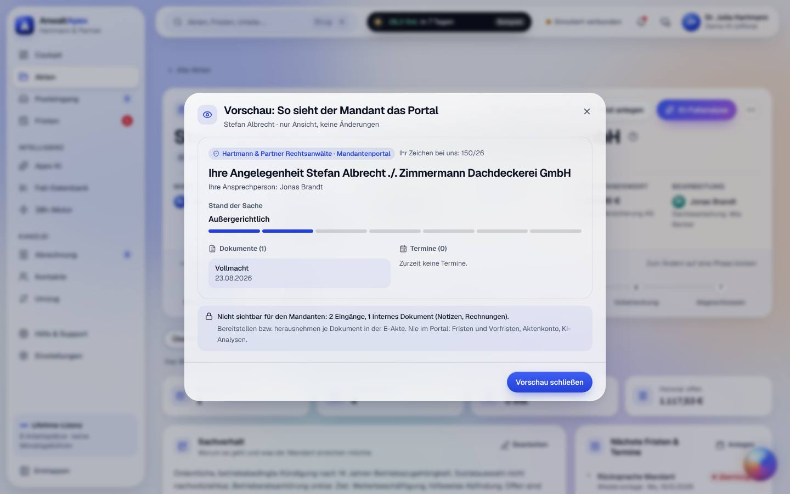 | **I2-T02-01 (K)** – Nach Fehlzuordnung und Rücknahme: Mandantenportal 150/26 (Stefan Albrecht) zeigt nur die Vollmacht; „Nicht sichtbar: 2 Eingänge …“ (D hell). |
| 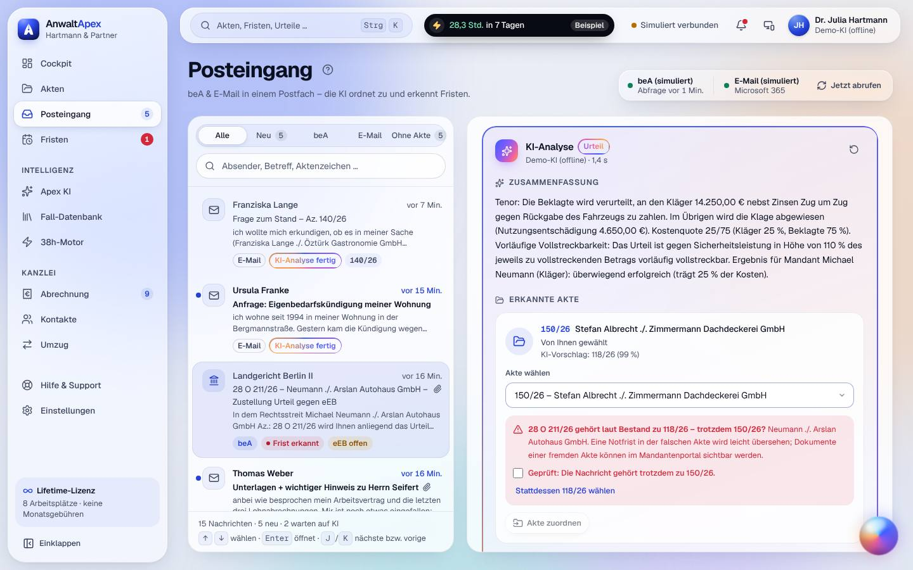 | **I2-T02-02 (M)** – „28 O 211/26 gehört laut Bestand zu 118/26 – trotzdem 150/26?“ mit Pflichtbestätigung und „Stattdessen 118/26 wählen“ (D hell). |
| 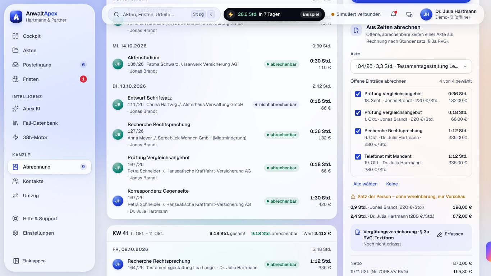 | **I2-T07-01 (K)** – 104/26: Jonas Brandt mit 220 €/Std. in der Zeitliste und in „Aus Zeiten abrechnen“ (0,9 Std. = 198,00 €) (L hell). |
| 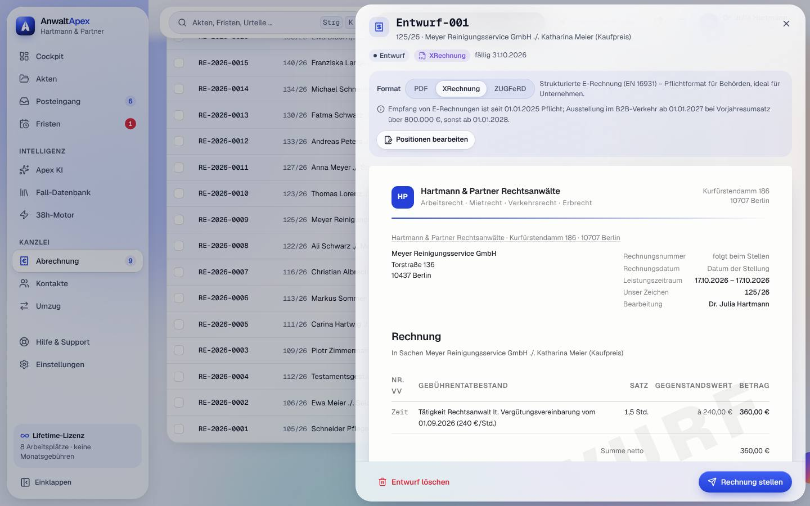 | **I2-T07-03, I2-T07-06** – Rechnung aus 1 von 3 Einträgen: 1,5 Std. à 240,00 € = 360,00 €, Leistungszeitraum nur der abgerechnete Tag (D hell). |
| 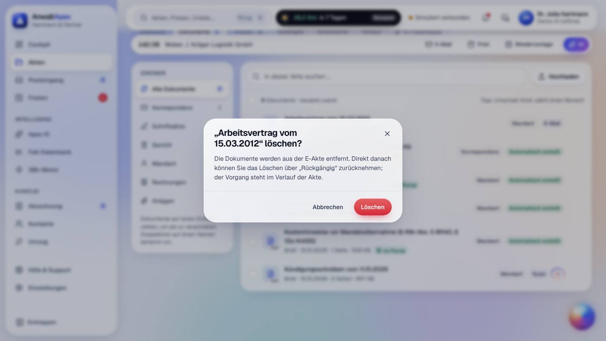 | **I2-T03-01 (H)** – Löschen-Rückfrage: Anfangsfokus auf „Abbrechen“, Hintergrund inert (L hell). |
| 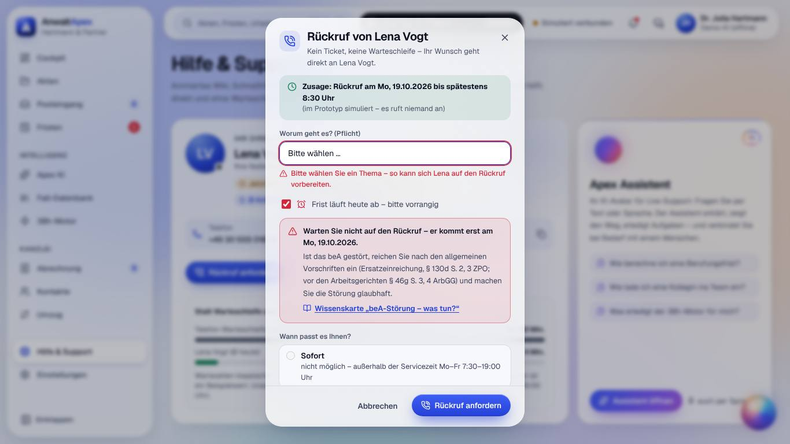 | **I2-T12-01 (H)** – „Frist läuft heute ab“ außerhalb der Servicezeit: Hinweis auf die Ersatzeinreichung mit Normen und Wissenskarte, Fehler am Feld (L hell). |
| 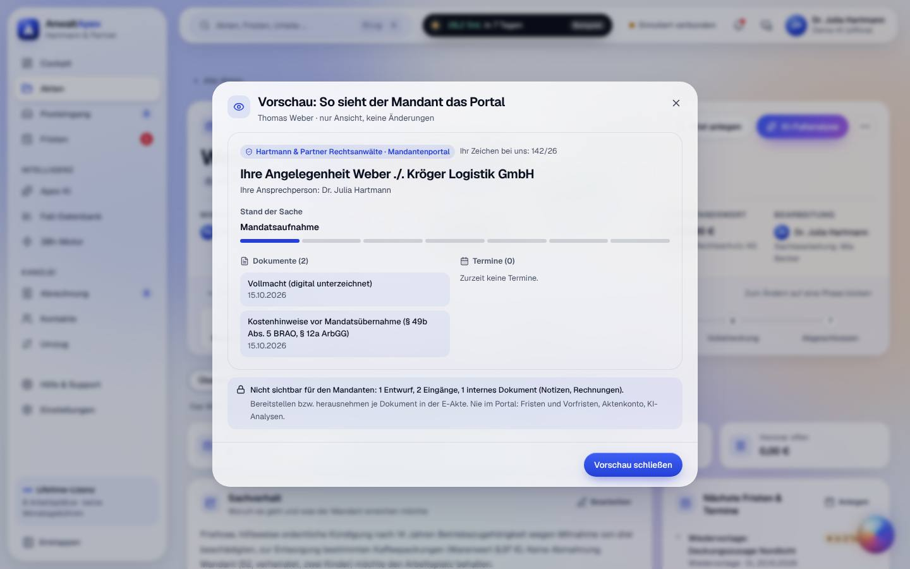 | **I2-T23-01 (H)** – Mandantenvorschau 142/26: Vollmacht und Kostenhinweise, die Deckungsanfrage (Entwurf) ist nicht sichtbar (D hell). |
| 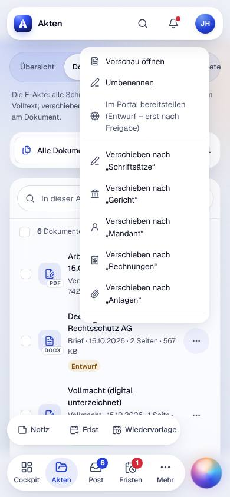 | **I2-T23-01 (H), Abnahme** – „Im Portal bereitstellen (Entwurf – erst nach Freigabe)“ gesperrt; das Menü öffnet nach oben, nichts liegt unter der Aktionsleiste (M hell). |
| 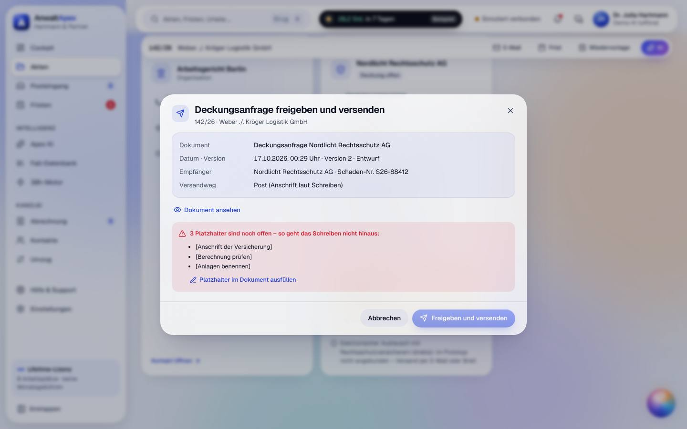 | **I2-T19-01 (H)** – „Deckungsanfrage freigeben und versenden“: Dokument, Version 2 · Entwurf, Empfänger, Versandweg; 3 offene Platzhalter, Versand gesperrt (D hell). |
| 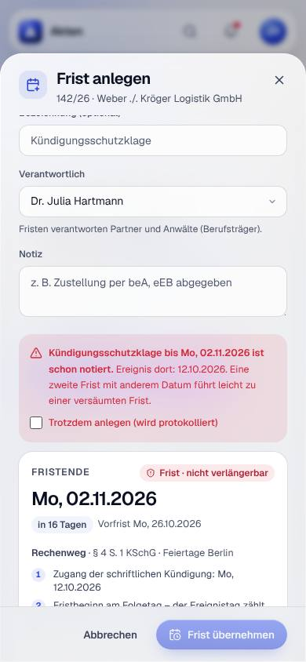 | **I2-T14-01 (H)** – „Kündigungsschutzklage bis Mo, 02.11.2026 ist schon notiert“ mit Pflichtbestätigung; Verantwortlich nur Berufsträger (M hell). |
| 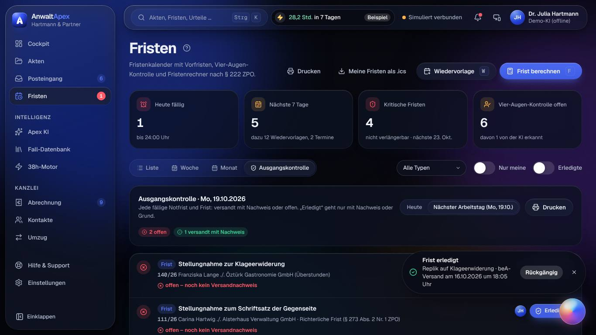 | **I2-T15-01 (H)** – Ausgangskontrolle „Nächster Arbeitstag (Mo, 19.10.)“: beA-Versand am 16.10.2026 um 18:05 Uhr (L dunkel). |
| 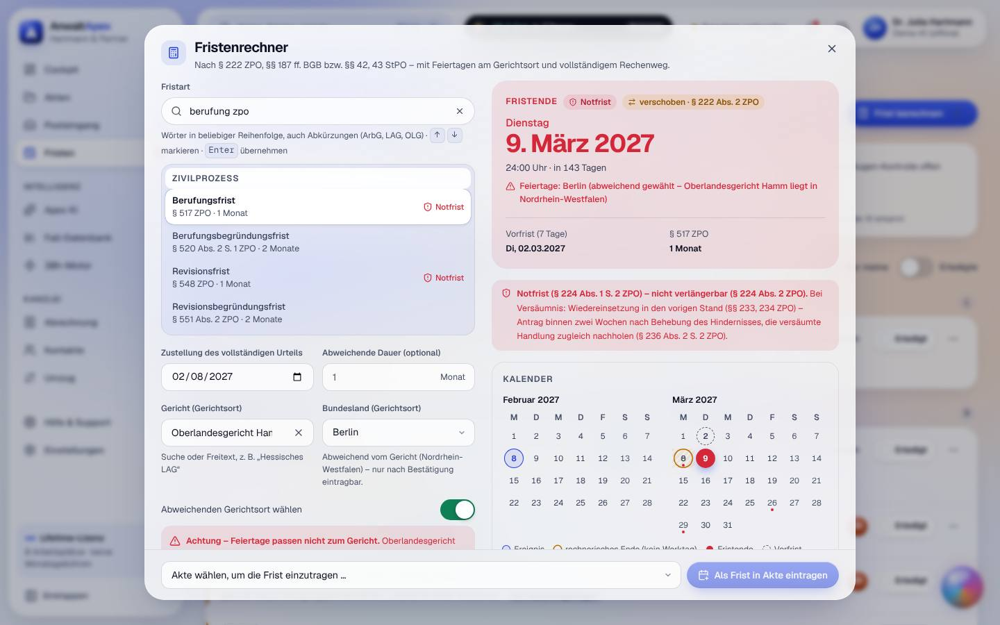 | **I2-T18-04 (H)** – Abweichender Gerichtsort nur über Schalter: rote Warnung, Di 09.03.2027, Eintragen gesperrt bis zur Bestätigung (D hell). |
| 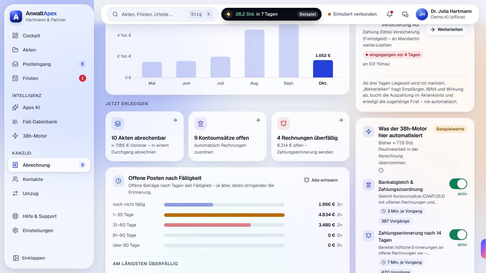 | **I2-T07-02 (H)** – Abrechnung: „Was der 38h-Motor hier automatisiert“ mit Chip „Beispielwerte“ und „3 Min. je Vorgang“ (L hell). |
| 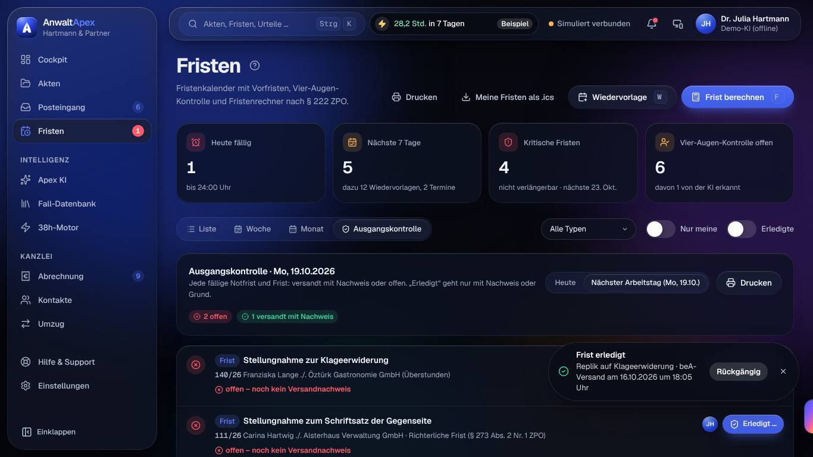 | **I2-T01-02 (M), Abnahme** – Nach „Erledigt“ in der Ausgangskontrolle: Kugel als Griff am Rand, „Erledigt …“ frei (L dunkel). |
| 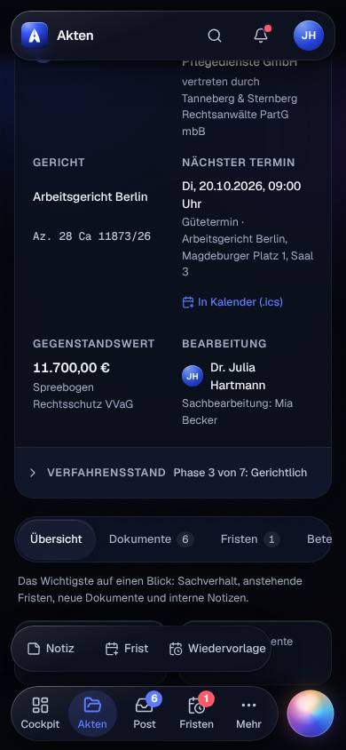 | **I2-T14-02 (M), I1-T14-04, I1-T14-07** – 151/26 am Telefon: Gütetermin mit „In Kalender (.ics)“, deckende Aktions- und Tab-Leiste (M dunkel). |
|  | **I2-T20-01 (M)** – Assistent am Telefon: „Zu ‚Schneider‘ passen 4 Akten“ – Karten auf Panelbreite (M hell). |
