# Iteration 3 – Usability-Bericht AnwaltApex

**Kundenavatar:** Claudia Reinholz (50), Fachanwältin für Arbeitsrecht, geschäftsführende Partnerin einer kleinen Sozietät in Paderborn (fiktiv)
**Schwerpunkt:** Mobil und Tablet · **Datum:** Samstag, 17.10.2026, ca. 01:00–02:20 Uhr · **Codestand:** nach Umsetzung von Iteration 2 (`SEED_VERSION` 10)
**Betrieb:** Browser-Demo (Demo-KI offline, Daten im Browserspeicher) · Chromium (Playwright, `de-DE`, Europe/Berlin) · Viewports D 1440×900, L 1366×768, M 390×844, **Tq 1024×768, Th 768×1024** · hell; T01 zusätzlich dunkel, T13 teilweise dunkel, T15 dunkel
**Testleitung:** Avatar-Werkzeug, vier Blöcke in getrennten frischen Profilen (`i3-A` … `i3-D`): A Erstkontakt, Verwaltung, Hilfe und 38h-Motor · B Alltag Mandatsarbeit · C Kanzlei, Geld und KI · D Umzug, mobil, abends, Assistent und ReFa
**Rohdaten:** [Block A](iteration-3/block-A.md) · [Block B](iteration-3/block-B.md) · [Block C](iteration-3/block-C.md) · [Block D](iteration-3/block-D.md) · Vorrunde: [Iteration 2](iteration-2.md)

> Die Zahlen stammen von einer einzigen simulierten Person. SUS, UEQ-S und Noten sind deshalb **Trendwerte** und keine Statistik.

> **Uhrzeit des Tests:** Alle vier Blöcke liefen in der Nacht auf Samstag. Geprüft wurden deshalb die Wege außerhalb der Servicezeit (T12) und der „nächste Arbeitstag“ am Wochenende (T15). Die Werktagssituationen (T12 um 16:50 Uhr, T15 um 21:30 Uhr) sind für Iteration 4 vorgemerkt (Abschnitt 10.6).

---

## 1. Kurzfazit

1. **Wieder ein deutlicher Schritt nach vorn – und erstmals kein K-Befund.**
   - SUS steigt von 71,9 auf **76,3**, die Empfehlung von 7,0 auf **7,75**. Die Note „Vertrauen“ verbessert sich von 2,88 auf **2,25**, „Fachliche Korrektheit“ von 1,88 auf **1,50**.
   - Im Nachtest sind **99 der 104 offenen IDs behoben** (95 %), 4 teilweise, 1 bleibt Testumgebung. Alle K- und H-Befunde der Vorrunde sind behoben.
   - UEQ-S pragmatisch erreicht mit **+1,63** erstmals das Abnahmeziel (≥ +1,5).
   - Der Avatar sagt: *„Das war die erste Runde, in der ich nichts nachrechnen musste, was falsch war. Die zwei Stellen, die mir Bauchweh machen, sind keine Rechenfehler, sondern Türen, durch die ein müder Mensch abends einen Fehler trägt. Die müssen zu.“*
2. **Der Fachkern ist exakt.** T18 6 von 6 Daten plus FamFG und Vertretung, T07 16 von 16 Werten plus Zeithonorar 360,00 €, T09 0,00 € Abweichung und A–C auf den Cent, T04 Klagefrist und 11.400 €, T11 0 Zeichenfehler. Die einzige fachlich falsche Stelle ist eine **Buchung**, keine Rechnung: Der Bankabgleich bucht die Honorarzahlung eines Mandanten als Fremdgeld (I3-T08-01).
3. **Schwerpunkt Mobil und Tablet: am Schreibtisch fertig, unterwegs noch nicht.**
   - Die Note „Mobil“ ist mit **2,63** die schwächste Dimension. 16 der 59 Befunde betreffen iPhone oder iPad.
   - iPhone: Lesen gelingt gut, aber an Fristen mit offener Kontrolle sind „Erledigt“ und „⋯“ nicht erreichbar, der beA-Status liegt zwei bis sechs Bildschirme tief, der KI-Datenhinweis nur per Wischen.
   - iPad: Quer bleibt die volle Seitenleiste stehen, Aktenliste und Fallanalyse werden zu schmal; hoch zeigt die Leiste nur Symbole ohne Beschriftung.
   - axe-core meldet **3 serious-Verstöße** (0 critical), alle in Stellungen, die erstmals geprüft wurden: iPhone gescrollt, iPhone Apex KI, iPad hoch.
4. **8 H-Befunde – „Türen, durch die ein müder Mensch einen Fehler trägt“.** Alle Ursachen sind, soweit Code betroffen, von der Testleitung im Code bestätigt:
   - **Honorar als Fremdgeld** (T08): Jede Handzuordnung zu einer Akte bucht ohne Rückfrage Fremdgeld.
   - **Sammelabrechnung** (T07): Nach dem Filtern rechnet sie auch die ausgeblendeten Akten ab.
   - **Überweisungsnachweis** (T15): Eine fremde Gutschrift lässt sich als Nachweis einer Fremdgeld-Weiterleitung wählen.
   - **Fristenrechner** (T18): Die Zustellung ist still mit „heute“ vorbelegt – im Akten-Dialog wurde das schon in Iteration 2 behoben.
   - **Fristkarte am iPhone** (T03): Aktionen liegen außerhalb des Bildschirms (von der Testleitung auf H angehoben).
   - **3 × axe serious:** KI-Hinweisleiste (M), RVG-Summenleiste (M), Beteiligten-Links im Aktenkopf (Th).
5. **Entscheidung der Testleitung:**
   - 64 Rohbefunde wurden zu **59 Befunden** zusammengeführt: **K 0 · H 8 · M 23 · N 28**. Eine ID-Kollision ist aufgelöst, ein Befund höher eingestuft (Abschnitt 7).
   - **Alle 59 werden umgesetzt**, 5 davon angepasst; ganz verworfen wird keiner. Teile von 4 Befunden sind verworfen bzw. an den Auftraggeber verwiesen (Abschnitt 9).
   - Dazu kommen der Rest von I2-T04-01 und die **Vorgabe der Projektleitung zur Fristverantwortung in den Demodaten** (`SEED_VERSION` 11).
   - Die Umsetzung läuft in zwei parallelen Paketen mit getrennten Dateibereichen: **A mit 17 Aufträgen, B mit 18** (Abschnitt 10).
6. **Kauf heute:** 4 × „unter Bedingungen“. Die Produktbedingungen sind genau die H-Befunde dieser Runde sowie I3-T10-01 und I3-T21-02. Die übrigen Bedingungen entscheidet der Auftraggeber: schriftliches Angebot mit Preis und Wartung, Übertragbarkeit und Escrow, KI-Verarbeitung in der EU, Impressum.

---

## 2. Kennzahlen

| Kennzahl | Iteration 3 | Abnahmeziel nach Iteration 5 |
|---|---|---|
| Aufgaben erfolgreich (ohne Umweg) | **21 / 24** · mit Umweg 3 (T07, T08, T23) · mit Hilfe 0 · abgebrochen 0 | 24 / 24 ohne Hilfe |
| Erfolgskriterium erfüllt | **24 / 24** | 24 / 24 |
| Fachlich korrekt (je Aufgabe) | **23 / 24** – nein bei T08 (Honorarzahlung als Fremdgeld gebucht) | alle Prüfwerte exakt |
| Fehlaktionen | **11** (A 2 · B 3 · C 6 · D 0) | – |
| SEQ-Mittel (1–7) | **6,0** (25 Einzelwerte; T18 lief in A und D) · A 6,0 · B 6,3 · C 5,8 · D 6,0 | – |
| SUS (Trendwert) | **76,3** (A 77,5 · B 77,5 · C 72,5 · D 77,5) | ≥ 80 |
| UEQ-S pragmatisch / hedonisch | **+1,63 / +1,31** (A +1,5/+1,25 · B +1,5/+1,5 · C +1,5/+1,25 · D +2,0/+1,25) | ≥ +1,5 / ≥ +1,5 |
| Schulnoten-Mittel | **2,07** (28 Noten) | alle ≤ 2,0; Vertrauen und Fachlich = 1 |
| Empfehlung (0–10) | **7,75** (8 · 8 · 7 · 8) | – |
| Kauf heute | **4 × „unter Bedingungen“** · 0 × nein | ja, oder Bedingungen nur noch zu Vertrag und Preis |
| axe-core serious / critical | **3 / 0** in 56 Ansichten (A 14 · B 10 · C 18 · D 14); betroffen 3 Ansichten: Apex KI · M, RVG-Rechner gescrollt · M, Akte 151/26 · Th | 0 / 0 |
| Befunde roh | 64: K 0 · H 7 · M 25 · N 32 | – |
| **Befunde nach Zusammenführung** | **59: K 0 · H 8 · M 23 · N 28** | 0 offene K und H |
| Entscheidung | 59 umsetzen (davon 5 angepasst) · 0 ganz verworfen | – |
| Nachtest Vorrunde | 104 IDs: **99 behoben** · 4 teilweise · 0 nicht behoben · 1 weiter Testumgebung | – |

**Fachliche Prüfwerte**

| Aufgabe | Ergebnis |
|---|---|
| T18 | **6/6 exakt:** 01.03.2027 (§ 188 Abs. 3 BGB) · 30.03.2027 (Ostermontag) · 09.03.2027 (BE, Frauentag) · 08.03.2027 (NW) · 08.03.2027 (3a, OLG Brandenburg) · 01.11.2027 (3b, Hessisches LAG, Allerheiligen beim Namen). Gegenprobe LAG Hamm Di 02.11.2027; § 117 FamFG 15.01. → Mo 15.03.2027; Vertretung nach § 53 BRAO |
| T07 | **16/16 exakt** (2.968,46 € / 2.797,69 €); Zeithonorar 1,5 Std. × 240 € = **360,00 € + 68,40 € = 428,40 €**; Storno RE-2026-0025 −1.117,53 €; RSV-Split 2.818,46 € + SB 150,00 €; Sammelabrechnung 4 Akten 2.281,89 € |
| T09 | **0,00 € Abweichung** (6 Abschnitte, 155,77 €), Satzwechsel 6,27 % → 6,52 % zum 01.07.2026; § 367 BGB 637,00 € → 142,51 € → 220,49 €; Zinsrechner **A 43,23 € · B 26,79 € · C 42,72 €** |
| T04 | Klagefrist **Mo 02.11.2026** mit Rechenweg; Gegenstandswert **11.400,00 €** (3 × 3.800 €) |
| T02/T03 | Berufung **Di 17.11.2026** (§ 517 ZPO), Begründung **Do 17.12.2026** (§ 520 Abs. 2 S. 1 ZPO), Vorfristen werktags 10.11./03.12. |
| T11 | **0 Zeichenfehler** (Windows-1252), 11.400,00 €, 2.180,50 €, Frist 30.10. |
| T10 | eigene Zahl 21,57 Std./Woche × 48 × 26,04 € = **26.960,77 €**; Übersicht 28,20 × 48 × 26,04 € = **35.247,74 €** |
| T14 / T19 / T00 | Widerrufsfrist **Di 03.11.2026** · Ausschlussfrist **Mi 30.12.2026** · Landing 38 × 48 × 19,74 € = **36.005,76 €**, Vorschau Mo 16.11.2026 |
| T08 | **fachlich nein:** Die Honorarzahlung 1.117,53 € (Albrecht, 150/26) wird bei Zuordnung zur Akte als Fremdgeld gebucht |

**Schulnoten je Dimension** (1 = sehr gut … 6 = ungenügend)

| Dimension | A | B | C | D | Mittel | Iteration 2 |
|---|---|---|---|---|---|---|
| Look & Feel | 2 | 2 | 2 | 2 | **2,0** | 2,0 |
| Lesbarkeit | 2,5 | 2 | 2 | 2 | **2,13** | 2,0 |
| Verständlichkeit | 2 | 2 | 2 | 2 | **2,0** | 2,0 |
| Vertrauen und Seriosität | 2,5 | 2 | 2,5 | 2 | **2,25** | 2,88 |
| Tempo | 2 | 2 | 2 | 2 | **2,0** | 2,13 |
| Fachliche Korrektheit | 1,5 | 1,5 | 2 | 1 | **1,5** | 1,88 |
| Mobil | 2,5 | 3 | 3 | 2 | **2,63** | 2,0 (nur A, D) |

**Aufgaben im Überblick**

| Aufgabe | Block · Viewport | Ergebnis | Erfolgskriterium | SEQ | Fehlakt. |
|---|---|---|---|---|---|
| T00 Landing | A · D, M (+ M dunkel) | erledigt | **erfüllt:** 5 von 5 Zielen in je ≤ 2 Aktionen (M je +1) | 6 | 0 |
| T21 Apex Console | A · D | erledigt | **erfüllt:** 18 / 18 Aktionen, Paderborn → NRW, Einladung 4/4; Anbieter-Person fehlt im Protokoll (M) | 6 | 0 |
| T16 Erste Anmeldung | A · L | erledigt | **erfüllt:** 6 / 8 Aktionen, 3 von 3 Fehlermeldungen mit nächstem Schritt | 6 | 1 |
| T18 Fristenrechner | A (3b) + D (1, 2, 3a, 4, 5) · D | erledigt | **erfüllt:** 6/6 Daten, FamFG, Vertretung; Zustellung still „heute“ (H) | 6 / 6 | 1 / 0 |
| T10 38h-Motor | A · L | erledigt | **erfüllt:** eigene Zahl aus eigenen Mengen, Werte gespeichert | 6 | 0 |
| T12 Störung, Hilfe | A · L, M | erledigt | **erfüllt:** § 46g S. 3, 4 ArbGG / § 130d S. 2, 3 ZPO; Rückruf 1 Aktion (L) / 2 (M) | 6 | 0 |
| T13 Einstellungen | A · D (+ L dunkel 112 %) | erledigt | **erfüllt:** 7 von 7 in ≤ 3 Aktionen; Prüfpunkte 10/12 | 6 | 0 |
| T01 Cockpit | B · D hell + dunkel, L, M | erledigt | **erfüllt:** 4 von 4 ohne Scrollen (D); am iPhone beA-Status erst bei y ≈ 1.627 | 6 | 0 |
| T02 beA-Posteingang | B · D, M | erledigt | **erfüllt:** 118/26 zu 99 %, beide Rechenwege in 3 Aktionen | 7 | 0 |
| T03 eEB, Vier-Augen | B · D, M | erledigt | **erfüllt:** Protokoll 4/4, Fristübernahme 1 Aktion; am iPhone „Erledigt“ unerreichbar (H) | 6 | 1 |
| T04 Mandatsaufnahme | B · L | erledigt | **erfüllt:** 17 / 25 Aktionen, Kollision vor der Anlage | 6 | 0 |
| T05 E-Akte | B · D, M | erledigt | **erfüllt:** 10 / 12 Aktionen, Verbleib in der Akte | 6 | 0 |
| T17 Kontakte | B · D | erledigt | **erfüllt:** Dublette und Löschsperre (§ 50 BRAO), Art. 15 in 3 Aktionen | 7 | 0 |
| T23 Aktenübersicht, Nachfolge | B · D, Tq | mit Umweg | **erfüllt:** 3 Akten in 4 Aktionen übergeben, Verlauf 3/3; Tq: eine Zeile sichtbar | 6 | 2 |
| T06 Fallanalyse, Suche | C · D, Tq | erledigt | **erfüllt:** 3/3 Entscheidungen, Strg+K 5 ms; M: Datenhinweis nur per Wischen (H) | 6 | 1 |
| T07 Abrechnung | C · D (+ L) | mit Umweg | **erfüllt** (16/16, 360,00 €); Sammelabrechnung rechnet Ausgeblendetes ab (H) | 5 | 3 |
| T08 Bankabgleich, Fremdgeld | C · L | mit Umweg | **erfüllt:** 0 Buchungen unter 90 % ohne Bestätigung; Honorar als Fremdgeld (H) | 5 | 2 |
| T09 Forderungskonto | C · D | erledigt | **erfüllt:** 0,00 €, A–C exakt | 7 | 0 |
| T19 Dokument-Analyse | C · D | erledigt | **erfüllt:** Ausschlussfrist erkannt, Fristende vom Fristenrechner, Verwerfen ändert nichts | 6 | 0 |
| T11 Umzug | D · D | erledigt | **erfüllt:** 0 Zeichenfehler, Dublette vor dem Import | 6 | 0 |
| T14 Mobil am Gericht | D · M, Th | erledigt | **erfüllt:** Akte in 2 Taps, Notiz + Widerrufsfrist in 9 Aktionen | 6 | 0 |
| T15 Dunkelmodus, Tagesabschluss | D · L dunkel | erledigt | **erfüllt:** 0 heute fällige Fristen ohne Kennzeichnung; fremde Gutschrift als Nachweis (H) | 6 | 0 |
| T20 Apex Assistent | D · D, M (Gegenprobe Deniz) | erledigt | **erfüllt:** 5/5 Befehle (D); Deniz mit Kürzeln 3/5 voll | 6 | 0 |
| T22 Petras Vormittag (ReFa) | D · L | erledigt | **erfüllt:** ReFa kann kein eEB abgeben; Petra 5/5 ohne Schulung | 6 | 0 |

**Mobil und Tablet (Schwerpunkt dieser Runde)**

| Gerät | Geprüft | Eindruck | Befunde |
|---|---|---|---|
| iPhone (M 390×844) | T00, T01, T02, T03, T05, T12, T14, T20; Stichproben RVG-Rechner, Bankabgleich, Forderungskonto, Apex KI | Kein Querscrollen der Seite, Rechenwege gut lesbar, Akte 151/26 mit 0 Bedienflächen unter 44 px. Es fehlen erreichbare Fristaktionen, ein schneller Systemstatus, antippbare Nummern und freie Sicht unter schwebenden Leisten. | I3-T03-01 (H↑), I3-T06-01 (H), I3-T07-02 (H), I3-T03-05, I3-T05-01, I3-T12-01, I3-T12-02 (+ I3-T01-01), I3-T02-01, I3-T02-02, I3-T12-03, I3-T14-03, I3-T00-01 |
| iPad quer (Tq 1024×768) | T06, T23 | Bedienbar, aber die volle Seitenleiste (264 px) lässt zu wenig Platz: Aktenliste mit einer sichtbaren Zeile, Fallanalyse in einer Zeitungsspalte | I3-T23-01, I3-T06-02 |
| iPad hoch (Th 768×1024) | T14 | Akte gut lesbar, aber die Leiste zeigt nur Symbole; zwei Links im Aktenkopf sind 20 px hoch | I3-T14-01, I3-T14-02 (H) |

---

## 3. Vergleich zur Vorrunde

| Kennzahl | Iteration 1 | Iteration 2 | Iteration 3 | Veränderung zu I2 | Ziel nach Iteration 5 |
|---|---|---|---|---|---|
| Aufgaben ohne Umweg | 6 / 24 | 22 / 24 | **21 / 24** | −1 | 24 / 24 |
| Erfolgskriterium erfüllt | 8 / 24 | 24 / 24 | **24 / 24** | ± 0 | 24 / 24 |
| Gescheitert oder abgebrochen | 6 | 0 | **0** | ± 0 | 0 |
| Fachlich korrekt | – | 22 / 24 | **23 / 24** | +1 | alle |
| Fehlaktionen | 25 | 12 | **11** | −1 | – |
| SEQ-Mittel | 4,6 | 5,8 | **6,0** | +0,2 | – |
| SUS (Trendwert) | 65,6 | 71,9 | **76,3** | +4,4 | ≥ 80 |
| UEQ-S pragmatisch | +1,13 | +1,44 | **+1,63** | +0,19 (Ziel erreicht) | ≥ +1,5 |
| UEQ-S hedonisch | +1,25 | +1,38 | **+1,31** | −0,06 | ≥ +1,5 |
| Schulnoten-Mittel | 2,6 | 2,13 | **2,07** | −0,06 (besser) | alle ≤ 2,0 |
| Note Vertrauen | 3,5 | 2,88 | **2,25** | −0,63 (besser) | 1 |
| Note Fachliche Korrektheit | 2,75 | 1,88 | **1,50** | −0,38 (besser) | 1 |
| Note Mobil | 2,67 | 2,0 (2 Blöcke) | **2,63** (4 Blöcke) | +0,63 (schlechter, Schwerpunkt) | ≤ 2,0 |
| Empfehlung (0–10) | 5,5 | 7,0 | **7,75** | +0,75 | – |
| Kauf heute | 0 × ja | 4 × unter Bedingungen | **4 × unter Bedingungen** | gleich; Bedingungen kleiner und konkreter | ja bzw. nur Vertrag und Preis |
| axe-core serious / critical | 14 / 6 in 49 Ansichten | 0 / 0 in 51 | **3 / 0 in 56** | +3 (nur neu geprüfte Stellungen M gescrollt, M Apex KI, Th) | 0 / 0 |
| Befunde nach Zusammenführung | 133 (K 4 · H 42 · M 63 · N 24) | 88 (K 2 · H 8 · M 35 · N 43) | **59 (K 0 · H 8 · M 23 · N 28)** | −29; K −2 | 0 offene K und H |
| Nachtest Vorrunde | – | 141 IDs, 124 behoben (88 %) | **104 IDs, 99 behoben (95 %)** | +7 Prozentpunkte | – |

**Einordnung:**

- **Weniger Aufgaben ohne Umweg trotz besserer Werte.** Die drei Umwege (T07, T08, T23) entstanden an neuen Grenzfällen: Filter und Auswahl in der Sammelabrechnung, Zuordnung einer Zahlung zu einer Akte, iPad-Ansicht der Aktenliste. Bei T23 kamen zwei Fehlaktionen hinzu, weil die Demodaten schon zwei Akten mit aktivem Portal enthalten (Hinweis für Iteration 4).
- **Mobil schlechter, alles andere besser.** Die Mobil-Note sinkt, weil diese Runde iPhone und iPad erstmals in allen Blöcken geprüft hat. Vertrauen, Fachlichkeit und Tempo verbessern sich. Die neuen axe-Verstöße liegen ausschließlich in Stellungen, die vorher nicht geprüft wurden.
- **Die Gewichte verschieben sich weiter.** Kein K-Befund mehr. Die H-Befunde sind keine Rechenfehler, sondern fehlende Sicherungen an Stellen, an denen ein Mensch unter Zeitdruck danebengreift.

---

## 4. Nachtest-Ergebnisse

Geprüft wurden **alle 104 offenen IDs** der Vorrunde: die 88 Befunde von Iteration 2 und die 16 offenen IDs von Iteration 1. Einige IDs liefen in mehreren Blöcken (z. B. I2-T18-01, -02 und -04 in A und D, I2-T01-02 in B, C und D). Belegt ein Block einen konkreten Rest, zählt die ID als „teilweise“ (das betrifft I2-T01-02).

| Status | IDs | Anteil |
|---|---|---|
| behoben | **99** | 95 % |
| teilweise | **4** | 4 % |
| nicht behoben | **0** | – |
| weiter Testumgebung (nicht prüfbar) | 1 | – |

- **Alle K- und H-Befunde von Iteration 2 sind behoben:**
  - K: I2-T02-01 (Urteil in fremder Akte nach Rücknahme) und I2-T07-01 (Stundensatz 220/280 €).
  - H: I2-T03-01 (Fokusfalle), I2-T12-01 (Notfallrat zur Ersatzeinreichung), I2-T23-01 (Portal nur Freigegebenes), I2-T19-01 (Freigabe bei Platzhaltern gesperrt), I2-T14-01 (Akten-Dialog ohne Vorbelegung), I2-T07-02 (Beispielwerte gekennzeichnet), I2-T15-01 (Versand- und Protokollzeit getrennt), I2-T18-04 (Gericht vor Bundesland).
- Von den 88 Befunden der Iteration 2 sind **85 behoben**, 3 teilweise. Von den 16 Vorrunden-IDs aus Iteration 1 sind 14 behoben.

**Nicht vollständig behoben**

| ID | S | Status | Was fehlt noch | weiter in |
|---|---|---|---|---|
| I1-T00-02 | H | teilweise | Impressum ist weiter ein gekennzeichneter Platzhalter (§ 5 DDG). | Auftraggeber |
| I2-T04-01 | M | teilweise | Kalender und Kennzahl sagen „nicht verlängerbar“, im Reiter „Fristen“ der Akte heißt die rote Pille nur „Frist“. | B-11 |
| I2-T14-04 | N | teilweise | Am iPhone steht in der Fristart-Suche weiter „↑ ↓ markieren · Enter übernehmen“. | I3-T14-03 (B-04) |
| I2-T01-02 | M | teilweise | Im Cockpit, in der Ausgangskontrolle, in der Sammelabrechnung und am iPhone behoben; auf D liegt die Kugel in Fallanalyse und Forderungskonto, auf L im Systemstatus noch über Text und Kennzahlen. | I3-T06-05 (A-07) |
| I1-T07-07 | N | nicht prüfbar | Datumsfelder im US-Format: Das Avatar-Werkzeug startet Chromium weiter nur mit `locale: "de-DE"`, ohne `--lang=de-DE`. | Testleitung (Abschnitt 10.6) |

**Behoben mit neuem Folgebefund** (die alte ID ist erledigt, der Rest hat eine neue ID): I2-T14-01 → I3-T18-02 (Fristenrechner) · I2-T15-03 → I3-T15-01 (Plausibilität des Überweisungsnachweises) · I2-T02-03 → I3-T03-02 (Korrektur-Dialog) · I2-T18-02 → I3-T18-01 (Markierung) · I2-T16-04 → I3-T16-01 (Spaltenmenü) · I2-T21-02 → I3-T21-02 (Person und Anlass) · I2-T22-01 → I3-T22-01 (W im Posteingang) · I2-T22-04 → I3-T08-04 (Bankabgleich) · I2-T07-04 → I3-T07-04 (Satz im Dialog) · I2-T06-02 → I3-T06-06 (Stand oben) · I2-T04-03 → I3-T04-01 (leerer Entwurf) · I1-T14-05 → I3-T14-02 (Th).

---

## 5. Die stärksten O-Töne

**Kritik**

> „Wenn Frau Schulte das so weiterleitet, überweisen wir dem Mandanten sein eigenes Honorar zurück.“ – T08, Zuordnung einer Mandantenzahlung zur Akte

> „Wenn ich auf ‚Deckung erteilt‘ filtere und das Programm trotzdem zehn Rechnungen machen will, dann ist das eine Falle. In die tappt Frau Schulte am Monatsende garantiert.“ – T07, Sammelabrechnung

> „Eine Fremdgeld-Weiterleitung mit einer Gutschrift von Frau Schneider ‚nachweisen‘? Das darf nicht gehen.“ – T15, Ausgangskontrolle

> „Warum steht da schon ‚heute‘ als Zustellung?“ – T18, Fristenrechner

> „Im Gericht will ich eine Frist erledigen – und der Knopf ist einfach weg.“ – T03, Fristkarte am iPhone

> „Zeigen Sie mir den Rechenweg – aber bitte zweimal denselben.“ – T03, Korrektur-Dialog

> „Dass sich die Fristerkennung mit einem Klick ohne Rückfrage ausschalten lässt, zeige ich Hollmann lieber nicht.“ – T10

> „Im Protokoll steht aber nur ‚AnwaltApex (System)‘. Ich will wissen, wer bei Ihnen das war und warum.“ – T21

> „Auf dem iPad sehe ich von der Aktenliste genau eine Zeile.“ – T23 · „Am iPad hoch rate ich, welches Symbol was ist.“ – T14

> „Bei 112 % ist mein Menüpunkt ‚Einstellungen‘ weg, und das ist genau die Größe, die ich brauche.“ – T13

> „Mit ganzen Sätzen top, mit Kürzeln Glückssache. ‚WV‘ muss sitzen.“ – Deniz Kaplan, T20

**Lob**

> „Das war die erste Runde, in der ich nichts nachrechnen musste, was falsch war.“ – Block D, Gesamteindruck

> „Am Schreibtisch ist das jetzt ein Werkzeug, dem ich Fristen anvertrauen würde – Rechenweg, eEB-Sperre, Vier-Augen und Protokoll stimmen.“ – Block B, Gesamteindruck

> „Ein Uhr nachts, und das Ding sagt mir: Warten Sie nicht, reichen Sie ersatzweise ein. So muss das sein.“ – T12

> „Genau so: Allerheiligen beim Namen, und warum es hier nicht zählt. Darauf kann ich mich verlassen.“ – T18 Fall 3b

> „Tenor, Kostenquote, Kammergericht – stimmt alles. Und wenn ich mich verklicke, hält mich das System fest, bevor eine Notfrist in der falschen Akte landet.“ – T02

> „Jeder Abschnitt, jeder Satzwechsel, jede Teilzahlung nach § 367 – ich habe nachgerechnet und nichts gefunden. Diese Aufstellung gebe ich so zum Gerichtsvollzieher.“ – T09

> „Das ist der erste Umzug, bei dem ich keine Angst um die Umlaute habe.“ – T11

> „Einundzwanzig Stunden bei uns, aus Ihren Minuten und meinen Mengen. Das zeige ich Hollmann.“ – T10

> „Die Maschine sagt mir, dass sie die Fälligkeit nicht kennt, statt eine zu erfinden.“ – T19

> „Vor Saal 3 mit einer Hand: Termin, Az., Gegenseite, Kündigung – und die Widerrufsfrist rechnet richtig.“ – T14

> „Frau Schulte: ‚U, E, W – das kann ich mir merken.‘“ – T22

---

## 6. Was gut war

- **Fristen**
  - Alle Prüfdaten exakt; der Rechenweg nennt Norm und Feiertag beim Namen („Allerheiligen – in NRW Feiertag, in Hessen (Gerichtsort) nicht“, „Frauentag nur in Berlin“, „rechnerisch 29.02.2027 – diesen Tag gibt es nicht“).
  - Das Gericht legt das Bundesland fest; ein abweichender Ort geht nur per Schalter mit roter Warnung und Pflichthäkchen.
  - Vertretung nach § 53 BRAO nur durch Berufsträger, Hinweis im Cockpit über die ganze Abwesenheit.
- **Posteingang und eEB**
  - Die K-Lücke der Vorrunde ist zu: Umzuordnung hin und zurück lässt nichts in der fremden Akte, beide Verläufe protokollieren; Warnung bei fremdem Gerichts-Az. mit Pflichtbestätigung.
  - eEB gesperrt mit Grund, Datum begrenzt, Hinweis auf offene Vier-Augen-Kontrolle, Protokoll 4/4, Doppelklick harmlos.
  - Kürzel J/K, U, E und W; die ReFa legt das eEB vor, abgeben kann sie es nicht (§ 173 Abs. 3 ZPO erklärt).
- **Ausgangskontrolle:** Versandzeit und Protokollzeit getrennt, „Nächster Arbeitstag (Mo, 19.10.)“ am Samstag, Druckansicht, Dunkelmodus ruhig.
- **Mandatsaufnahme und Kontakte:** Kollisionsprüfung vor der Anlage, Ablehnung mit Vermerk; Entwurf übersteht Browser-Neustart; Dublette vor dem Speichern; Löschsperre mit § 50 BRAO; Art.-15-Auskunft mit Prüfhinweis zur Verschwiegenheit.
- **Mandantenportal und Nachfolge:** Portal zeigt nur Freigegebenes, „Nicht sichtbar für den Mandanten: …“; Übergabe von 3 Akten in 4 Aktionen; Aufbewahrung bis 31.12.2032 berechnet.
- **Geld**
  - RVG 16/16 mit § 60 RVG, Eingaben überstehen Neuladen; Storno mit eigener Nummer und Korrekturentwurf.
  - Zeitabrechnung nur mit Vergütungsvereinbarung (§ 3a RVG), Satz und Datum auf der Rechnung, XRechnung automatisch.
  - Bankabgleich mit Sicherheitsstufen, Regel, Person und Uhrzeit je Buchung, „Zuordnung lösen“; Fremdgeld-Weiterleitung mit IBAN-Prüfziffer und pain.001.
  - Forderungskonto und Zinsrechner auf den Cent.
- **KI-Disziplin:** echte Entscheidungen mit Datum, „KI-Schätzwert, keine Wahrscheinlichkeit“, „ohne Beleg – anwaltlich prüfen“; Ausschlussfrist erkannt, Fälligkeit erfragt; Version 2 statt zweiter Datei; Freigabe bei Platzhaltern gesperrt.
- **Erstkontakt und Verwaltung:** Console leitet NRW aus Paderborn ab, Einladung ehrlich und ohne Passwort; Protokoll mit Anmeldung, Fehlversuch, Abmeldung und Anbieter-Eingriff; Passwort-Fehlermeldungen mit nächstem Schritt; Strg+K findet Lizenz, § 43e und Passwort.
- **38h-Motor:** eigene Zahl aus eigenen Mengen auf den Cent, gespeichert; Was-Wann-Freigabe 12/12.
- **Umzug:** Windows-1252 erkannt, Dublette mit „Frist wird nur einmal angelegt“, Akte ohne Abschlussdatum vorgelegt, unterbrochener Lauf vollständig zurückgenommen.
- **Mobil:** Akte 151/26 in 2 Taps, Notiz als Bottom-Sheet mit Diktat, Rechenweg am iPhone gut lesbar, mobile Hilfetexte statt Desktop-Hinweisen, kein Querscrollen der Seite.
- **Barrierefreiheit:** 53 von 56 Ansichten ohne serious/critical; D und L durchgehend 0.

---

## 7. Befunde nach Bereich

**So sind die Tabellen zu lesen:**

- **S** ist der Schweregrad: **K** kritisch, **H** hoch, **M** mittel, **N** niedrig. „↑“ heißt: von der Testleitung höher eingestuft.
- **Paket A** heißt „Rahmen, Design, Einstieg, Logik & Daten“, **Paket B** heißt „Fachseiten“. Die Nummer verweist auf den Auftrag in Abschnitt 10.4; „(+ A-xx)“ nennt den Teil im anderen Paket.
- Zeilen mit einer **I2-ID** sind offene Befunde der Vorrunde. Sie behalten ihre ID, laufen mit und sind in den Summen nicht enthalten.

**ID-Kollision aufgelöst:** Block A und Block D haben beide `I3-T18-01` vergeben. Wie in Iteration 2 behält Block A die ID (Markierung in der Fristart-Liste, N). Der Befund aus Block D (Zustellung im Fristenrechner still „heute“, H) heißt jetzt **I3-T18-02**.

**Zusammengeführt** (die zusammengeführte ID bleibt gültig und zählt im Nachtest mit):

- I3-T01-01 → **I3-T12-02** (beA- bzw. Systemstatus am iPhone nicht im ersten Bildschirm; eine Lösung: Statuspunkt in der mobilen Kopfleiste)
- I3-T20-03 → **I3-T12-01** (Durchwahl der Ansprechpartnerin in der Assistent-Antwort als `tel:`-Link)
- I3-T06-04 → **I3-T03-03** (Meldungen liegen über Bedienelementen offener Dialoge und Drawer)
- I3-T12-07 → **I3-T06-05** (Assistent-Kugel weicht über Text und Kennzahlen nicht aus; Rest von I2-T01-02)
- I3-T22-02 → **I3-T08-04** („≈ x Min. gespart“ im Bankabgleich ohne Kennzeichnung als Schätzung)

**Neu eingestuft:** I3-T03-01 von M auf **H**. Am iPhone sind „Erledigt“, „Korrigieren“, „Streichen“ und „Details“ an Fristen mit offener Kontrolle weder sichtbar noch erreichbar. Damit ist eine Kernaufgabe am Gerät dieser Runde nicht lösbar, nicht nur umständlich. Der Avatar nennt den Punkt als erste Kaufbedingung von Block B.

**Befunde je Bereich und Schwere** (nach Zusammenführung)

| Bereich | K | H | M | N | gesamt |
|---|---|---|---|---|---|
| Landing | – | – | – | 3 | 3 |
| Apex Console und Zugang | – | – | 1 | 1 | 2 |
| Rahmen: Seitenleiste, Kopfleiste, Menüs, Meldungen, Kürzel, Strg+K, Kugel, Cockpit | – | – | 7 | 2 | 9 |
| Akten (Liste, Kopf, Akte mobil, Vorschau, Mandatsaufnahme, Portal) | – | 1 | 3 | 4 | 8 |
| Posteingang | – | – | – | 3 | 3 |
| Fristen und Fristenrechner | – | 3 | 2 | 3 | 8 |
| Apex KI und Fall-Datenbank | – | 1 | 2 | 1 | 4 |
| 38h-Motor | – | – | 1 | 1 | 2 |
| Abrechnung | – | 3 | 3 | 4 | 10 |
| Umzug | – | – | – | 2 | 2 |
| Hilfe und Support | – | – | 1 | 4 | 5 |
| Einstellungen | – | – | 1 | – | 1 |
| Apex Assistent | – | – | 2 | – | 2 |
| **Summe** | **0** | **8** | **23** | **28** | **59** |

### 7.1 Landing (`/willkommen`)

| ID | S | Kategorie | Befund | Entscheidung | Paket |
|---|---|---|---|---|---|
| I3-T00-01 | N | Look & Feel | Das aufgeklappte Menü am iPhone ist eine durchscheinende Glasfläche; die Hero-Schrift schimmert durch. | **umsetzen** – deckend wie die Tab-Leiste (I2-T14-02) | A-13 |
| I3-T00-02 | N | Vertrauen | „45 bis 60 Minuten in der Telefon-Warteschleife“ steht ohne Beleg; in Hilfe und Vergleich ist dieselbe Aussage gekennzeichnet. | **umsetzen** | A-13 |
| I3-T00-03 | N | Fachlich | Die Vorschau nennt „Landgericht Berlin II“, der Rechenweg aber „Gerichtsort noch offen – Kanzleisitz (Berlin)“, obwohl das Kammergericht bekannt ist. Ergebnis Mo 16.11.2026 stimmt. | **umsetzen** | A-13 |

### 7.2 Apex Console und Zugang (`/console`, Protokoll)

| ID | S | Kategorie | Befund | Entscheidung | Paket |
|---|---|---|---|---|---|
| I3-T21-02 | M | Vertrauen | „Neues Startpasswort“ fragt weder nach Wunsch noch Anlass; das Kanzlei-Protokoll nennt nur „AnwaltApex (System)“, nicht die Person beim Anbieter. | **umsetzen, angepasst** – Pflichtfelder „Angefordert von“ und „Anlass“, Person und Anlass im Protokoll; statt E-Mail eine Benachrichtigung in der App (der Prototyp versendet keine E-Mails) | A-08 |
| I3-T21-01 | N | Fehler | Zugang am 17.10. um 01:05 Uhr angelegt, überall „seit 16.10.2026“: `lizenz.seit` entsteht aus dem UTC-Datum (`src/core/seed/kunde.ts:46`, im Code bestätigt). | **umsetzen** – Ortszeit; auch `src/pages/umzug/Schritte.tsx:577` | A-08 (+ B-18) |

### 7.3 Rahmen: Seitenleiste, Kopfleiste, Menüs, Meldungen, Kürzel, Strg+K, Kugel, Cockpit

| ID | S | Kategorie | Befund | Entscheidung | Paket |
|---|---|---|---|---|---|
| I3-T16-01 | M | Bedienbarkeit | „Spalten wählen“ (Akten, L ungescrollt) öffnet nach oben hinter Kacheln und Ansichten-Leiste; 7 von 8 Einträgen verdeckt, „Gericht“ nicht klickbar. Ursache im Code: Das Menü rendert im Tabellencontainer mit `overflow: hidden` und klappt seit I2 nach oben. | **umsetzen** – Menüs zentral in eigener Ebene (Portal) | A-02 |
| I3-T13-01 | M | Barrierefreiheit | Bei Schriftgröße 112 % überdeckt auf D die Lizenz-Kachel „Einstellungen“; auf L ist „Einstellungen“ ohne Scrollen nicht zu sehen, an der Stelle liegt „Einklappen“. | **umsetzen** | A-03 |
| I3-T14-01 | M | Mobil | iPad hoch: Leiste nur mit Symbolen, Erklärung nur im `title`; Name der Links mit Zähler ist nur die Zahl („6“); Links 56×40 px. | **umsetzen** – beschriftete Leiste, auch für iPad quer (Grundlage für I3-T23-01 und I3-T06-02) | A-03 |
| I3-T12-02 | M | Mobil | Am iPhone fehlt der Systemstatus in der Kopfleiste; Weg über Mehr → Hilfe und ≈ 4.850 px Scrollen. Zusammengeführt mit I3-T01-01: Im Cockpit steht „beA ✓ · E-Mail ✓“ erst bei y ≈ 1.627, auch das Briefing nennt ihn nicht. | **umsetzen** | A-04 |
| I3-T03-03 | M | Bedienbarkeit | Die Meldung „Kontrolle bestätigt“ liegt über dem offenen Korrektur-Dialog und verdeckt „Korrektur speichern“. Zusammengeführt mit I3-T06-04: „Zitat kopiert“ liegt über „An Akte heften“ im Drawer. | **umsetzen** – zentral im Toaster | A-05 |
| I3-T22-01 | M | Tempo | W im Posteingang öffnet die Wiedervorlage mit leerem Aktenfeld, obwohl die geöffnete Nachricht 142/26 zugeordnet ist. | **umsetzen** | A-06 |
| I3-T07-04 | M | Bedienbarkeit | Der Dialog „Zeit erfassen“ (Z, Strg+K) zeigt weder Stundensatz noch Vereinbarung; dass 125/26 keine Vereinbarung hat, sieht man erst beim Abrechnen. | **umsetzen** | A-06 (+ B-14) |
| I3-T06-03 | N | Bedienbarkeit | Strg+K bei offener Dokumentansicht meldet nur „Suche gerade nicht verfügbar“; Getipptes geht verloren. | **umsetzen** – reine Ansichten schließt Strg+K selbst | A-07 |
| I3-T06-05 | N | Look & Feel | Die Kugel liegt über Text und Kennzahlen (Fallanalyse, Forderungskonto auf D; Systemstatus auf L). Zusammengeführt mit I3-T12-07; Rest von I2-T01-02. | **umsetzen** | A-07 |

### 7.4 Akten (`/akten`): Liste, Kopf, Akte mobil, Vorschau, Mandatsaufnahme, Portal

| ID | S | Kategorie | Befund | Entscheidung | Paket |
|---|---|---|---|---|---|
| I3-T14-02 | H | Barrierefreiheit | axe serious `target-size` (iPad hoch, Akte 151/26): Links „Havelbrück Pflegedienste GmbH“ und „Arbeitsgericht Berlin“ im Aktenkopf nur 20 px hoch (WCAG 2.5.8). | **umsetzen** | B-10 |
| I3-T05-01 | M | Mobil | Am iPhone schwebt über der Tab-Leiste die Schnellaktionsleiste; zusammen ≈ 150 px verdecken Dokumentzeilen, bei Mehrfachauswahl liegt die zweite gewählte Zeile darunter. | **umsetzen** | B-11 |
| I3-T23-01 | M | Mobil | iPad quer: Tabelle 890 px in 694 px Container ohne Hinweis, „Bearbeitung“ und „Geändert“ unsichtbar, Kennzahlen abgeschnitten, erste Zeile bei y ≈ 680. | **umsetzen** – Liste kompakt (B), schmale beschriftete Leiste (A) | B-12 (+ A-03) |
| I3-T15-02 | M | Barrierefreiheit | Dokumentvorschau im Dunkelmodus voll papierweiß, ohne Schalter zum Dimmen (Prüfpunkt T15). | **umsetzen** | B-11 |
| I3-T04-01 | N | Bedienbarkeit | „Entwurf fortsetzen?“ erscheint auch ohne jede Eingabe; danach steht „Mandatsaufnahme fortsetzen“ dauerhaft in der Liste. | **umsetzen** | B-17 |
| I3-T04-02 | N | Verständlichkeit | Nach „Mandat ablehnen“ zeigt die Zusammenfassung weiter „Mandantenportal freischalten“ und „Das erledigt AnwaltApex automatisch …“. | **umsetzen** | B-17 |
| I3-T23-02 | N | Vertrauen | Der Dialog sagt „Im Prototyp wird die E-Mail nicht versendet“, die Meldung danach „… erhält die Zugangs-E-Mail“. | **umsetzen** | B-17 |
| I3-T23-03 | N | Fachlich | Nach „Akte abschließen“ bleibt das Mandantenportal aktiv; der Dialog fragt nicht danach. | **umsetzen** | B-10 |
| I2-T04-01 | M | Fachlich | Rest der Vorrunde: Im Reiter „Fristen“ der Akte heißt die rote Pille der Klagefrist nur „Frist“. | **weiter umsetzen** | B-11 |

### 7.5 Posteingang (`/posteingang`)

| ID | S | Kategorie | Befund | Entscheidung | Paket |
|---|---|---|---|---|---|
| I3-T02-01 | N | Mobil | „Rechenweg anzeigen“ (19 px) und „Andere Akte wählen“ (32 px) unter 44 px Höhe. | **umsetzen** | B-16 |
| I3-T02-02 | N | Mobil | Am iPhone fehlen in der Filterleiste die Zähler („Neu“, „Ohne Akte“); „Ohne Akte“ klebt am Rand. | **umsetzen** | B-16 |
| I3-T02-03 | N | Verständlichkeit | Nachricht mit 2 Anhängen; Meldung und Verlauf nennen „1 Anhang“, die `Zustellungsnachricht.xml` bleibt ohne Hinweis draußen. | **umsetzen** – beide Anhänge nennen, Strukturdaten ausdrücklich als „nicht abgelegt“ | B-16 |

### 7.6 Fristen und Fristenrechner (`/fristen`)

| ID | S | Kategorie | Befund | Entscheidung | Paket |
|---|---|---|---|---|---|
| I3-T18-02 | H | Fachlich | Fristenrechner: „Zustellung des vollständigen Urteils“ still mit heute vorbelegt; mit Fristart und Gericht erscheint sofort ein Fristende, „Als Frist in Akte eintragen“ ist eine Aktenwahl entfernt. Im Akten-Dialog seit I2-T14-01 behoben. Im Code bestätigt (`Fristenrechner.tsx:56`). (In Block D: I3-T18-01) | **umsetzen** | B-04 |
| I3-T15-01 | H | Vertrauen | Nachweis „Überweisung“ bietet Zahlungseingänge anderer Akten an; eine fremde Gutschrift (388,12 €, 137/26) ist ohne Warnung als Nachweis der Fremdgeld-Weiterleitung 131/26 wählbar. Im Code bestätigt: Die Liste filtert nur nach „nicht offen“. | **umsetzen** | B-03 |
| I3-T03-01 | H ↑ | Mobil | Am iPhone liegt die Aktionszeile in einem Container mit `overflow: hidden` (356 px, Inhalt 532 px): „Erledigt“ und „⋯“ (Korrigieren, Streichen, Details) außerhalb des Bildschirms. | **umsetzen** – auf H angehoben (Abschnitt 7, Kopf) | B-05 |
| I3-T03-02 | M | Fachlich | Der Korrektur-Dialog rechnet mit „Gerichtsort noch offen – Kanzleisitz (Berlin)“, obwohl dieselbe Frist sonst „Berlin (Kammergericht, Berufungsgericht)“ nennt; kein Feld für den Gerichtsort. Im Code bestätigt: Der Ort der Frist wird nicht gespeichert, `feiertagsOrt` nicht übergeben. | **umsetzen** – Gerichtsort an der Frist speichern und in der Korrektur verwenden | B-06 (+ A-00) |
| I3-T03-05 | M | Mobil | Am iPhone zeigt der erste Bildschirm nur Titel, Knöpfe und vier Kennzahl-Kacheln; erste Frist unter y ≈ 800; Umschaltung „Ausgangs…“ abgeschnitten. | **umsetzen** | B-05 |
| I3-T03-04 | N | Verständlichkeit | Bei selbst notierten Fristen fehlt „Kontrolle bestätigen“ ohne sichtbaren Grund; die Erklärung steht nur im Tooltip. | **umsetzen** | B-05 |
| I3-T18-01 | N | Bedienbarkeit | Der vormarkierte erste Treffer der Fristart-Liste ist kaum als markiert erkennbar; nach Übernahme steht weiter der Suchtext im Feld. | **umsetzen** | B-04 |
| I3-T14-03 | N | Mobil | Am iPhone steht unter der Fristart-Suche „↑ ↓ markieren · Enter übernehmen“ (Rest von I2-T14-04). | **umsetzen** | B-04 |

### 7.7 Apex KI und Fall-Datenbank (`/ki`, `/fall-datenbank`)

| ID | S | Kategorie | Befund | Entscheidung | Paket |
|---|---|---|---|---|---|
| I3-T06-01 | H | Barrierefreiheit | Am iPhone stehen die drei KI-Hinweise in einer waagerechten Wischleiste; der Datenschutzhinweis ist unsichtbar. axe serious `scrollable-region-focusable`. | **umsetzen** | B-07 |
| I3-T06-02 | M | Mobil | iPad quer: Ergebniskopf der Fallanalyse bleibt dreispaltig, die Zusammenfassung läuft in ≈ 270 px (≈ 30 Zeichen je Zeile). | **umsetzen** – einspaltiger Kopf (A), schmale Leiste (A-03) | A-14 |
| I3-T19-01 | M | Fachlich | Deckungsanfrage 142/26 nennt 10.200 €, der KI-Klageentwurf derselben Akte 13.600 € (mit Weiterbeschäftigungsantrag). | **umsetzen, angepasst** – die Deckungsanfrage nennt dieselben Antragsbestandteile (10.200 € + 3.400 € = 13.600 €); der Gegenstandswert der Akte bleibt 10.200 € (Präsentationsablauf T07, Vorgabe der Projektleitung) | B-07 (+ A-01) |
| I3-T06-06 | N | Vertrauen | Instanzenhinweis klein und grau; der Stand der Fall-Datenbank steht erst am Seitenende. | **umsetzen** | B-07 |

### 7.8 38h-Motor (`/automatisierung`)

| ID | S | Kategorie | Befund | Entscheidung | Paket |
|---|---|---|---|---|---|
| I3-T10-01 | M | Vertrauen | „Fristen aus Posteingang erkennen“, „Vorfristen & Wiedervorlagen setzen“ und „eEB vorbereiten“ lassen sich mit einem Klick ohne Rückfrage pausieren, von jeder Rolle; danach kein Hinweis in Fristen oder Cockpit. | **umsetzen** – Rückfrage mit Folge, nur Partner/Administration, Hinweis in Fristen und Cockpit, Protokoll | B-15 (+ A-00, A-15) |
| I3-T10-02 | N | Verständlichkeit | Im Rechner steht noch „Lifetime-Lizenz vs. Abo“. | **umsetzen** | B-15 |

### 7.9 Abrechnung (`/abrechnung`)

| ID | S | Kategorie | Befund | Entscheidung | Paket |
|---|---|---|---|---|---|
| I3-T08-01 | H | Fachlich | „Zuordnen zu …“ einer Akte bucht ohne Rückfrage Fremdgeld: Die Honorarzahlung von Stefan Albrecht (1.117,53 €, Rechnung vorher storniert) steht danach im Fremdgeld-Wächter „an Stefan Albrecht weiterzuleiten“. Im Code bestätigt: Die Handzuordnung zur Akte kennt nur die Art „Fremdgeld“. | **umsetzen** – Buchungsart abfragen, vorbelegt nach Zahler | B-01 (+ A-00) |
| I3-T07-01 | H | Bedienbarkeit | Sammelabrechnung mit Filter „Deckung erteilt 5“: weiter „10 von 10 ausgewählt“, „10 Entwürfe anlegen“, Summe 7.184,50 €; das Kopf-Häkchen wählt dann genau die unsichtbaren. Im Code bestätigt: Auswahl und Summe ignorieren den Filter. | **umsetzen** | B-02 |
| I3-T07-02 | H | Barrierefreiheit | Am iPhone legt sich die feststehende Summenleiste beim Scrollen über die oberste Gebührenzeile; axe serious `target-size`; fokussierte Häkchen können verdeckt sein (WCAG 2.4.11). | **umsetzen** | B-08 |
| I3-T07-03 | M | Vertrauen | „Rechnung stellen“ vergibt ohne Rückfrage die Nummer; auf der Rechnung stehen Platzhalter-IBAN und „USt-IdNr. DE000000000 (Platzhalter – im Kanzleiprofil hinterlegen)“ – das Kanzleiprofil hat dafür aber gar kein Feld (im Code bestätigt). | **umsetzen, angepasst** – Rückfrage vor der Nummernvergabe, Felder im Kanzleiprofil; Kundenkanzleien gesperrt bis vollständig, Präsentationskanzleien mit Warnung und Pflichthäkchen | B-09 (+ A-00, A-16) |
| I3-T08-02 | M | Bedienbarkeit | Verwendungszweck mit stornierter Rechnungsnummer: nur „von Hand zuordnen“, kein Hinweis auf Storno und offenen Korrekturentwurf. | **umsetzen** | B-01 |
| I3-T08-03 | M | Bedienbarkeit | Auf L belegen Kennzahlen, Meldung und Erklärkarte den ersten Bildschirm; offene Umsätze ab y ≈ 690. | **umsetzen** | B-13 |
| I3-T07-05 | N | Look & Feel | Der Stornostempel überdeckt „Gegenstandswert 12.900,00 €“. | **umsetzen** | B-09 |
| I3-T07-06 | N | Fachlich | 142/26 „Deckung offen“, Deckungsanfrage noch nicht versandt, trotzdem „Schaden-Nr. S26-88412“. | **umsetzen, angepasst** – die Nummer bleibt (sie entsteht mit der Schadenmeldung, die hier der Mandant selbst gemacht hat), ihre Herkunft wird sichtbar | A-01 (+ B-07) |
| I3-T08-04 | N | Vertrauen | „≈ 15 Min. gespart“ ohne Kennzeichnung als Schätzung und ohne Annahme. Zusammengeführt mit I3-T22-02 (gleiche Stelle, „≈ 18 Min.“). | **umsetzen** | B-13 |
| I3-T09-01 | N | Verständlichkeit | Neue Zinsabschnitte bei gleichem Kapital und Satz (wegen Kostenbuchungen); der Hinweis nennt nur Basiszins und Kapital. Summen stimmen. | **umsetzen** | B-14 |

### 7.10 Umzug (`/umzug`)

| ID | S | Kategorie | Befund | Entscheidung | Paket |
|---|---|---|---|---|---|
| I3-T11-01 | N | Vertrauen | Archivakte 87/18 zeigt „Abgeschlossen am 17.10.2026“ – das ist das Übernahmedatum, das echte Datum ist unbekannt. | **umsetzen** | B-10 (+ A-00) |
| I3-T11-02 | N | Verständlichkeit | Die Kurzfassung ab Schritt 4 nennt nur „FiBu und Zugangsdaten nicht“; „Dokumente-Verweise 4“ klingt nach übernommenen Dokumenten. | **umsetzen** | B-18 |

### 7.11 Hilfe und Support (`/hilfe`)

| ID | S | Kategorie | Befund | Entscheidung | Paket |
|---|---|---|---|---|---|
| I3-T12-01 | M | Mobil | Die Durchwahl der Ansprechpartnerin ist am iPhone kein `tel:`-Link (Hilfe-Karte, Assistent). Zusammengeführt mit I3-T20-03: Die Assistent-Antwort auf „Ich brauche meine Ansprechpartnerin“ nennt die Durchwahl gar nicht. | **umsetzen** | A-10 (+ B-18) |
| I3-T12-03 | N | Mobil | Plakette „Jetzt nicht erreichbar · wieder Mo, 19.10. …“ rechts abgeschnitten. | **umsetzen** | A-10 |
| I3-T12-04 | N | Vertrauen | „Rückruf … bis spätestens 8:30 Uhr“ passt nicht zu „innerhalb von 30 Minuten ab 7:30 Uhr“. | **umsetzen, angepasst** – 8:30 Uhr bleibt (Puffer für über Nacht eingegangene Anfragen) und wird im Dialog erklärt | A-10 |
| I3-T12-05 | N | Vertrauen | Um 01:20 Uhr „Letzte Sicherung heute 03:00 Uhr“; am Samstag „Ø Antwortzeit heute: 4 Min.“ neben „Jetzt nicht erreichbar“. | **umsetzen** | A-10 |
| I3-T12-06 | N | Verständlichkeit | „Ihre feste Ansprechperson“ und Chip „Ansprechperson abgerufen“ neben überall sonst „Ansprechpartnerin“. | **umsetzen** | A-11 (+ B-15) |

### 7.12 Einstellungen (`/einstellungen`)

| ID | S | Kategorie | Befund | Entscheidung | Paket |
|---|---|---|---|---|---|
| I3-T13-02 | M | Vertrauen | Mitarbeitende können ihr Passwort nicht selbst ändern; der Weg führt über ein Startpasswort, das Partner oder Administration vergeben (im Code bestätigt). | **umsetzen** | A-09 |

### 7.13 Apex Assistent

| ID | S | Kategorie | Befund | Entscheidung | Paket |
|---|---|---|---|---|---|
| I3-T20-01 | M | Bedienbarkeit | Gegenprobe Deniz: „wv 137 in 3 tagen zeugenliste prüfen“ → „Das kann ich im Demo-Modus noch nicht beantworten“. | **umsetzen** | A-12 |
| I3-T20-02 | M | Fachlich | „akte müller“ → „eine passende Akte: 12/26“, 101/26 Johanna Müller fehlt; „Öffne die Akte Müller.“ findet richtig zwei. | **umsetzen** | A-12 |

---

## 8. Bilder

| Bild | Was es zeigt |
|---|---|
| 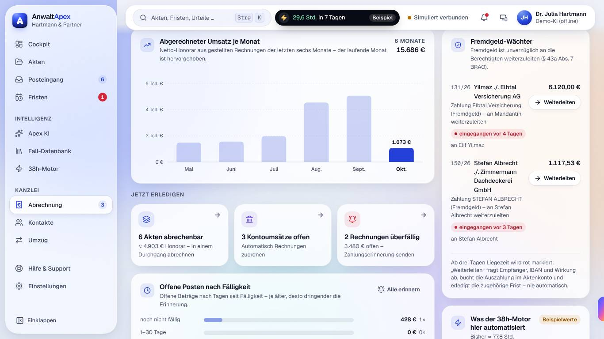 | **I3-T08-01 (H)** – Fremdgeld-Wächter verlangt die Weiterleitung der Honorarzahlung an Stefan Albrecht (L hell). |
| 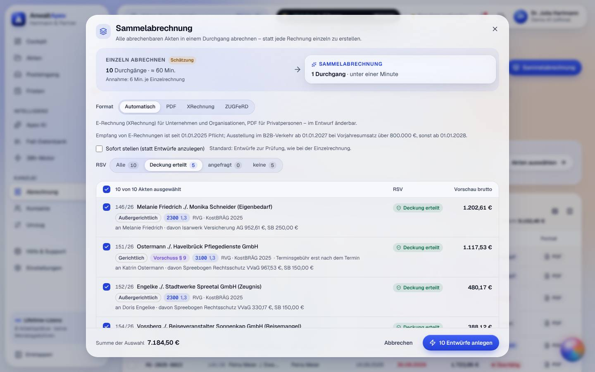 | **I3-T07-01 (H)** – Filter „Deckung erteilt 5“, aber „10 von 10 Akten ausgewählt“ und „10 Entwürfe anlegen“ (D hell). |
| 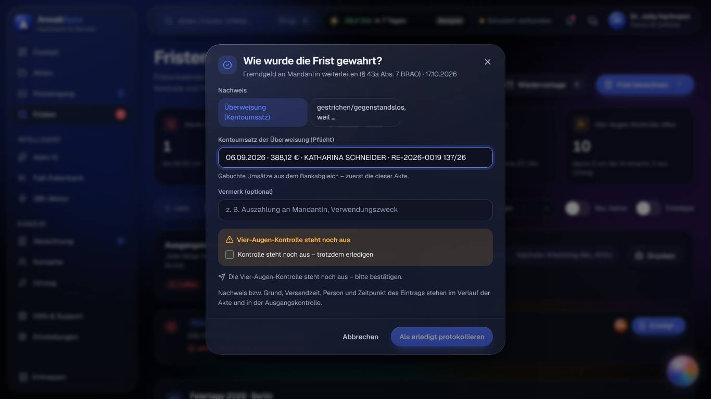 | **I3-T15-01 (H)** – Ausgangskontrolle: Gutschrift einer fremden Akte als Überweisungsnachweis wählbar (L dunkel). |
| 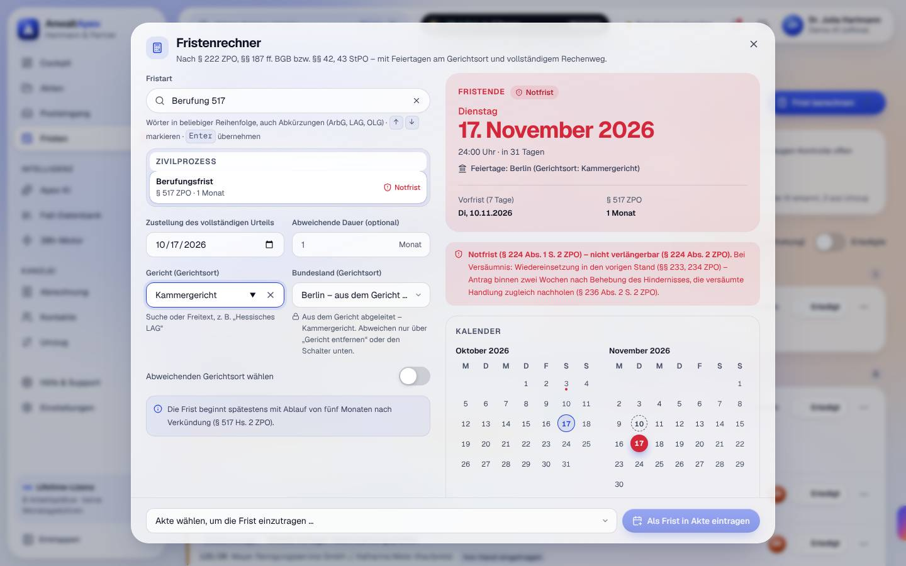 | **I3-T18-02 (H)** – Fristenrechner mit still vorbelegter Zustellung „heute“ und sofortigem Fristende (D hell). |
|  | **I3-T03-01 (H↑)** – Fristen, Filter Vier-Augen: „Korrektur anford…“ abgeschnitten, „Erledigt“ und „⋯“ außerhalb des Bildschirms (M hell). |
| 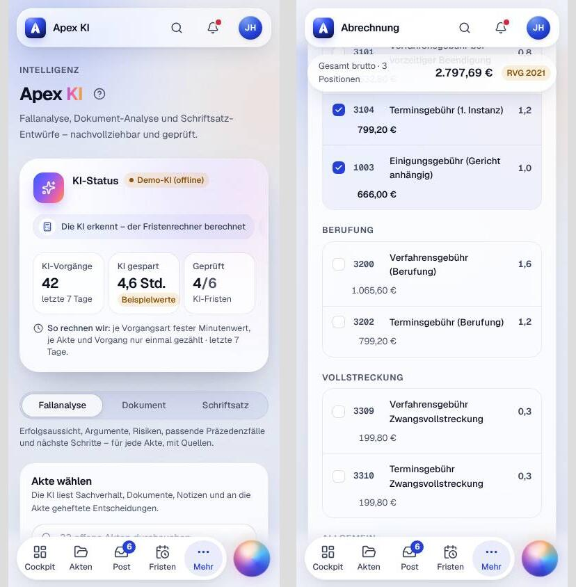 | **I3-T06-01 (H) und I3-T07-02 (H)** – links die KI-Hinweise in der Wischleiste, rechts die Summenleiste über der Gebührenzeile 3101 (M hell). |
| 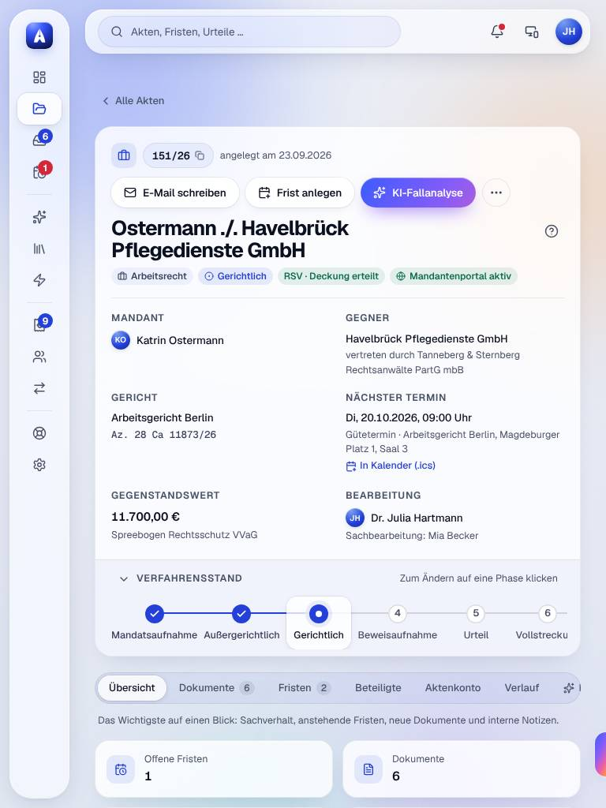 | **I3-T14-01 (M) und I3-T14-02 (H)** – Leiste nur mit Symbolen; im Aktenkopf die 20 px hohen Links „Havelbrück Pflegedienste GmbH“ und „Arbeitsgericht Berlin“ (Th hell). |
|  | **I3-T03-02 und I3-T03-03 (M)** – Korrektur der Berufungsfrist 118/26 mit „Gerichtsort noch offen – Kanzleisitz“; die Meldung verdeckt „Korrektur speichern“ (D hell). |
|  | **I3-T23-01 (M)** – Aktenliste am iPad quer: Kennzahlen und Spalten abgeschnitten, erste Aktenzeile ganz unten (Tq hell). |
| 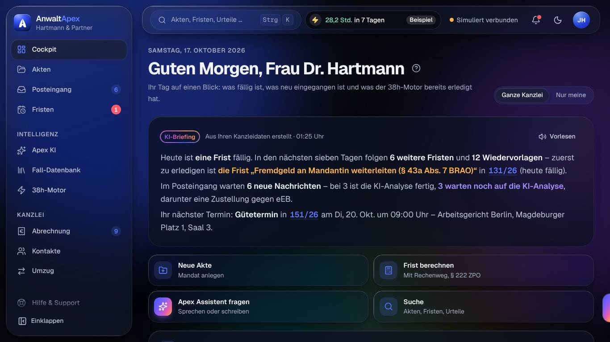 | **I3-T13-01 (M)** – Schriftgröße 112 %: „Einstellungen“ fehlt in der Seitenleiste (L dunkel). |
| 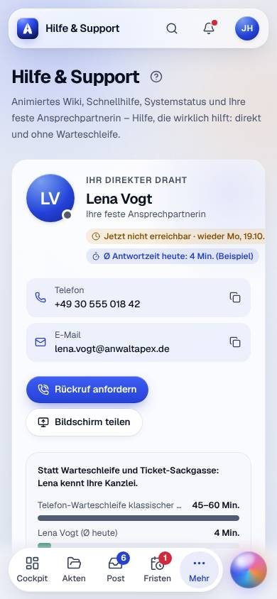 | **I3-T12-01 (M) und I3-T12-03 (N)** – Durchwahl nicht antippbar, Plakette abgeschnitten (M hell). |
| 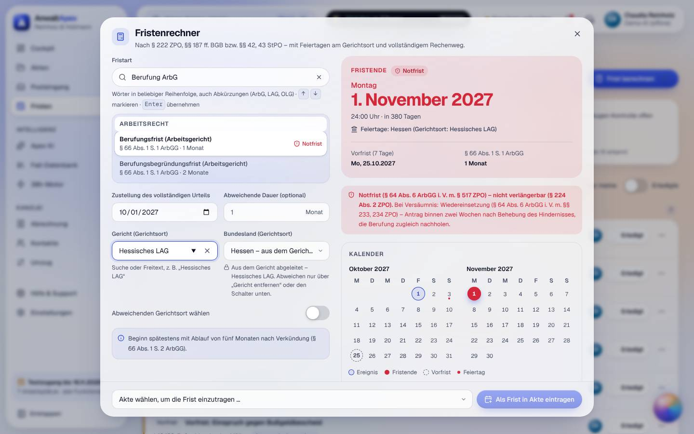 | **Positiv, T18 Fall 3b** – Hessisches LAG, Mo 01.11.2027, „Allerheiligen – in NRW Feiertag, in Hessen nicht“ (D hell). |
| 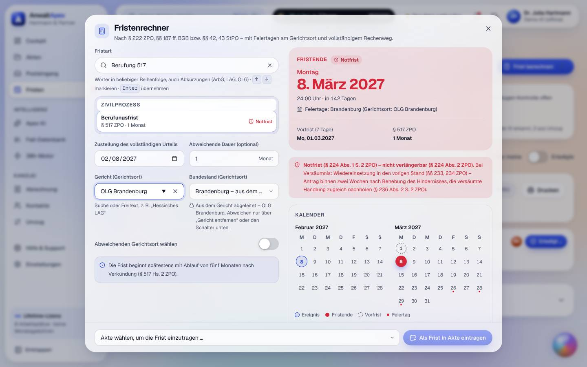 | **Positiv, T18 Fall 3a** – OLG Brandenburg, Mo 08.03.2027, Frauentag nur in Berlin (D hell). |
| 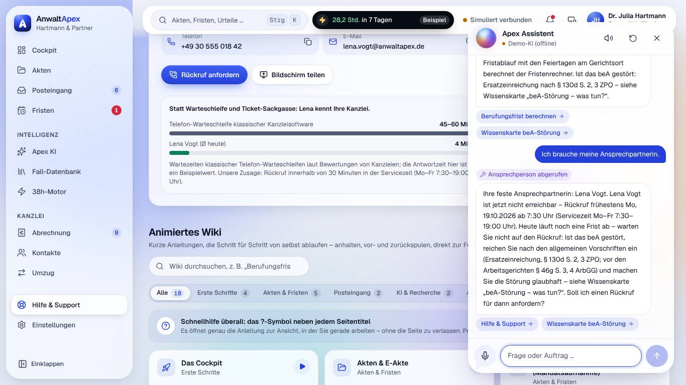 | **Positiv, T12** – Assistent außerhalb der Servicezeit: „Warten Sie nicht auf den Rückruf“ mit Ersatzeinreichung (L hell). |
|  | **Positiv, T02** – Berufungsfrist am iPhone mit Rechenweg „Berlin (Kammergericht, Berufungsgericht)“ (M hell). |
| 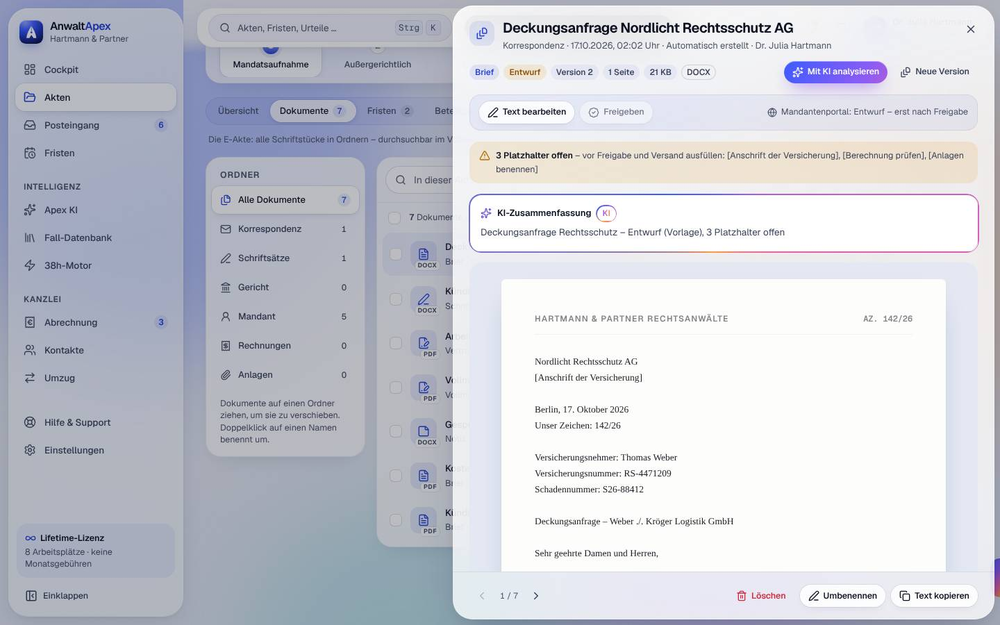 | **Positiv, T19** – Deckungsanfrage als Version 2, „3 Platzhalter offen“, Freigeben gesperrt (D hell). |

---

## 9. Verworfen, angepasst, zusammengeführt – und Vorgaben der Projektleitung

### 9.1 Entscheidungen der Testleitung

**Leitlinie des Auftraggebers:** das gesamte Feedback einbauen. Verworfen wird nur, was dem Briefing widerspricht, fachlich falsch ist, auf einem Missverständnis beruht oder außerhalb eines Prototyps liegt. Kein Befund dieser Runde ist ganz verworfen.

| ID | Teil | Entscheidung | Grund |
|---|---|---|---|
| I3-T07-06 | „Bei Deckung offen keine Schadennummer“ | verworfen; angepasst umgesetzt | Fachlich nicht zutreffend: Der Versicherer vergibt die Schadennummer mit der Schadenmeldung, die häufig der Mandant selbst vornimmt, nicht erst mit der Zusage. Umgesetzt wird, dass die Herkunft der Nummer sichtbar ist (Schadenmeldung durch Herrn Weber). |
| I3-T07-03 | Sperre auch in den Präsentationskanzleien | angepasst | Eine harte Sperre würde Storno, Zeithonorar-Rechnung und „Sofort stellen“ in den Präsentationsabläufen unvorführbar machen. In Präsentationskanzleien deshalb Warnung und Pflichthäkchen, in Kundenkanzleien und im Serverbetrieb Sperre bis zur Ergänzung. Rückfrage vor der Nummernvergabe überall. |
| I3-T19-01 | Gegenstandswert der Akte 142/26 auf 13.600 € anheben | angepasst | 13.600 € liegen in einer anderen Wertstufe als 10.200 € und würden Entwurf-001 (2.968,46 €) und damit den Präsentationsablauf T07 ändern (Vorgabe: Präsentationsabläufe unverändert). Die Deckungsanfrage nennt stattdessen die Antragsbestandteile wie der Klageentwurf. |
| I3-T21-02 | „optional E-Mail an die Hauptnutzerin“ | angepasst | Der Prototyp versendet keine E-Mails. Umgesetzt wird eine Benachrichtigung in der App an Partner und Administration. |
| I3-T12-04 | „angleichen“ | angepasst | Die Zusage „bis 8:30 Uhr“ bleibt als Puffer für über Nacht eingegangene Anfragen und wird erklärt; eine neue geschäftliche Zusage entsteht nicht. |
| I3-T03-01 | Schweregrad | M → H | Kernaktion am Gerät dieser Runde nicht erreichbar (Abschnitt 7, Kopf). |
| I3-T18-01 (Block D) | ID | umbenannt in I3-T18-02 | ID-Kollision mit Block A |
| I3-T01-01, I3-T20-03, I3-T06-04, I3-T12-07, I3-T22-02 | ganz | zusammengeführt | Duplikate (Abschnitt 7, Kopf) |
| I1-T00-02 | Impressum | an den Auftraggeber verwiesen | Echte Anbieterdaten liegen nicht vor; der Platzhalter bleibt gekennzeichnet. |
| I1-T07-07 | US-Datumsformat | weiter Testumgebung | Das Avatar-Werkzeug startet Chromium ohne deutsche Systemsprache (Abschnitt 10.6). |

### 9.2 Vorgaben der Projektleitung (verbindlich)

1. **Fristverantwortung in den Demodaten** (offene Frage aus Iteration 2, Abschnitt 11.4):
   - Echte Fristen (Notfrist, Frist) tragen in den Demodaten immer eine Anwältin, einen Anwalt oder einen Partner als Verantwortliche. Fachangestellte sind dort Vier-Augen-Kontrolle bzw. Sachbearbeitung.
   - Büroaufgaben wie „Fremdgeld an Mandantin weiterleiten“ sind Wiedervorlagen und dürfen Fachangestellten zugeordnet sein. So bleibt Petras Vormittag (T22, „Nur meine“) aussagekräftig.
   - Prüfung der Testleitung (Prüfskript über alle drei Präsentationskanzleien, Stichtag 17.10.2026): Genau eine Frist ist betroffen, „Fremdgeld an Mandantin weiterleiten“ in 131/26 (Mia Becker, Typ „Frist“). Sie wird Wiedervorlage. Alle Präsentationsabläufe bleiben unverändert. `SEED_VERSION` steigt auf 11 (Auftrag A-01).
2. **Geschäftliche Zusagen** bleiben neutral: Wartungssatz, Übertragbarkeit der Lizenz, Quellcode-Hinterlegung (Escrow), Impressum und eine EU-Option der Live-KI stehen im Produkt nur als „im Angebot geregelt“ bzw. „auf Anfrage“. Die T13-Prüfpunkte „Übertragbarkeit“ und „EU-Zusage“ bleiben deshalb bis zur Entscheidung des Auftraggebers „nein“.

### 9.3 Offene Entscheidungen des Auftraggebers

Diese Punkte nennt der Avatar als Kaufbedingung. Sie lassen sich im Produkt nicht lösen:

- schriftliches Angebot mit Lizenz- und Wartungspreis für 7 Arbeitsplätze (Blöcke A, B, C, D)
- Übertragbarkeit der Lizenz und Quellcode-Hinterlegung verbindlich geregelt (Block A)
- KI-Verarbeitung in der EU oder eine nach § 43e Abs. 4 BRAO tragfähige Lösung; bis dahin nutzt der Avatar nur die Offline-KI (Blöcke A, C)
- Impressum mit echten Anbieterdaten (Blöcke A, C)
- Erreichbarkeit außerhalb der Servicezeit (Notfallkontakt, unverändert aus Iteration 2)

---

## 10. Umsetzungsplan

### 10.1 Pakete und Dateibereiche

Zwei Fixer arbeiten parallel. Ihre Dateibereiche überschneiden sich nicht.

| Paket | Name | Dateibereich |
|---|---|---|
| **A** | Rahmen, Design, Einstieg, Logik & Daten | `src/components/**`, `src/styles/**`, `src/app/**`, `src/App.tsx`, `src/main.tsx`, `src/lib/**`, `src/store/**`, `src/core/**`, `src/ai/**`, `src/content/**`, `server/**`, `src/pages/Cockpit.tsx`, `src/pages/cockpit/**`, `src/pages/public/**`, `src/pages/hilfe/**`, `src/pages/einstellungen/**`, `src/pages/console/**` |
| **B** | Fachseiten | `src/pages/akten/**`, `src/pages/kontakte/**`, `src/pages/posteingang/**`, `src/pages/fristen/**`, `src/pages/abrechnung/**`, `src/pages/ki/**`, `src/pages/falldb/**`, `src/pages/motor/**`, `src/pages/umzug/**` |

**Regeln:**

- Paket A übernimmt außerdem `docs/DEMO-SKRIPT.md` und `docs/KUNDENAVATAR.md`, falls die Demodaten-Änderung dort Spuren hat.
- Berührt ein Befund beide Bereiche, ist er nach der Hauptdatei zugeordnet. Der Auftrag nennt die mitbetroffene Datei; der andere Fixer fasst sie dafür nicht an. Lässt sich der Befund sauber nach Dateien teilen, hat jedes Paket einen ausdrücklich benannten Teil („Teil A“, „Teil B“).
- Paket A darf Hilfsfunktionen aus Paket B **importieren**, aber nicht ändern (z. B. `satzFuerEintrag` aus `src/pages/abrechnung/lib.ts`). Paket B ändert deren Signatur nicht.
- Was bereichsübergreifend offen bleibt, zieht die Prüfung nach.

### 10.2 Schnittstellenvertrag (A-00, zuerst)

Paket A legt vor allen anderen Aufträgen die gemeinsamen Schnittstellen an. Paket B programmiert gegen diese Namen.

- **`src/core/types.ts`** – nur optionale Felder:
  - `Frist.gerichtsort?: { land: Bundesland; gericht?: string; quelle: "gericht" | "akte" | "kanzleisitz" | "hand" }` – der Ort, mit dessen Feiertagen die Frist berechnet wurde (B-06).
  - `Automation.pausiertAm?: ISODateTime` und `Automation.pausiertVon?: ID` (B-15).
  - `Tenant.geschaeftskonto?: { iban: string; bic?: string; bank?: string }` (B-09; `steuernummer` und `ustIdNr` gibt es schon).
  - `Transaktion.zuordnung.art?: "rechnung" | "vorschuss" | "fremdgeld" | "kosten"` (B-01).
  - `Akte.abschlussdatumUnbekannt?: boolean` (B-10).
  - Server-Schema und `src/lib/backend/schema.ts` lassen die Felder zu; falsche Werte ergeben 400.
- **`src/core/fristen.ts`:** `feiertagsortFuerFrist(frist, akte, kontakte, kanzleiLand)` → `{ land, feiertagsOrt, quelle }`. Reihenfolge: gespeicherter Ort der Frist, dann Gericht der Akte, dann Kanzleisitz. Mit Tests.
- **`src/core/automationen.ts`:** `FRIST_AUTOMATIKEN` (`posteingang-fristen`, `vorfristen`, `eeb`), `istFristAutomatik(key)`, `folgeBeimPausieren(key)`, `pausierteFristAutomatiken(liste)`.
- **`src/lib/rollen.ts`:** `darfAutomatikSchalten(user, key)` – Fristautomatiken nur Partner und Administration.
- **`src/components/FristAutomatikHinweis.tsx`:** Hinweisband „Fristerkennung pausiert seit … von …“, liest den Store selbst, rendert nichts, wenn alles aktiv ist (Cockpit A-15, Fristen B-15).
- **`src/core/abrechnung.ts`:** `fehlendeRechnungsangaben(tenant): string[]` mit IBAN-Prüfung über `ibanGueltig` (B-09, A-16).

### 10.3 Reihenfolge

1. A-00
2. H-Befunde: B-01, B-02, B-03, B-04, B-05, B-07, B-08, B-10
3. Vorgabe der Projektleitung: A-01
4. M-Befunde
5. N-Befunde

Paket B beginnt mit B-02, B-03, B-04, B-05, B-07 und B-08, denn sie hängen nicht von A-00 ab. B-01, B-06, B-09, B-10 und B-15 folgen nach A-00 (B-09 zusätzlich nach A-16).

### 10.4 Aufträge

Die vollständigen Auftragstexte (Änderung, Erfolgskriterium, Dateien) erhalten die Fixer getrennt. Hier die Übersicht:

**Paket A (17 Aufträge)**

| Nr. | Befunde | Inhalt |
|---|---|---|
| A-00 | – (Grundlage für B-01, B-06, B-09, B-10, B-15) | Typ- und Schnittstellenvertrag, Hilfsfunktionen, Hinweisband |
| A-01 | Vorgabe PL, I3-T07-06, I3-T19-01 (Teil Demodaten) | Demodaten: Fremdgeld-Aufgabe 131/26 als Wiedervorlage, Fristverantwortung nur Berufsträger, Herkunft der Schadennummer, Deckungsanfrage mit Antragsbestandteilen, `SEED_VERSION` 11, Tests |
| A-02 | I3-T16-01 | Menüs in eigener Ebene, immer vollständig sichtbar |
| A-03 | I3-T13-01, I3-T14-01 (+ Grundlage I3-T23-01, I3-T06-02) | Seitenleiste: 112/125 %, beschriftete Tablet-Leiste bis 1180 px, zugängliche Namen, 44 px |
| A-04 | I3-T12-02 (+ I3-T01-01) | Systemstatus am iPhone: Kopfleiste, Mehr-Menü, Hilfe, Cockpit-Briefing |
| A-05 | I3-T03-03 (+ I3-T06-04) | Meldungen nie über Dialog- und Drawer-Bedienelementen |
| A-06 | I3-T22-01, I3-T07-04 (Teil Dialog) | W/Z/F mit Akte der geöffneten Nachricht; Stundensatz im Dialog „Zeit erfassen“ |
| A-07 | I3-T06-03, I3-T06-05 (+ I3-T12-07) | Strg+K über reinen Ansichten; Kugel weicht auch über Text und Kennzahlen aus |
| A-08 | I3-T21-02, I3-T21-01 | Console: Person und Anlass im Protokoll; Datum in Ortszeit |
| A-09 | I3-T13-02 | Eigenes Passwort ändern für alle Rollen |
| A-10 | I3-T12-01 (+ I3-T20-03), I3-T12-03, I3-T12-04, I3-T12-05 | Hilfe: `tel:`-Links, Plakette, Rückrufzusage, Sicherungszeit |
| A-11 | I3-T12-06 (Teil A) | Einheitlich „Ansprechpartnerin“ |
| A-12 | I3-T20-01, I3-T20-02 | Assistent: Kanzleikürzel (WV …), Kurzformen mit Mehrdeutigkeitsprüfung |
| A-13 | I3-T00-01, I3-T00-02, I3-T00-03 | Landing: Menü deckend, Fußnote, Gerichtsort in der Vorschau |
| A-14 | I3-T06-02 | Fallanalyse-Kopf am iPad einspaltig |
| A-15 | I3-T10-01 (Teil A) | Pausierte Fristautomatik: Hinweis im Cockpit, Protokoll, Serverrecht |
| A-16 | I3-T07-03 (Teil A) | Rechnungsangaben im Kanzleiprofil (Steuernummer, USt-IdNr., Geschäftskonto) |

**Paket B (18 Aufträge)**

| Nr. | Befunde | Inhalt |
|---|---|---|
| B-01 | **I3-T08-01 (H)**, I3-T08-02 | Bankabgleich: Buchungsart bei Zuordnung zur Akte, stornierte Rechnung im Verwendungszweck |
| B-02 | **I3-T07-01 (H)** | Sammelabrechnung rechnet nur Sichtbares ab |
| B-03 | **I3-T15-01 (H)** | Überweisungsnachweis nur mit passendem Ausgang |
| B-04 | **I3-T18-02 (H)**, I3-T18-01, I3-T14-03 | Fristenrechner ohne stille Vorbelegung; Fristart-Auswahl |
| B-05 | **I3-T03-01 (H↑)**, I3-T03-05, I3-T03-04 | Fristen am iPhone |
| B-06 | I3-T03-02 | Fristkorrektur behält den Gerichtsort |
| B-07 | **I3-T06-01 (H)**, I3-T19-01, I3-T06-06 | Apex KI und Fall-Datenbank |
| B-08 | **I3-T07-02 (H)** | RVG-Summenleiste verdeckt nichts |
| B-09 | I3-T07-03, I3-T07-05 | Rechnung stellen mit Rückfrage und Pflichtangaben; Stornostempel |
| B-10 | **I3-T14-02 (H)**, I3-T23-03, I3-T11-01 | Aktenkopf: Klickflächen, Portal beim Abschluss, Umzugsakte |
| B-11 | I3-T05-01, I3-T15-02, I2-T04-01 | Akte mobil, gedimmte Vorschau, Pille „nicht verlängerbar“ |
| B-12 | I3-T23-01 | Aktenliste am iPad |
| B-13 | I3-T08-03, I3-T08-04 (+ I3-T22-02) | Bankabgleich: Liste nach oben, Schätzung kennzeichnen |
| B-14 | I3-T07-04 (Teil B), I3-T09-01 | Zeiterfassung mit Satz, Zinsabschnitte erklärt |
| B-15 | I3-T10-01, I3-T10-02, I3-T12-06 (Teil B) | 38h-Motor: Rückfrage und Recht für Fristautomatiken, Hinweis in Fristen, „vs.“, Begriff |
| B-16 | I3-T02-01, I3-T02-02, I3-T02-03 | Posteingang am iPhone, Anhänge nennen |
| B-17 | I3-T04-01, I3-T04-02, I3-T23-02 | Mandatsaufnahme und Portal-Meldung |
| B-18 | I3-T11-02, I3-T21-01 (Teil B), I3-T12-01 (Teil B) | Umzug: Kurzfassung, Datum in Ortszeit, `tel:`-Links |

### 10.5 Abnahme der Umsetzung

1. `npm run typecheck && npm test && npm run build` laufen grün. Neue Tests decken mindestens ab:
   - Buchungsart bei Zuordnung zur Akte: Zahler = Mandant → Vorschuss/Honorar, Versicherer → Fremdgeld; Lösen storniert auch eine Vorschussbuchung (B-01)
   - Sammelabrechnung: Auswahl = Auswahl ∩ Filter (B-02)
   - Überweisungsnachweis: keine Gutschrift, keine fremde Akte ohne Warnung (B-03)
   - Fristenrechner ohne Ereignis ohne Ergebnis (B-04); Korrektur behält den Gerichtsort (A-00, B-06)
   - Demodaten: keine Frist oder Notfrist mit Fachangestellter als Verantwortlicher; Fingerabdruck der übrigen Daten unverändert, die eine gewollte Abweichung benannt (A-01)
   - Assistent: „wv 137 in 3 tagen zeugenliste prüfen“ und „akte müller“ (A-12)
   - Rückrufzusage, Ortsdatum bei Anlage um 01:05 Uhr, Passwort ändern im Protokoll (A-08, A-09, A-10)
2. Alle **8 H-Befunde** werden in der Prüfung im Browser nachgestellt, mit Bild je Befund; dazu die drei axe-Ansichten (Apex KI M, RVG-Rechner M gescrollt, Akte 151/26 Th).
3. axe-core bleibt in allen Ansichten aus Abschnitt 2 bei 0 serious und 0 critical; neu geprüft werden Th und Tq (Leiste, Aktenliste, Fallanalyse), das iPhone in gescrollter Stellung und Dialoge mit Meldungen.
4. Die Prüfwerte werden erneut nachgerechnet: T07 (16 Werte, 360,00 €, Sammelsumme 2.281,89 €), T09 (A–C, 155,77 €), T18 (6 Daten plus FamFG), T04 (02.11.2026, 11.400 €), T10 (26.960,77 €, 35.247,74 €).
5. Mobil: Fristen, Akte 142/26 und Posteingang auf M und 360 px hell und dunkel ohne verdeckte oder abgeschnittene Bedienelemente; Seitenleiste bei 112 % und 125 % auf D und L.
6. Texte per `grep`: kein sichtbares „Ansprechperson“ für die Ansprechpartnerin, kein „vs.“ im 38h-Motor, kein `toISOString().slice(0, 10)` als „heute“.

### 10.6 Hinweise für Iteration 4 (Testleitung)

- **Schwerpunkt laut Avatar (1.10): Lesbarkeit, Dunkelmodus und Barrierefreiheit.** Alle Aufgaben dunkel; T01, T02, T15 mit 200 % auf D; Reflow bei 320 px für T00, T01, T02, T14; T03, T04, T07 nur mit Tastatur; reduzierte Bewegung; Deuteranopie für T01, T03, T15; axe für jede Ansicht.
- **Werktag:** Iteration 3 lief komplett in der Nacht auf Samstag. Iteration 4 an einem Werktag tagsüber starten oder die Seitenuhr fest setzen (z. B. Di 20.10.2026, 16:50 Uhr für T12 und 21:30 Uhr für T15).
- **Avatar-Werkzeug:**
  - Chromium zusätzlich mit `args: ["--lang=de-DE"]` starten, damit Datumsfelder deutsch erscheinen (I1-T07-07, dritter Hinweis).
  - Für `tablet` und `tablet-hoch` `hasTouch: true` setzen. Bisher emuliert das Werkzeug Touch nur unter 768 px; am iPad erscheinen deshalb Tooltips und Tastaturhinweise, die ein echtes iPad nicht zeigt.
- **Demodaten nach `SEED_VERSION` 11:** Die Fremdgeld-Aufgabe 131/26 ist eine Wiedervorlage. Im Cockpit am Testtag zählt sie nicht mehr als „Frist heute“; die Erwartungswerte für T01 und T15 im Prompt entsprechend fassen. Für den Nachtest von I3-T15-01 eine Zahlungsfrist mit Überweisungsnachweis verwenden.
- **T23:** 137/26 und 130/26 haben schon ein aktives Portal. Im Prompt eine Akte ohne Portal nennen (z. B. 107/26).
- **T08:** I3-T08-01 sowohl über „Zuordnen zu …“ als auch über einen Vorschlag des Abgleichs gegenprüfen (Hinweis aus Block C).
- **Nachtest:** alle 59 Befunde dieser Runde (64 IDs einschließlich der zusammengeführten) und die offenen IDs der Vorrunde (I1-T00-02, I2-T01-02, I2-T04-01, I2-T14-04, I1-T07-07), im frischen Profil mit `SEED_VERSION` 11.

---

## 11. Umsetzung & Nachweis

**Stand:** Samstag, 17.10.2026, nach der Umsetzung der Pakete A und B und der bereichsübergreifenden Restpunkte
**Betrieb:** Browser-Demo (Demo-KI offline) · Chromium (Playwright, `de-DE`, Europe/Berlin) · eigene Prüfskripte mit frischem Browserprofil je Lauf, dazu das Avatar-Werkzeug mit Profil `pruefung-i3` · Viewports D 1440×900, L 1366×768, Tq 1024×768, Th 768×1024 (beide mit Touch), M 390×844, klein 360×740 · hell und dunkel wie angegeben · Server-Probe gegen den gebauten Server (`dist-server`) mit eigener Datenbank
**Uhrzeit der Prüfung:** Samstag, 17.10.2026, ca. 04:15–05:20 Uhr – wie der Test selbst außerhalb der Servicezeit und am Wochenende.

### 11.1 Ergebnis

| Schwere | Befunde (zusammengeführt) | umgesetzt | davon angepasst | teilweise | offen | im Browser nachgestellt |
|---|---|---|---|---|---|---|
| K | 0 | – | – | – | – | – |
| H | 8 | **8** | – | – | – | 8 |
| M | 23 | **23** | 3 | – | – | 17 |
| N | 28 | **28** | 2 | – | – | 11 |
| **Summe** | **59** | **59** | **5** | **0** | **0** | **36** |

- **Alle 8 H-Befunde sind umgesetzt und in dieser Abnahme im Browser nachgestellt**, mit Bild je Befund (11.6). Wo Fachlogik betroffen ist, belegen zusätzlich automatische Tests die Änderung.
- **Die drei axe-Ansichten der Runde sind sauber:** Apex KI (M hell und dunkel), RVG-Rechner am iPhone gescrollt (alle 150 px von oben bis unten, hell und dunkel) und Akte 151/26 am iPad hoch (Touch hell, Maus dunkel) – jeweils 0 serious/critical.
- **Angepasst** (wie in Abschnitt 9.1 beschlossen): I3-T21-02 (Benachrichtigung in der App statt E-Mail), I3-T07-03 (Rückfrage überall; Sperre in Kundenkanzleien, Warnung mit Pflichthäkchen in Präsentationskanzleien), I3-T19-01 (Deckungsanfrage nennt die Antragsbestandteile, der Gegenstandswert der Akte bleibt), I3-T07-06 (Schadennummer bleibt, ihre Herkunft wird sichtbar), I3-T12-04 (8:30 Uhr bleibt und wird erklärt).
- **Mitlaufende Befunde:** I2-T04-01 (Rest der Vorrunde) ist umgesetzt und im Browser bestätigt; die **Vorgabe der Projektleitung zur Fristverantwortung** (`SEED_VERSION` 11) ist umgesetzt und durch Tests belegt. Weiter beim Auftraggeber: das Impressum (I1-T00-02); weiter Testumgebung: I1-T07-07.
- Die übrigen M- und N-Befunde stützen sich auf die Selbstprüfung der Fixer bzw. auf Tests (Spalte „Nachweis“ in 11.5).

**So ist die Spalte „Nachweis“ zu lesen:**

- **Prüfung** – in dieser Abnahme im Browser nachgestellt (Viewport und Modus stehen dabei).
- **Fixer A / Fixer B** – Selbstprüfung des Fixers laut Rückmeldung; in der Abnahme nicht erneut nachgestellt.
- **Test** – automatischer Test in `npm test`.
- **Server-Probe** – Anfrage gegen den gebauten Server (`dist-server`) mit eigener Datenbank.
- Die Kürzel in Klammern (A-00 … B-18) verweisen auf die Aufträge in Abschnitt 10.4.

### 11.2 In der Prüfung nachgeholt

**Bereichsübergreifende Restpunkte und „nicht umgesetzt“-Punkte der Fixer:**

| Herkunft | Punkt | Umsetzung |
|---|---|---|
| B-08 (nicht umgesetzt) | Kopfleiste verdeckt beim Scrollen Bedienelemente; axe `target-size` im RVG-Rechner am iPhone bei y ≈ 1.200 („Satz erhöhen“) und y ≈ 2.700 (`#rvg-anr`) | Die Kopfleiste liegt jetzt **über** der Scrollfläche statt darin (`AppShell`); der Inhalt läuft nicht mehr unter ihre Knöpfe. Ihr Verlauf blendet die oberste Inhaltskante weich aus, Lage und Aussehen sind unverändert. `scroll-padding-top` sinkt entsprechend auf 16 px; alle Haftpositionen (Einstellungen-Reiter, Akten-Kurzkopf, E-Akte-Ordner, RVG-Ergebnis, Bankabgleich, Monatsansicht, Fall-Datenbank, Schriftsatz) und Scroll-Versätze (Akte, Posteingang, Schriftsatz) sind um die Höhe der Kopfleiste korrigiert – gemessen stehen sie auf dem Bildschirm genau wie vorher (Kurzkopf y = 78, RVG-Ergebnis y = 96, Einstellungen-Reiter y = 76). Ergebnis: RVG-Rechner M hell und dunkel 0 serious in allen Scrollstellungen. |
| B-15 (nicht umgesetzt) | „Ansprechperson“ im Import des 38h-Motors | Die Funktion heißt jetzt `festeAnsprechBezeichnung` (`src/lib/rollen.ts`), alle Aufrufer sind umgestellt (Assistent, Demo-Backend, Server, Hilfe, Lizenz, Umzug, 38h-Motor). `grep "Ansprechperson" src/pages/motor` ist leer. |
| A-14 | Aktentitel in der Fallanalyse-Auswahl gekürzt | `line-clamp-2` entfernt (`FallanalyseTab.tsx`). Prüfung Tq: „Thomas Lorenz ./. Kowalski Bau GmbH & Co. KG (Gewährleistung)“ vollständig. |
| A-06 | Direktlink `/abrechnung?tab=zeit&akte=<id>` | Die Zeiterfassung liest `akte`, wählt die Akte vor (nur Akten dieser Kanzlei), öffnet ohne Vergütungsvereinbarung gleich „Vereinbarung erfassen“, fokussiert das Datum und scrollt die Karte ins Bild; der Parameter verschwindet danach aus der Adresse. Prüfung D und M dunkel: aus dem Dialog „Zeit erfassen“ (Alt+Z in 125/26) → „Vereinbarung erfassen“ → Formular offen, Fokus im Datum, axe 0; mit Vereinbarung nur Vorwahl und „240 €/Std. lt. Vergütungsvereinbarung vom 01.10.2026“; unbekannte ID wählt nichts. |
| A-15 | Einheitlicher Protokolltext beim Schalten | `useAutomationUmschalten` nutzt `automatikSchaltText`: „Automatik „Fristen aus Posteingang erkennen“ pausiert – durch Dr. Julia Hartmann. Neue beA-Nachrichten werden dann nicht mehr auf Fristen geprüft – Sie notieren Fristen von Hand.“ bzw. „… wieder eingeschaltet – durch …“. Die Meldung nach dem Pausieren nutzt `folgeWaehrendPause` (ohne „dann“). |
| B-04 | Herkunft des Ereignisdatums aus dem Assistenten | `fristenrechnerLink(regel, ereignis?, akteId?, herkunft?)`: Der Assistent übergibt „der Frage an den Apex Assistenten“; der Rechenweg nennt „Ereignisdatum aus der Frage an den Apex Assistenten übernommen“. Die allgemeine Antwort zur Berufung zum OLG/LAG legt **kein** Datum mehr vor – sie übergab bisher still „heute“ (Rest von I3-T18-02). Test `analyse.test.ts` angepasst. |
| B-09 | § 14 UStG genau benennen | Kanzleiprofil → Rechnungsangaben: „Pflichtangabe auf jeder Rechnung: Steuernummer oder USt-IdNr. (§ 14 Abs. 4 S. 1 Nr. 2 UStG). Dazu das Geschäftskonto als Zahlungsweg für Überweisung und E-Rechnung.“; Hinweis am IBAN-Feld: „Zahlungsweg (für E-Rechnung/Überweisung), keine Pflichtangabe nach § 14 UStG.“ `fehlendeRechnungsangaben` und der Stellen-Dialog trennten schon richtig. |
| A (Beobachtung) | „Im Mandantenportal bereitstellen“ beim Entwurf der Deckungsanfrage | Nicht geändert: Im Menü steht „Im Portal bereitstellen (Entwurf – erst nach Freigabe)“ gesperrt (`aria-disabled`), in der Vorschau „Mandantenportal: Entwurf – erst nach Freigabe“; auch der Versand an den Mandanten stellt Entwürfe nicht bereit. Prüfung D an 142/26. |

**Funde der Abnahme, gleich behoben:**

- **Akten-Kurzkopf (Desktop):** Die feststehende Kurzleiste der Akte lag in der Scrollfläche über den Inhalten; axe meldete beim Scrollen von 151/26 auf D `target-size` (serious) am Schalter „Mandantenportal“ unter dem KI-Knopf, und beim Zurück-Tabben konnte der Fokus unter der Leiste liegen (WCAG 2.4.11). Der Kurzkopf steht jetzt in einer eigenen Ebene unter der Kopfleiste (außerhalb der Scrollfläche, gleiche Lage, Scrollleiste ausgespart); solange er sichtbar ist, hält die Scrollfläche oben 64 px frei. Prüfung D dunkel: 0 serious in 35 Scrollstellungen (alle 50 px); 179 Fokusschritte vor und zurück ohne verdecktes Ziel; Klick auf „Frist“ im Kurzkopf öffnet „Frist anlegen“.
- **Abrechnung am Telefon:** Der Knopf „Alle erinnern“ (Offene Posten) zeigte unter 640 px nur das Symbol ohne Namen – axe `button-name` (critical) auf M und 360 px. Der Name bleibt jetzt für Screenreader erhalten (`sr-only sm:not-sr-only`).
- **Durchwahl in der Hilfe (I3-T12-01):** Der `tel:`-Link war am iPhone 32 px hoch. Mit grobem Zeiger ist er jetzt 44 px hoch (gemessen 122×44 px).

### 11.3 Qualitätstor und Prüfwerte

| Prüfung | Ergebnis |
|---|---|
| `npx tsc --noEmit` | 0 Fehler |
| `npm test` | **173 / 173** grün (der Test des Fristenrechner-Links prüft jetzt `regel`, `ereignis` und `herkunft`) |
| `npm run build` | Web und Server fehlerfrei (nur die bekannten Größenhinweise zu `index.js` und `dist-server/index.js`) |
| Server-Probe (`dist-server`) | Rechnungsangaben: IBAN mit falscher Prüfziffer 400 (`feld: iban`), gültige Werte 200 und normalisiert („DE89 3704 0044 0532 0130 00“, „COBADEFFXXX“), Protokoll „Rechnungsangaben geändert (USt-IdNr., IBAN, BIC, Bank) – durch Dr. Julia Hartmann“; Mia Becker 403. Fristautomatik pausieren: Mia 403 mit Begründung, Dr. Hartmann 204 – `pausiertVon` kommt aus der Sitzung (ein mitgeschickter fremder Wert wird ersetzt), beim Einschalten gelöscht. Passwort ändern mit falschem altem Passwort 400 (`feld: alt`). Console-Startpasswort ohne Angaben 400 (`feld: angefordertVon`), mit Angaben 200 und im Kanzleiprotokoll „Startpasswort für Mia Becker durch AnwaltApex neu vergeben – Lena Vogt auf Anforderung von Dr. Julia Hartmann, Anlass: Passwort vergessen“ |
| Konsolen-Sweep, Login Dr. Hartmann | **128 Ansichten: 0 pageerrors, 0 console.errors** (500 auf `/api/info` ausgenommen). 43 Routen und Reiter auf D hell und D dunkel (neu u. a. Rechnungsangaben, Zeiterfassung mit `akte`, `/hilfe#status`, Fristenrechner mit `herkunft`), 28 davon auf M hell, 9 Hauptrouten auf Tq, Landing und Anmeldung hell und dunkel, Apex Console |
| axe-core (WCAG 2.2 A/AA) | **0 serious/critical** in allen Abnahme-Ansichten: 8 H-Befunde (hell und dunkel wie in 11.5), Stichproben M/N, dazu **229 gescrollte Stellungen** (Cockpit, Akten, Akte 151/26, Fristen, Posteingang, Abrechnung, Einstellungen, Hilfe auf M dunkel, 360 px, D, Th, Tq dunkel und L dunkel; im ersten Lauf vor den Funden der Abnahme 11 Treffer in 155 Stellungen), dazu Akte 151/26 auf D dunkel alle 50 px und Einstellungen am iPhone alle 40 px |
| Querscrollen | keines (Fristen 390 und 360 px, Aktenliste Tq mit `scrollWidth` = `clientWidth`, Rechnungsangaben 360 px) |
| Texte (`grep`) | kein „Ansprechperson“ in `src/pages/motor`; „Ansprechperson“ in `src/pages` nur noch im Mandantenportal für die Anwältin bzw. den Anwalt der Kanzlei (geschlechtsneutral gewollt); kein „vs.“ im 38h-Motor |

| Prüfwert | Soll | Ist |
|---|---|---|
| T07 RVG 2025 / 2021 | 2.968,46 € / 2.797,69 € | **exakt** (`berechneRvg`: 919,10 · 848,40 · 707,00 · netto 2.494,50 · USt 473,96 bzw. 865,80 · 799,20 · 666,00 · netto 2.351,00 · USt 446,69) |
| T07 Sammelabrechnung | 151–154/26 = 2.281,89 € | **2.281,89 €** (Browser, 4 von 10 Akten); Filter „Deckung erteilt“ 5 Akten = 3.484,50 € |
| T09 A / B / C | 43,23 € · 26,79 € · 42,72 € | **exakt** (`verzugszinsen`); Forderungskonto 126/26 **155,77 €** (Browser) |
| T04 Klagefrist | Mo 02.11.2026 | **2026-11-02** (`berechneNachRegel`) |
| T18, T02/T03, FamFG | 6 Daten, 118/26 → 17.11.2026 | **exakt** (Tests `fristen.i1.test.ts`, `logik.test.ts`) |
| T08 Buchung | Honorarzahlung Albrecht als Honorar/Vorschuss | **Vorschuss 1.117,53 €**, Guthaben 1.117,53 €, Fremdgeld 0,00 € (Browser) |

### 11.4 Offen und Hinweise für Iteration 4

- **Entscheidungen des Auftraggebers (unverändert, Abschnitt 9.3):** Angebot mit Preis und Wartung, KI-Verarbeitung in der EU, Übertragbarkeit und Escrow, Impressum (I1-T00-02), Erreichbarkeit außerhalb der Servicezeit.
- **Kopfleiste und Kurzkopf liegen jetzt über der Scrollfläche.** Der Inhalt läuft beim Scrollen nicht mehr unter die Glasleiste, sondern endet weich an ihrer Unterkante. Für den Schwerpunkt Barrierefreiheit (Abschnitt 10.6) lohnt der Blick auf gescrollte Stellungen in allen Bereichen; die Abnahme hat 229 Stellungen ohne Befund geprüft.
- **Überweisungsnachweis (I3-T15-01) im Nachtest:** Mit `SEED_VERSION` 11 ist „Fremdgeld an Mandantin weiterleiten“ eine Wiedervorlage ohne Nachweispflicht. Für den Nachtest eine Zahlungsfrist vom Typ „Frist“ anlegen (z. B. „Zahlung an Mandantin – Überweisungsnachweis“ in 131/26). Achtung: „Fremdgeld weiterleiten“ im Wächter erledigt offene Fristen mit „Fremdgeld“ im Titel selbst (mit Nachweis „Fremdgeld … weitergeleitet“).
- **Datumsfelder** erscheinen im Prüfbrowser trotz `--lang=de-DE` weiter im US-Format (I1-T07-07, Testumgebung).
- **Nachtest:** alle 59 Befunde dieser Runde (64 IDs) und die offenen IDs der Vorrunde (Abschnitt 10.6), im frischen Profil mit `SEED_VERSION` 11.

### 11.5 Befunde einzeln

| ID | S | Status | Was geändert | Nachweis |
|---|---|---|---|---|
| | | | **7.1 Landing** | |
| I3-T00-01 | N | umgesetzt | Aufgeklapptes Menü deckend wie die Tab-Leiste (A-13) | Prüfung M dunkel: keine Hero-Schrift scheint durch, axe 0 |
| I3-T00-02 | N | umgesetzt | Fußnote zur Wartezeit mit `aria-describedby` (A-13) | Fixer A (axe 0) |
| I3-T00-03 | N | umgesetzt | Vorschau rechnet mit „Kammergericht, Berufungsgericht“; Ergebnis Mo 16.11.2026 unverändert (A-13) | Fixer A |
| | | | **7.2 Apex Console und Zugang** | |
| I3-T21-02 | M | umgesetzt (angepasst) | Startpasswort nur mit „Angefordert von“, Anlass und Bearbeiter; Person und Anlass im Kanzleiprotokoll, Glocke für die Verwaltung (A-08) | Server-Probe (400 ohne Angaben, Protokolltext mit Person und Anlass); Test `protokoll.test.ts` |
| I3-T21-01 | N | umgesetzt | Datum in Ortszeit (`heuteBerlin`) für `lizenz.seit`, Testzeitraum und Kunde; Umzug mit `today()` (A-08, B-18) | Test `protokoll.test.ts`; Fixer A und B |
| | | | **7.3 Rahmen** | |
| I3-T16-01 | M | umgesetzt | Menüs in eigener Ebene (Portal), Messung vor dem Anzeigen, nach oben nur wenn es ganz passt (A-02) | Prüfung L: Spaltenmenü der Aktenliste mit allen 8 Einträgen, keiner verdeckt, axe 0 |
| I3-T13-01 | M | umgesetzt | Seitenleiste mit Dichtestufen nach Messung, auch bei 112/125 % (A-03) | Prüfung L 112 % und 125 %: alle 12 Bereiche bis „Einstellungen“ sichtbar |
| I3-T14-01 | M | umgesetzt | Beschriftete schmale Leiste unter 1180 px; Namen „Posteingang, 6 neu“ (A-03) | Prüfung Th: Leiste 88 px mit Beschriftung, Ziele 52 px, axe 0; [Bild](iteration-3/bilder/nachweis/T14-02-akte-151-beschriftete-leiste-Th.jpg) |
| I3-T12-02 | M | umgesetzt | Systemstatus-Knopf in der mobilen Kopfleiste, Eintrag im Mehr-Menü, Statuszeile im Briefing (A-04) | Prüfung M: Knopf → `/hilfe#status`, Abschnitt oben im Bild (y = 180) |
| I3-T03-03 | M | umgesetzt | Meldungen bei offenem Dialog oben mittig bzw. neben dem Drawer, nie über dessen Bedienelementen (A-05) | Prüfung L: Meldung bei offenem Fristenrechner überdeckt keine Schaltfläche des Dialogs |
| I3-T22-01 | M | umgesetzt | W und Alt+Z übernehmen die Akte der geöffneten Nachricht (A-06) | Fixer A |
| I3-T07-04 | M | umgesetzt | Satzzeile im Dialog „Zeit erfassen“ und unter der Aktenwahl der Zeiterfassung; Direktlink öffnet „Vereinbarung erfassen“ (A-06, B-14, Prüfung) | Prüfung D und M dunkel (11.2); Test `lib.test.ts`; [Bild](iteration-3/bilder/nachweis/T07-04-zeiterfassung-vereinbarung-direktlink-D.jpg) |
| I3-T06-03 | N | umgesetzt | Strg+K über reinen Ansichten schließt sie und öffnet die Suche ohne Zeichenverlust (A-07) | Fixer A |
| I3-T06-05 | N | umgesetzt | Kugel weicht auch über Text und Kennzahlen aus, in allen Scrollflächen (A-07) | Fixer A |
| | | | **7.4 Akten** | |
| I3-T14-02 | H | umgesetzt | Links im Aktenkopf mindestens 24 px, mit grobem Zeiger 44 px (B-10) | Prüfung Th Touch hell: „Havelbrück Pflegedienste GmbH“ 206×44, „Arbeitsgericht Berlin“ 130×44; Th Maus dunkel 24 px; axe 0 in beiden; Avatar-Werkzeug axe 0; [Bild](iteration-3/bilder/nachweis/T14-02-akte-151-beschriftete-leiste-Th.jpg) |
| I3-T05-01 | M | umgesetzt | Keine Schnellaktionsleiste auf dem Reiter Dokumente; Mehrfachauswahl als breite Leiste über der Tab-Leiste (B-11) | Prüfung M 142/26: Leiste auf „Dokumente“ nicht vorhanden; Fixer B (Mehrfachauswahl) |
| I3-T23-01 | M | umgesetzt | Eigener Spaltensatz 768–1099 px, kompakte Kacheln (B-12, A-03) | Prüfung Tq: kein Querscrollen, erste Zeile bei y = 447, axe 0 |
| I3-T15-02 | M | umgesetzt | „Seite abdunkeln / Original“ in der Dokumentvorschau im Dunkelmodus (B-11) | Prüfung L dunkel (151/26): Schalter vorhanden, axe 0 |
| I3-T04-01 | N | umgesetzt | Entwurf erst ab der ersten echten Eingabe (B-17) | Prüfung D: „Neuer Mandant“ → Firma → Abbrechen → kein „fortsetzen“ |
| I3-T04-02 | N | umgesetzt | Ablehnung zeigt „Abgelehnt – keine Akte“ ohne Portal und Automatik-Kasten (B-17) | Fixer B (axe 0) |
| I3-T23-02 | N | umgesetzt | Meldung „… (im Prototyp nicht versendet)“ (B-17) | Fixer B |
| I3-T23-03 | N | umgesetzt | Abschluss-Dialog fragt bei aktivem Portal „Portal sperren“ oder „Offen lassen bis …“ (B-10) | Prüfung D 151/26: „Das Mandantenportal ist aktiv – was soll damit geschehen?“, axe 0 |
| I2-T04-01 | M | umgesetzt | Reiter „Fristen“ der Akte: „Frist · nicht verlängerbar“ (B-11) | Prüfung L dunkel 142/26 |
| | | | **7.5 Posteingang** | |
| I3-T02-01 | N | umgesetzt | „Rechenweg anzeigen“ und „Andere Akte wählen“ 44 px am Telefon (B-16) | Fixer B (axe 0) |
| I3-T02-02 | N | umgesetzt | Filterleiste am Telefon mit Zählern, waagerecht scrollbar (B-16) | Prüfung M: „Neu 6“, „Ohne Akte 5“, axe 0 |
| I3-T02-03 | N | umgesetzt | Meldung und Verlauf nennen beide Anhänge, Strukturdaten „nicht abgelegt“ (B-16) | Test `analyse.test.ts`; Fixer B |
| | | | **7.6 Fristen und Fristenrechner** | |
| I3-T18-02 | H | umgesetzt | Ereignis ist Pflicht, kein Ergebnis ohne Datum, „heute“ nur als Schnellwahl; Herkunft im Rechenweg (B-04); Assistent ohne still „heute“ (Prüfung) | Prüfung D: „Bitte das Datum eintragen … – oder „heute“ wählen“, Eintragen gesperrt; nach „heute“ Rechenweg „… heute (Schnellwahl)“; Link aus dem Assistenten „Ereignisdatum aus der Frage an den Apex Assistenten übernommen“; axe 0; Avatar-Werkzeug L dunkel axe 0; Tests `fristartSuche.test.ts`, `analyse.test.ts`; [Bild](iteration-3/bilder/nachweis/T18-02-rechner-ohne-ereignis-kein-ergebnis-D.jpg) |
| I3-T15-01 | H | umgesetzt | Nachweis nur mit Ausgängen: zuerst Weiterleitungen der Akte, fremde Ausgänge nur mit Warnung und Begründung, Gutschriften nie (B-03) | Prüfung L dunkel, 131/26: ohne Ausgang „Noch keine Überweisung gebucht – die Frist bleibt offen.“, Erledigen gesperrt, unter „Anderen Umsatz wählen …“ nur Ausgänge (Miete, Telefon); nach der SEPA-Weiterleitung vorgewählt „Weiterleitung vom 17.10.2026 · 6.120,00 € an Elif Yilmaz (SEPA-Datei)“; axe 0; Test `logik.test.ts`; [Bild 1](iteration-3/bilder/nachweis/T15-01-nachweis-ohne-ausgang-gesperrt-L-dunkel.jpg), [Bild 2](iteration-3/bilder/nachweis/T15-01-nachweis-weiterleitung-vorgewaehlt-L-dunkel.jpg) |
| I3-T03-01 | H ↑ | umgesetzt | Mobile Aktionszeile: Hinweis, Hauptaktion 44 px, „⋯“ mit Korrektur, Erledigt, Korrigieren, Streichen, Details (B-05) | Prüfung M hell und 360 px dunkel: 0 Bedienelemente außerhalb der Breite; „Erledigt“ 90×44, „⋯“ 44×44; Menüeinträge 44 px und im Bild; axe 0; Avatar-Werkzeug M axe 0; [Bild](iteration-3/bilder/nachweis/T03-01-fristen-aktionen-menue-360-dunkel.jpg) |
| I3-T03-02 | M | umgesetzt | Gerichtsort an der Frist gespeichert und in der Korrektur verwendet; Abweichung nur per Schalter (B-06, A-00) | Test `logik.test.ts` (118/26 → 17.11.2026, Hessen/NRW), `fristen.i1.test.ts`; Fixer B (D) |
| I3-T03-05 | M | umgesetzt | Kompakter Kopf am Telefon: Kennzahlen in einer Reihe, Chips, Drucken/.ics im „⋯“ (B-05) | Prüfung M: Liste beginnt im ersten Bildschirm („Heute“ bei y ≈ 425), „Ausgang“ vollständig |
| I3-T03-04 | N | umgesetzt | Hinweis „Von Ihnen notiert – Kontrolle durch Kollegin/Kollegen“ bzw. „Vier-Augen offen“ sichtbar (B-05) | Prüfung M: „Vier-Augen offen – bestätigt eine zweite Person“ |
| I3-T18-01 | N | umgesetzt | Markierte Zeile eindeutig, gewählte Zeile „gewählt“, Name im Suchfeld (B-04) | Prüfung D: „Berufungsfrist … gewählt“ mit Haken |
| I3-T14-03 | N | umgesetzt | Tastaturhinweis am Telefon ausgeblendet (B-04) | Prüfung M: Hinweis nicht sichtbar |
| | | | **7.7 Apex KI und Fall-Datenbank** | |
| I3-T06-01 | H | umgesetzt | Grundsätze am Telefon untereinander statt Wischleiste (B-07) | Prüfung M hell und dunkel: alle drei Grundsätze im ersten Bildschirm (y 308–428), „Demo-KI: keine Daten an einen KI-Anbieter“ sichtbar, axe 0; Avatar-Werkzeug axe 0; [Bild](iteration-3/bilder/nachweis/T06-01-ki-grundsaetze-untereinander-M.jpg) |
| I3-T06-02 | M | umgesetzt | Fallanalyse-Kopf per Container-Query einspaltig unter 1100 px (A-14); Aktentitel brechen um (Prüfung) | Prüfung Tq 142/26: Einschätzung und Knopf oben, Zusammenfassung volle Breite; Titel der Aktenauswahl vollständig |
| I3-T19-01 | M | umgesetzt (angepasst) | Deckungsanfrage und Klageentwurf mit 10.200 € + 3.400 € = 13.600 €; Gegenstandswert der Akte bleibt (B-07, A-01) | Test `schriftsatz.test.ts`, `analyse.test.ts`; Fixer B |
| I3-T06-06 | N | umgesetzt | Stand der Fall-Datenbank oben (B-07) | Prüfung D: „Auszug · jüngste vom 16 …“ im Kopf |
| | | | **7.8 38h-Motor** | |
| I3-T10-01 | M | umgesetzt | Rückfrage mit Folge, nur Partner/Administration, Hinweis in Cockpit, Briefing und Fristen, Protokoll mit Person und Folge, Serverrecht (B-15, A-15, A-00) | Prüfung L: Rückfrage mit Fokus auf „Abbrechen“; Hinweis „Fristerkennung pausiert seit 17.10.2026, 04:49 Uhr (Dr. Julia Hartmann)“ in Cockpit und Fristen, „Achtung: …“ im Briefing; nach dem Einschalten weg; Server-Probe (Mia 403, `pausiertVon` aus der Sitzung); Test `automationen.i1.test.ts`; [Bild](iteration-3/bilder/nachweis/T10-01-cockpit-fristerkennung-pausiert-L.jpg) |
| I3-T10-02 | N | umgesetzt | Kein „vs.“ mehr im Rechner (B-15) | Prüfung D: kein „vs.“ auf der Seite |
| | | | **7.9 Abrechnung** | |
| I3-T08-01 | H | umgesetzt | Buchungsart bei Zuordnung zur Akte ist Pflicht, vorbelegt nach Zahler; Fremdgeld des Mandanten nur mit Warnung und Häkchen (B-01, A-00) | Prüfung L: nach Storno und Korrekturentwurf von RE-2026-0024 ist Albrecht 1.117,53 € mit 150/26 und „Honorar/Vorschuss · vorgeschlagen“ vorbelegt; „Als Vorschuss/Honorar gebucht“; Fremdgeld-Wächter ohne Albrecht; Aktenkonto Guthaben 1.117,53 €, Fremdgeld 0,00 €; Versicherer-Zahlung 107/26 → „Fremdgeld · vorgeschlagen“; axe 0 (L hell, Avatar L dunkel); Test `abgleich.test.ts`; [Bild](iteration-3/bilder/nachweis/T08-01-albrecht-vorschuss-vorbelegt-L.jpg) |
| I3-T07-01 | H | umgesetzt | Abrechnung = Auswahl ∩ Filter, Zähler, Summe und Knopf nennen den Filter (B-02) | Prüfung D: „Deckung erteilt“ → „5 von 5 sichtbaren Akten ausgewählt“, 3.484,50 €, „5 Entwürfe anlegen – Deckung erteilt“; Kopf-Häkchen 1× → 0, 2× → 5; 151–154/26 = 2.281,89 €; axe 0; Avatar-Werkzeug L dunkel axe 0; Test `lib.test.ts`; [Bild](iteration-3/bilder/nachweis/T07-01-sammelabrechnung-5-von-5-sichtbaren-D.jpg) |
| I3-T07-02 | H | umgesetzt | Summenleiste deckend über der Tab-Leiste (B-08); Kopfleiste außerhalb der Scrollfläche (Prüfung) | Prüfung M hell und dunkel: 114 Fokusziele, 0 verdeckt; axe 0 in allen Scrollstellungen (vorher 2 × serious durch die Kopfleiste); Avatar-Werkzeug y = 1.200 und 1.500 axe 0; [Bild](iteration-3/bilder/nachweis/T07-02-rvg-summenleiste-gescrollt-M.jpg) |
| I3-T07-03 | M | umgesetzt (angepasst) | Rückfrage vor der Nummernvergabe, Rechnungsangaben im Kanzleiprofil, Pflichtangaben-Warnung bzw. Sperre; E-Rechnung mit echten Angaben (B-09, A-16, Prüfung § 14) | Prüfung D: „RE-2026-0026 stellen?“ mit „Pflichtangaben fehlen: Steuernummer oder USt-IdNr. (§ 14 Abs. 4 UStG) · Bankverbindung (IBAN) für den Zahlungsweg“, Fokus „Abbrechen“, axe 0; Prüfung 360 px als Mia: Formular gesperrt, axe 0; Server-Probe; Tests `abrechnung.test.ts`, `lib.test.ts`, `erechnung.test.ts` |
| I3-T08-02 | M | umgesetzt | Hinweis auf stornierte Rechnung mit „Korrekturrechnung stellen und Zahlung zuordnen“ und „Entwurf öffnen“ (B-01) | Prüfung L: „RE-2026-0024 ist storniert (Storno RE-2026-0025) – Korrekturentwurf Entwurf-001 offen“ mit beiden Knöpfen |
| I3-T08-03 | M | umgesetzt | Erklärkarte einklappbar, Kennzahlen kompakt, Umschalter im Listenkopf (B-13) | Fixer B (L: erste offene Zeile y = 524) |
| I3-T07-05 | N | umgesetzt | Stornostempel neben dem Titelblock (B-09) | Fixer B |
| I3-T07-06 | N | umgesetzt (angepasst) | Herkunft der Schadennummer sichtbar (Notiz und Aktivität zur Schadenmeldung) (A-01) | Fixer A; Test `analyse.test.ts` |
| I3-T08-04 | N | umgesetzt | „≈ N Min. gespart“ mit Chip „Schätzung“ und Annahme (B-13) | Fixer B |
| I3-T09-01 | N | umgesetzt | Spalte „Neuer Abschnitt wegen“ (B-14) | Prüfung D 126/26: „Verzugsbeginn“, „Kostenbuchung 19.06.2026“ …; Summe 155,77 € unverändert |
| | | | **7.10 Umzug** | |
| I3-T11-01 | N | umgesetzt | `abschlussdatumUnbekannt`: „Abgeschlossen (Datum im Altsystem unbekannt) · übernommen am …“ (B-10, A-00) | Test `uebernahme.test.ts` |
| I3-T11-02 | N | umgesetzt | Vollständige Kurzfassung ab Schritt 4, „Datenblatt je Akte“ (B-18) | Fixer B |
| | | | **7.11 Hilfe und Support** | |
| I3-T12-01 | M | umgesetzt | Durchwahl überall als `tel:`-Link, Assistent nennt sie immer (A-10, B-18); mit grobem Zeiger 44 px (Prüfung) | Prüfung M: `tel:+493055501842` 122×44 px, axe 0; Test `analyse.test.ts` („Ich brauche meine Ansprechpartnerin“), `assistent.i1.test.ts` |
| I3-T12-03 | N | umgesetzt | Plakette bricht um (A-10) | Prüfung M: „Jetzt nicht erreichbar · wieder Mo, 19.10.2026 ab 7:30 Uhr“ bricht in zwei Zeilen um, nichts abgeschnitten; Antwortzeit „Ø in der Servicezeit“ |
| I3-T12-04 | N | umgesetzt (angepasst) | Rückrufregel „in der ersten Stunde nach Beginn (bis 8:30 Uhr)“ erklärt (A-10) | Test `rueckruf.test.ts` |
| I3-T12-05 | N | umgesetzt | Letzte Sicherung nie in der Zukunft, Antwortzeit-Chip nur in der Servicezeit (A-10) | Test `rueckruf.test.ts`; Fixer A |
| I3-T12-06 | N | umgesetzt | „Ansprechpartnerin“ bzw. „Ansprechpartner“ nach der Person (A-11, B-15); Funktionsname ohne „Ansprechperson“ (Prüfung) | `grep` (11.3); Fixer A und B |
| | | | **7.12 Einstellungen** | |
| I3-T13-02 | M | umgesetzt | Eigenes Passwort ändern für jede Rolle, über Datenschutz und Strg+K (A-09) | Prüfung M als Mia: Strg+K „Passwort ändern“ → Dialog mit drei Feldern und „Passwörter anzeigen“, axe 0; Server-Probe (falsches altes Passwort 400 `feld: alt`) |
| | | | **7.13 Apex Assistent** | |
| I3-T20-01 | M | umgesetzt | Kanzleikürzel (WV, Az., Fr.) und Kurzbefehle als Bitte mit Bestätigungskarte (A-12) | Prüfung M: „wv 137 in 3 tagen zeugenliste prüfen“ → Karte „137/26 · Titel Zeugenliste prüfen · Datum Di, 20.10.2026 · Eintragen · Ändern · Verwerfen“; Test `assistent.i1.test.ts` |
| I3-T20-02 | M | umgesetzt | „akte müller“ läuft über die Mehrdeutigkeitsprüfung mit Auswahlkarten (A-12) | Test `assistent.i1.test.ts` |
| | | | **Vorgabe der Projektleitung** | |
| PL Fristverantwortung | – | umgesetzt | Fremdgeld-Aufgabe 131/26 als Wiedervorlage; Fristen nur mit Berufsträgern; `SEED_VERSION` 11 (A-01) | Test `core.test.ts` (3 Kanzleien × 3 Stichtage); Prüfung M: „Wiedervorlage · Fremdgeld an Mandantin weiterleiten“ (Mia Becker) in der Fristenliste |

### 11.6 Bilder zum Nachweis

| Bild | Was es zeigt |
|---|---|
| 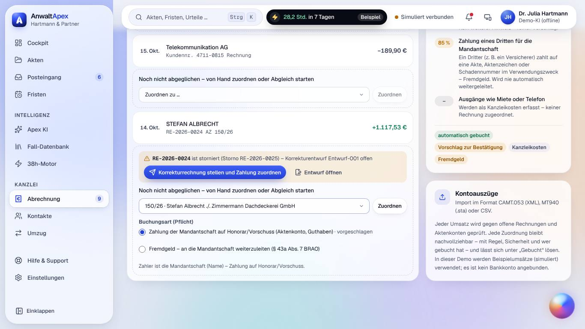 | **I3-T08-01 (H), I3-T08-02** – Bankabgleich: Storno-Hinweis mit Korrekturentwurf, Akte 150/26 vorgewählt, Buchungsart „Honorar/Vorschuss · vorgeschlagen“ (L hell). |
| 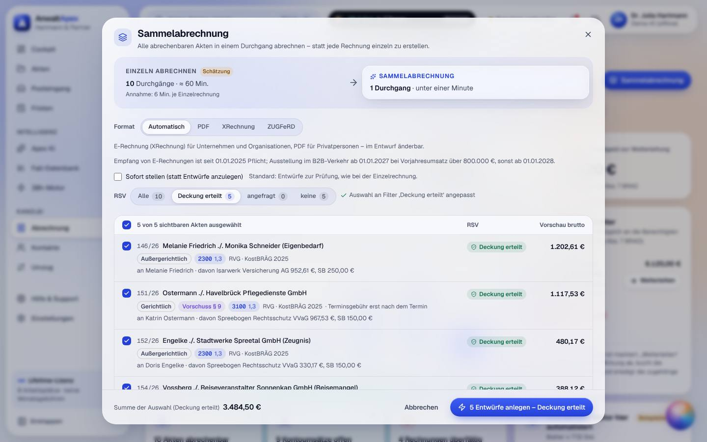 | **I3-T07-01 (H)** – Filter „Deckung erteilt“: „5 von 5 sichtbaren Akten ausgewählt“, Summe 3.484,50 €, „5 Entwürfe anlegen – Deckung erteilt“ (D hell). |
|  | **I3-T15-01 (H)** – Zahlungsfrist 131/26 ohne Ausgang: „Noch keine Überweisung gebucht – die Frist bleibt offen.“, Erledigen gesperrt (L dunkel). |
| 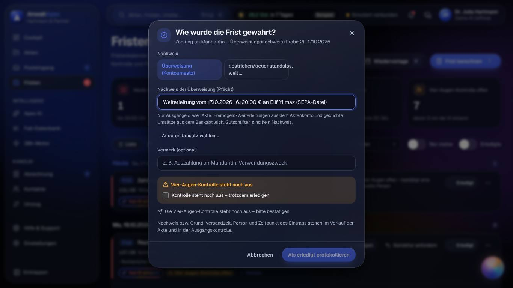 | **I3-T15-01 (H)** – Nach der SEPA-Weiterleitung ist sie als Nachweis vorgewählt (L dunkel). |
| 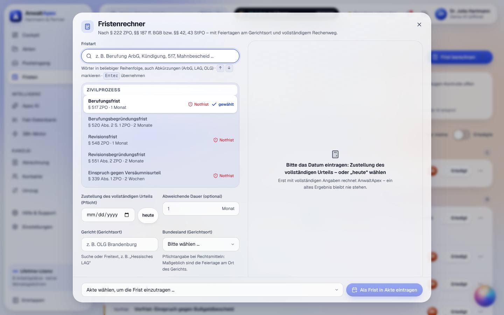 | **I3-T18-02 (H), I3-T18-01** – Fristenrechner: Zustellung leer, kein Ergebnis, „heute“ als Schnellwahl; Zeile „gewählt“ (D hell). |
| 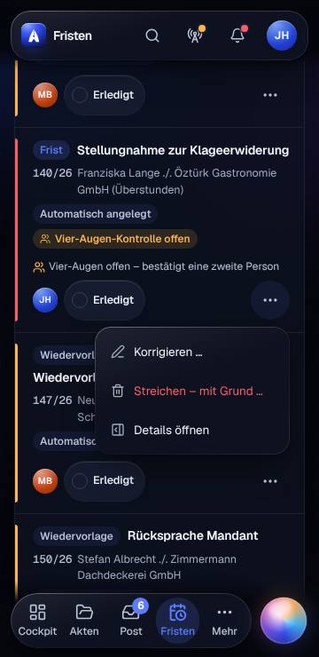 | **I3-T03-01 (H↑), I3-T03-04** – 360 px dunkel: „Vier-Augen offen – bestätigt eine zweite Person“, „Erledigt“ und „⋯“ mit Korrigieren, Streichen, Details (360 px dunkel). |
| 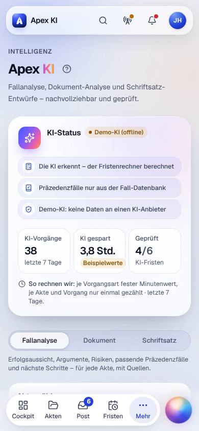 | **I3-T06-01 (H)** – Apex KI am iPhone: drei Grundsätze untereinander, Datenhinweis im ersten Bildschirm (M hell). |
| 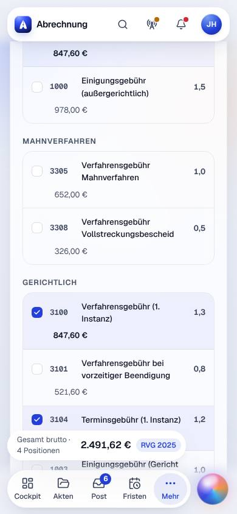 | **I3-T07-02 (H)** – RVG-Rechner gescrollt: Summenleiste über der Tab-Leiste, Kopfleiste über der Scrollfläche (M hell). |
| 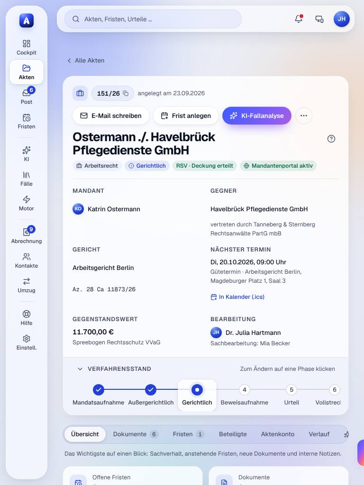 | **I3-T14-02 (H), I3-T14-01** – iPad hoch: beschriftete Leiste, Links im Aktenkopf 44 px hoch (Th hell, Touch). |
| 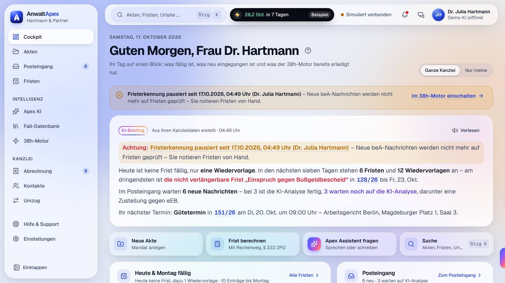 | **I3-T10-01** – Cockpit: Hinweisband und „Achtung“ im Briefing mit Datum, Uhrzeit und Person (L hell). |
| 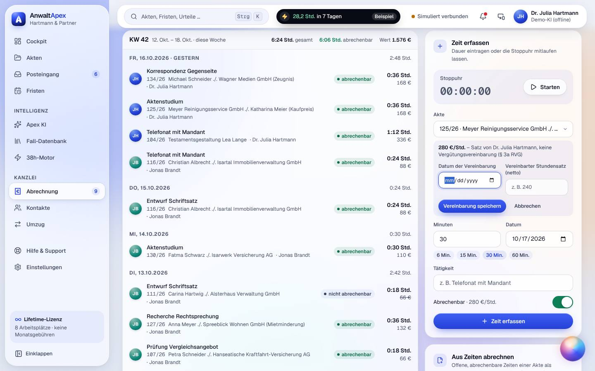 | **I3-T07-04, A-06 nachgeholt** – Direktlink aus „Zeit erfassen“: 125/26 vorgewählt, „Vereinbarung erfassen“ offen, Fokus im Datum (D hell). |
| 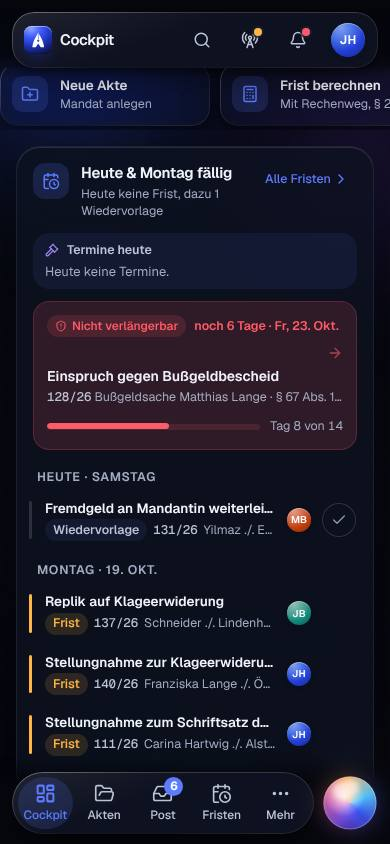 | **B-08 nachgeholt** – Cockpit gescrollt: Inhalt endet weich an der Kopfleiste (M dunkel). |
| 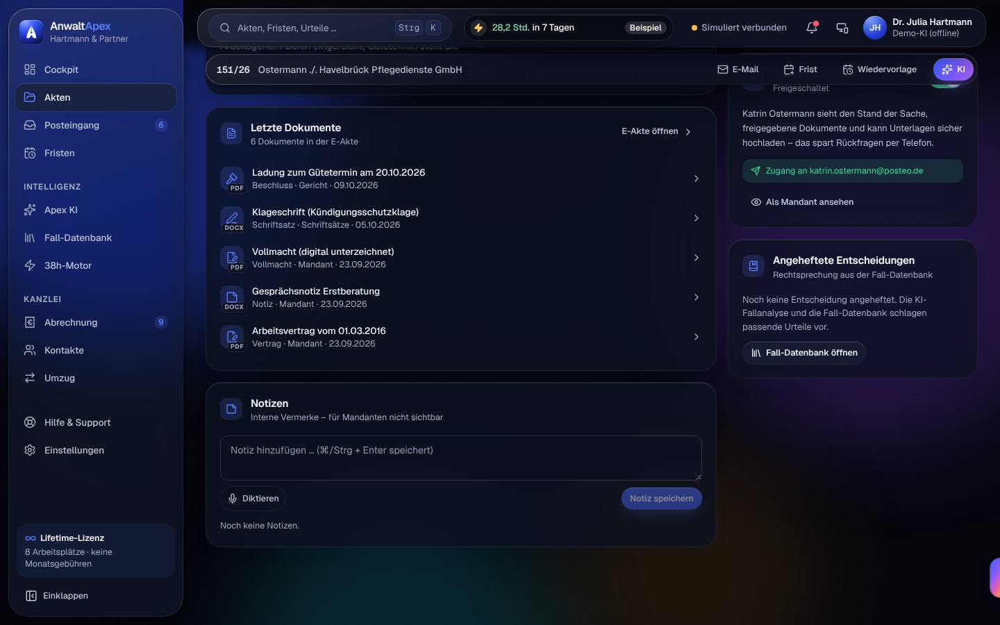 | **Fund der Abnahme** – Kurzkopf der Akte 151/26 in eigener Ebene, gleiche Lage wie vorher (D dunkel). |
