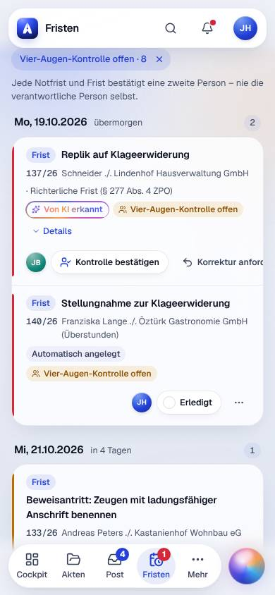
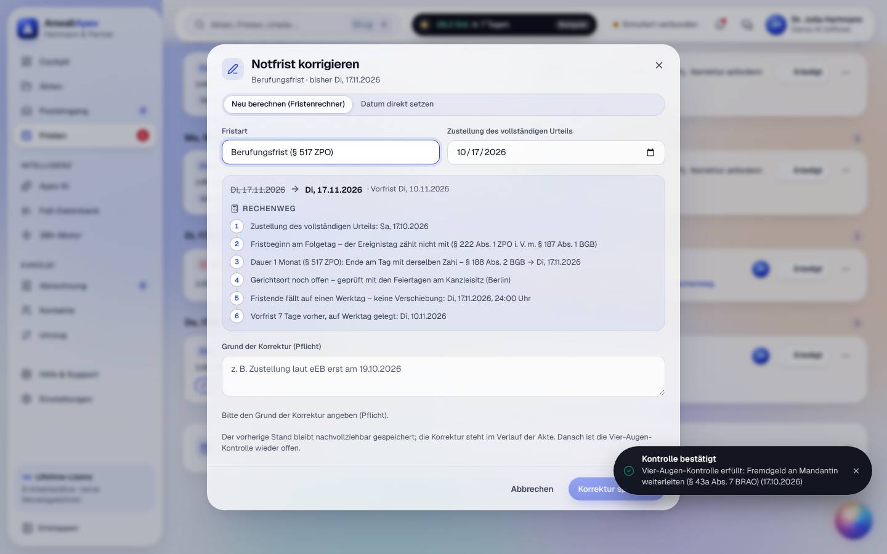
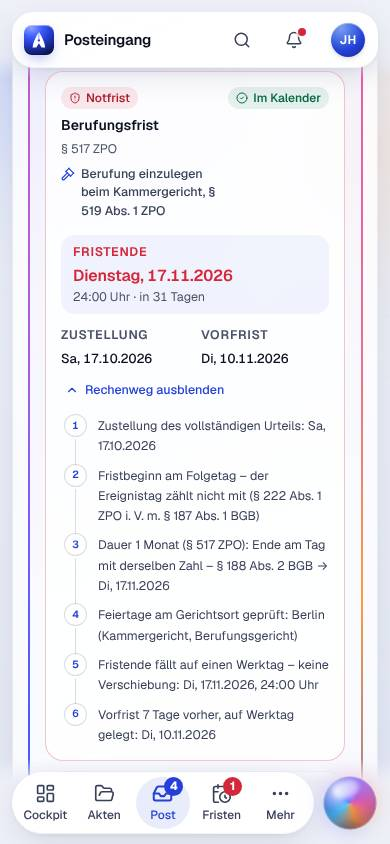

## Iteration 3 – Feedback Claudia Reinholz · Block B (Alltag Mandatsarbeit)

**Datum:** Sa, 17.10.2026, ca. 01:00–01:40 Uhr Ortszeit · **Betriebsmodus:** Browser-Demo (Anmeldeseite „Demo-Modus: Ihre Änderungen bleiben in diesem Browser gespeichert“, Kopfleiste „Demo-KI (offline)“, „Simuliert verbunden“) · **Browser:** Chromium (Playwright, `de-DE`, Europe/Berlin; Datumsfelder weiter im US-Format → Testumgebung, kein Befund) · **Testleitung:** Avatar-Werkzeug, frisches Profil `i3-B`, Präsentationszugang Dr. Julia Hartmann (Anmeldung per E-Mail und Passwort)

**Reihenfolge und Viewports:** T01 (D hell, D dunkel, L, **M**) → T02 (D, **M**) → T03 (D, **M**) → T04 (L) → T05 (D, **M**) → T17 (D) → T23 (D, **Tq**).
**Schwerpunkt Iteration 3 (Mobil und Tablet):** T01, T02, T03 und T05 zusätzlich am iPhone (390×844), T23 zusätzlich am iPad quer (1024×768). Gemessen wurden Bedienflächen, Überläufe und was ohne Scrollen sichtbar ist. axe-core in 10 Ansichten.

> Eine einzige simulierte Person: SUS, UEQ-S und Noten sind **Trendwerte**.

> Mein Eindruck in einem Satz: *Am Schreibtisch ist das jetzt ein Werkzeug, dem ich Fristen anvertrauen würde – Rechenweg, eEB-Sperre, Vier-Augen und Protokoll stimmen. Am iPhone kann ich lesen, aber nicht jede Frist anfassen, und auf dem iPad sehe ich von der Aktenliste genau eine Zeile.*

### Nachtest Vorrunde (Befunde meiner Aufgaben T01–T05, T17, T23)

| Befund | Status | Was ich gesehen habe |
|---|---|---|
| I2-T01-01 | behoben | × direkt an der Apex Island: 1 Aktion, Meldung „Apex Island ausgeblendet … Rückgängig“. Der Schalter in Darstellung heißt jetzt „Apex Island (Live-Meldungen) anzeigen“, genau wie das Element. |
| I2-T01-02 | behoben | Kugel weicht im Cockpit als Griff an den rechten Rand aus („Kugel ist an den Rand ausgewichen, damit sie nichts verdeckt“). D und L: Posteingang-Karte und Statuszeile frei. |
| I2-T01-03 | behoben | „28,2 Std. in 7 Tagen“ bzw. „29,1 Std. in 7 Tagen“ ungekürzt auf D und L. |
| I2-T02-01 (K) | behoben | 118/26 → 150/26 (mit Pflichtbestätigung) → zurück 118/26: „Jetzt 118/26 statt 150/26 · 2 Dokumente verschoben – in beiden Verläufen protokolliert“. 150/26: Ordner „Gericht“ 0 Dokumente, kein Urteil; Verlauf „Zuordnung … zurückgenommen – 2 Dokumente nach 118/26 verschoben“. |
| I2-T02-02 | behoben | Warnkasten „28 O 211/26 gehört laut Bestand zu 118/26 – trotzdem 150/26? … Dokumente einer fremden Akte können im Mandantenportal sichtbar werden“, Häkchen Pflicht, „Stattdessen 118/26 wählen“. Kopfzeile danach „Akte 150/26 (zugeordnet) · KI-Vorschlag 118/26“. |
| I2-T02-03 | behoben | Rechenweg: „Feiertage am Gerichtsort geprüft: Berlin (Kammergericht, Berufungsgericht)“, „§ 520 Abs. 2 S. 1 ZPO“. Im Korrektur-Dialog geht der Ort wieder verloren → neu I3-T03-02. |
| I2-T02-04 | behoben | D: „Neu 5 · beA · E-Mail · Ohne Akte 5“ mit Abstand. Am iPhone fehlen die Zähler → neu I3-T02-02 (N). |
| I2-T02-05 | behoben | J, J, K: n-12 → n-4 → n-1 → n-4. Fußzeile der Liste: „↑ ↓ wählen · Enter öffnet · J/K nächste bzw. vorige“. |
| I2-T03-01 (H) | behoben | Mandatsaufnahme: 12 × Tab, Fokus bleibt im Dialog. „Eingaben verwerfen?“ öffnet mit Fokus auf „Weiter bearbeiten“; „Mandantenportal sperren?“ mit Fokus auf „Abbrechen“. |
| I2-T03-02 | behoben | Zeilenmenü „Korrigieren …“ mit „Neu berechnen (Fristenrechner)“ / „Datum direkt setzen“ und „Grund der Korrektur (Pflicht)“; an fremden Fristen „Kontrolle bestätigen“ und „Korrektur anfordern“. |
| I2-T03-03 | behoben | Nach der eEB-Abgabe empfiehlt die Karte nur noch „Mandanten über das Urteil informieren und Berufung prüfen“. |
| I2-T04-01 | **teilweise** | Monatsansicht: „NICHT VERLÄNGERBAR · Klagefrist Kündigungsschutzklage“ in Rot; „Kritische Fristen“ zählt sie (5 → 6). In der Akte 155/26 → Fristen heißt die rote Pille aber nur „Frist“ (mit Schild), ohne „nicht verlängerbar“. |
| I2-T04-02 | behoben | Mandatsaufnahme: „Feiertage: Kanzleisitz; den Gerichtsort bei Klageerhebung prüfen“, Rechenweg „Gerichtsort noch offen – geprüft mit den Feiertagen am Kanzleisitz (Berlin)“. |
| I2-T04-03 | behoben | Nach Neustart des Browsers: „Entwurf fortsetzen? … Stand: Schritt 2 von 4 …“, alle Eingaben (Gegner, Zugang, Entgelt, RSV) wieder da. Kleiner Rest: Abfrage auch bei leerem Entwurf → neu I3-T04-01 (N). |
| I2-T04-04 | behoben (Sichtprüfung) | „Bestehender Kontakt“: „↑/↓ wählt, Enter übernimmt, Escape leert die Suche“ als Liste mit einem Tab-Stopp; nicht erneut vollständig mit Tastatur durchgespielt. |
| I2-T04-05 | behoben | Deckungsanfrage 142/26: „Brief · 15.10.2026 · Entwurf“. |
| I2-T05-01 | behoben | Kündigungsschreiben 142/26: „Eingang 15.10.2026 · Scan · Az. 142/26 · Eingegangenes Dokument – unverändert“, darunter das Original der Kröger Logistik GmbH ohne Kanzleikopf. |
| I2-T05-02 | behoben | „Bruchware“ ins Suchfeld getippt: kein W-Kürzel. Darstellung hat den Schalter „Kürzel mit einzelnen Buchstaben“. |
| I2-T05-03 | behoben | L: Reiterleiste der Akte 142/26 bei y = 509 (vorher 667), Verfahrensstand eingeklappt. |
| I2-T17-01 | behoben | „Neuer Kontakt“: keine Rolle vorbelegt, „Rollen (Pflicht) – Bitte mindestens eine Rolle wählen“. |
| I2-T17-02 | behoben | „1 Akte, keine offen“, „2 Akten, davon 1 offen“, „5 Akten, davon 3 offen“. |
| I2-T23-01 (H) | behoben | „Als Mandant ansehen“ 142/26: nur Vollmacht und Kostenhinweise; „Nicht sichtbar für den Mandanten: 1 Entwurf, 3 Eingänge, 1 internes Dokument“. Meine E-Mail ohne Portal-Häkchen erscheint dort nicht. |
| I2-T23-02 | behoben | Deaktivieren Jonas Brandt: „Bearbeitung und Fristverantwortung übertragen an …“ bietet nur „Dr. Julia Hartmann · Partnerin“, Hinweis „Nur Partner und Anwälte“. |
| I2-T23-03 | behoben | „Mandantenportal sperren?“ – „Petra Schneider verliert den Zugang sofort – sperren? … Der Vorgang steht im Verlauf.“ |
| I2-T23-04 | behoben | „Es ist noch 1 offene Wiedervorlage eingetragen … Keine offenen Rechnungen, das Aktenkonto ist ausgeglichen … Aufbewahrungsfrist der Handakte (§ 50 BRAO, sechs Jahre)“. |
| I2-T23-05 | behoben | 150/26 „Außergerichtlich“, Gericht „Arbeitsgericht Berlin – Az. noch nicht bekannt“. |
| I1-T01-03 | behoben | über I2-T01-01. |
| I1-T01-05 | behoben | über I2-T01-02. |
| I1-T04-07 | behoben | über I2-T04-05. |
| I1-T05-05 | behoben | über I2-T05-03. |
| I1-T23-04 | behoben | Aktenbezeichnungen brechen bei 1440 px vollständig um („Vossberg ./. Reiseveranstalter Sonnenkap GmbH (Reisemangel)“). |

**Summe:** 31 IDs geprüft – 30 behoben, 1 teilweise (I2-T04-01), 0 nicht behoben.

### Aufgaben

| Aufgabe | Ergebnis | Erfolgskriterium (Messwert) | Prüfpunkte x/y | Aktionen/Soll | Fehlaktionen | fachlich korrekt | SEQ | O-Ton |
|---|---|---|---|---|---|---|---|---|
| T01 Morgenroutine Cockpit (D hell, D dunkel, L, M) | erledigt | **erfüllt:** 4 von 4 ohne Scrollen auf D – heute **1 Frist** („Fremdgeld an Mandantin weiterleiten“, 131/26), Termine heute **keine** (nächster: Gütetermin 151/26, Di 20.10., 9:00 Uhr), **6 neue Nachrichten**, **beA ✓ · E-Mail ✓ (simuliert)**. Abgleich Fristen „Heute fällig 1“, Posteingang „Neu 6“ | 6/6 (+1 nicht geprüft: reduzierte Bewegung, Iteration 4) | 0 / 0 | 0 | ja – Briefing, Karten und Detailansichten decken sich | 6 | „Das ist mein Morgen auf einer Seite. Am iPhone muss ich für den beA-Status zwei Bildschirme runter – das ist genau die Frage, die ich im Gerichtsflur habe.“ |
| T02 beA-Posteingang mit Urteil (D, M) | erledigt | **erfüllt:** 118/26 zu 99 % „erkannt über Gerichtsaktenzeichen 28 O 211/26“; Berufung **Di 17.11.2026** (§ 517 ZPO), Begründung **Do 17.12.2026** (§ 520 Abs. 2 S. 1 ZPO), beide mit Rechenweg in **3 Aktionen** | 5/5 (Umzuordnung hin 4 Aktionen wegen Pflichtbestätigung, zurück 3) | 3 / 3 | 0 | ja – Zustellung Sa 17.10.2026; +1 Monat = 17.11. (Di), +2 Monate = 17.12. (Do), § 188 Abs. 2 BGB; Vorfristen 10.11. (Di) und 03.12. (Do) | 7 | „Tenor, Kostenquote, Kammergericht – stimmt alles. Und wenn ich mich verklicke, hält mich das System fest, bevor eine Notfrist in der falschen Akte landet. So will ich das.“ |
| T03 Frist übernehmen, eEB, Vier-Augen (D, M) | erledigt | **erfüllt:** eEB vorher gesperrt („Erst Frist notieren, dann eEB“), danach aktiv; Fristübernahme **1 Aktion**; Protokoll **4/4** („eEB abgegeben von Dr. Julia Hartmann am 17.10.2026, 01:13 Uhr · Zustellungsdatum 17.10.2026 · erstmals geöffnet am 17.10.2026, 01:08 Uhr“) | 4/4 | 4 / 4 (Übernehmen, eEB, Häkchen, Abgeben) + 1 Kontrolle | 1 (eigene Frist gesucht, die ich nicht selbst kontrollieren darf) | ja – Fristbeginn = eEB-Datum; Abweichung nicht provozierbar (Datumsfeld nur 17.10.–17.10., Eingang heute) | 6 | „Dass ich meine eigene Frist nicht selbst abhaken darf, ist richtig. Dass mir das niemand an der Zeile sagt, nicht. Und am iPhone komme ich an ‚Erledigt‘ gar nicht ran.“ |
| T04 Mandatsaufnahme KSchG + Kollision (L) | erledigt | **erfüllt:** Akte 155/26 in **17 / 25 Aktionen**; Klagefrist **Mo 02.11.2026** mit vollständigem Rechenweg; Gegenstandswert **11.400,00 €** (3 × 3.800 €, § 42 Abs. 2 S. 1 GKG) | 8/8 | 17 / 25 | 0 | ja – 3 Wochen ab Sa 10.10. → Sa 31.10.; So 01.11. → Mo 02.11. (§ 193 BGB, § 222 Abs. 2 ZPO); Vorfrist Mo 26.10.; WV Deckungszusage vom Samstag auf Mo 26.10. gelegt | 6 | „Kröger wird vor der Anlage erkannt, ohne Entscheidung geht nichts, die Ablehnung steht im Protokoll. Das ist Kollisionsprüfung, wie ich sie kenne – nur schneller.“ |
| T05 E-Akte aufräumen und schreiben (D, M) | erledigt | **erfüllt:** Umbenennen 2, Verschieben 4 (3 Häkchen + „Gericht“), Suche 1 Feld (2 Treffer, markiert), E-Mail 3 (Schreiben, Anlage, Senden); „Gesendet – Sie bleiben in der Akte“, Verlauf „E-Mail an Thomas Weber gesendet“ (4 von 4 + ja) | 6/6 | 10 / 12 | 0 | ja – Anlage „Kündigungsschreiben … · Version 1“ in Vorschau und Versand | 6 | „Zwölf PDFs abends um acht – das ginge jetzt. Am iPhone über ‚⋯‘ auch, nur die zweite schwebende Leiste liegt mir über den Dokumenten.“ |
| T17 Kontakte (D) | erledigt | **erfüllt (2/2):** Dublettenwarnung „Kontakt besteht bereits: Kröger Logistik GmbH …“ vor dem Speichern; Löschen Weber gesperrt: „Aufbewahrung der Handakte 6 Jahre nach Mandatsende (§ 50 Abs. 1 BRAO) – löschbar erst nach Abschluss der Akten (1 Akte noch offen)“ | 5/5 | 13 / – | 0 | ja – Schadennummer nur an der Akte, Versicherungskontakt mit Schadenabteilung, Postfach, Ansprechpartner, drebis-Kennung | 7 | „Auskunft nach Art. 15 in drei Klicks, mit Prüfhinweis zur Verschwiegenheit. Da habe ich nichts zu meckern.“ |
| T23 Aktenübersicht, Portal, Nachfolge (D, Tq) | erledigt mit Umweg | **erfüllt:** Filter Offen + Verkehrsrecht + Jonas Brandt = 3 Akten (131/26, 130/26, 107/26); umgehängt in **4 Aktionen** (Alle wählen, Bearbeiter ändern, Dr. Julia Hartmann, Übergeben); Verlauf **3/3** „Bearbeitung von Jonas Brandt an Dr. Julia Hartmann übergeben“ | 5/6 (Tq: bedienbar ja, aber Spalten und Kennzahlen abgeschnitten) | 4 / 4 (+ Portal 3, Abschluss 3) | 2 (137/26 und 130/26 hatten schon ein Portal; Akte ohne Portal gesucht) | ja – Aufbewahrung „bis 31.12.2032 vorgemerkt (§ 50 BRAO)“: Mandatsende 2026, Frist ab Jahresende, + 6 Jahre | 6 | „Übergabe mit Fristen, Wiedervorlage und Verlauf – das ist meine Nachfolgeplanung in vier Klicks. Am iPad sehe ich von der Liste allerdings eine Zeile.“ |

**Aktionen gezählt** nach 1.6 (Texteingaben = 1 je Feld). Fehlaktionen gesamt: **3**. SEQ-Mittel: **6,3**.

**Prüfpunkte im Einzelnen**

- **T01:** Notfrist durch Farbe + Text („Nicht verlängerbar“) + Symbol – ja · KI-Briefing gekennzeichnet („KI-Briefing“), 0 Abweichungen zu den Karten – ja · Island verdeckt nichts (D, L) – ja · Bewegung: 1 Inhaltswechsel in 120 s – ja · in 1 Aktion abschaltbar (×) – ja · Name per Tooltip erklärt („Apex Island – zeigt, was der 38h-Motor zuletzt erledigt hat (Beispielwerte) …“) – ja · dunkel: alle 4 Angaben ruhig lesbar, keine grellen Flächen – ja · reduzierte Bewegung – nicht geprüft (Iteration 4).
- **T02:** Zusammenfassung als KI erkennbar, 0 Abweichungen (14.250,00 € Zug um Zug, Abweisung 4.650,00 €, 25/75) – ja · „Die KI erkennt – berechnet wird mit dem geprüften Fristenrechner.“ – ja (steht ganz unten auf der Karte) · Kammergericht + Feiertage Berlin – ja · Umzuordnung hin und zurück – ja (hin 4 Aktionen, weil die Pflichtbestätigung dazukommt; das will ich so) · Nachricht ohne Akte → „Mandat anlegen“ – ja · Petra ohne Schulung – ja, die Warnung bei fremdem Gerichts-Az. fängt genau ihren typischen Fehler ab.
- **T03:** Fristbeginn = eEB-Zustellungsdatum (17.10.2026) – ja · Frist und Vorfrist im Kalender, Vorfristen werktags (Di 10.11., Do 03.12.) – ja · „Kontrolle bestätigen“ mit 1 Aktion (fremde Frist, D und M) – ja; Korrektur mit Pflichtgrund und neuer Vier-Augen-Kontrolle – ja · Doppelklick auf „eEB abgeben“ → genau 1 Verlaufseintrag – ja.
- **T04:** § 12a Abs. 1 S. 2 ArbGG – ja · Versicherer (mit Vorschlagsliste), Vers.-Nr. RS-5518302, SB 150,00 € – ja · Deckungsanfrage-Entwurf „wartet auf Ihre Freigabe“ – ja · Schadennummer nachtragbar („Schadennummer noch nicht vergeben“, „Angaben bearbeiten“) – ja · „Vorschuss anfordern (§ 9 RVG)“ – ja · drebis „im Prototyp nicht angebunden – Versand per E-Mail oder Brief“ – ja · Kollision vor der Anlage: „Möglicher Interessenkonflikt (§ 43a Abs. 4 BRAO) – 1 Treffer · Kröger Logistik GmbH: Gegner in 142/26 Weber ./. Kröger Logistik GmbH“, „Akte anlegen“ ohne Entscheidung abgewiesen, Ablehnung mit Vermerk protokolliert – ja · Tab-Reihenfolge Anrede → Vorname → Nachname → E-Mail → Telefon → Straße → PLZ → Ort → Abbrechen, Pflichtfelder mit * – ja; Abbrechen fragt nach („Als Entwurf behalten / Eingaben verwerfen / Weiter bearbeiten“) – ja.
- **T05:** Verschieben ohne Ziehen („Verschieben nach: Korrespondenz · Schriftsätze · Gericht …“, am iPhone im „⋯“-Menü) – ja · Mehrfachauswahl per Häkchen/Umschalt – ja · Treffer im Dokument markiert (3 × „Bruchware“) – ja · Vorschau und Versand nennen „Version 1“ – ja · Umbenennen und Verschieben mit „Rückgängig“ – ja · „Diktieren“ im E-Mail-Dialog – ja.
- **T17:** Export in 3 Aktionen (Kontakt, „Auskunft (Art. 15)“, „Datei speichern“; dazu JSON nach Art. 20) – ja · verknüpfte Akte 142/26 in 2 Aktionen – ja · Kollisionsprüfung aus dem Kontakt („als Mandant“ → „Konflikt: Gegner in 142/26 … Ergebnis im Protokoll vermerkt“) – ja · Versicherungsfelder passend – ja · Schadennummer an der Akte, nicht am Kontakt – ja.
- **T23:** Filter kombinierbar (Status + Sachgebiet + Bearbeitung, in der Adresse gemerkt) – ja · Portal-Freischaltung im Verlauf („Mandantenportal freigeschaltet für Petra Schneider …“), Vorschau „Als Mandant ansehen“ – ja · Ablage nennt § 50 BRAO und das Datum – ja · Deaktivieren erklärt Akten, Fristen und Verlauf – ja · Tq: Filter und Mehrfachauswahl bedienbar – ja, aber nicht „nichts abgeschnitten“ – nein (I3-T23-01).

### Mobil und Tablet (Schwerpunkt dieser Runde)

| Ansicht | Viewport | Ergebnis |
|---|---|---|
| Cockpit | M hell | KI-Briefing mit Frist und 131/26 oben; „Posteingang und Termine im Briefing“ aufklappbar. Tab-Leiste mit Zählern (Post 6, Fristen 1). beA-Status erst bei y ≈ 1.627 → I3-T01-01. |
| Posteingang, Nachricht, Rechenweg | M hell | Gut: Kopf kompakt, „Notfrist bis Di, 17.11.2026“, Rechenweg 6 Schritte gut lesbar ([Bild](bilder/block-B-T02-positiv-rechenweg-kammergericht-M-hell.jpg)). Textknöpfe 19–32 px hoch → I3-T02-01. Filter ohne Zähler → I3-T02-02. |
| Fristen | M hell | „Kontrolle bestätigen“ 1 Tap. Aktionszeile läuft über, „Erledigt“ und „⋯“ unerreichbar → I3-T03-01. Liste beginnt erst unter vier Kennzahl-Kacheln → I3-T03-05. |
| Akte 142/26, Dokumente | M hell | Mobile Hinweise („über das Menü ‚⋯‘ am Dokument“), „Verschieben nach …“ im Menü, Mehrfachauswahl-Leiste. „E-Mail schreiben“ im ersten Bildschirm (y = 403). Schnellaktionsleiste verdeckt Zeilen → I3-T05-01. |
| eEB am iPhone | M | **nicht prüfbar:** Das einzige eEB der Demodaten war bereits am Schreibtisch abgegeben. |
| Akten (Liste, Filter, Mehrfachauswahl) | Tq hell | Filter, „15 ausgewählt“, „Bearbeiter ändern“ bedienbar. Tabelle 890 px in 694 px, Kennzahlen abgeschnitten, erste Zeile bei y ≈ 680 → I3-T23-01 ([Bild](bilder/block-B-T23-aktenliste-spalten-abgeschnitten-Tq-hell.jpg)). |

### Befunde

- **I3-T03-01 [M] [Fristen → Liste (z. B. Filter „Vier-Augen-Kontrolle offen“) · M 390×844 · hell]** Bei Fristen mit offener Kontrolle steht die Aktionszeile „JB · Kontrolle bestätigen · Korrektur anfordern · Erledigt · ⋯“ in einem Container mit `overflow: hidden` (Breite 356 px, Inhalt 532 px). „Korrektur anfordern“ ist angeschnitten, **„Erledigt“ (x 416–505) und „⋯“ (x 513–549, darin Korrigieren, Streichen, Details) liegen außerhalb des Bildschirms** und lassen sich weder sehen noch antippen. → Erwartet: Jede Aktion an der Frist ist am iPhone erreichbar – im Gericht will ich eine Frist erledigen oder korrigieren. → Vorschlag: Aktionen auf M umbrechen (zweite Zeile) oder „Korrektur anfordern“ und „Erledigt“ ins „⋯“-Menü legen; „⋯“ immer sichtbar am rechten Rand. · Screenshot: [block-B-T03-fristkarte-aktionen-abgeschnitten-M-hell.jpg](bilder/block-B-T03-fristkarte-aktionen-abgeschnitten-M-hell.jpg) · Dateien: `src/pages/fristen/FristZeile.tsx`
- **I3-T03-02 [M] [Fristen → Berufungsfrist 118/26 → ⋯ → „Korrigieren …“ · D · hell]** Der Korrektur-Dialog rechnet neu und schreibt in Schritt 4 „Gerichtsort noch offen – geprüft mit den Feiertagen am Kanzleisitz (Berlin)“. Dieselbe Frist sagt im Posteingang und in der Liste „Feiertage am Gerichtsort geprüft: Berlin (Kammergericht, Berufungsgericht)“. Der Dialog hat kein Feld für den Gerichtsort. Ergebnis hier gleich (17.11.2026), aber eine Korrektur verliert den Rechtsmittelort – liegt das Gericht in einem anderen Land als die Kanzlei, rechnet die Korrektur still mit den falschen Feiertagen (vgl. I2-T18-04). → Erwartet: Korrektur übernimmt Gericht und Ort der ursprünglichen Frist; Rechenweg derselben Frist widerspricht sich nie. → Vorschlag: Gerichtsort/Bundesland aus der Frist bzw. Akte in den Korrektur-Dialog übernehmen, anzeigen und änderbar machen; Test „Korrektur behält Gerichtsort“. · Screenshot: [block-B-T03-korrektur-gerichtsort-kanzleisitz-meldung-ueber-knopf-D-hell.jpg](bilder/block-B-T03-korrektur-gerichtsort-kanzleisitz-meldung-ueber-knopf-D-hell.jpg) · Dateien: `src/pages/fristen/KorrekturDialog.tsx`, `src/core/fristen.ts`
- **I3-T03-03 [M] [Fristen → „Kontrolle bestätigen“, danach „Korrigieren …“ · D · hell]** Die Meldung „Kontrolle bestätigt – Vier-Augen-Kontrolle erfüllt …“ liegt unten rechts **über dem offenen Dialog** und verdeckt den Knopf „Korrektur speichern“ (nur „Korrektur s…“ sichtbar), bis sie nach einigen Sekunden verschwindet oder geschlossen wird. → Erwartet: Meldungen verdecken nie die Hauptaktion eines Dialogs. → Vorschlag: Bei offenem Dialog Meldungen oben bzw. oberhalb des Dialog-Fußes anzeigen oder hinter den Dialog legen; Fußbereich freihalten. · Screenshot: wie I3-T03-02 · Datei: `src/components/ui/Toaster.tsx`
- **I3-T03-04 [N] [Fristen → Liste, eigene Fristen 118/26 · D · hell]** Bei den beiden selbst notierten Fristen fehlt „Kontrolle bestätigen“ ohne sichtbaren Grund. Die Erklärung („Die verantwortliche Person kann sich nicht selbst kontrollieren“) steht nur im Tooltip des Badges bzw. erst im Filter „Vier-Augen-Kontrolle offen“. → Erwartet: An der Zeile lesbar, warum ich nicht bestätigen kann und wer es tun soll. → Vorschlag: Badge „Vier-Augen offen – bestätigt eine zweite Person“ oder Zeile „Von Ihnen notiert – Kontrolle durch Kollegin/Kollegen“. · Datei: `src/pages/fristen/FristZeile.tsx`
- **I3-T03-05 [M] [Fristen · M 390×844 · hell]** Der erste Bildschirm zeigt nur Titel, „Drucken“, „.ics“, zwei Knöpfe und vier Kennzahl-Kacheln; die erste Frist steht erst unterhalb von y ≈ 800. Die Umschaltung „Liste · Woche · Monat · Ausgangs…“ ist abgeschnitten. → Erwartet: Am iPhone sehe ich zuerst die Fristen. → Vorschlag: Kennzahlen auf M als eine Zeile kompakter Chips (oder einklappbar), Umschaltung umbrechen bzw. „Ausgangskontrolle“ kürzen. · Datei: `src/pages/fristen/Fristen.tsx`
- **I3-T01-01 [M] [Cockpit · M 390×844 · hell]** Der Status „beA ✓ · E-Mail ✓ · letzte Abfrage …“ steht erst bei y ≈ 1.627, also knapp zwei Bildschirmhöhen tiefer; auch das aufgeklappte Briefing nennt ihn nicht. Auf D ist er ohne Scrollen sichtbar. → Erwartet: Am Gericht sehe ich auf einen Blick, ob beA läuft. → Vorschlag: beA-Status als Zeile ins KI-Briefing oder als Punkt in die mobile Kopfleiste. · Dateien: `src/pages/cockpit/Briefing.tsx`, `src/pages/cockpit/KartenArbeit.tsx`
- **I3-T05-01 [M] [Akte 142/26 → Dokumente · M 390×844 · hell]** Über der Tab-Leiste schwebt eine zweite Leiste „Notiz · Frist · Wiedervorlage“; zusammen belegen beide ≈ 150 px. Sie verdecken Dokumentzeilen; bei Mehrfachauswahl ist unter der Auswahlleiste nur eine Zeile sichtbar, die zweite gewählte liegt unter der Schnellaktionsleiste. → Erwartet: Nichts Bedienbares liegt unter schwebenden Leisten. → Vorschlag: Schnellaktionen auf M in den Aktenkopf oder ins „⋯“ verlegen, bei Mehrfachauswahl ausblenden, Liste mit unterem Innenabstand. · Datei: `src/pages/akten/AkteDetail.tsx`
- **I3-T23-01 [M] [Akten → Liste · Tq 1024×768 · hell]** Die Tabelle ist 890 px breit, der Container 694 px (Querwischen ohne Hinweis): „Gegenstandswert“ angeschnitten, „Bearbeitung“ und „Geändert“ unsichtbar – gerade die Spalte, nach der ich bei der Übergabe filtere. Kennzahlen abgeschnitten („davon 6 mit hoher Prio…“, „Akten mit Frist ≤ 7 Ta…“, „davon 1 mit kritischer …“). Die erste Aktenzeile beginnt bei y ≈ 680; die volle Seitenleiste (264 px) bleibt stehen. → Erwartet: Am iPad quer Liste und Filter ohne Abschneiden (Prüfpunkt T23). → Vorschlag: Ab Tablet-Breite Seitenleiste kompakt (Symbole), Bearbeitung als Kürzel unter der Aktenbezeichnung, Kennzahlen kompakt in einer Zeile; sichtbarer Hinweis auf Querscrollen. · Screenshot: [block-B-T23-aktenliste-spalten-abgeschnitten-Tq-hell.jpg](bilder/block-B-T23-aktenliste-spalten-abgeschnitten-Tq-hell.jpg) · Datei: `src/pages/akten/AktenListe.tsx`
- **I3-T02-01 [N] [Posteingang → KI-Karte · M 390×844 · hell]** „Rechenweg anzeigen/ausblenden“ ist 167 × 19 px, „Andere Akte wählen“ 142 × 32 px groß – beides unter 44 px Höhe; mit dem Daumen am Gericht knapp. → Vorschlag: Mindesthöhe 44 px für Textknöpfe auf M. · Datei: `src/pages/posteingang/KiKarte.tsx`
- **I3-T02-02 [N] [Posteingang → Filter · M 390×844 · hell]** Am iPhone stehen „Neu“ und „Ohne Akte“ ohne Zähler (D: „Neu 5“, „Ohne Akte 5“); „Ohne Akte“ klebt am Rand. → Vorschlag: Zähler auch mobil, Leiste scrollbar mit Randabstand. · Datei: `src/pages/posteingang/Posteingang.tsx`
- **I3-T02-03 [N] [Posteingang → „Akte zuordnen“ · D · hell]** Die Nachricht hat „2 Anhänge“ (Urteil_28O211-26.pdf, Zustellungsnachricht.xml); Meldung und Verlauf sagen „1 Anhang in ‚Gericht‘“, die XML landet ohne Hinweis nicht in der E-Akte. → Erwartet: Ich sehe, was abgelegt wurde und was nicht. → Vorschlag: „Zustellungsnachricht.xml (Strukturdaten) nicht abgelegt“ nennen oder mit ablegen. · Datei: `src/pages/posteingang/analyse.ts`
- **I3-T04-01 [N] [Mandatsaufnahme · L · hell]** „Entwurf fortsetzen? – Mandant: noch nicht gewählt · Schritt 1 von 4“ erscheint auch, wenn der Dialog nur geöffnet und „Neuer Mandant“ bzw. „Firma / Organisation“ angeklickt wurde, ohne jede Eingabe; danach steht „Mandatsaufnahme fortsetzen“ dauerhaft in der Aktenliste. → Vorschlag: Entwurf erst ab der ersten Eingabe speichern. · Datei: `src/pages/akten/Mandatsaufnahme.tsx`
- **I3-T04-02 [N] [Mandatsaufnahme → Zusammenfassung, Kollisionstreffer Kröger · L · hell]** Nach „Mandat ablehnen“ stehen weiter „Mandantenportal freischalten“ (Schalter an, „Zugangs-E-Mail an personal@kroeger-logistik.de“) und „Das erledigt AnwaltApex automatisch: Vollmacht …, Mandatsbestätigung …“. Gespeichert wird richtig nichts, aber es liest sich anders. → Vorschlag: Bei „Ablehnen“ diese Blöcke ausblenden; Portal bei Kollisionstreffer standardmäßig aus. · Datei: `src/pages/akten/Mandatsaufnahme.tsx`
- **I3-T23-02 [N] [Akte 107/26 → Mandantenportal freischalten · D · hell]** Der Dialog sagt richtig „Im Prototyp wird die E-Mail nicht versendet“, die Meldung danach aber „Petra Schneider erhält die Zugangs-E-Mail an petra.schneider@posteo.de“. → Vorschlag: „(im Prototyp nicht versendet)“ auch in der Meldung. · Datei: `src/pages/akten/Mandantenportal.tsx`
- **I3-T23-03 [N] [Akte 122/26 → Akte abschließen · D · hell]** Nach dem Abschluss steht im Aktenkopf weiter „Mandantenportal aktiv“; der Abschluss-Dialog fragt nicht danach. → Erwartet: Bewusste Entscheidung, ob der Mandant nach Mandatsende noch Zugriff hat. → Vorschlag: Im Abschluss-Dialog „Portal sperren / offen lassen bis …“ anbieten. · Datei: `src/pages/akten/AkteKopf.tsx`

**Weitergeführt (ID bleibt):** I2-T04-01 teilweise – in der Akte (Reiter „Fristen“, z. B. 155/26) heißt die rote Pille der Klagefrist nur „Frist“; Kalender und Kennzahl sagen „nicht verlängerbar“. Vorschlag: gleiche Pille „Frist · nicht verlängerbar“ in `src/pages/akten/TabFristen.tsx`.

**Hinweis an die Testleitung (kein Befund):** In den Demodaten haben 137/26 (das Beispiel aus T23) und 130/26 schon ein aktives Portal; freigeschaltet habe ich 107/26.

**Befunde dieser Runde:** 15 neu – K 0 · H 0 · M 7 · N 8; dazu I2-T04-01 (M, teilweise).

### axe-core

| Ansicht · Viewport | serious | critical |
|---|---|---|
| Cockpit · D hell | 0 | 0 |
| Cockpit · D dunkel | 0 | 0 |
| Cockpit · M hell | 0 | 0 |
| Posteingang (Liste) · M hell | 0 | 0 |
| Posteingang (Nachricht n-1) · M hell | 0 | 0 |
| Fristen (Filter Vier-Augen) · M hell | 0 | 0 |
| Akte 142/26 Übersicht · M hell | 0 | 0 |
| Akte 142/26 Dokumente · M hell | 0 | 0 |
| Kontakte · D hell | 0 | 0 |
| Akten (Liste) · Tq hell | 0 | 0 |

### Was gut war

- **Fachkern exakt:** Berufung 17.11.2026, Begründung 17.12.2026, Klagefrist 02.11.2026, 11.400 €, Vorfristen werktags, Aufbewahrung bis 31.12.2032 – alles nachgerechnet, nichts falsch.
- **Die K-Lücke der Vorrunde ist zu:** Umzuordnung hin und zurück lässt nichts in der fremden Akte, beide Verläufe protokollieren, die Warnung bei fremdem Gerichts-Az. verlangt eine bewusste Bestätigung.
- **eEB-Ablauf:** gesperrt mit Grund, Datum begrenzt auf Eingangstag bis heute, Hinweis auf offene Vier-Augen-Kontrolle mit Pflicht-Häkchen, Protokoll 4/4, Doppelklick harmlos.
- **Mandantenportal:** nur Freigegebenes, Vorschau mit „Nicht sichtbar für den Mandanten: …“, Freischalt-Dialog sagt genau, was der Mandant sieht.
- **Übergabe in 4 Aktionen** mit Fristen, Wiedervorlage „Übernommene Akte sichten“ und Verlaufseintrag je Akte; Deaktivieren nur an Berufsträger.
- **Kontakte:** keine stille Rolle, Dublette vor dem Speichern, Löschsperre mit § 50 BRAO, Auskunft mit Prüfhinweis zur Verschwiegenheit.
- **Am iPhone gut lesbar:** Nachricht, KI-Zusammenfassung und Rechenweg; mobile Hilfetexte statt Desktop-Hinweisen.

### Fragebögen

**SUS:** 4 · 2 · 4 · 1 · 4 · 2 · 4 · 2 · 4 · 2 = **77,5** (Trendwert; Iteration 2 Block B: 70,0)

**UEQ-S:** pragmatisch **+1,5** (unterstützend +2, einfach +2, effizient +1, übersichtlich +1) · hedonisch **+1,5** (spannend +1, interessant +2, originell +1, neuartig +2)

**Noten:**

| Dimension | Note | Begründung |
|---|---|---|
| Look & Feel | 2 | Ruhig und seriös, dunkel angenehm; am iPhone zu viele schwebende Leisten. |
| Lesbarkeit | 2 | Rechenwege und Briefing gut lesbar, hell und dunkel; Kennzahlen am iPad abgeschnitten. |
| Verständlichkeit | 2 | Warnungen sagen, was passiert; fehlende Erklärung an der eigenen Frist, Meldung „erhält die E-Mail“ im Prototyp. |
| Vertrauen und Seriosität | 2 | Portal, Umzuordnung, eEB und Protokolle überzeugen; der Korrektur-Dialog vergisst den Gerichtsort. |
| Tempo | 2 | Übernahme 1 Aktion, Übergabe 4, Akte 17; am iPhone Umwege, weil Aktionen fehlen. |
| Fachliche Korrektheit | 1,5 | Alle Werte exakt; Abzug für den widersprüchlichen Rechenweg in der Korrektur. |
| Mobil | 3 | Lesen am iPhone gut, Fristen anfassen nicht vollständig; iPad-Liste zeigt eine Zeile. |

**Empfehlung (0–10):** 8 · **Kauf heute:** unter Bedingungen – Fristenkarte am iPhone vollständig bedienbar (I3-T03-01, I3-T03-05), Korrektur übernimmt den Gerichtsort (I3-T03-02), Aktenliste am iPad ohne Abschneiden (I3-T23-01); dazu schriftliches Angebot mit Preis (Auftraggeber) und die Ergebnisse der Blöcke A, C und D.

**Top 3 Verbesserungen (nach Dringlichkeit):**
1. Fristen am iPhone: alle Aktionen erreichbar, Liste vor den Kennzahlen (I3-T03-01, I3-T03-05).
2. Fristkorrektur behält Gericht und Gerichtsort; Meldungen verdecken keine Dialogknöpfe (I3-T03-02, I3-T03-03).
3. Tablet und iPhone: Aktenliste am iPad ohne abgeschnittene Spalten und Kennzahlen, beA-Status im ersten iPhone-Bildschirm, Schnellaktionsleiste verdeckt keine Dokumente (I3-T23-01, I3-T01-01, I3-T05-01).

### Bilder

| Bild | Was es zeigt |
|---|---|
|  | **I3-T03-01 (M)** – Fristen, Filter Vier-Augen, iPhone hell: „Korrektur anford…“ abgeschnitten, „Erledigt“ und „⋯“ außerhalb des Bildschirms. |
|  | **I3-T03-02 / I3-T03-03 (M)** – Korrektur der Berufungsfrist 118/26: „Gerichtsort noch offen – geprüft mit den Feiertagen am Kanzleisitz (Berlin)“; die Meldung „Kontrolle bestätigt“ liegt über „Korrektur speichern“ (D hell). |
|  | **Positiv** – Berufungsfrist am iPhone: Fristende Di 17.11.2026, Vorfrist Di 10.11.2026, „Feiertage am Gerichtsort geprüft: Berlin (Kammergericht, Berufungsgericht)“. |
|  | **I3-T23-01 (M)** – Aktenliste am iPad quer: Kennzahlen abgeschnitten, „Gegenstandsw…“ angeschnitten, „Bearbeitung“ und „Geändert“ außerhalb, erste Aktenzeile ganz unten. |
