# Iteration 4 – Usability-Bericht AnwaltApex

**Kundenavatar:** Claudia Reinholz (50), Fachanwältin für Arbeitsrecht, geschäftsführende Partnerin einer kleinen Sozietät in Paderborn (fiktiv)
**Schwerpunkt:** Lesbarkeit, Dunkelmodus und Barrierefreiheit · **Datum:** Samstag, 17.10.2026, ca. 05:24–06:42 Uhr · **Codestand:** nach Umsetzung von Iteration 3 (`SEED_VERSION` 11, 173 Tests)
**Betrieb:** Browser-Demo (Demo-KI offline, Daten im Browserspeicher) · Chromium (Playwright, `de-DE`, Europe/Berlin) · **alle Aufgaben dunkel, „Bewegung reduzieren“ an** · Viewports D 1440×900, L 1366×768, M 390×844, Tq 1024×768, Th 768×1024 · **200 %** (720×450 @2x) für T01, T02, T15 · **Reflow 320×640** für T00, T01, T02, T14 · **nur Tastatur** für T03, T04, T07 (dazu T22) · **Deuteranopie** für T01, T03, T15 · axe-core je Ansicht
**Testleitung:** Avatar-Werkzeug, vier Blöcke in getrennten frischen Profilen (`i4-A` … `i4-D`): A Erstkontakt, Verwaltung, Hilfe und 38h-Motor · B Alltag Mandatsarbeit · C Kanzlei, Geld und KI · D Umzug, mobil, abends, Assistent und ReFa
**Rohdaten:** [Block A](iteration-4/block-A.md) · [Block B](iteration-4/block-B.md) · [Block C](iteration-4/block-C.md) · [Block D](iteration-4/block-D.md) · Vorrunde: [Iteration 3](iteration-3.md)

> Die Zahlen stammen von einer einzigen simulierten Person. SUS, UEQ-S und Noten sind deshalb **Trendwerte** und keine Statistik.

> **Uhrzeit des Tests:** Auch diese Runde lief am Samstagmorgen vor 7 Uhr, also außerhalb der Servicezeit. Das Avatar-Werkzeug kann die Seitenuhr nicht setzen; die Werktagssituationen (T12 um 16:50 Uhr, T15 um 21:30 Uhr) bleiben offen. Block D hat den Tagesabschluss über „Nächster Arbeitstag (Mo, 19.10.)“ und eine selbst angelegte Testfrist geprüft. Für Iteration 5 ist eine feste Uhr vorgesehen (Abschnitt 10.6).

---

## 1. Kurzfazit

1. **Weiter aufwärts – und die Vorrunde ist fast vollständig abgeräumt.**
   - SUS steigt von 76,3 auf **78,1** (Block A und D erreichen 80,0). Das Schulnoten-Mittel sinkt auf **2,02**, „Mobil“ von 2,63 auf **2,0**, „Fachliche Korrektheit“ von 1,50 auf **1,38**.
   - Im Nachtest sind **65 der 69 offenen IDs behoben** (94 %), 2 teilweise, 2 nicht prüfbar, keine nicht behoben. **Alle 8 H-Befunde von Iteration 3 sind behoben.**
   - axe-core meldet in **84 Ansichten** (alle dunkel) nur noch **1 serious** und 0 critical (Vorrunde: 3 serious in 56).
   - Der Avatar sagt: *„Dunkel, mit 200 % und am iPad ist das jetzt ein ruhiges, lesbares Werkzeug, und die Fristen stimmen auf den Tag – aber ich habe eine Kollisionsprüfung erlebt, die ‚keine Treffer‘ protokolliert, obwohl die Firma in meiner eigenen Akte Gegner ist. Das darf nicht passieren.“*
2. **Schwerpunkt Lesbarkeit, Dunkelmodus und Barrierefreiheit: die Grundlage trägt, die Details noch nicht.**
   - Bestanden: Dunkelmodus ruhig, Farbfehlsicht (Deuteranopie) sicher durch Text und Symbol, 200 % und 320 px ohne Querscrollen, Fokus in 120 gemessenen Schritten immer sichtbar und nie verdeckt.
   - Offen: Tastaturbedienung (Rechnungen und Akten nicht per Tastatur zu öffnen, Fokusverlust nach Aktionen, doppelte Tab-Stopps an Schaltern), „Bewegung reduzieren“ wird an drei Stellen übergangen, Inhalte werden gekürzt statt umbrochen, einzelne helle Flächen im Dunkelmodus.
   - Deshalb verschlechtern sich „Lesbarkeit“ (2,13 → **2,25**) und „Tempo“ (2,0 → **2,25**) leicht – das sind genau die Dimensionen, die diese Runde gezielt belastet hat.
3. **Ein K-Befund – berufsrechtlich, nicht rechnerisch** (I4-T17-01): Eine Dublette der Firma „Kröger Logistik GmbH“ lässt sich mit einem Klick anlegen. Danach melden die Kollisionsprüfung im Kontakt „keine widerstreitende Rolle“ und die Mandatsaufnahme „keine Treffer im Aktenbestand“, obwohl Kröger Gegner in 142/26 ist (§ 43a Abs. 4 BRAO). **Im Code bestätigt:** Die Prüfung läuft nur über die Kontakt-ID (`kollisionFuerNeuesMandat` → `aktenVonKontakt`).
4. **3 H-Befunde:**
   - **Rechtsschutz nicht nachtragbar** (T04): Die Mandatsaufnahme verspricht „später in der Akte ergänzen“, die Akte bietet dafür keinen Weg.
   - **Rechnungen nicht per Tastatur zu öffnen** (T07, WCAG 2.1.1). Die Testleitung hat im Code und per Playwright bestätigt, dass **auch die Aktenliste** betroffen ist; beide nutzen dieselbe Tabelle.
   - **Kontrast im Dunkelmodus** (T09, axe serious): Weiß auf `--ink` (#5c7bff) hat 3,66 : 1. Ursache ist das Token, betroffen sind alle gefüllten Ink-Flächen mit weißer Schrift.
5. **Entscheidung der Testleitung:**
   - 54 Rohbefunde wurden zu **52 Befunden** zusammengeführt: **K 1 · H 3 · M 19 · N 29**. Eine ID-Kollision ist aufgelöst (I4-T18-01 aus Block D heißt jetzt **I4-T18-04**), zwei Befunde sind im Umfang erweitert (Abschnitt 7).
   - **Alle 52 werden umgesetzt**, 3 davon angepasst; ganz verworfen wird keiner. Ein Teil eines Befunds ist verworfen (Abschnitt 9).
   - Die Umsetzung läuft in zwei parallelen Paketen mit getrennten Dateibereichen: **A mit 15 Aufträgen (A-00 bis A-14), B mit 16** (Abschnitt 10).
6. **Kauf heute:** 4 × „unter Bedingungen“, Empfehlung unverändert **7,75**. Die Produktbedingungen sind die K- und H-Befunde sowie I4-T16-01 (Anbieter-Eingriff im Protokoll), I4-T08-01 (Fremdgeld kontogenau), I4-T18-04 (Vertretung vorab) und der Tastaturfokus. Alles Übrige entscheidet der Auftraggeber: schriftliches Angebot mit Preis und Wartung, Übertragbarkeit und Escrow, KI-Verarbeitung in der EU, Impressum.

---

## 2. Kennzahlen

| Kennzahl | Iteration 4 | Abnahmeziel nach Iteration 5 |
|---|---|---|
| Aufgaben erfolgreich (ohne Umweg) | **21 / 24** · mit Umweg 3 (T04, T07, T17) · mit Hilfe 0 · abgebrochen 0 | 24 / 24 ohne Hilfe |
| Erfolgskriterium erfüllt | **24 / 24** | 24 / 24 |
| Fachlich korrekt (je Aufgabe) | **23 / 24** – nein bei T17 (Kollisionsprüfung an der Dublette falsch negativ) | alle Prüfwerte exakt |
| Fehlaktionen | **11** (A 0 · B 3 · C 5 · D 3) | – |
| SEQ-Mittel (1–7) | **5,9** (25 Einzelwerte; T18 lief in A und D) · A 6,1 · B 5,6 · C 5,8 · D 6,0 | – |
| SUS (Trendwert) | **78,1** (A 80,0 · B 75,0 · C 77,5 · D 80,0) | ≥ 80 |
| UEQ-S pragmatisch / hedonisch | **+1,63 / +1,25** (A +1,75/+1,25 · B +1,5/+1,25 · C +1,5/+1,25 · D +1,75/+1,25) | ≥ +1,5 / ≥ +1,5 |
| Schulnoten-Mittel | **2,02** (28 Noten) | alle ≤ 2,0; Vertrauen und Fachlich = 1 |
| Empfehlung (0–10) | **7,75** (8 · 7 · 8 · 8) | – |
| Kauf heute | **4 × „unter Bedingungen“** · 0 × nein | ja, oder Bedingungen nur noch zu Vertrag und Preis |
| axe-core serious / critical | **1 / 0** in 84 Ansichten (A 21 · B 18 · C 22 · D 23), alle dunkel; betroffen: Forderungskonto · D · dunkel (`color-contrast`) | 0 / 0 |
| Befunde roh | 54: K 1 · H 3 · M 19 · N 31 (A 12 · B 14 · C 16 · D 12) | – |
| **Befunde nach Zusammenführung** | **52: K 1 · H 3 · M 19 · N 29** | 0 offene K und H |
| Entscheidung | 52 umsetzen (davon 3 angepasst) · 0 ganz verworfen · 1 Teil verworfen | – |
| Nachtest Vorrunde | 69 IDs: **65 behoben** · 2 teilweise · 0 nicht behoben · 2 nicht prüfbar | – |

**Fachliche Prüfwerte**

| Aufgabe | Ergebnis |
|---|---|
| T18 | **6/6 exakt:** 01.03.2027 (§ 188 Abs. 3 BGB) · 30.03.2027 (Ostermontag) · 09.03.2027 (BE, Frauentag) · 08.03.2027 (NW, OLG Hamm) · 08.03.2027 (3a, OLG Brandenburg) · **01.11.2027** (3b, Hessisches LAG, „Allerheiligen – in NRW Feiertag, in Hessen nicht“), Vorfrist Mo 25.10.2027. FamFG § 63 Abs. 1 und § 117 Abs. 1 S. 3 vorhanden (15.01. → Mo 15.03.2027) |
| T07 | **16/16 exakt** (2.968,46 € / 2.797,69 €); Zeithonorar 1,5 Std. × 240 € = **360,00 € + 68,40 € = 428,40 €**; RSV-Split 2.818,46 € + SB 150,00 €; Storno RE-2026-0025 −1.117,53 €; Sammelabrechnung 4 Akten 2.281,89 € |
| T09 | **0,00 € Abweichung** (6 Abschnitte, 155,77 €, 183 Tage), Satzwechsel 6,27 % → 6,52 % zum 01.07.2026; § 367 BGB 637,00 € → 142,51 € → 220,49 €; Zinsrechner **A 43,23 € · B 26,79 € · C 42,72 €** |
| T04 | Klagefrist **Mo 02.11.2026** mit 7-stufigem Rechenweg; Gegenstandswert **11.400,00 €** (3 × 3.800 €, § 42 Abs. 2 S. 1 GKG) |
| T02 / T03 / T22 | Berufung **Di 17.11.2026** (§ 517 ZPO), Begründung **Do 17.12.2026** (§ 520 Abs. 2 S. 1 ZPO), Vorfristen werktags 10.11./03.12.; RVG-Stichprobe T22 296,07 € |
| T11 | **0 Zeichenfehler** (Windows-1252), 11.400,00 €, 2.180,50 €, Notfrist 30.10. und Verjährung 31.12. in der Vier-Augen-Kontrolle |
| T10 | eigene Zahl 1.187 Min. = **19,78 Std./Woche** × 48 × 26,04 € = **24.723,42 €**; Anwaltszeit 2 × 48 × 240 € = 23.040 €; Demo-Kopf 28,20 × 48 × 26,04 € = 35.247,74 € |
| T06 / T19 | 3/3 BAG-Entscheidungen mit Gericht, Datum, Az.; Abfindungsspanne 23.800–47.600 €; Ausschlussfrist **Mi 30.12.2026** (Vorfrist 16.12.), Fälligkeit erfragt |
| T14 / T00 / T16 | Widerruf **Di 03.11.2026** (Vorfrist Fr 30.10.) · Landing 38 × 48 × 19,74 € = 36.005,76 € ≈ 36.000 €, Vorschau Mo 16.11.2026 · Bußgeld-Einspruch § 67 Abs. 1 OWiG bis Do 22.10. |
| T17 | **fachlich nein:** Kollisionsprüfung an der Dublette „Kröger Logistik GmbH“ meldet „keine Treffer“, obwohl Kröger Gegner in 142/26 ist |
| T08 | Zuordnungen richtig (Fremdgeld 5.670,00 € und 6.120,00 €); die Kontobezeichnung „auf dem Anderkonto“ ist für die Nutzerin nicht nachvollziehbar (I4-T08-01, M) |

**Schulnoten je Dimension** (1 = sehr gut … 6 = ungenügend)

| Dimension | A | B | C | D | Mittel | Iteration 3 |
|---|---|---|---|---|---|---|
| Look & Feel | 2 | 2 | 2 | 2 | **2,0** | 2,0 |
| Lesbarkeit | 2,5 | 2 | 2,5 | 2 | **2,25** | 2,13 |
| Verständlichkeit | 2 | 2 | 2 | 2 | **2,0** | 2,0 |
| Vertrauen und Seriosität | 2 | 3 | 2 | 2 | **2,25** | 2,25 |
| Tempo | 2 | 2,5 | 2,5 | 2 | **2,25** | 2,0 |
| Fachliche Korrektheit | 1 | 2 | 1,5 | 1 | **1,38** | 1,5 |
| Mobil | 2 | 2 | 2 | 2 | **2,0** | 2,63 |

**Aufgaben im Überblick**

| Aufgabe | Block · Viewport (alle dunkel) | Ergebnis | Erfolgskriterium | SEQ | Fehlakt. |
|---|---|---|---|---|---|
| T00 Landing | A · D, M, Reflow 320 | erledigt | **erfüllt:** Satz nach 5 s zutreffend, 5 von 5 Zielen in je ≤ 2 Aktionen; bei 320 px Rechnerkarte abgeschnitten (M) | 6 | 0 |
| T21 Apex Console | A · D | erledigt | **erfüllt (knapp):** 19 / 18 Aktionen (zwei neue Pflichtangaben), Paderborn → NRW, Einladung 4/4, K-Probe Datenschutz bestanden | 6 | 0 |
| T16 Erste Anmeldung | A · L | erledigt | **erfüllt:** 6 / 8 Aktionen, 3 von 3 Fehlermeldungen mit nächstem Schritt; Anbieter-Eingriff im Protokoll gekürzt (M) | 6 | 0 |
| T18 Fristenrechner | A (3b) + D (1, 2, 3a, 4, 5) · D | erledigt | **erfüllt:** 6/6 Daten, FamFG; Vertretung greift erst am ersten Abwesenheitstag (M) | 7 / 6 | 0 / 1 |
| T10 38h-Motor | A · L | erledigt | **erfüllt:** eigene Zahl 19,78 Std./Woche → 24.723,42 €; Beschreibungen nach 3 Zeilen gekürzt (M) | 6 | 0 |
| T12 Störung, Hilfe | A · L, M | erledigt | **erfüllt:** § 46g S. 3, 4 ArbGG / § 130d S. 2, 3 ZPO, Rückruf in 1 Aktion; Wiki läuft trotz reduzierter Bewegung (M) | 6 | 0 |
| T13 Einstellungen | A · D (+ L 112/125 %) | erledigt | **erfüllt:** 7 von 7 in ≤ 3 Aktionen; Prüfpunkte 9/12 (3 × Auftraggeber) | 6 | 0 |
| T01 Cockpit | B · D hell/dunkel, Deuteranopie, 200 %, 320 px | erledigt | **erfüllt:** 4 von 4 ohne Scrollen; Kugel-Glühen läuft trotz reduzierter Bewegung (M) | 6 | 0 |
| T02 beA-Posteingang | B · D, 200 %, 320 px, M | erledigt | **erfüllt:** 118/26 zu 99 %, beide Rechenwege in 3 Aktionen | 7 | 0 |
| T03 eEB, Vier-Augen | B · D nur Tastatur, Deuteranopie, M | erledigt | **erfüllt:** Protokoll 4/4, Fristübernahme 1 Aktion; Fokus fällt nach „Kontrolle bestätigen“ an den Seitenanfang (M) | 5 | 1 |
| T04 Mandatsaufnahme | B · L nur Tastatur | mit Umweg | **erfüllt:** 155/26 in 15 / 25 Aktionen, 02.11.2026, 11.400 €; Rechtsschutz nicht nachtragbar (H) | 4 | 1 |
| T05 E-Akte | B · D, M | erledigt | **erfüllt:** 10 / 12 Aktionen, Verbleib in der Akte | 6 | 0 |
| T17 Kontakte | B · D | mit Umweg | **erfüllt (2/2)** – aber die Dublette hebelt die Kollisionsprüfung aus (K), fachlich nein | 4 | 1 |
| T23 Aktenübersicht, Nachfolge | B · D, Tq | erledigt | **erfüllt:** 3 Akten in 4 Aktionen übergeben, Verlauf 3/3 | 7 | 0 |
| T06 Fallanalyse, Suche | C · D (+ M, Tq) | erledigt | **erfüllt:** 3/3 Entscheidungen, Strg+K 7 ms | 6 | 0 |
| T07 Abrechnung | C · D nur Tastatur, dann Maus | mit Umweg | **erfüllt** (16/16, 428,40 €); Rechnungen per Tastatur nicht zu öffnen (H) | 4 | 5 |
| T08 Bankabgleich, Fremdgeld | C · L | erledigt | **erfüllt:** 0 Buchungen unter 90 % ohne Bestätigung, 5/5 mit Grund; Kontobezeichnung (M) | 6 | 0 |
| T09 Forderungskonto | C · D (+ hell) | erledigt | **erfüllt:** 0,00 €, A–C exakt; Kontrast der Zinssatz-Plakette (H) | 7 | 0 |
| T19 Dokument-Analyse | C · D | erledigt | **erfüllt:** Ausschlussfrist erkannt, Fälligkeit erfragt, Verwerfen ändert 0 Daten | 6 | 0 |
| T11 Umzug | D · D | erledigt | **erfüllt:** 0 Zeichenfehler, Dublette vor dem Import, Rückgängig vollständig | 6 | 0 |
| T14 Mobil am Gericht | D · M, 320 px, Th | erledigt | **erfüllt:** Akte in 2 Taps, Notiz + Widerrufsfrist in 9 Aktionen; drei schwebende Ebenen unten (M) | 6 | 0 |
| T15 Dunkelmodus, Tagesabschluss | D · L, 200 % D, Deuteranopie | erledigt | **erfüllt:** 0 Fristen ohne Kennzeichnung; abgelaufenes Fristende ohne Rückfrage eintragbar (M) | 6 | 2 |
| T20 Apex Assistent | D · D, M | erledigt | **erfüllt:** 5/5 Befehle, Bestätigungskarte, ehrliches „nicht erreichbar“ | 6 | 0 |
| T22 Petras Vormittag (ReFa) | D · L Tastatur | erledigt | **erfüllt:** ReFa kann kein eEB abgeben (§ 173 Abs. 3 ZPO erklärt); 5/5 ohne Schulung | 6 | 0 |

**Lesbarkeit, Dunkelmodus und Barrierefreiheit (Schwerpunkt dieser Runde)**

| Probe | Geprüft | Ergebnis | Befunde |
|---|---|---|---|
| Dunkelmodus | alle 24 Aufgaben | Ruhig, Dokumentvorschau gedimmt, Notfrist-Rot, Vier-Augen-Gelb und KI-Rahmen unterscheidbar. Störend: helle Flächen (Landing-Abschlusskarte, Console-Einladung, KI-Entwurf, Rechnungsvorschau), Kontrast der Ink-Flächen, gesperrte Hauptknöpfe sehen aktiv aus. | I4-T09-01 (H), I4-T00-02, I4-T06-01, I4-T21-01, I4-T18-01 |
| Farbfehlsicht (Deuteranopie) | T01, T03, T15 | **bestanden:** Rot wird Oliv/Ocker, Notfrist, „nicht verlängerbar“ und Vier-Augen bleiben durch Text und Schild-Symbol unterscheidbar. | – |
| 200 % (WCAG 1.4.4) | T01, T02, T15 | Kein Querscrollen, alle Angaben erreichbar. Im Telefon-Layout belegen Kopf- und Tab-Leiste ≈ 29–30 % der Höhe. | I4-T15-03 |
| Reflow 320 px (WCAG 1.4.10) | T00, T01, T02, T14 | Keine Seite scrollt quer, Rechenwege brechen sauber um. Abgeschnitten: Rechnerkarte der Landing, Kopfleisten- und Kartentitel im Cockpit; die Schnellaktionsleiste liegt über „KI-Analyse“. | I4-T00-01, I4-T01-01, I4-T14-01 |
| Nur Tastatur (WCAG 2.1.1, 2.4.3, 2.4.7) | T03, T04, T07, T22 | Fokus immer sichtbar (2 px) und nie verdeckt, Fokusfalle in Dialogen, Menüs mit Pfeiltasten, Kürzel U/E/W/F. Aber: Rechnungen und Akten nicht per Tastatur zu öffnen, Fokus fällt nach Aktionen auf den Seitenanfang, Schalter haben zwei Tab-Stopps, lange Wege. | I4-T07-01 (H), I4-T03-01, I4-T03-02, I4-T04-02, I4-T07-02, I4-T03-05, I4-T08-04 |
| Reduzierte Bewegung | alle | Apex Island und Übergänge halten sich daran. Weiter laufen: das Glühen der Kugel, das Wiki und die Schreibmaschine im Schriftsatz-Entwurf. | I4-T01-02, I4-T12-01, I4-T19-01 |
| Kürzen statt Umbrechen | Protokoll, 38h-Motor, Console, Umzug, Fußnoten | Gekürzt wird ausgerechnet, was gelesen werden muss: Anbieter-Eingriff, Automatik-Beschreibung, E-Mail-Adresse, Untertitel; Fußnoten laufen mit ≈ 190 Zeichen je Zeile. | I4-T16-01, I4-T10-01, I4-T21-02, I4-T11-01, I4-T00-03 |
| axe-core | 84 Ansichten | 83 ohne serious/critical, 1 serious (`color-contrast`, Forderungskonto dunkel). Die Tastatur-, Bewegungs- und Kürzungsbefunde findet axe nicht. | I4-T09-01 |

---

## 3. Vergleich zur Vorrunde

| Kennzahl | Iteration 1 | Iteration 2 | Iteration 3 | Iteration 4 | Veränderung zu I3 | Ziel nach Iteration 5 |
|---|---|---|---|---|---|---|
| Aufgaben ohne Umweg | 6 / 24 | 22 / 24 | 21 / 24 | **21 / 24** | ± 0 | 24 / 24 |
| Erfolgskriterium erfüllt | 8 / 24 | 24 / 24 | 24 / 24 | **24 / 24** | ± 0 | 24 / 24 |
| Gescheitert oder abgebrochen | 6 | 0 | 0 | **0** | ± 0 | 0 |
| Fachlich korrekt | – | 22 / 24 | 23 / 24 | **23 / 24** | ± 0 (andere Aufgabe: T17 statt T08) | alle |
| Fehlaktionen | 25 | 12 | 11 | **11** | ± 0 | – |
| SEQ-Mittel | 4,6 | 5,8 | 6,0 | **5,9** | −0,1 | – |
| SUS (Trendwert) | 65,6 | 71,9 | 76,3 | **78,1** | +1,8 | ≥ 80 |
| UEQ-S pragmatisch | +1,13 | +1,44 | +1,63 | **+1,63** | ± 0 (Ziel gehalten) | ≥ +1,5 |
| UEQ-S hedonisch | +1,25 | +1,38 | +1,31 | **+1,25** | −0,06 | ≥ +1,5 |
| Schulnoten-Mittel | 2,6 | 2,13 | 2,07 | **2,02** | −0,05 (besser) | alle ≤ 2,0 |
| Note Lesbarkeit | 2,75 | 2,0 | 2,13 | **2,25** | +0,13 (schlechter, Schwerpunkt) | ≤ 2,0 |
| Note Tempo | 2,25 | 2,13 | 2,0 | **2,25** | +0,25 (schlechter, nur Tastatur) | ≤ 2,0 |
| Note Vertrauen | 3,5 | 2,88 | 2,25 | **2,25** | ± 0 | 1 |
| Note Fachliche Korrektheit | 2,75 | 1,88 | 1,50 | **1,38** | −0,13 (besser) | 1 |
| Note Mobil | 2,67 | 2,0 (2 Blöcke) | 2,63 | **2,0** | −0,63 (besser) | ≤ 2,0 |
| Empfehlung (0–10) | 5,5 | 7,0 | 7,75 | **7,75** | ± 0 | – |
| Kauf heute | 0 × ja | 4 × unter Bedingungen | 4 × unter Bedingungen | **4 × unter Bedingungen** | gleich; Bedingungen kleiner | ja bzw. nur Vertrag und Preis |
| axe-core serious / critical | 14 / 6 in 49 Ansichten | 0 / 0 in 51 | 3 / 0 in 56 | **1 / 0 in 84** | −2, bei 28 Ansichten mehr | 0 / 0 |
| Befunde nach Zusammenführung | 133 (K 4 · H 42 · M 63 · N 24) | 88 (K 2 · H 8 · M 35 · N 43) | 59 (K 0 · H 8 · M 23 · N 28) | **52 (K 1 · H 3 · M 19 · N 29)** | −7; K +1, H −5 | 0 offene K und H |
| Nachtest Vorrunde | – | 141 IDs, 124 behoben (88 %) | 104 IDs, 99 behoben (95 %) | **69 IDs, 65 behoben (94 %)** | −1 Prozentpunkt; 0 nicht behoben | – |

**Einordnung:**

- **Mobil fertig, Tastatur noch nicht.** Die Note „Mobil“ springt auf 2,0 zurück, weil alle iPhone- und iPad-Befunde der Vorrunde behoben sind. Dafür verlieren „Lesbarkeit“ und „Tempo“ leicht: Diese Runde hat T03, T04 und T07 nur mit der Tastatur bedient und alles im Dunkelmodus mit reduzierter Bewegung geprüft. Die neuen Befunde liegen genau dort.
- **Weniger, aber schwerere Einzelstellen.** Die Zahl der H-Befunde sinkt von 8 auf 3. Der eine K-Befund ist kein Rechenfehler, sondern eine Prüfung, die an einer Dublette vorbeisieht – das trifft die Vertrauensnote von Block B (3).
- **Die Grundlage hält.** Alle Prüfwerte sind exakt, axe ist bis auf ein Token sauber, und der Nachtest findet keinen einzigen nicht behobenen Befund.

---

## 4. Nachtest-Ergebnisse

Geprüft wurden **alle 69 offenen IDs** der Vorrunde: die 59 Befunde von Iteration 3 mit den 5 zusammengeführten IDs (64) und die 5 offenen IDs aus Iteration 1 und 2 (I1-T00-02, I2-T01-02, I2-T04-01, I2-T14-04, I1-T07-07). Mehrere IDs liefen in mehreren Blöcken (z. B. I3-T18-02 in A und D, I3-T06-05 in A, B und C).

| Status | IDs | Anteil |
|---|---|---|
| behoben | **65** | 94 % |
| teilweise | **2** | 3 % |
| nicht behoben | **0** | – |
| nicht prüfbar | 2 | – |

- **Alle 8 H-Befunde von Iteration 3 sind behoben:** I3-T08-01 (Honorar als Fremdgeld), I3-T07-01 (Sammelabrechnung mit Filter), I3-T15-01 (Überweisungsnachweis), I3-T18-02 (Zustellung still „heute“), I3-T03-01 (Fristkarte am iPhone), I3-T06-01, I3-T07-02 und I3-T14-02 (die drei axe-Verstöße).
- **Vorgabe der Projektleitung zum Nachtest I3-T15-01 eingehalten:** Seit `SEED_VERSION` 11 ist die Fremdgeld-Aufgabe in 131/26 eine Wiedervorlage ohne Nachweispflicht. Block D hat deshalb eine Testfrist vom Typ „Frist“ angelegt („Zahlung an Mandantin – Überweisungsnachweis“, ohne „Fremdgeld“ im Titel). Ergebnis: ohne Ausgang „Noch keine Überweisung gebucht – die Frist bleibt offen“, Erledigen gesperrt, nur Ausgänge mit Begründung wählbar, keine Gutschriften → **behoben**.

**Nicht vollständig behoben**

| ID | S | Status | Was fehlt noch | weiter in |
|---|---|---|---|---|
| I1-T00-02 | H | teilweise | Impressum ist weiter ein gekennzeichneter Platzhalter (§ 5 DDG). | Auftraggeber |
| I3-T21-02 | M | teilweise | Abfrage von Person und Anlass mit Pflichtmeldung ist da, der Protokolltext vollständig. In der Kanzlei-Ansicht ist er aber gekürzt und als „Anmeldeversuch bzw. Sperre (automatisch)“ zugeordnet. | I4-T16-01 (A-03) |
| I3-T21-01 | N | nicht prüfbar | „seit 17.10.2026“ stimmt; die Fehlerbedingung (Anlage zwischen 0 und 2 Uhr Ortszeit) lässt sich mit dem Werkzeug nicht nachstellen. Der Test `protokoll.test.ts` aus Iteration 3 deckt sie ab. | Testleitung (feste Uhr, 10.6) |
| I1-T07-07 | N | nicht prüfbar | Datumsfelder weiter im US-Format – Testumgebung (Chromium-Sprache), kein Produktbefund. | Testleitung (10.6) |

**Behoben, mit verwandtem neuem Befund** (die alte ID ist erledigt, der Rest hat eine neue ID): I3-T03-03 → I4-T03-03 (Meldung liegt jetzt über dem Dialogtitel) · I3-T06-05 → I4-T13-01 (neue Stelle bei 125 % Schriftgröße) · I3-T15-02 → I4-T06-01 (dieselbe Dimmung fehlt bei KI-Entwurf und Rechnungsvorschau) · I3-T18-02 → I4-T18-03 (Fristart vorgewählt) · I3-T08-04 → I4-T05-01 (Zeitersparnis im Akten-Verlauf ohne Kennzeichnung).

---

## 5. Die stärksten O-Töne

**Kritik**

> „Die Warnung ist ein Hinweis, kein Riegel. Und danach sagt mir dieselbe Software schriftlich ‚keine Treffer‘. Das unterschreibe ich nicht.“ – T17, Dublette und Kollisionsprüfung

> „Dass ich aber die Rechtsschutzversicherung nicht mehr nachtragen kann, nachdem die Akte steht, ist bei uns jeden zweiten Tag der Fall.“ – T04

> „Eine Rechnung, die ich mit der Tastatur nicht aufbekomme, kann ich auch nicht stornieren. Das ist kein Schönheitsfehler.“ – T07

> „Nur liegt das Geld der Versicherung auf unserem Geschäftskonto, nicht auf dem Anderkonto. Das muss die Software auseinanderhalten.“ – T08

> „Im Protokoll lese ich aber ‚… durch AnwaltApex neu verge…‘ und dann nichts mehr. Genau den Rest will ich lesen.“ – T16

> „Die Vertretung greift aber erst am ersten Urlaubstag, und am Freitag davor sehe ich die Montagsfrist des Kollegen nicht.“ – T18 Fall 5

> „Mit der Tastatur geht alles – aber nach ‚Kontrolle bestätigen‘ stehe ich wieder ganz oben auf der Seite. Das ist kein Arbeiten, das ist Suchen.“ – T03

> „Nur das bunte Ding unten rechts pulsiert weiter, obwohl ich Bewegung abgestellt habe.“ – T01 · „Ich lese langsam, und der Text darf mir nicht weglaufen.“ – T12

> „Lesen kann ich die blaue Zinssatz-Plakette abends allerdings schlecht.“ – T09

> „Warum ist Frau Vogt samstags um sechs ‚erreichbar‘, wenn der Assistent sagt, sie ist es nicht?“ – T11

> „Dass ich eine längst abgelaufene Frist ohne Rückfrage eintragen kann, gefällt mir nicht.“ – T15

> „Dass die Beschreibungen nach drei Zeilen abbrechen, kann ich ihm nicht zeigen.“ – T10, über Bernd Hollmann

**Lob**

> „Dunkel, mit 200 % und am iPad ist das jetzt ein ruhiges, lesbares Werkzeug, und die Fristen stimmen auf den Tag.“ – Block B, Gesamteindruck

> „Allerheiligen steht beim Namen im Rechenweg, mit Hessen als Gerichtsort. Genau so. Und ohne Datum rechnet er nicht mehr einfach mit heute.“ – T18 Fall 3b

> „Bei uns sind es knapp 20 Stunden, nicht 38 – und das Ding rechnet mir das offen vor. Das kann ich Hollmann zeigen.“ – T10

> „Das ist der Satz, den ich hören will: ‚erfindet kein Datum‘. Und Nein heißt Nein – nichts gespeichert, ich habe nachgezählt.“ – T19

> „Sechs Abschnitte, sechs Mal auf den Cent. Und die Halbjahresgrenze sieht man in der Tabelle.“ – T09

> „Tenor, 4.650 € Abweisung, 25/75 – stimmt. Mit 200 % und auf 320 px bricht der Rechenweg sauber um. So muss das.“ – T02

> „Übergabe, Portal, Ablage – jetzt auch am iPad ohne Abschneiden. Hier habe ich nichts zu meckern.“ – T23

> „Er fragt nach, bevor er etwas einträgt, und sagt ehrlich, dass Frau Vogt am Samstag nicht da ist. So will ich das.“ – T20

> „Als Frau Schulte: U, E, W – das ist fast RA-MICRO. Und dass ich das eEB nur vorlegen kann, steht da, mit Paragraf.“ – T22

> „Gut: Frau Vogt muss jetzt angeben, wer das Passwort wollte und warum.“ – T21 · „Keine Angst mehr um die Umlaute.“ – T11

---

## 6. Was gut war

- **Fachkern exakt, auch dunkel und bei 200 %:** T18 6/6 mit Ostermontag, Frauentag und Allerheiligen beim Namen, T07 16/16 plus 428,40 €, T09 0,00 € Abweichung über sechs Abschnitte, Klagefrist 02.11.2026 und 11.400 €, Ausschlussfrist 30.12.2026, Aufbewahrung bis 31.12.2032.
- **Ohne Datum kein Ergebnis:** Der Fristenrechner rechnet nicht mehr still mit „heute“; das Bundesland kommt aus dem Gericht und ist gesperrt.
- **Kollisionswarnung bei einer neu getippten Firma schon in Schritt 1** der Mandatsaufnahme, mit Treffer, Norm (§ 43a Abs. 4 BRAO) und Pflichtentscheidung; Ablehnung ohne Akte, mit Protokoll.
- **eEB komplett per Tastatur** (U, E, Häkchen, Abgeben) mit Vier-Augen-Hinweis, Protokoll 4/4 und Schutz gegen Doppelabgabe; die ReFa legt vor, abgeben kann sie nicht (§ 173 Abs. 3 ZPO erklärt).
- **Geld mit Verstand:** Buchungsart ist Pflicht, Honorar wird nicht mehr Fremdgeld; Storno-Hinweis mit „Korrekturrechnung stellen und Zahlung zuordnen“; RSV-Rechnung mit Versichereranteil, Selbstbeteiligung, „Vergütungsschuldner bleiben Sie“; Sammelabrechnung respektiert den Filter; Fremdgeld-Weiterleitung mit § 43a Abs. 7 BRAO, § 4 BORA und IBAN-Prüfziffer.
- **KI mit Grenzen:** 3 von 3 echten BAG-Entscheidungen mit Zitierform, „AnwaltApex erfindet kein Datum“, „Vorschlag verwerfen“ ändert nachweislich nichts, Version 2 statt zweiter Datei.
- **Verwaltung und Vertrauen:** Neues Startpasswort nur mit „Angefordert von“ und Anlass; fristrelevante Automatik nur mit Rückfrage samt Folge und Hinweis im Cockpit; Console zeigt keine Akteninhalte und keine Mandantennamen; Anmeldung in 6 Aktionen mit Fehlermeldungen, die den nächsten Schritt nennen.
- **Umzug:** Windows-1252 erkannt, 0 Zeichenfehler, Dublette vor dem Import, Rückgängig vollständig.
- **Barrierefreiheit:** 83 von 84 Ansichten ohne serious/critical; Farbfehlsicht sicher; Fokus in 120 gemessenen Schritten sichtbar und nie verdeckt; Schriftgröße 112 %/125 % ohne Verlust in der Seitenleiste; Reflow und 200 % ohne Querscrollen.
- **Mobil:** Status-Knopf in der Kopfleiste, Durchwahl als `tel:`-Link mit 44 px, iPhone-Fristkarte und iPad-Aktenliste vollständig bedienbar.

---

## 7. Befunde nach Bereich

**So sind die Tabellen zu lesen:**

- **S** ist der Schweregrad: **K** kritisch, **H** hoch, **M** mittel, **N** niedrig.
- **Paket A** heißt „Rahmen, Design, Einstieg, Logik & Daten“, **Paket B** heißt „Fachseiten“. Die Nummer verweist auf den Auftrag in Abschnitt 10.4; „(+ B-xx)“ bzw. „(+ A-xx)“ nennt den Teil im anderen Paket.
- „im Code bestätigt“ heißt: Die Testleitung hat die Ursache im Quelltext nachgelesen bzw. per Playwright nachgemessen.

**ID-Kollision aufgelöst:** Block A und Block D haben beide `I4-T18-01` vergeben. Wie in den Vorrunden behält Block A die ID (gesperrter Hauptknopf im Fristenrechner, N). Der Befund aus Block D (Vertretung erst ab dem ersten Abwesenheitstag, M) heißt jetzt **I4-T18-04** (Block D hat -02 und -03 schon vergeben).

**Zusammengeführt** (die zusammengeführte ID bleibt gültig und zählt im Nachtest mit):

- I4-T07-03 → **I4-T03-01** (Schalter mit zwei Tab-Stopps; eine Ursache in `Switch.tsx`)
- I4-T22-01 → **I4-T03-03** (Meldung liegt über dem Kopf eines offenen Dialogs)
- I4-T21-02, Teil „Meldungen über dem Dialog“ → **I4-T03-03**; der Rest (E-Mail gekürzt, Bestätigung am Knopf) bleibt I4-T21-02

**Im Umfang erweitert:**

- **I4-T07-01** gilt auch für die **Aktenliste**: Per Playwright gemessen hat `/akten` je Zeile ebenfalls nur das Häkchen „Auswählen“ als Tastaturziel. Beide Listen nutzen `DataTable`, die Lösung ist zentral.
- **I4-T09-01** gilt für **alle gefüllten Ink-Flächen mit weißer Schrift** (u. a. Zähler in Seitenleiste und Cockpit): Im Dunkelmodus ist `--ink` = #5c7bff, Weiß darauf 3,66 : 1. Das vorhandene Token `--ink-fill` (#3f5ce4) ergibt 5,4 : 1.

**Ursachen präzisiert:** I4-T03-01 entsteht nicht durch `layout`, sondern durch `whileTap` am `motion.span` (motion macht Elemente mit Tap-Geste per `tabindex="0"` fokussierbar). I4-T01-02: `MotionConfig reducedMotion="user"` schaltet nur Transform- und Layout-Animationen ab; die Deckkraft-Animation des Glühens (4 s, endlos) läuft weiter.

**Befunde je Bereich und Schwere** (nach Zusammenführung)

| Bereich | K | H | M | N | gesamt |
|---|---|---|---|---|---|
| Landing | – | – | 2 | 1 | 3 |
| Apex Console, Zugang und Protokoll | – | – | 1 | 3 | 4 |
| Rahmen: Kopfleiste, Meldungen, Schalter, Kugel, Cockpit, 200 %/320 px | – | – | 2 | 4 | 6 |
| Akten (Mandatsaufnahme, Beteiligte, Frist anlegen, Akte mobil, Verlauf, Portal) | – | 1 | 4 | 4 | 9 |
| Kontakte | 1 | – | – | – | 1 |
| Posteingang | – | – | 1 | – | 1 |
| Fristen und Fristenrechner | – | – | 2 | 5 | 7 |
| Apex KI und Fall-Datenbank | – | – | 2 | 3 | 5 |
| 38h-Motor | – | – | 1 | – | 1 |
| Abrechnung | – | 2 | 2 | 6 | 10 |
| Umzug | – | – | 1 | 1 | 2 |
| Hilfe und Support | – | – | 1 | – | 1 |
| Apex Assistent | – | – | – | 2 | 2 |
| **Summe** | **1** | **3** | **19** | **29** | **52** |

### 7.1 Landing (`/willkommen`)

| ID | S | Kategorie | Befund | Entscheidung | Paket |
|---|---|---|---|---|---|
| I4-T00-01 | M | Barrierefreiheit | Reflow 320 px: Die Rechnerkarte „Ihre Ersparnis“ ragt ≈ 12 px über den Rand; „38 Std“, „19,74 €“, Skala und Erklärzeile abgeschnitten, Regler bis x = 332. Bei 360 px in Ordnung. | **umsetzen** – zugesagt sind 360 px, WCAG 1.4.10 verlangt 320 CSS-px; Schwerpunkt dieser Runde | A-08 |
| I4-T00-02 | M | Look & Feel | Die Abschlusskarte mit Kontakt ist im Dunkelmodus eine helle Fläche von ≈ 1.200 × 540 px (invertiert, `bg-[var(--fg)]`, im Code bestätigt) und blendet. | **umsetzen** | A-08 |
| I4-T00-03 | N | Barrierefreiheit | Die Fußnoten ¹ ² ³ (Herleitung 38 Std./36.000 €) stehen klein und grau in einer Zeile mit ≈ 190 Zeichen. | **umsetzen** | A-08 |

### 7.2 Apex Console, Zugang und Protokoll

| ID | S | Kategorie | Befund | Entscheidung | Paket |
|---|---|---|---|---|---|
| I4-T16-01 | M | Vertrauen | Kanzleiprotokoll: Der Anbieter-Eingriff „Startpasswort für Claudia Reinholz durch AnwaltApex neu verge…“ ist auf eine Zeile gekürzt (1.099 px Text, 393 px sichtbar), Person und Anlass unlesbar; Urheber „Anmeldeversuch bzw. Sperre (automatisch)“. Im Code bestätigt: `truncate` und Urheberregel für `akteur === "system"` bei Anmelde-Einträgen. Rest von I3-T21-02. | **umsetzen** – Umbruch, eigene Urheberzeile „AnwaltApex – Lena Vogt (Apex Console)“, Filter „Anbieter“ | A-03 (+ A-00) |
| I4-T21-01 | N | Look & Feel | Der Einladungstext steht im Dunkelmodus auf einer weißen Fläche (`.paper`) im dunklen Dialog. | **umsetzen** | A-09 |
| I4-T21-02 | N | Bedienbarkeit | Im Dialog „Neues Startpasswort erzeugt“ liegen die Kopier-Meldungen über Titel und Hinweis; die E-Mail ist auf „…reinholz-hollmann.exam…“ gekürzt. | **umsetzen** – Teil Meldungen über I4-T03-03 (A-06); E-Mail umbrechen, „✓ Kopiert“ am Knopf | A-09 |
| I4-T21-03 | N | Barrierefreiheit | Zehn Knöpfe heißen für Screenreader nur „Neues Passwort“; die Person steht nur im `title`. | **umsetzen** | A-09 |

### 7.3 Rahmen: Kopfleiste, Meldungen, Schalter, Kugel, Cockpit, 200 %/320 px

| ID | S | Kategorie | Befund | Entscheidung | Paket |
|---|---|---|---|---|---|
| I4-T03-01 | M | Barrierefreiheit | Jeder Schalter hat zwei Tab-Stopps: den Knopf und einen namenlosen Span ohne Fokusrahmen (Fristen, Korrektur-Dialog, Mandatsaufnahme, RVG-Rechner). Zusammengeführt mit I4-T07-03. Ursache im Code: `whileTap` am `motion.span`. | **umsetzen** | A-05 |
| I4-T01-02 | M | Barrierefreiheit | Bei „Bewegung reduzieren“ läuft das Glühen der Assistent-Kugel als Endlosanimation (4 s) weiter. Im Code bestätigt (Deckkraft-Animation in `ApexOrb`, kein `useReducedMotion`). | **umsetzen** | A-04 |
| I4-T03-03 | N | Bedienbarkeit | Bei offenem Dialog liegt die Meldung oben mittig über Dialogtitel und erster Zeile („Notfrist korr…“, „bisher Di, 17.11.2026“). Zusammengeführt mit I4-T22-01 (Posteingang, „Wiedervorlage anlegen“) und dem Meldungsteil von I4-T21-02. Folgebefund zu I3-T03-03. | **umsetzen** – zentral im Toaster | A-06 |
| I4-T13-01 | N | Look & Feel | Bei 125 % Schriftgröße liegt die „ausgewichene“ Kugel über Text (Einstellungen → Darstellung). | **umsetzen** | A-07 |
| I4-T01-01 | N | Barrierefreiheit | Reflow 320 px: kein Querscrollen, aber abgeschnitten „Cock…“, „Poste…“, „Heute & M…“, „Heute keine Frist, dazu 1…“. | **umsetzen** | A-10 |
| I4-T15-03 | N | Barrierefreiheit | Bei 200 % fällt die App ins Telefon-Layout; Kopf- und Tab-Leiste mit Kugel belegen ≈ 29 % der Höhe, sichtbar sind nur 3 Fristen. | **umsetzen, angepasst** – kompakte Kopf- und Tab-Leiste bei geringer Höhe; die Kugel sitzt am Telefon schon in der Zone der Tab-Leiste | A-10 |

### 7.4 Akten (`/akten`): Mandatsaufnahme, Beteiligte, Frist anlegen, Akte mobil, Verlauf, Portal

| ID | S | Kategorie | Befund | Entscheidung | Paket |
|---|---|---|---|---|---|
| I4-T04-01 | H | Bedienbarkeit | Schritt 3 der Mandatsaufnahme verspricht „Sie können die Versicherung später in der Akte ergänzen“; die Akte zeigt nur „Kein Rechtsschutz hinterlegt. Ergänzen Sie ihn bei Bedarf über die Mandatsdaten.“ – ohne Knopf, „Mandatsdaten“ gibt es nicht. Damit keine Deckungsanfrage, keine SB, kein § 9-Vorschuss. Im Code bestätigt (`TabBeteiligte.tsx`, Leerkarte ohne Aktion; der Bearbeiten-Dialog setzt eine bestehende RSV voraus). | **umsetzen** | B-02 |
| I4-T04-02 | M | Barrierefreiheit | Beim Schrittwechsel bleibt der Fokus auf dem Fußknopf, der zu „Ohne Rechtsschutz weiter“ und „Akte anlegen“ wird – zweimal Enter legte die Akte ungesehen an; nach „Übernehmen“ und „Zurück“ fällt der Fokus auf BODY. | **umsetzen** | B-05 |
| I4-T14-01 | M | Mobil | Am iPhone liegen unten bis zu drei schwebende Ebenen (Meldung, Schnellaktionsleiste, Tab-Leiste ≈ 28 % der Höhe); Gericht und Terminuhrzeit verdeckt, bei 320 px „KI-Analyse“. | **umsetzen** – Schnellaktionen (B), Meldungen am Telefon oben (A) | B-10 (+ A-06) |
| I4-T15-01 | M | Fachlich | Der Frist-Dialog schlägt ein Ereignisdatum aus einer **gestrichenen** Frist vor („Fehleintrag“). Im Code bestätigt: `ereignisVorschlaege` filtert nicht nach Status. | **umsetzen** | B-08 |
| I4-T15-02 | M | Fehler | „Frei bestimmte Frist“ ist auf „Tage“, „Widerrufsfrist“ auf „Wochen“ vorbelegt; ein seit 10 Tagen abgelaufenes Fristende ließ sich ohne Rückfrage eintragen (bei Doppelung gibt es eine Pflichtbestätigung). | **umsetzen** | B-08 |
| I4-T04-03 | N | Bedienbarkeit | Feld „Versicherung“: keine sichtbare Vorschlagsliste; gespeichert wird „Nordlicht“ statt des vorhandenen Kontakts „Nordlicht Rechtsschutz AG“. | **umsetzen** | B-02 |
| I4-T05-01 | N | Vertrauen | Akten-Verlauf: „57 Min. Routinearbeit … automatisch erledigt“ und „3/4/6/15/25 Min. gespart“ ohne Kennzeichnung als Schätzung (vgl. I3-T08-04). | **umsetzen** | B-16 |
| I4-T23-01 | N | Verständlichkeit | „Als Mandant ansehen“ zählt „3 Eingänge“, der dritte ist die ausgehende E-Mail an Herrn Weber. | **umsetzen** | B-16 |
| I4-T14-02 | N | Tempo | „Letzte Dokumente“ zeigt 5 von 6; das Kündigungsschreiben fehlt (3 Aktionen mehr am Gericht). | **umsetzen** | B-10 |

### 7.5 Kontakte (`/kontakte`)

| ID | S | Kategorie | Befund | Entscheidung | Paket |
|---|---|---|---|---|---|
| I4-T17-01 | K | Fachlich | Die Dublette „Kröger Logistik GmbH“ wird trotz Hinweis „Kontakt besteht bereits“ mit einem Klick angelegt. Die Kollisionsprüfung im neuen Kontakt meldet „Keine widerstreitende Rolle … Ergebnis im Protokoll vermerkt“, die Mandatsaufnahme mit dieser Dublette „Kollisionsprüfung: keine Treffer im Aktenbestand“ – Kröger ist Gegner in 142/26 (§ 43a Abs. 4 BRAO, § 3 BORA). Im Code bestätigt: Prüfung nur über die Kontakt-ID. | **umsetzen** – Prüfung über alle gleichen Kontakte (Name, E-Mail, Telefon, Firmen-Domain), Dublette nur mit Begründung, „Bestehenden Kontakt verwenden“, Zusammenführen | A-00 (Kernlogik) + B-01 |

### 7.6 Posteingang (`/posteingang`)

| ID | S | Kategorie | Befund | Entscheidung | Paket |
|---|---|---|---|---|---|
| I4-T02-01 | M | Bedienbarkeit | „Andere Akte wählen“ ist eine native Liste mit allen Akten ohne Suche (35 im Demo, ≈ 650 in der Kanzlei). | **umsetzen** – Suchauswahl nach Az., Partei, Gerichts-Az. | B-13 |

### 7.7 Fristen und Fristenrechner (`/fristen`)

| ID | S | Kategorie | Befund | Entscheidung | Paket |
|---|---|---|---|---|---|
| I4-T18-04 | M | Fachlich | Vertretung wirkt erst ab dem ersten Abwesenheitstag: Am Sa 17.10. sieht die Vertreterin Brandts „Replik auf Klageerwiderung“ (137/26, fällig Mo 19.10.) weder in „Nur meine“ noch im Cockpit. Im Code bestätigt (`vertreteneIds` nur bei `istAbwesend` heute). (In Block D: I4-T18-01) | **umsetzen** – Hinweis und Fristen vorab, Liste beim Speichern | A-00, A-11 + B-07 |
| I4-T03-02 | M | Barrierefreiheit | Nach „Kontrolle bestätigen“ fällt der Fokus auf BODY; für die nächste Kontrolle wieder Sprunglink + 22 Tabs. | **umsetzen** | B-06 |
| I4-T03-04 | N | Vertrauen | Korrektur-Historie „17. Okt.: vorher 17. Nov. – Probe …“ ohne Person und neuen Wert. | **umsetzen** | B-06 |
| I4-T03-05 | N | Tempo | Keine Listennavigation (J/K, Pfeile) wie im Posteingang; 36 Tabs bis zur Berufungsfrist 118/26. | **umsetzen** | B-06 (+ A-00) |
| I4-T18-01 | N | Bedienbarkeit | Der gesperrte Hauptknopf „Als Frist in Akte eintragen“ ist im Dunkelmodus kaum von einem aktiven zu unterscheiden (nur `opacity 0,5`, im Code bestätigt); den Grund nennt nur der Platzhalter. | **umsetzen** – gesperrte Optik zentral (A), Grund am Knopf (B) | A-02 + B-09 |
| I4-T18-02 | N | Look & Feel | Fall 1: Der Kalender zeigt Januar und März; der Februar mit dem rechnerischen Ende So 28.02. fehlt. | **umsetzen** | B-09 |
| I4-T18-03 | N | Verständlichkeit | Der Rechner öffnet mit vorgewählter Fristart „Berufungsfrist“ (im Code bestätigt). | **umsetzen** – keine Vorwahl ohne `regel`-Parameter | B-09 |

### 7.8 Apex KI und Fall-Datenbank (`/ki`, `/fall-datenbank`)

| ID | S | Kategorie | Befund | Entscheidung | Paket |
|---|---|---|---|---|---|
| I4-T06-01 | M | Look & Feel | Fallanalyse-Entwurf und Rechnungsvorschau sind im Dunkelmodus grellweiße Blätter; in der E-Akte ist dasselbe Schriftstück gedimmt. | **umsetzen** – gemeinsame Papier-Dimmung für alle Vorschauen | A-00, A-13 + B-11 |
| I4-T19-01 | M | Barrierefreiheit | Schriftsatz-Entwurf erscheint als Schreibmaschinen-Animation trotz `prefers-reduced-motion: reduce` (im Code bestätigt). | **umsetzen** | B-11 |
| I4-T06-02 | N | Verständlichkeit | Das „Gewicht“ stark/mittel/gering folgt nur der Reihenfolge der KI-Begründung; die fachlich tragende Duldung steht als „gering“ da. | **umsetzen** – „Rang“ statt Gewicht | A-13 |
| I4-T06-03 | N | Vertrauen | KI-Recherche setzt Urteile, die nur am Stichwort „Kündigung“ hängen, mit 68 % an. | **umsetzen** | B-11 |
| I4-T06-04 | N | Bedienbarkeit | „Im Ordner ‚Schriftsätze‘ öffnen“ markiert in der E-Akte „Alle Dokumente“. | **umsetzen** – Ordner beim Sprung per `?dok=` wählen | B-16 |

### 7.9 38h-Motor (`/automatisierung`)

| ID | S | Kategorie | Befund | Entscheidung | Paket |
|---|---|---|---|---|---|
| I4-T10-01 | M | Verständlichkeit | Die Beschreibung jeder Automatik ist auf 3 Zeilen gekürzt (13 px, grau), ohne „mehr“; abgeschnitten werden u. a. „versendet nach Ihrer Freigabe“ und „mit Eskalation an die Vertretung“. | **umsetzen** im 38h-Motor; **Teil verworfen:** Cockpit-Karte (Abschnitt 9.1) | B-14 |

### 7.10 Abrechnung (`/abrechnung`)

| ID | S | Kategorie | Befund | Entscheidung | Paket |
|---|---|---|---|---|---|
| I4-T07-01 | H | Barrierefreiheit | Rechnungen lassen sich per Tastatur nicht öffnen (Zeile nur per Maus, einziger Tab-Stopp das namenlose Häkchen „Auswählen“); Strg+K findet „RE-2026-0024“ und „Entwurf-001“ nicht. Stellen, Storno und Korrektur nur mit Maus (WCAG 2.1.1). **Erweitert:** Die Aktenliste hat dieselbe Lücke (per Playwright gemessen). | **umsetzen** – zentral in `DataTable` (A), Namen je Liste (B), Rechnungen in Strg+K (A) | A-01 + B-03 |
| I4-T09-01 | H | Barrierefreiheit | axe serious `color-contrast`: Plakette „Zinssatz p. a. 6,52 %“ Weiß auf #5c7bff ≈ 3,7 : 1 (nur dunkel). **Erweitert** auf alle `bg-ink`-Flächen mit weißer Schrift. | **umsetzen** – zentral über das Token | A-02 |
| I4-T08-01 | M | Fachlich | Der Versicherer-Umsatz (5.670,00 €) steht in derselben Kontoliste wie Miete und Telekom; die Meldung sagt „auf dem Anderkonto“, die SEPA-Datei „Freigabe im Online-Banking des Anderkontos“. Im Code bestätigt: Umsätze kennen kein Konto. | **umsetzen** – Konto je Umsatz, Texte und SEPA-Datei vom tatsächlichen Konto | A-00, A-14 + B-04 |
| I4-T07-02 | M | Bedienbarkeit | RVG-Rechner per Tastatur: nach Strg+K Fokus auf BODY, 29 Tab-Stopps bis zur Aktenwahl, nach „Werte der Akte übernehmen“ Fokus auf BODY; die Kugel hat je nach Zustand ein oder zwei Tab-Stopps (wechselnde Reihenfolge). | **umsetzen** (Rechner); **angepasst** (Kugel: feste Reihenfolge statt eines Tab-Stopps) | B-12 (+ A-07) |
| I4-T07-04 | N | Bedienbarkeit | „Zahlungserinnerung“ und „Als bezahlt markieren“ sind bei einem gewählten Entwurf aktiv; erst der Klick meldet, dass nichts passiert. | **umsetzen** | B-03 |
| I4-T07-05 | N | Fachlich | Zeiterfassung: Wochenliste rechnet 125/26 mit 280 € (168 €), „Aus Zeiten abrechnen“ mit 240 € lt. Vereinbarung (144,00 €). | **umsetzen** | B-12 |
| I4-T08-02 | N | Verständlichkeit | „Die Anzeige wurde unterbrochen – …“ nach einem Seitenwechsel liest sich wie ein Fehler (Block D lobt denselben Satz als ehrlich). | **umsetzen, angepasst** – nur bei echtem Verlassen, neutral formuliert | B-04 |
| I4-T08-03 | N | Verständlichkeit | „1 Rechnungen offen“, „1 Kontoumsätze offen“, „1 Rechnungen überfällig“. | **umsetzen** | B-04 |
| I4-T08-04 | N | Barrierefreiheit | „Fremdgeld weiterleiten“: Bei falscher IBAN bleibt der Fokus auf dem Knopf. | **umsetzen** | B-04 |
| I4-T09-02 | N | Vertrauen | Zinsrechner (5.000 €, 01.07.–30.07., 9 PP) und RVG-Rechner (10.000 €) öffnen mit Werten, die nirgends als Beispiel gekennzeichnet sind. | **umsetzen** | B-12 |

### 7.11 Umzug (`/umzug`)

| ID | S | Kategorie | Befund | Entscheidung | Paket |
|---|---|---|---|---|---|
| I4-T11-01 | M | Vertrauen | Die Karte „Lena Vogt“ zeigt am Samstag um 06:16 Uhr „● erreichbar“, der Assistent zur selben Zeit „jetzt nicht erreichbar“; der Chip ist fest verdrahtet (im Code bestätigt); Untertitel gekürzt. | **umsetzen** – Status nach Servicezeit (`inServicezeit`) | B-15 |
| I4-T11-02 | N | Verständlichkeit | „… 3 Fristen übernommen“ gegenüber Kachel „2 Fristen · dazu 1 Wiedervorlage/Termin“. | **umsetzen** | B-15 |

### 7.12 Hilfe und Support (`/hilfe`)

| ID | S | Kategorie | Befund | Entscheidung | Paket |
|---|---|---|---|---|---|
| I4-T12-01 | M | Barrierefreiheit | Das Wiki „beA-Störung – was tun?“ schaltet trotz reduzierter Bewegung nach ≈ 9 s selbst weiter (im Code bestätigt: kein Abgleich mit der Einstellung). | **umsetzen** – startet angehalten | A-04 |

### 7.13 Apex Assistent

| ID | S | Kategorie | Befund | Entscheidung | Paket |
|---|---|---|---|---|---|
| I4-T12-02 | N | Vertrauen | Die Notfallantwort zur beA-Störung empfiehlt am Samstag 05:45 Uhr „Lena Vogt anrufen … (Mo–Fr 7:30–19:00 Uhr)“, ohne zu sagen, dass sie gerade nicht erreichbar ist (im Code bestätigt, `assistent.ts`). | **umsetzen** | A-12 |
| I4-T20-01 | N | Bedienbarkeit | Der Assistent bereitet eine zweite Wiedervorlage für 137/26 am selben Tag vor, ohne Hinweis auf die bestehende. | **umsetzen** | A-12 |

---

## 8. Bilder

| Bild | Was es zeigt |
|---|---|
|  | **I4-T17-01 (K)** – Mandatsaufnahme mit der Dublette „Kröger Logistik GmbH“ als Mandant: „Kollisionsprüfung: keine Treffer im Aktenbestand“, „Akte anlegen“ einen Klick entfernt (D dunkel). |
|  | **I4-T04-01 (H)** – Akte 155/26 → Beteiligte: „Kein Rechtsschutz hinterlegt. Ergänzen Sie ihn bei Bedarf über die Mandatsdaten.“ – kein Knopf, daneben „Gericht zuordnen“ (L dunkel). |
|  | **I4-T07-01 (H)** – Fokus auf dem Häkchen von Entwurf-001; die Auswahlleiste bietet nur Erinnerung und „bezahlt“, kein Öffnen (D dunkel). |
|  | **I4-T09-01 (H)** – Forderungskonto 126/26, unten rechts die Plakette „Zinssatz p. a. 6,52 %“ (Weiß auf Blau, ≈ 3,7 : 1) (D dunkel). |
|  | **I4-T16-01 (M)** – Datenschutz → Protokoll: „Startpasswort für Claudia Reinholz durch AnwaltApex neu verge…“, Urheber „Anmeldeversuch bzw. Sperre (automatisch)“ (L dunkel). |
| 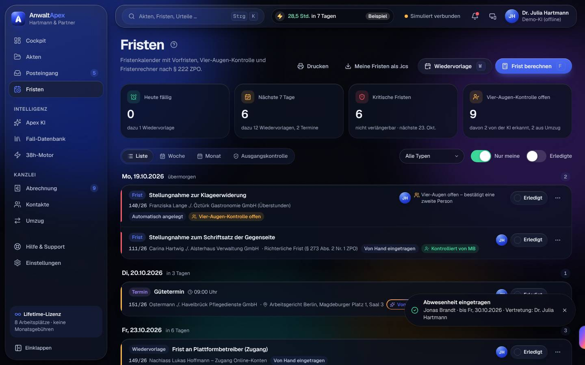 | **I4-T18-04 (M)** – Abwesenheit Jonas Brandt ab Mo 19.10. eingetragen; am Samstag zeigt „Nur meine“ seine Montagsfrist nicht (D dunkel). In Block D als I4-T18-01 geführt. |
| 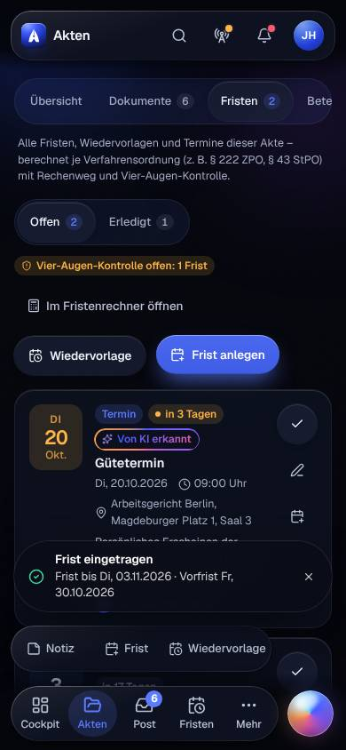 | **I4-T14-01 (M)** – Akte 151/26 am iPhone: Meldung, Schnellaktionsleiste und Tab-Leiste übereinander, Gericht und Termin verdeckt (M dunkel). |
| 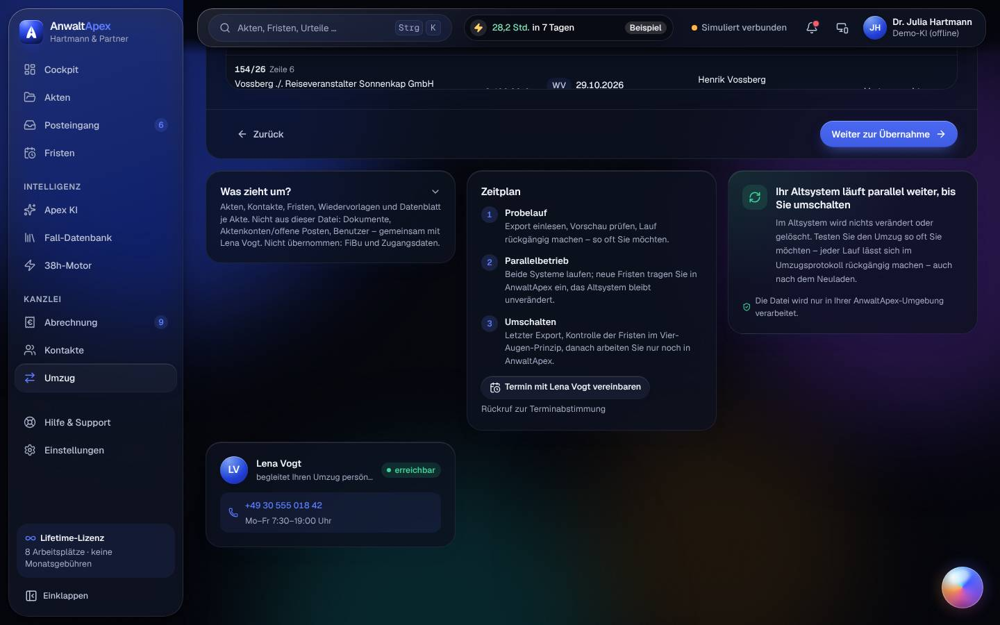 | **I4-T11-01 (M)** – Umzug, Karte „Lena Vogt“: grüner Chip „erreichbar“ am Samstag vor 7 Uhr (D dunkel). |
|  | **I4-T00-02 (M)** – Landing: Die Abschlusskarte mit Kontakt ist eine große helle Fläche auf dunkler Seite (D dunkel). |
|  | **Positiv, T18 Fall 3b** – Mo 01.11.2027, Feiertage Hessen aus dem Gericht abgeleitet und gesperrt, Vorfrist Mo 25.10.2027; unten rechts der gesperrte Knopf (I4-T18-01) (D dunkel). |
|  | **Positiv, Nachtest I3-T10-01** – Rückfrage vor dem Pausieren der Fristerkennung mit Folge, Fokus auf „Abbrechen“ (L dunkel). |
|  | **Positiv, T04** – Neu getippte Firma „Kröger Logistik GmbH“: Interessenkonflikt § 43a Abs. 4 BRAO mit Treffer 142/26 schon in Schritt 1 (L dunkel). |
|  | **Positiv, T02/T03** – Berufungsbegründungsfrist Do 17.12.2026 mit Rechenweg (Kammergericht, Berlin) und gesperrtem „eEB abgeben“ mit Grund (D dunkel). |
|  | **Positiv, T07** – RVG-Rechner per Tastatur: 11.400 €, Auftrag 15.05.2025 → „Tabelle KostRÄG 2021“, 2.797,69 € auf den Cent (D dunkel). |
|  | **Positiv, T19** – Dokument-Analyse Arbeitsvertrag 142/26: „Bitte die Fälligkeit eingeben – AnwaltApex erfindet kein Datum“ (D dunkel). |
| 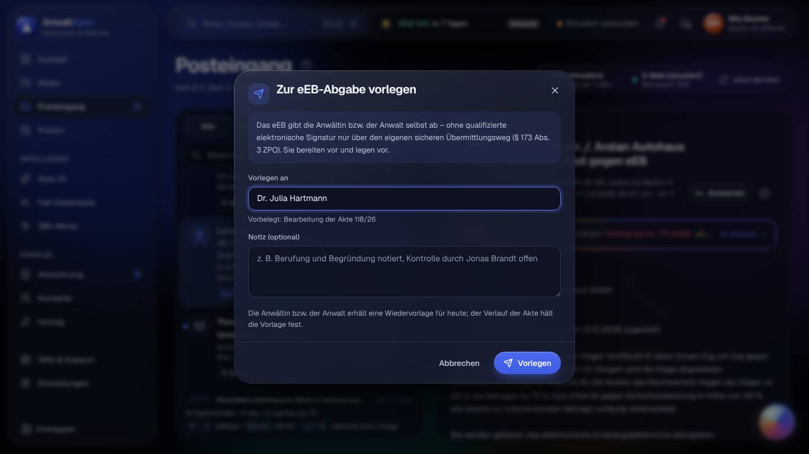 | **Positiv, T22** – „Zur eEB-Abgabe vorlegen“: Die ReFa legt vor, die Anwältin gibt ab (§ 173 Abs. 3 ZPO) (L dunkel). |

---

## 9. Verworfen, angepasst, zusammengeführt – und Vorgaben der Projektleitung

### 9.1 Entscheidungen der Testleitung

**Leitlinie des Auftraggebers:** das gesamte Feedback einbauen. Verworfen wird nur, was dem Briefing widerspricht, fachlich falsch ist, auf einem Missverständnis beruht oder außerhalb eines Prototyps liegt. Kein Befund dieser Runde ist ganz verworfen.

| ID | Teil | Entscheidung | Grund |
|---|---|---|---|
| I4-T10-01 | Cockpit-Karte (`KartenKanzlei.tsx`, Z. ≈ 228) | **verworfen (Teil)** | Die Karte zeigt keine Automatik-Beschreibung, sondern einen Anriss des Sachverhalts einer Akte mit Link zur Akte. Dort steht der vollständige Text einen Klick entfernt; es geht keine fachliche Angabe verloren. Umgesetzt wird der 38h-Motor, wo das „Was“ der Prüfpunkt ist. |
| I4-T07-02 | „Kugel mit einem Tab-Stopp“ | angepasst | Die Kugel hat zwei Funktionen (öffnen, einklappen); mit nur einem Tab-Stopp wäre der T20-Prüfpunkt „Avatar in 1 Klick abschaltbar“ verletzt. Die eigentliche Falle ist die wechselnde Reihenfolge: Je nach Ausweichzustand rendert die Kugel einen oder zwei Knöpfe (im Code bestätigt). Umgesetzt: feste Lage am Ende der Tab-Folge, „Öffnen“ immer vor „Einklappen“, Einklappen zusätzlich im Kopf des Assistenten. |
| I4-T15-03 | „Kugel im Telefon-Layout in die Tab-Leiste“ | bereits erfüllt | Im Telefon-Layout sitzt die Kugel schon in der Zone der Tab-Leiste (`MobileTabBar`). Umgesetzt wird die kompakte Kopf- und Tab-Leiste bei geringer Höhe. |
| I4-T08-02 | „Hinweis entfernen“ | angepasst | Block D lobt denselben Hinweis als ehrlich. Er bleibt bei echtem Verlassen der Seite während des Laufs, aber neutral formuliert und ohne „unterbrochen“. |
| I4-T00-01 | Zusage 360 px | umsetzen | Zugesagt sind 360 px; WCAG 1.4.10 verlangt 320 CSS-px, und der Reflow bei 320 px ist Schwerpunkt dieser Runde. Kein Widerspruch zum Briefing. |
| I4-T07-01 | Umfang | erweitert | Aktenliste per Playwright gemessen: dasselbe einzige Tastaturziel „Auswählen“ je Zeile. |
| I4-T09-01 | Umfang | erweitert | Ursache ist das Token `--ink` im Dunkelmodus; alle gefüllten Ink-Flächen mit weißer Schrift sind betroffen. |
| I4-T18-01 (Block D) | ID | umbenannt in I4-T18-04 | ID-Kollision mit Block A |
| I4-T07-03, I4-T22-01 | ganz | zusammengeführt | Duplikate (Abschnitt 7, Kopf) |
| I4-T21-02 | Meldungsteil | zusammengeführt mit I4-T03-03 | gleiche Ursache im Toaster; der Rest bleibt I4-T21-02 |
| I1-T00-02 | Impressum | an den Auftraggeber verwiesen | Echte Anbieterdaten liegen nicht vor; der Platzhalter bleibt gekennzeichnet. |
| I1-T07-07, I3-T21-01 | – | nicht prüfbar | Testumgebung bzw. Uhrzeit nicht einstellbar (Abschnitt 10.6) |

### 9.2 Vorgaben der Projektleitung (verbindlich)

1. **Nachtest I3-T15-01:** Seit `SEED_VERSION` 11 ist die Fremdgeld-Aufgabe in 131/26 eine Wiedervorlage ohne Nachweispflicht. Für den Nachtest wurde eine Zahlungsfrist vom Typ „Frist“ selbst angelegt („Zahlung an Mandantin – Überweisungsnachweis“). Weil „Fremdgeld weiterleiten“ offene Einträge mit „Fremdgeld“ im Titel selbst schließt, trägt die Testfrist dieses Wort bewusst nicht. Ergebnis: behoben. Beim Anlegen dieser Testfrist entstanden die zwei Fehlaktionen in T15 – und daraus die berechtigten Befunde I4-T15-01 und I4-T15-02.
2. **Geschäftliche Zusagen bleiben neutral:** Wartungssatz, Übertragbarkeit der Lizenz, Quellcode-Hinterlegung (Escrow), Impressum und eine EU-Option der Live-KI stehen im Produkt weiter nur als „im Angebot geregelt“ bzw. „auf Anfrage“. Die T13-Prüfpunkte „EU-Verarbeitung“, „Übertragbarkeit“ und „Escrow“ bleiben deshalb „nein“ (9/12); kein Auftrag ändert diese Texte.
3. **Demodaten:** Für I4-T08-01 bekommt jeder Kontoumsatz ein Konto (Geschäfts- oder Anderkonto). Das ist die einzige gewollte Änderung der Demodaten; `SEED_VERSION` steigt auf 12, alle Präsentationsabläufe und Prüfwerte bleiben unverändert (Auftrag A-14, Fingerabdruck-Test).

### 9.3 Offene Entscheidungen des Auftraggebers

Diese Punkte nennt der Avatar als Kaufbedingung. Sie lassen sich im Produkt nicht lösen:

- schriftliches Angebot mit Lizenz- und Wartungspreis für 7 Arbeitsplätze (Blöcke A, B, C, D)
- Übertragbarkeit der Lizenz und Quellcode-Hinterlegung verbindlich geregelt (Blöcke A, C, D)
- KI-Verarbeitung in der EU oder eine nach § 43e Abs. 4 BRAO tragfähige Lösung; bis dahin nutzt der Avatar nur die Offline-KI (Blöcke A, C, D)
- Impressum mit echten Anbieterdaten (Blöcke A, D)

---

## 10. Umsetzungsplan

### 10.1 Pakete und Dateibereiche

Zwei Fixer arbeiten parallel. Ihre Dateibereiche überschneiden sich nicht.

| Paket | Name | Dateibereich |
|---|---|---|
| **A** | Rahmen, Design, Einstieg, Logik & Daten | `src/components/**`, `src/styles/**`, `src/app/**`, `src/App.tsx`, `src/main.tsx`, `src/lib/**`, `src/store/**`, `src/core/**`, `src/ai/**`, `src/content/**`, `server/**`, `src/pages/Cockpit.tsx`, `src/pages/cockpit/**`, `src/pages/public/**`, `src/pages/hilfe/**`, `src/pages/einstellungen/**`, `src/pages/console/**` |
| **B** | Fachseiten | `src/pages/akten/**`, `src/pages/kontakte/**`, `src/pages/posteingang/**`, `src/pages/fristen/**`, `src/pages/abrechnung/**`, `src/pages/ki/**`, `src/pages/falldb/**`, `src/pages/motor/**`, `src/pages/umzug/**` |

**Regeln:**

- Paket A übernimmt außerdem `docs/DEMO-SKRIPT.md`, falls die Demodaten-Änderung (Konto je Umsatz) dort Spuren hat.
- Berührt ein Befund beide Bereiche, ist er nach der Hauptdatei zugeordnet. Der Auftrag nennt die mitbetroffene Datei im anderen Bereich; der zuständige Fixer fasst sie nicht an. Lässt sich der Befund sauber nach Dateien teilen, hat jedes Paket einen ausdrücklich benannten Teil („Teil A“, „Teil B“). Was bereichsübergreifend offen bleibt, zieht die Prüfung nach.
- Paket A darf Hilfsfunktionen aus Paket B **importieren**, aber nicht ändern (z. B. `satzFuerEintrag`). Paket B ändert deren Signatur nicht.

### 10.2 Schnittstellenvertrag (A-00, zuerst)

Paket A legt vor allen anderen Aufträgen die gemeinsamen Schnittstellen samt Kernlogik und Tests an. Paket B programmiert gegen genau diese Namen.

- **`src/core/kontaktpruefung.ts`** (I4-T17-01):
  - `gleicheKontakte(k, kontakte)` → andere Datensätze derselben Person/Firma (gleicher `nameSchluessel`, gleiche E-Mail, gleiche Telefonnummer, bei Organisationen gleiche E-Mail-Domain ohne Freemailer), je mit Grund.
  - `kollisionFuerNeuesMandat(k, akten, als, kontakte?)` – mit `kontakte` über den Kontakt **und** alle gleichen Kontakte; Treffer tragen `ueber?: Kontakt`. Ohne viertes Argument unverändert.
  - `kollisionFuerEntwurf({ name, email?, telefon?, typ? }, kontakte, akten, als)` – für neu getippte Namen.
- **`src/core/vertretung.ts`** (I4-T18-04): `kuenftigeVertretungen(team, fristen, userId, heute, vorlaufTage = 14)` → `{ person, von, bis, fristen }[]`.
- **`src/core/types.ts`** – nur optionale Felder: `Transaktion.konto?: "geschaeft" | "ander"` (fehlt = Geschäftskonto, I4-T08-01) · `Aktivitaet.quelle?: "anbieter"` und `Aktivitaet.anbieterPerson?: string` (I4-T16-01). Schema (`src/lib/backend/schema.ts`) und Server lassen sie zu.
- **`src/components/ui/DataTable.tsx`** (I4-T07-01): Props `rowLabel?: (row) => string` und `selectLabel?: (row) => string`.
- **`src/components/ui/PapierSchalter.tsx`** (I4-T06-01): `usePapierGedimmt()` und `<PapierSchalter />`; im Dunkelmodus ist jedes `.paper` global gedimmt, außer `html[data-papier="original"]`; Schlüssel `apex.dokumentvorschau.abdunkeln` wie bisher.
- **`src/components/shell/Tastenkuerzel.tsx`** (I4-T03-05): `FRISTEN_KUERZEL` (J/↓, K/↑, Enter, B) in der Schnellhilfe auf `/fristen`.
- **Adresse** `/fristen?vertretung=vorab` (Cockpit-Hinweis aus A-11 → Fristenliste in B-07).

### 10.3 Reihenfolge

1. A-00
2. K- und H-Befunde: A-01, A-02 · B-01, B-02, B-03
3. M-Befunde
4. N-Befunde

Paket B beginnt mit B-02, B-05, B-08, B-09, B-10, B-14 und B-15, denn sie hängen nicht von A-00 ab. B-01, B-03, B-04, B-06, B-07 und B-11 folgen nach A-00 (B-04 zusätzlich nach A-14).

### 10.4 Aufträge

Die vollständigen Auftragstexte (Änderung, Erfolgskriterium, Dateien) erhalten die Fixer getrennt. Hier die Übersicht:

**Paket A (15 Aufträge)**

| Nr. | Befunde | Inhalt |
|---|---|---|
| A-00 | **I4-T17-01 (K, Teil A)**, I4-T18-04 (Teil A), Grundlagen für I4-T08-01, I4-T16-01, I4-T07-01, I4-T06-01, I4-T03-05 | Schnittstellenvertrag und Kernlogik mit Tests (Kollision über Dubletten, Vertretung vorab, Felder, Tabellen-Namen, Papier-Dimmung, Fristen-Kürzel) |
| A-01 | **I4-T07-01 (H, Teil A)** | Tabellenzeilen per Tastatur öffnen (`DataTable`), Rechnungen und Entwürfe in Strg+K |
| A-02 | **I4-T09-01 (H)**, I4-T18-01 (Teil A) | Dunkelmodus: Kontrast der Ink-Flächen, erkennbar gesperrte Knöpfe |
| A-03 | I4-T16-01 | Anbieter-Eingriffe im Kanzleiprotokoll vollständig, eigener Urheber, Filter „Anbieter“ |
| A-04 | I4-T01-02, I4-T12-01 | „Bewegung reduzieren“: Kugel ohne Endlosanimation, Wiki startet angehalten |
| A-05 | I4-T03-01 (+ I4-T07-03) | Schalter mit genau einem Tab-Stopp |
| A-06 | I4-T03-03 (+ I4-T22-01, Teil I4-T21-02), I4-T14-01 (Teil A) | Meldungen nie über Dialogkopf; am Telefon oben |
| A-07 | I4-T13-01, I4-T07-02 (Teil A, angepasst) | Kugel: Ausweichen bei 112/125 %, feste Tab-Reihenfolge |
| A-08 | I4-T00-01, I4-T00-02, I4-T00-03 | Landing: Reflow 320 px, dunkle Abschlusskarte, lesbare Fußnoten |
| A-09 | I4-T21-01, I4-T21-02, I4-T21-03 | Console: dunkle Textflächen, E-Mail umbrechen, Kopierbestätigung am Knopf, zugängliche Namen |
| A-10 | I4-T01-01, I4-T15-03 (angepasst) | Reflow 320 px in Kopfleiste und Cockpit; kompakte Leisten bei 200 % |
| A-11 | I4-T18-04 (Teil A) | Vertretung vorab im Cockpit und beim Speichern der Abwesenheit |
| A-12 | I4-T12-02, I4-T20-01 | Assistent: Notfallantwort mit Erreichbarkeit, Doppelungsprüfung |
| A-13 | I4-T06-02, I4-T06-01 (Teil A) | Fallanalyse: „Rang“ statt „Gewicht“, Entwurf gedimmt mit Papier-Schalter |
| A-14 | I4-T08-01 (Teil A) | Demodaten: Konto je Umsatz, `SEED_VERSION` 12, Fingerabdruck-Test |

**Paket B (16 Aufträge)**

| Nr. | Befunde | Inhalt |
|---|---|---|
| B-01 | **I4-T17-01 (K, Teil B)** | Kollisionsprüfung über alle gleichen Kontakte in Mandatsaufnahme und Kontakt; Dublette nur mit Begründung; Zusammenführen |
| B-02 | **I4-T04-01 (H)**, I4-T04-03 | Rechtsschutz in der Akte nachtragen (mit Deckungsanfrage und Wiedervorlage); Versicherer als Suchauswahl |
| B-03 | **I4-T07-01 (H, Teil B)**, I4-T07-04 | Rechnungs- und Aktenliste mit Namen für Öffnen und Auswahl; Mehrfachaktionen für Entwürfe gesperrt |
| B-04 | I4-T08-01 (Teil B), I4-T08-02 (angepasst), I4-T08-03, I4-T08-04 | Bankabgleich kontogenau, neutraler Statussatz, Singular, Fokus bei falscher IBAN |
| B-05 | I4-T04-02 | Mandatsaufnahme: Fokus nach Schrittwechsel, kein Doppel-Enter bis „Akte anlegen“ |
| B-06 | I4-T03-02, I4-T03-05, I4-T03-04 | Fristenliste: Fokus nach „Kontrolle bestätigen“, J/K-Navigation, vollständige Korrektur-Historie |
| B-07 | I4-T18-04 (Teil B) | Fristenliste zeigt künftige Vertretungsfristen vorab |
| B-08 | I4-T15-01, I4-T15-02 | Frist-Dialog: keine Vorschläge aus gestrichenen Fristen, Einheit nicht vorbelegt, Rückfrage bei abgelaufenem Fristende |
| B-09 | I4-T18-01 (Teil B), I4-T18-02, I4-T18-03 | Fristenrechner: Grund am gesperrten Knopf, Kalender mit allen Markierungen, keine vorgewählte Fristart |
| B-10 | I4-T14-01 (Teil B), I4-T14-02 | Akte am iPhone: Schnellaktionen ohne Verdecken, alle Dokumente bzw. Kerndokumente |
| B-11 | I4-T06-01 (Teil B), I4-T19-01, I4-T06-03 | Papier-Dimmung in Schriftsatz, Rechnungs- und Dokumentvorschau; Text sofort bei reduzierter Bewegung; schwache Treffer kennzeichnen |
| B-12 | I4-T07-02 (Teil B), I4-T09-02, I4-T07-05 | RVG-Rechner per Tastatur, Beispielwerte kennzeichnen, Zeiterfassung mit vereinbartem Satz |
| B-13 | I4-T02-01 | Aktenwahl mit Suche im Posteingang |
| B-14 | I4-T10-01 | 38h-Motor: Beschreibungen vollständig |
| B-15 | I4-T11-01, I4-T11-02 | Umzug: Erreichbarkeit nach Servicezeit, einheitliche Zählung |
| B-16 | I4-T05-01, I4-T23-01, I4-T06-04 | Akte: Schätzung im Verlauf kennzeichnen, Portal-Vorschau zählt richtig, Ordner beim Sprung |

### 10.5 Abnahme der Umsetzung

1. `npm run typecheck && npm test && npm run build` laufen grün. Neue Tests decken mindestens ab:
   - Kollisionsprüfung über eine Dublette: zweiter Datensatz „Kröger Logistik GmbH“ → Konflikt „Gegner in 142/26“; Schreibvarianten; Freemail-Domain ohne Treffer (A-00)
   - Zusammenführen einer Dublette hängt alle Verweise um (B-01)
   - Vertretung vorab: Abwesenheit 19.10.–30.10., heute 17.10. → 137/26 im Ergebnis (A-00)
   - „Rang“ statt „Gewicht“ in der Einschätzung (A-13); Notfallantwort außerhalb der Servicezeit und Doppelungsprüfung im Assistenten (A-12)
   - Frist-Dialog: kein Vorschlag aus gestrichenen Fristen (B-08); Kontotexte im Bankabgleich (B-04)
   - Demodaten: jeder Umsatz mit Konto, Versicherer-Regulierungen auf dem Anderkonto, Fingerabdruck sonst unverändert (A-14)
2. **K- und H-Befunde** werden im Browser nachgestellt, mit Bild je Befund: I4-T17-01 (Dublette → Treffer, kein „keine Treffer“), I4-T04-01 (RSV in 155/26 nachgetragen, Deckungsanfrage und WV entstanden), I4-T07-01 (Rechnung **und** Akte nur per Tab + Enter geöffnet, Rechnung per Tastatur storniert), I4-T09-01 (Forderungskonto dunkel axe 0; Skript misst jeden Text auf `bg-ink` ≥ 4,5 : 1).
3. axe-core bleibt in allen 84 Ansichten aus Abschnitt 2 (dunkel) bei 0 serious und 0 critical; dazu hell als Gegenprobe für Cockpit, Fristen, Forderungskonto und Landing.
4. **Was axe nicht findet, misst ein Prüfskript:** keine fokussierbaren Elemente ohne Namen in Fristen, Mandatsaufnahme, Rechnungen, RVG-Rechner (Schalter = 1 Tab-Stopp); `document.activeElement` ist nach „Kontrolle bestätigen“, Schrittwechsel, „Übernehmen“ und „Werte übernehmen“ nie BODY; bei reduzierter Bewegung keine laufende Endlosanimation (Cockpit, Wiki, Schriftsatz); keine Meldung über Dialogtitel (`elementFromPoint`); bei 320 px keine abgeschnittenen Titel in Kopfleiste, Cockpit und Landing-Rechner.
5. Die Prüfwerte werden erneut nachgerechnet: T07 (16 Werte, 428,40 €, Sammelsumme 2.281,89 €), T09 (A–C, 155,77 €), T18 (6 Daten plus FamFG), T04 (02.11.2026, 11.400 €), T10 (24.723,42 € bzw. 35.247,74 €).
6. Texte per `grep`: kein „über die Mandatsdaten“, kein „Die Anzeige wurde unterbrochen“, kein „1 Rechnungen“; „Anmeldeversuch bzw. Sperre (automatisch)“ nur noch für echte Anmeldeereignisse.

### 10.6 Hinweise für Iteration 5 (Testleitung)

- **Schwerpunkt laut Avatar (1.10): Abnahme und Kaufentscheidung.** Viewports wie je Aufgabe angegeben; zum Abschluss die Preisfragen (1.8 F) und die Empfehlung an Bernd Hollmann in drei Sätzen.
- **Feste Uhr:** Alle vier Runden liefen nachts bzw. am Samstagmorgen. Das Avatar-Werkzeug sollte die Seitenuhr setzen können (Playwright `page.clock.setFixedTime`), z. B. Di 20.10.2026, 16:50 Uhr für T12 und 21:30 Uhr für T15. Damit lässt sich auch I3-T21-01 (Anlage zwischen 0 und 2 Uhr) nachstellen.
- **Avatar-Werkzeug:** Touch für `tablet` und `tablet-hoch` aktivieren (bisher nur unter 768 px), damit die 44-px-Ziele am iPad prüfbar werden; Datumsfelder bleiben im US-Format (I1-T07-07, Testumgebung).
- **Demodaten nach `SEED_VERSION` 12:** frische Profile verwenden. Jeder Kontoumsatz zeigt sein Konto; die Regulierungen der Versicherer liegen auf dem Anderkonto.
- **T17:** Die Dublettenprobe aus Block B wiederholen (neuer Kontakt „Kröger Logistik GmbH“, danach Kollisionsprüfung im Kontakt und Mandatsaufnahme mit dem neuen Datensatz) und zusätzlich „Zusammenführen“ prüfen.
- **T18 Fall 5:** Abwesenheit mit Beginn in der Zukunft eintragen und die Vertretung vorab prüfen.
- **Nachtest:** alle 52 Befunde dieser Runde (54 IDs einschließlich I4-T07-03 und I4-T22-01) sowie die offenen IDs I1-T00-02, I3-T21-01 und I1-T07-07, im frischen Profil.

---

## 11. Umsetzung & Nachweis

**Stand:** Samstag, 17.10.2026, nach der Umsetzung der Pakete A und B und der bereichsübergreifenden Restpunkte
**Betrieb:** Browser-Demo (Demo-KI offline) · Chromium (Playwright, `de-DE`, Europe/Berlin) · eigene Prüfskripte mit frischem Browserprofil je Lauf, Bilder im Profil `pruefung-i4` · Viewports D 1440×900, L 1366×768, M 390×844, Reflow 320×640, 200 % (720×450 @2x) · fast alles dunkel, Gegenproben hell; „Bewegung reduzieren“ für die Bewegungsproben · Server-Probe gegen den gebauten Server (`dist-server`) mit eigener Datenbank
**Uhrzeit der Prüfung:** Samstag, 17.10.2026, ca. 07:30–09:30 Uhr – wie der Test selbst außerhalb der Servicezeit und am Wochenende.

### 11.1 Ergebnis

| Schwere | Befunde (zusammengeführt) | umgesetzt | davon angepasst | teilweise | offen | in dieser Prüfung im Browser nachgestellt |
|---|---|---|---|---|---|---|
| K | 1 | **1** | – | – | – | 1 |
| H | 3 | **3** | – | – | – | 3 |
| M | 19 | **19** | 1 | – | – | 13 |
| N | 29 | **29** | 2 | – | – | 10 |
| **Summe** | **52** | **52** | **3** | **0** | **0** | **27** |

- **Der K-Befund ist behoben und nachgestellt** (I4-T17-01): Die Dublette „Kröger Logistik GmbH“ lässt sich nur noch mit Begründung (mindestens 10 Zeichen) und Häkchen anlegen; danach melden die Kollisionsprüfung im Kontakt **und** die Mandatsaufnahme „Gegner in 142/26 … über den Kontakt „Kröger Logistik GmbH“ aus Berlin“ statt „keine Treffer“. Zusammenführen hängt alles um und löscht die Dublette. Bilder in 11.6.
- **Alle 3 H-Befunde sind nachgestellt**, mit Bild: Rechtsschutz in einer bestehenden Akte nachgetragen (Deckungsanfrage-Entwurf, Wiedervorlage, Verlauf), Rechnung und Akte nur per Tab + Enter geöffnet und eine Rechnung per Tastatur storniert, Ink-Kontrast im Dunkelmodus gemessen (45 Texte auf Ink-Flächen, mindestens 4,64 : 1).
- **Angepasst** (wie in Abschnitt 9.1 beschlossen): I4-T07-02 (Kugel mit fester Tab-Reihenfolge statt einem Tab-Stopp), I4-T08-02 (Hinweis bleibt, neutral und nur bei echtem Verlassen), I4-T15-03 (kompakte Leisten bei geringer Höhe; die Kugel sitzt am Telefon schon in der Tab-Leiste). **Teil verworfen:** I4-T10-01, Cockpit-Karte.
- Die zusammengeführten IDs I4-T07-03 (→ I4-T03-01) und I4-T22-01 (→ I4-T03-03) sind mit ihren Hauptbefunden umgesetzt.
- Die übrigen M- und N-Befunde stützen sich auf die Selbstprüfung der Fixer und auf Tests (Spalte „Nachweis“ in 11.5).

**So ist die Spalte „Nachweis“ zu lesen:**

- **Prüfung** – in dieser Abnahme im Browser nachgestellt (Viewport und Modus stehen dabei).
- **Fixer A / Fixer B** – Selbstprüfung des Fixers laut Rückmeldung; in der Abnahme nicht erneut nachgestellt.
- **Test** – automatischer Test in `npm test`.
- **Server-Probe** – Anfrage gegen den gebauten Server (`dist-server`) mit eigener Datenbank.
- Die Kürzel in Klammern (A-00 … B-16) verweisen auf die Aufträge in Abschnitt 10.4.

### 11.2 In der Prüfung nachgeholt

**Bereichsübergreifende Restpunkte und „nicht umgesetzt“-Punkte der Fixer:**

| Herkunft | Punkt | Umsetzung |
|---|---|---|
| B-11 / A-00 | Papier-Dimmung in E-Akte-Vorschau, Schriftsatz und Rechnungsvorschau über den gemeinsamen `PapierSchalter` | **Bereits von Fixer B erledigt, geprüft:** `DokumentVorschau`, `SchriftsatzTab`, `RechnungVorschau`, `Forderungskonto` und `FallanalysePanel` nutzen `PapierSchalter` bzw. `usePapierGedimmt`; keine eigene `filter`-Klasse mehr. Prüfung D dunkel: Rechnungsvorschau mit „Seite abdunkeln · Original“, Fallanalyse-Entwurf mit `brightness(0.87)`. |
| A-02 (Rest) | Ziehbild in der E-Akte mit Inline-Stil `var(--ink)` | `TabDokumente.tsx` nutzt jetzt `var(--ink-fill)` (Weiß darauf 5,44 : 1 statt 3,7 : 1). |
| B-06 (Rest) | `FRISTEN_KUERZEL` unvollständig | Die Schnellhilfe „?“ nennt jetzt je Taste alle Wege: „J oder ↓ oder Alt J“, „K oder ↑ oder Alt K“, „B oder Alt B“, dazu wo sie wirken („J außerhalb von Eingabefeldern, ↓ in der Liste, Alt+J auch in Eingabefeldern“). Enter: „Details der gewählten Frist öffnen (J/K setzt den Fokus auf den Titel der Zeile); Esc bringt den Fokus zurück“. Der Text am Schalter „Kürzel mit einzelnen Buchstaben“ nennt Alt+J/K/B und die Pfeiltasten als immer wirksam. Neues Feld `weitere` in `Kuerzel`. Prüfung D dunkel, axe 0. |
| B-06 / B-07 / B-01 / B-04 | Aufrufe der neuen Schnittstellen aus A-00 | **Bereits von Fixer B erledigt, geprüft:** `einzeltasteErlaubt` und `altKuerzel` in `FristListe.tsx`; `kuenftigeVertretungen` und `?vertretung=vorab` in `Fristen.tsx`; `kollisionFuerNeuesMandat(…, kontakte)`, `kollisionFuerEntwurf` und `gleicheKontakte` in Mandatsaufnahme, Kontakt-Drawer und „Neuer Kontakt“; `Transaktion.konto` im Bankabgleich (keine Seite legt selbst Umsätze an). Alle vier im Browser nachgestellt (11.5). |
| B-05 → A-05 | Zwei Tab-Stopps am RSV-Schalter der Mandatsaufnahme | Keine Änderung nötig: Ursache war `whileTap` in `Switch.tsx` (A-05). Prüfung L dunkel, Schritt 3: im Block nur `BUTTON#ma-rsv[switch]` fokussierbar, Tab geht vom Schalter direkt weiter. |
| B-10 → `CardHeader` | Kartentitel bei 320 px ohne Auslassungszeichen abgeschnitten | `CardHeader` (`Glass.tsx`): Titel mit `break-words hyphens-auto`; reicht der Platz neben Symbol und Aktion nicht für mindestens 9rem Titel, rückt die Aktion in die nächste Zeile (rechtsbündig). Der Vorschlag `max-w-[50%]` für die Aktion ist nicht übernommen – breite Aktionen (Umschalter) wären sonst übergelaufen. Prüfung: 88 Kartentitel in 8 Ansichten je 4 Scrolllagen, bei 320 px **0 abgeschnitten, 0 mitten im Wort getrennt**, 24 Aktionen in zweiter Zeile; auf D 0 Änderungen am Layout. |
| B-04 (optional) | Anderkonto als Auftraggeberkonto der Fremdgeld-Weiterleitung | Neu: `Tenant.anderkonto?: { iban, bank? }`. Kanzleiprofil → Rechnungsangaben hat den Block „Anderkonto für Fremdgeld“ (optional, steht nicht auf Rechnungen). Geprüft wird wie beim Geschäftskonto (`pruefeRechnungsangaben`, gleiche Meldungen), zusätzlich: **Anderkonto und Geschäftskonto müssen verschiedene Konten sein (§ 4 BORA)**. Demo-Backend und Server speichern und protokollieren („Anderkonto-IBAN, Anderkonto-Bank“). Die Weiterleitung setzt die IBAN in die SEPA-Datei und nennt sie im Dialog; fehlt sie, steht dort, wo man sie ergänzt. Die Demodaten bleiben leer (Vorgabe 9.2.3). Test in `abrechnung.test.ts`; Prüfung D dunkel (Fehler am Feld, Fokus, `aria-invalid`, axe 0); Server-Probe. |
| B-04 / A-14 (nicht umgesetzt) | Elbtal 6.120 € in 131/26 ohne Kontoumsatz – kein Konto nennbar | **Offen (Vorgabe):** Ein zusätzlicher Umsatz würde die Demodaten über das Feld `konto` hinaus ändern; Abschnitt 9.2.3 erlaubt nur dieses Feld, der Fingerabdruck-Test sichert das. Die Oberfläche bleibt ehrlich: Wächter und Aktenkonto sagen „Offenes Fremdgeld: 6.120,00 €“, die Weiterleitung „Eingang ohne Bankumsatz gebucht; bitte das Konto prüfen“. Entscheidung für eine spätere Seed-Version bei der Projektleitung. |
| A-10 (nicht umgesetzt) | „≥ 4 Fristen sichtbar“ bei 200 % | Hängt vom Datenstand ab (am Samstag 0 fällig). Gemessen bei 720×450 @2x auf `/fristen`: feste Leisten 9,8 % der Höhe. Nicht weiter geändert. |
| A-08 (Hinweis) | axe `target-size` an der FAQ-Zeile unter der Landing-Navigation in einzelnen Scrolllagen | Nicht geändert (nur in Scrolllagen, in denen die Zeile unter der festen Navigation liegt). Landing D hell und dunkel in Ausgangslage axe 0. |
| B-10 (Info) | Meldungen am Telefon oben, `--tabbar-h` bei geringer Höhe | Geprüft: `AkteDetail.tsx` hält unten keinen Platz mehr frei; nichts zu tun. |

**Funde der Abnahme, gleich behoben:**

- **„Rechtsschutz speichern“ verschluckte den ersten Klick** (I4-T04-01/-03): Die Versicherer-Liste steht im Fluss des Dialogs und öffnet beim Fokus. Klickte man bei offener Liste auf „Rechtsschutz speichern“, schloss die Liste schon beim Mausdruck, der Dialog schrumpfte, der Knopf rutschte unter der Maus weg – nichts geschah, keine Fehlermeldung. `VersichererAuswahl` schließt die Liste jetzt 200 ms verzögert. Prüfung L dunkel: Speichern ohne Versicherer → Meldung am Feld, Fokus im Feld, `aria-invalid`; mit Versicherer speichert der erste Klick. Gilt auch für Mandatsaufnahme Schritt 3.
- **Tastenhinweis auf dem Primärknopf** (I4-T09-01): Das „F“ in „Frist berechnen F“ (Fristen-Seite) stand grau auf der Ink-Fläche – **2,02 : 1**. `.kbd` in `.btn-primary`/`.btn-ai` übernimmt jetzt die Knopfschrift mit hellem Rahmen (4,64 : 1); gesperrte Knöpfe bleiben neutral.
- **„Weiter mit →“ im Wiki wirkte erst nach einem Klick in den Player** (I4-T12-01): Beim Öffnen der Schnellhilfe liegt der Fokus auf dem Reiter-Inhalt; die Pfeiltasten hörte nur der Player selbst. `WikiPlayer` lauscht jetzt im ganzen Reiter bzw. Dialog (nicht in Reiterleisten, Listen und Eingabefeldern; bei mehreren Playern nur der fokussierte). Prüfung D dunkel mit „Bewegung reduzieren“: nach 12 s noch Schritt 1, → ohne Klick → Schritt 2.
- **KI-Briefing:** Die neue Zeile „Vertretung ab Mo, 19.10.: Sie vertreten Jonas Brandt bis Fr, 30.10.“ stand in der Aktenzeichen-Schrift (mono, blau). Jetzt Fließtext-Schrift, weiter als Link auf `/fristen?vertretung=vorab`.
- **Zusammenführen-Protokoll:** „Rollen ergänzt: mandant“ (interner Schlüssel) → „Rollen ergänzt: Mandant“. Test in `zusammenfuehren.test.ts`.
- **`CardHeader` bei 320 px:** Mit `break-words` allein hätte „Sachverhalt“ neben „Bearbeiten“ als „Sachverhal|t“ umbrochen (Chromium trennt ohne Wörterbuch nicht). Gelöst über die umbrechende Aktion (Tabelle oben).

### 11.3 Qualitätstor und Prüfwerte

| Prüfung | Ergebnis |
|---|---|
| `npx tsc --noEmit` | 0 Fehler |
| `npm test` | **205 / 205** grün (neu u. a. Anderkonto in `abrechnung.test.ts`, lesbare Rollen in `zusammenfuehren.test.ts`; dazu die Tests der Fixer) |
| `npm run build` | Web und Server fehlerfrei (nur der bekannte Größenhinweis zu `dist-server/index.js`) |
| Server-Probe (`dist-server`) | Anderkonto = Geschäftskonto 400 (`feld: anderIban`, § 4 BORA), falsche Prüfziffer 400, gültig 200 und normalisiert („DE02 1203 0000 0000 2020 51“), Protokoll „Rechnungsangaben geändert (USt-IdNr., IBAN, Anderkonto-IBAN, Anderkonto-Bank) – durch Dr. Julia Hartmann“, Entfernen 200. `SEED_VERSION` 12: jeder Umsatz mit Konto, Hanseatische auf „ander“; Umsatz mit `konto: "privat"` 400, mit „ander“ 204; Anbieter-Eintrag aus der Kanzlei 400 („schreibt nur die Apex Console“) |
| Konsolen-Sweep, Login Dr. Hartmann | **148 Ansichten: 0 pageerrors, 0 console.errors** (500 auf `/api/info` ausgenommen). 51 Routen und Reiter auf D hell und D dunkel (neu u. a. `/fristen?vertretung=vorab`, Protokoll-Filter „Anbieter“, Rechnung per `?rechnung=`, Beteiligte ohne RSV, `?dok=`, „Neuer Kontakt“, Team), davon 32 auf M hell, 9 Hauptrouten auf Tq, Landing und Anmeldung hell und dunkel, Apex Console |
| axe-core (WCAG 2.2 A/AA) | **0 serious/critical** in 44 Ansichten (14 Hauptansichten auf D dunkel, D hell und M dunkel, Landing D hell und dunkel) und in allen Abnahme-Ansichten aus 11.5 |
| Kontrast auf Ink-Flächen (Skript, dunkel) | 45 Texte in 10 Ansichten (Cockpit mit Seitenleiste, Forderungskonto auch gescrollt, Fristen Liste/Woche/Monat, Rechnungen mit Auswahl, Akten, Mandatsaufnahme, Fristenrechner): **mindestens 4,64 : 1** (Primärknopf, hellste Verlaufsstelle), Plakette „Zinssatz p. a. 6,52 %“ 5,44 : 1; hell mindestens 7,5 : 1. Vor dem Fund der Abnahme: 2,02 : 1 am „F“ |
| Bewegung reduziert | Cockpit 0 laufende Endlos-Animationen (ohne Einstellung 14); Wiki bleibt auf Schritt 1 |
| Reflow und 200 % | 320 px: Cockpit, Posteingang, Akte, Einstellungen, Hilfe ohne Querscrollen und ohne abgeschnittene Titel; Landing-Rechnerkarte 287 px breit, nichts über dem Rand; 200 % `/fristen`: feste Leisten 9,8 % |
| Texte (`grep`) | kein „über die Mandatsdaten“, kein „Die Anzeige wurde unterbrochen“, kein „1 Rechnungen“/„1 Kontoumsätze“ in der Oberfläche |

| Prüfwert | Soll | Ist |
|---|---|---|
| T07 RVG 2025 / 2021 | 2.968,46 € / 2.797,69 € | **exakt** (`berechneRvg`: 919,10 · 848,40 · 707,00 · netto 2.494,50 · USt 473,96 bzw. 865,80 · 799,20 · 666,00 · netto 2.351,00 · USt 446,69) |
| T07 Storno | RE-2026-0025 −1.117,53 € | **RE-2026-0025** über 1.117,53 € (Browser, nur Tastatur) |
| T09 A / B / C | 43,23 € · 26,79 € · 42,72 € | **exakt** (`verzugszinsen`); Forderungskonto 126/26 **155,77 €**, Satz 6,52 % (Browser) |
| T04 Klagefrist | Mo 02.11.2026 | **2026-11-02** (`berechneNachRegel`) |
| T18, T02/T03, FamFG | 6 Daten, Berufung/Begründung | **exakt** (Tests `fristen.i1.test.ts`, `logik.test.ts`) |
| T08 Konto | Hanseatische 5.670,00 € / 107/26 auf dem Anderkonto | **Anderkonto** (Bankabgleich L dunkel: Chip „Anderkonto“, Filter „Alle 9 · Geschäftskonto 8 · Anderkonto 1“; Server-Probe) |

### 11.4 Offen und Hinweise für Iteration 5

- **Entscheidungen des Auftraggebers (unverändert, Abschnitt 9.3):** Angebot mit Preis und Wartung, KI-Verarbeitung in der EU, Übertragbarkeit und Escrow, Impressum (I1-T00-02).
- **Elbtal 6.120 € (131/26):** bleibt ohne Kontoumsatz und damit ohne Kontoangabe (Vorgabe 9.2.3). Im Nachtest zu I4-T08-01 die Hanseatische (107/26) prüfen; bei 131/26 nennt die Oberfläche bewusst kein Konto.
- **Anderkonto-IBAN** ist in den Beispielkanzleien leer – die SEPA-Datei der Weiterleitung trägt dann einen Platzhalter, der Dialog sagt, wo man die IBAN ergänzt.
- **Neue Wege für den Nachtest:** „Rechtsschutz ergänzen“ unter Beteiligte; Zusammenführen im Kontakt-Drawer; Strg+K findet Rechnungen („RE-2026-0022“, Entwürfe); `/fristen?vertretung=vorab` aus dem Cockpit; J/K/B und Alt-Varianten in der Fristenliste; „Seite abdunkeln · Original“ in allen Vorschauen.
- **Tastatur-Tempo (T07):** Nach „Zum Inhalt springen“ liegen auf der Rechnungsliste noch 30, auf der Aktenliste 29 Tab-Stopps vor der ersten Zeile (Kopfbereich, Filter, sortierbare Spaltenköpfe). Strg+K ist der schnellere Weg zur einzelnen Rechnung.
- **Demodaten `SEED_VERSION` 12:** frische Profile verwenden.
- **Nachtest:** alle 52 Befunde dieser Runde (54 IDs einschließlich I4-T07-03 und I4-T22-01) und die offenen IDs aus Abschnitt 10.6, mit fester Uhr wie dort vorgesehen.

### 11.5 Befunde einzeln

| ID | S | Status | Was geändert | Nachweis |
|---|---|---|---|---|
| | | | **7.1 Landing** | |
| I4-T00-01 | M | umgesetzt | Rechnerkarte unter 360 px mit 16 px Innenabstand und `minmax(0,1fr)`, Werte unter dem Etikett, Umschalter bricht um (A-08) | Prüfung 320×640 dunkel: Karte 287 px, nichts über dem Rand, kein Querscrollen |
| I4-T00-02 | M | umgesetzt | Abschlusskarte `.schluss-karte`: dunkel eine erhöhte dunkle Fläche mit Rand und Glühen (A-08) | Prüfung D dunkel: keine helle Fläche > 400×300 über die ganze Seite; axe 0 |
| I4-T00-03 | N | umgesetzt | Fußnoten als Liste, 14 px, `--fg-2`, höchstens 54ch, per `aria-describedby` an den Kennzahlen (A-08) | Fixer A (≤ 77 Zeichen je Zeile, axe 0) |
| | | | **7.2 Apex Console, Zugang und Protokoll** | |
| I4-T16-01 | M | umgesetzt | Anbieter-Eingriffe mit `quelle: "anbieter"` und Person; Protokollzeile bricht um, „Mehr anzeigen“; Urheber „AnwaltApex – Lena Vogt (Apex Console)“; Filter „Alle · Anmeldungen · Anbieter“ (A-00, A-03) | Fixer A (Ablauf Console → Protokoll, L dunkel, axe 0); Test `protokoll.test.ts`; Stichprobe: Filter „Alle · Anmeldungen · Anbieter“ über `?filter=anbieter`; Server-Probe: Kanzlei kann keine Anbieter-Einträge schreiben |
| I4-T21-01 | N | umgesetzt | Einladungstext auf einer Token-Fläche statt `.paper` (A-09) | Fixer A (keine helle Fläche, axe 0) |
| I4-T21-02 | N | umgesetzt | E-Mail umbricht; `KopierKnopf` mit „✓ Kopiert“ am Knopf, keine Meldung über dem Dialog (A-09; Meldungsteil A-06) | Fixer A (0 Meldungen über Titel und Hinweis) |
| I4-T21-03 | N | umgesetzt | „Neues Passwort für {Name} erzeugen“ (A-09) | Fixer A (9 eindeutige Knopfnamen) |
| | | | **7.3 Rahmen** | |
| I4-T03-01 | M | umgesetzt | `Switch` ohne `whileTap`, Daumen `aria-hidden` ohne `tabindex`, Tipp-Effekt per CSS (A-05); zusammengeführt mit I4-T07-03 | Prüfung L dunkel: RSV-Schalter der Mandatsaufnahme 1 Tab-Stopp; Fristen D: 0 fokussierbare Elemente ohne Namen; Fixer A (RVG-Rechner, Darstellung) |
| I4-T01-02 | M | umgesetzt | `useBewegungReduziert`; `ApexOrb` statisch mit Zustandsringen; global `MotionGlobalConfig.skipAnimations` bei „Bewegung reduzieren“ (A-04) | Prüfung D dunkel mit Einstellung: 0 laufende Endlos-Animationen im Cockpit (ohne Einstellung 14) |
| I4-T03-03 | N | umgesetzt | `Toaster` misst den Dialog und legt Meldungen über, unter oder neben ihn, nie hinein; am Telefon oben (A-06); zusammengeführt mit I4-T22-01 und dem Meldungsteil von I4-T21-02 | Prüfung D dunkel: Meldung bei offenem Fristenrechner unten links, keine Überschneidung mit dem Dialog |
| I4-T13-01 | N | umgesetzt | Ausweichprüfung der Kugel mit gerenderter Größe bei 112/125 % (A-07) | Fixer A (6 Scrolllagen je Ansicht, nie Text unter Kugel oder Griff) |
| I4-T01-01 | N | umgesetzt | Kopfleiste und Kartentitel im Cockpit unter 360 px umbrechend (A-10); dazu `CardHeader` mit umbrechender Aktion (Prüfung) | Prüfung 320×640 dunkel: Cockpit, Posteingang, Akte, Einstellungen, Hilfe ohne abgeschnittene Titel, axe 0 |
| I4-T15-03 | N | umgesetzt (angepasst) | Kompakte, beim Scrollen einklappende Kopf- und Tab-Leiste bei geringer Höhe (A-10) | Prüfung 720×450 @2x: feste Leisten 9,8 %; Fixer A |
| | | | **7.4 Akten** | |
| I4-T04-01 | H | umgesetzt | „Rechtsschutz ergänzen“ auf der leeren RSV-Karte: Versicherer, VS-Nr., Schaden-Nr., SB; Speichern legt Deckungsanfrage-Entwurf, Wiedervorlage und Verlauf an (B-02); Klickverlust beim Speichern behoben (Prüfung) | **Prüfung** L dunkel, 149/26: „über die Mandatsdaten“ weg; ohne Versicherer Meldung und Fokus im Feld; danach RSV „Nordlicht Rechtsschutz AG · Deckung offen · RS-4471209 · SB 150,00 €“, „Deckungsanfrage Nordlicht Rechtsschutz AG“ (Korrespondenz, Entwurf), WV „Deckungszusage“ Mo 26.10.2026, zwei Verlaufseinträge; axe 0; [Bild](iteration-4/bilder/nachweis/H-T04-01-2-rsv-nachgetragen-beteiligte-L-dunkel.jpg) |
| I4-T04-02 | M | umgesetzt | Fokus auf die Schrittüberschrift, 350-ms-Sperre gegen Doppel-Enter, Fokus nach „Übernehmen“ (B-05) | Prüfung L dunkel: nach „Weiter“ Fokus auf „Schritt 2 von 4: Sache“ bzw. „Schritt 3 von 4: Rechtsschutz“ |
| I4-T14-01 | M | umgesetzt | Schnellaktionsleiste am Telefon entfernt, Notiz und WV im Aktenkopf (B-10); Meldungen am Telefon oben (A-06) | Fixer B (390 und 320 px dunkel, nichts verdeckt, axe 0); Fixer A |
| I4-T15-01 | M | umgesetzt | Keine Ereignis-Vorschläge aus gestrichenen Fristen, Herkunft genannt (B-08) | Test `fristAnlegen.test.ts`; Fixer B |
| I4-T15-02 | M | umgesetzt | Einheit bei Dauer-Regeln nicht vorbelegt (Pflichtmeldung); abgelaufenes Fristende nur nach Bestätigung, im Verlauf vermerkt (B-08) | Test `fristAnlegen.test.ts`; Fixer B |
| I4-T04-03 | N | umgesetzt | Versicherer als Suchauswahl aus Kontakten mit Rolle Versicherung und bekannten Versicherern, Hinweis „verknüpft“ bzw. „neu angelegt“ (B-02) | Prüfung L dunkel: „Nordl“ → „Nordlicht Rechtsschutz AG“; beim zweiten Mal als bestehender Kontakt |
| I4-T05-01 | N | umgesetzt | „≈ 57 Min. … automatisch erledigt“ mit Chip „Schätzung (Beispielwerte)“, Einträge „(Schätzung)“ (B-16) | Fixer B |
| I4-T23-01 | N | umgesetzt | Portal-Vorschau: „2 Eingänge, 1 gesendete E-Mail“ (B-16) | Fixer B |
| I4-T14-02 | N | umgesetzt | Kerndokumente oben, „Alle 6 anzeigen“; „E-Akte“ unter 380 px (B-10); `CardHeader` mit umbrechender Aktion (Prüfung) | Prüfung 320×640 dunkel: „Sachverhalt“ ganz, „Bearbeiten“ in zweiter Zeile; Fixer B |
| | | | **7.5 Kontakte** | |
| I4-T17-01 | K | umgesetzt | Kernlogik `gleicheKontakte`, `kollisionFuerNeuesMandat(…, kontakte)` mit `ueber`, `kollisionFuerEntwurf` (A-00); Prüfung über alle gleichen Kontakte in Mandatsaufnahme und Kontakt, Dublette nur mit Begründung und Häkchen, „Bestehenden Kontakt verwenden“ als Hauptaktion, Zusammenführen (B-01) | **Prüfung** D dunkel: Hinweis „Kontakt besteht bereits … – Gegner in 142/26“, ohne Begründung Meldung und Fokus; danach Kollision im Kontakt „Konflikt: Gegner in 142/26 (… über den Kontakt „Kröger Logistik GmbH“ aus Berlin)“ und im Protokoll; Mandatsaufnahme mit der Dublette „Interessenkonflikt … 1 Treffer“, kein „keine Treffer“; Zusammenführen L dunkel: Vorschau, „Abbrechen“ vorfokussiert, danach 1 Datensatz mit Rollen „Gegner, Mandant“; axe 0; Tests `kontaktpruefung.test.ts`, `zusammenfuehren.test.ts`; [Bild](iteration-4/bilder/nachweis/K-T17-01-3-mandatsaufnahme-dublette-D-dunkel.jpg) |
| | | | **7.6 Posteingang** | |
| I4-T02-01 | M | umgesetzt | „Andere Akte wählen“ als Suchauswahl mit Gruppen (B-13) | Prüfung D dunkel: „Weber“ → 142/26, „28 O 211“ → 118/26, „142“ → 142/26; Gruppen KI-Vorschlag, Offene Akten; axe 0 |
| | | | **7.7 Fristen und Fristenrechner** | |
| I4-T18-04 | M | umgesetzt | `kuenftigeVertretungen` (A-00); Cockpit-Hinweis und Briefing-Zeile, Liste beim Speichern der Abwesenheit (A-11); Fristenliste vorab mit Chip (B-07) | **Prüfung** D dunkel: Abwesenheit Brandt 19.–30.10. → Dialog listet 4 Fristen, Fokus „Fertig“; Cockpit „Ab Mo, 19.10. vertreten Sie Jonas Brandt (bis Fr, 30.10.) – 4 Fristen …“; „Fristen ansehen“ → `/fristen?vertretung=vorab` mit 137/26 und Chip „Vertretung für Jonas Brandt ab Mo, 19.10.“; axe 0; Test `vertretung.test.ts` |
| I4-T03-02 | M | umgesetzt | Fokus nach „Kontrolle bestätigen“ in die nächste bzw. vorige Zeile oder auf die Leermeldung (B-06) | Prüfung D dunkel: Fokus danach auf „Erledigt“ in der Liste, nicht auf BODY; Fixer B |
| I4-T03-04 | N | umgesetzt | Korrektur-Historie mit Zeit, Person, alt → neu, Grund (B-06) | Fixer B |
| I4-T03-05 | N | umgesetzt | J/K, ↓/↑, Alt+J/K/B, B in der Fristenliste (B-06); Schnellhilfe vollständig (A-00, Prüfung) | Prüfung D dunkel: J setzt den Fokus auf den Titel der nächsten Zeile; Schnellhilfe „In der Fristenliste“ mit allen Wegen, axe 0 |
| I4-T18-01 | N | umgesetzt | Gesperrte Primär- und KI-Knöpfe neutral (A-02); Grund sichtbar am Knopf (B-09) | Prüfung D dunkel: „Als Frist in Akte eintragen“ transparent, Rand und Schrift `--fg-3`, `not-allowed`, Grund „Erst das Datum eintragen und eine Akte wählen“ |
| I4-T18-02 | N | umgesetzt | Minikalender zeigt alle markierten Monate (B-09) | Fixer B |
| I4-T18-03 | N | umgesetzt | Keine vorgewählte Fristart ohne `?regel=` (B-09) | Fixer B; Prüfung: mit `?regel=berufung` „Fristart vorgewählt aus dem Aufruf – bitte prüfen“ |
| | | | **7.8 Apex KI und Fall-Datenbank** | |
| I4-T06-01 | M | umgesetzt | `.paper` im Dunkelmodus global gedimmt, `PapierSchalter` in allen Vorschauen (A-00, A-13, B-11) | Prüfung D dunkel: Rechnungsvorschau gedimmt mit „Seite abdunkeln · Original“, Fallanalyse-Entwurf `brightness(0.87)` |
| I4-T19-01 | M | umgesetzt | Schriftsatz bei reduzierter Bewegung sofort vollständig (B-11) | Fixer B |
| I4-T06-02 | N | umgesetzt | „Rang“ statt „Gewicht“, Caption und `RANG_HINWEIS` (A-13) | Prüfung D dunkel, 142/26: Tabelle „Faktoren der Einschätzung mit Rang und Quelle“, keine Wertung stark/mittel/gering; Test `einschaetzung.test.ts` |
| I4-T06-03 | N | umgesetzt | Schwache Treffer mit Chip und unten; strengere Wortprüfung (B-11) | Test `recherche.test.ts`; Fixer B |
| I4-T06-04 | N | umgesetzt | `?dok=` wählt den Ordner des Dokuments (B-16) | Fixer B |
| | | | **7.9 38h-Motor** | |
| I4-T10-01 | M | umgesetzt (Teil verworfen) | Beschreibungen ungekürzt, 14 px, `fg-2`; lange Titel weich getrennt (B-14); Cockpit-Karte verworfen (9.1) | Prüfung L dunkel: keine gekürzte Beschreibung, „versendet nach Ihrer Freigabe“ und „Eskalation an die Vertretung“ lesbar |
| | | | **7.10 Abrechnung** | |
| I4-T07-01 | H | umgesetzt | `DataTable`: Öffnen-Knopf in der ersten Spalte, Enter/Leertaste, ↑/↓, Namen für Öffnen und Häkchen (A-00, A-01); Namen je Liste (B-03); Strg+K-Gruppe „Rechnungen“ (A-01) | **Prüfung** D dunkel, nur Tastatur: je Zeile „RE-… auswählen“ + „Rechnung RE-… öffnen“; Enter öffnet, ↓ springt zur nächsten Zeile; „Stornieren“ (5 Tabs im Panel) → Rückfrage mit Fokus „Abbrechen“ → Tab, Enter → RE-2026-0024 storniert, Stornorechnung RE-2026-0025; Akte 153/26 per Tab + Enter geöffnet; Strg+K „RE-2026-0022“ → Gruppe Rechnungen, Enter öffnet; axe 0; Test `search.test.ts`; [Bild](iteration-4/bilder/nachweis/H-T07-01-4-storniert-D-dunkel.jpg) |
| I4-T09-01 | H | umgesetzt | Ink-Flächen im Dunkelmodus mit `--ink-fill` (A-02); Ziehbild und Tastenhinweis auf Primärknöpfen (Prüfung) | **Prüfung**: Forderungskonto D dunkel und hell axe 0 (auch gescrollt); Plakette 5,44 : 1; 45 Texte auf Ink-Flächen ≥ 4,64 : 1; [Bild](iteration-4/bilder/nachweis/H-T09-01-1-forderungskonto-D-dunkel.jpg) |
| I4-T08-01 | M | umgesetzt | `Transaktion.konto`, Demodaten `SEED_VERSION` 12 (A-00, A-14); Chip und Filter je Konto, Meldungen und SEPA-Datei nach Konto (B-04); Anderkonto-IBAN im Kanzleiprofil (Prüfung) | Prüfung L dunkel: Hanseatische 5.670,00 € mit Chip „Anderkonto“, Filter „Alle 9 · Geschäftskonto 8 · Anderkonto 1“, axe 0; Tests `core.test.ts` (Fingerabdruck), `abgleich.test.ts`; Server-Probe. Elbtal 6.120 € ohne Umsatz bleibt ohne Konto (11.2) |
| I4-T07-02 | M | umgesetzt (angepasst) | RVG-Rechner: Fokus ins Wertfeld nach Strg+K, Sprunglinks, weniger Tab-Stopps, Fokus nach „Übernehmen“ (B-12); Kugel mit fester Tab-Reihenfolge, Einklappen im Assistenten-Kopf (A-07) | Fixer B (axe 0); Fixer A (68 Stopps in 3 Neuladungen identisch) |
| I4-T07-04 | N | umgesetzt | Mehrfachaktionen bei reinen Entwürfen gesperrt mit Grund, bei gemischter Auswahl mit Anzahl (B-03) | Fixer B |
| I4-T07-05 | N | umgesetzt | Wochenliste rechnet mit dem vereinbarten Satz (B-12) | Fixer B |
| I4-T08-02 | N | umgesetzt (angepasst) | Statussatz nur bei echtem Verlassen, neutral (B-04) | Fixer B; `grep` ohne „Die Anzeige wurde unterbrochen“ |
| I4-T08-03 | N | umgesetzt | Einzahl „1 Kontoumsatz offen“ usw. (B-04) | Prüfung L: kein „1 Rechnungen“/„1 Kontoumsätze“; Fixer B |
| I4-T08-04 | N | umgesetzt | Fokus ins erste falsche Feld mit `aria-invalid`/`aria-describedby` (B-04) | Fixer B |
| I4-T09-02 | N | umgesetzt | Beispielwerte in RVG- und Zinsrechner gekennzeichnet (B-12) | Fixer B |
| | | | **7.11 Umzug** | |
| I4-T11-01 | M | umgesetzt | Erreichbarkeit nach Servicezeit, minütlich; Untertitel umbrechend (B-15) | Prüfung L dunkel, Sa 17.10.: „nicht erreichbar – wieder Mo, 19.10. ab 7:30 Uhr“; Test `erreichbarkeit.test.ts` |
| I4-T11-02 | N | umgesetzt | Einheitliche Zählung „9 Fristen, 2 Wiedervorlagen und 1 Termin“ (B-15) | Test `uebernahme.test.ts`; Fixer B |
| | | | **7.12 Hilfe und Support** | |
| I4-T12-01 | M | umgesetzt | Wiki startet bei reduzierter Bewegung angehalten (A-04); ← → im ganzen Hilfe-Bereich (Prüfung) | **Prüfung** D dunkel mit Einstellung: nach 12 s Schritt 1, → ohne Klick Schritt 2; [Bild](iteration-4/bilder/nachweis/M-T12-01-wiki-angehalten-reduce-D-dunkel.jpg) |
| | | | **7.13 Apex Assistent** | |
| I4-T12-02 | N | umgesetzt | Notfallantwort prüft die Servicezeit: „… jetzt nicht erreichbar (wieder Mo, 19.10.2026 ab 7:30 Uhr) – warten Sie nicht …“ (A-12) | Test `assistent.i1.test.ts` (feste Uhr Sa 05:45 und Di 10:00) |
| I4-T20-01 | N | umgesetzt | Doppelungsprüfung, Hinweis und „Trotzdem eintragen“ in der Bestätigungskarte (A-12) | Test `assistent.i1.test.ts`; Fixer A (axe 0) |
| | | | **Zusammengeführt** | |
| I4-T07-03 | N | umgesetzt | mit I4-T03-01 (A-05) | wie I4-T03-01 |
| I4-T22-01 | N | umgesetzt | mit I4-T03-03 (A-06) | wie I4-T03-03 |

### 11.6 Bilder zum Nachweis

| Bild | Was es zeigt |
|---|---|
| 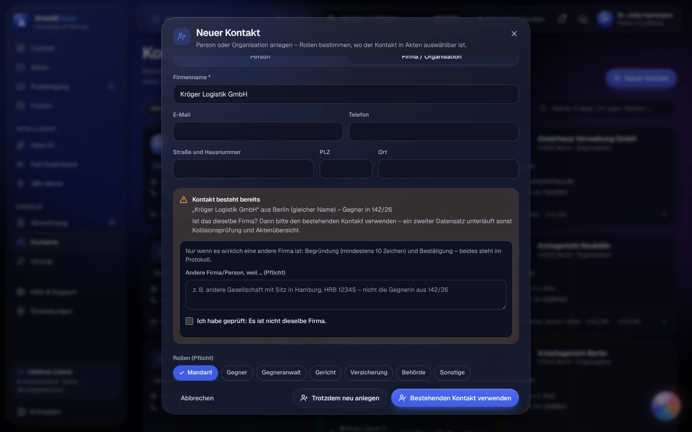 | **I4-T17-01 (K)** – „Neuer Kontakt“ mit „Kröger Logistik GmbH“: „Kontakt besteht bereits … – Gegner in 142/26“, Begründung und Häkchen Pflicht, „Bestehenden Kontakt verwenden“ als Hauptaktion (D dunkel). |
| 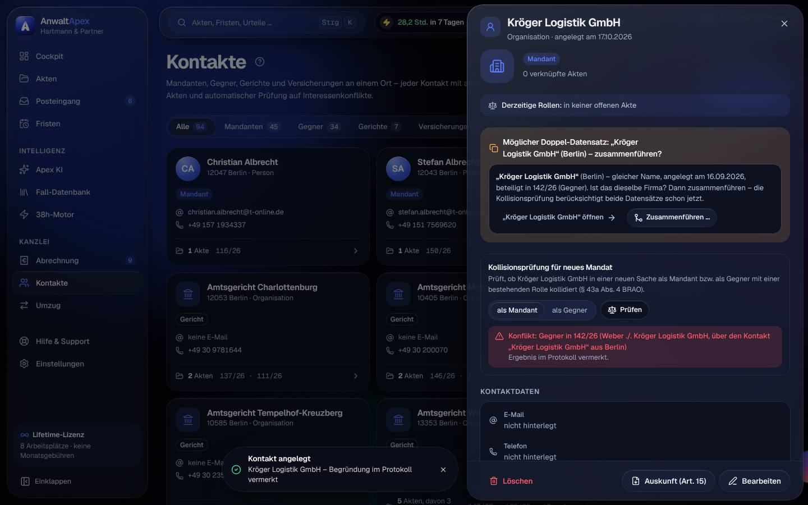 | **I4-T17-01 (K)** – Kontakt-Drawer der Dublette: „Möglicher Doppel-Datensatz – zusammenführen?“ und „Konflikt: Gegner in 142/26 (… über den Kontakt „Kröger Logistik GmbH“ aus Berlin)“ (D dunkel). |
| 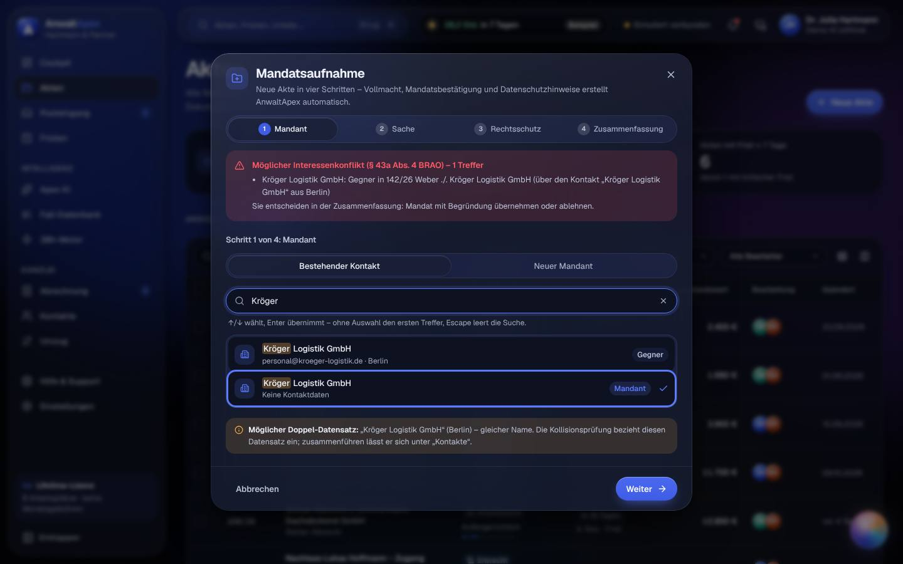 | **I4-T17-01 (K)** – Mandatsaufnahme, Mandant = Dublette: „Möglicher Interessenkonflikt (§ 43a Abs. 4 BRAO) – 1 Treffer“ statt „keine Treffer“ (D dunkel). |
| 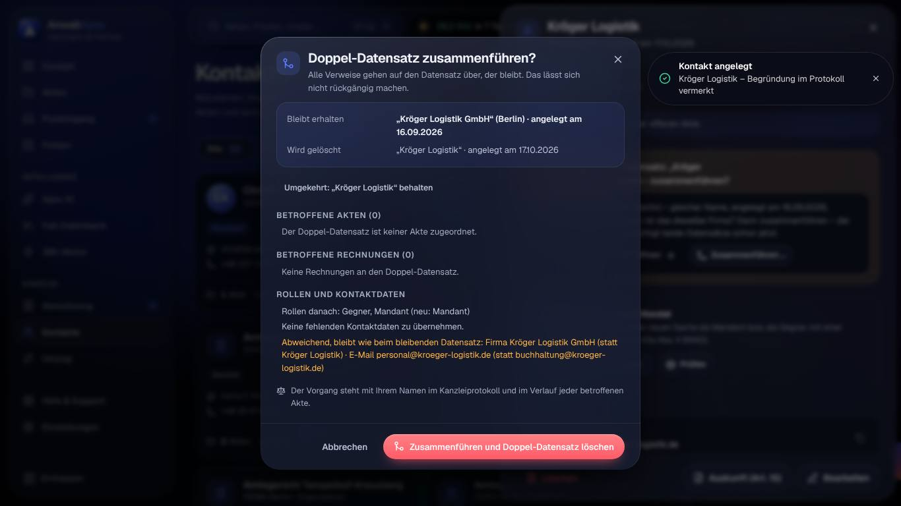 | **I4-T17-01 (K)** – Vorschau „Doppel-Datensatz zusammenführen?“ mit Akten, Rechnungen, Rollen und abweichenden Daten; „Abbrechen“ vorfokussiert (L dunkel). |
| 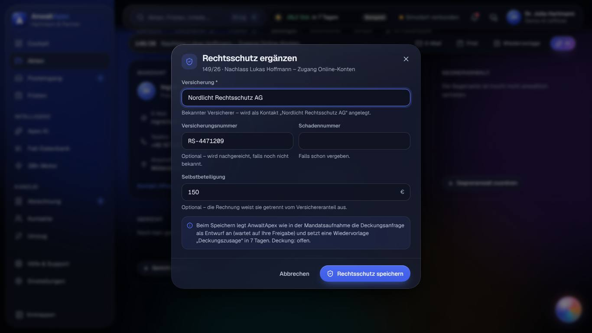 | **I4-T04-01 (H)** – Dialog „Rechtsschutz ergänzen“ in 149/26 mit Versicherer aus der Suchauswahl (L dunkel). |
| 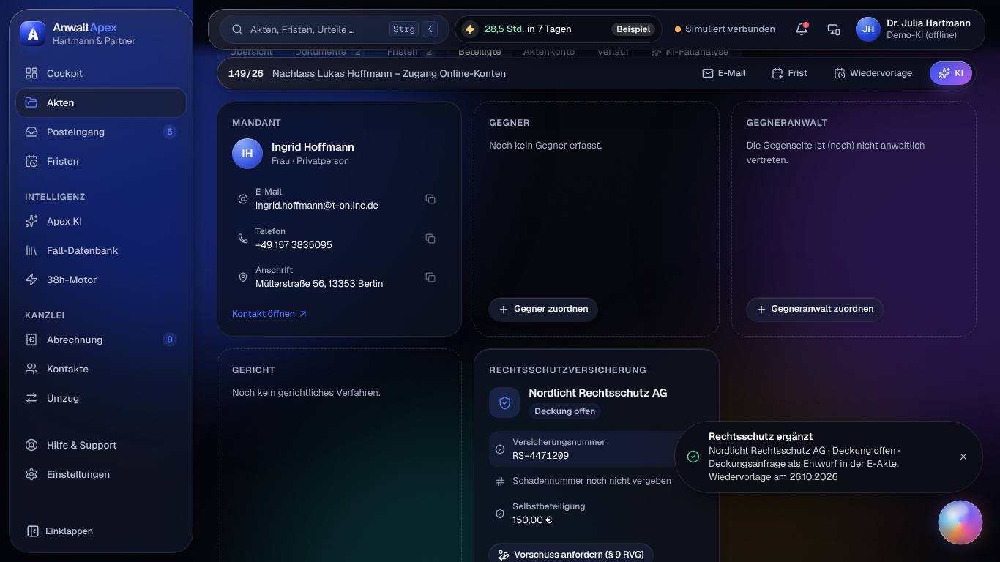 | **I4-T04-01 (H)** – Beteiligte danach: Nordlicht Rechtsschutz AG, Deckung offen, SB 150,00 €, „Vorschuss anfordern (§ 9 RVG)“; Meldung mit Deckungsanfrage und WV am 26.10.2026 (L dunkel). |
| 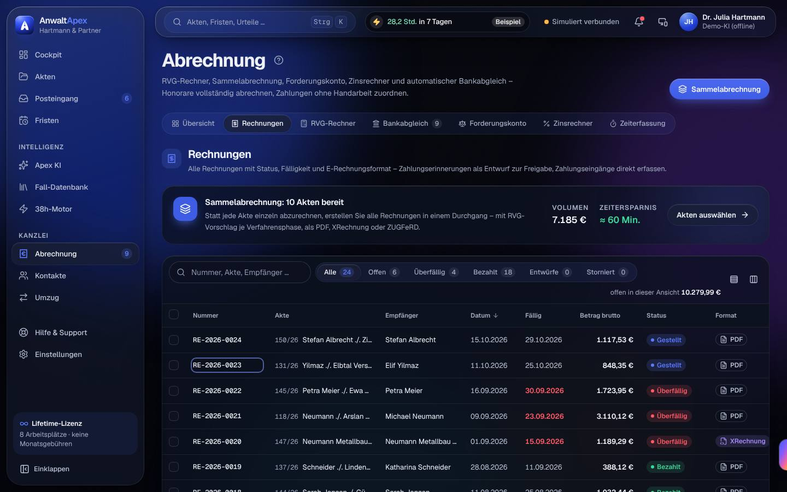 | **I4-T07-01 (H)** – Fokus auf „Rechnung RE-2026-0023 öffnen“ nach ↓ (D dunkel). |
| 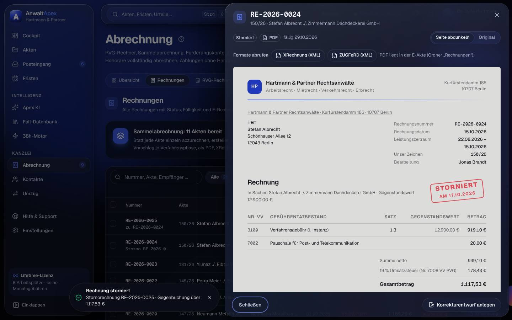 | **I4-T07-01 (H)** – RE-2026-0024 nur mit der Tastatur storniert, Stornorechnung RE-2026-0025, Papier gedimmt mit Umschalter (D dunkel). |
| 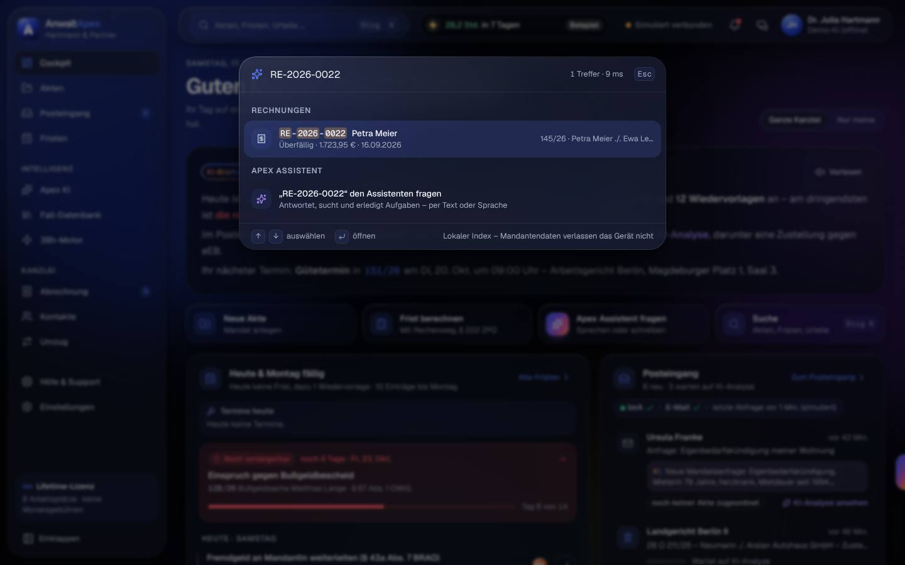 | **I4-T07-01 (H)** – Strg+K „RE-2026-0022“: Gruppe „Rechnungen“ mit Status und Betrag (D dunkel). |
| 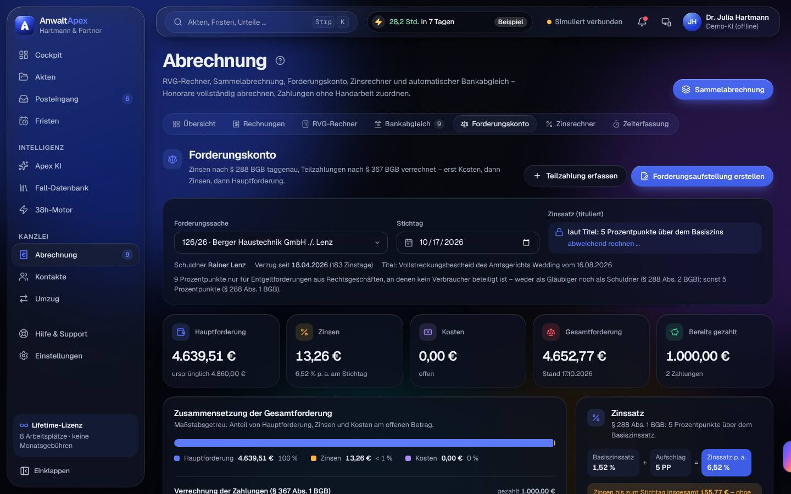 | **I4-T09-01 (H)** – Forderungskonto 126/26, Plakette „Zinssatz p. a. 6,52 %“ auf `--ink-fill`, axe 0 (D dunkel). |
|  | **I4-T09-01 (H), Fund der Abnahme** – „Frist berechnen F“: Tastenhinweis in Knopfschrift statt Grau (dunkel). |
| 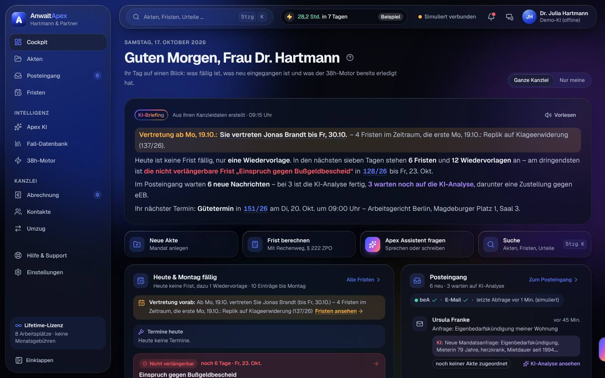 | **I4-T18-04 (M)** – Cockpit am Sa 17.10.: Briefing-Zeile und Hinweis „Vertretung vorab“ mit „Fristen ansehen“ (D dunkel). |
| 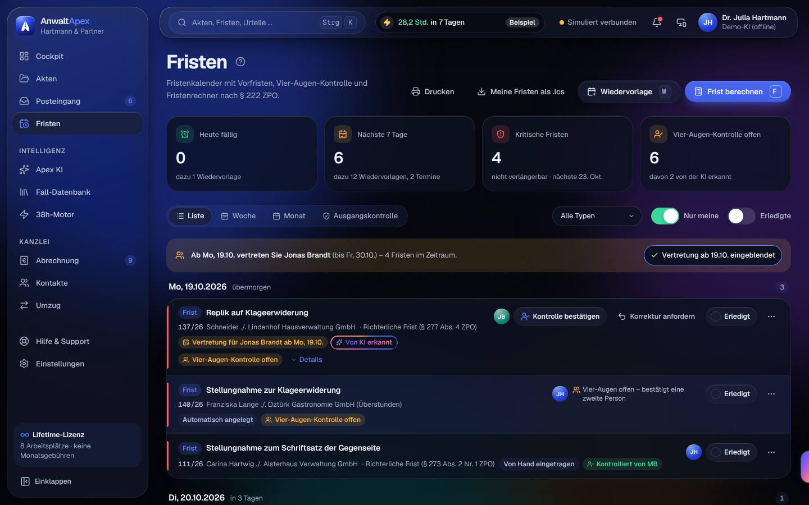 | **I4-T18-04 (M)** – `/fristen?vertretung=vorab`: Hinweis, Schalter und Brandts Fristen mit Chip „Vertretung für Jonas Brandt ab Mo, 19.10.“ (D dunkel). |
| 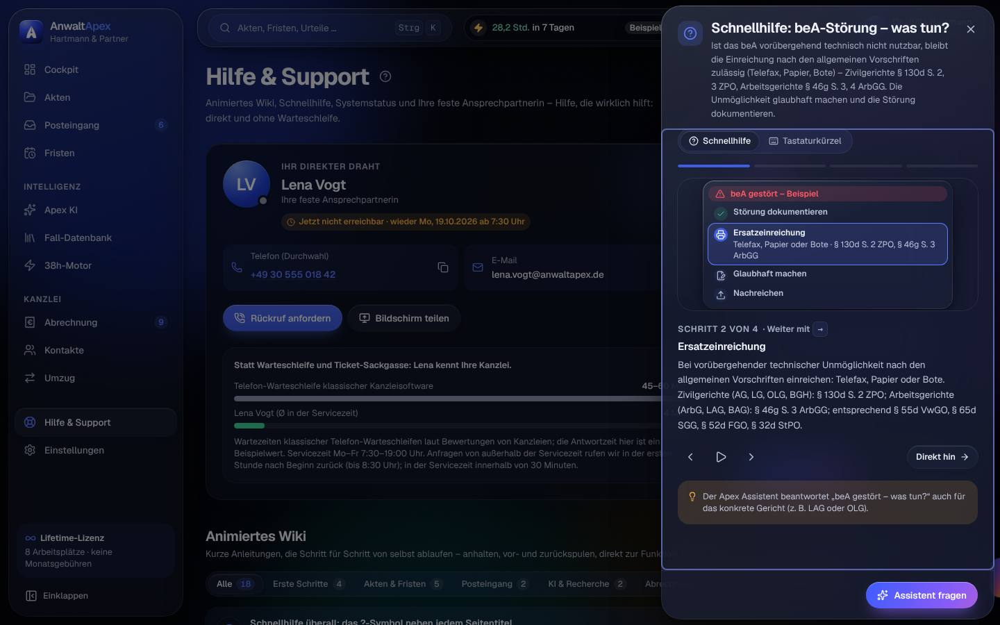 | **I4-T12-01 (M)** – Schnellhilfe „beA-Störung“ bei reduzierter Bewegung: „Schritt 1 von 4 · Weiter mit →“ (D dunkel). |
| 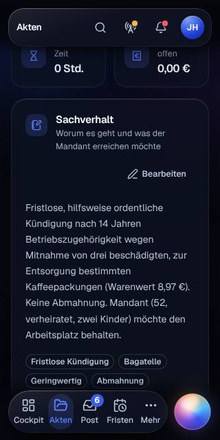 | **I4-T14-02 / I4-T01-01 (N)** – Akte bei 320 px: „Sachverhalt“ vollständig, „Bearbeiten“ in der zweiten Zeile (dunkel). |
| 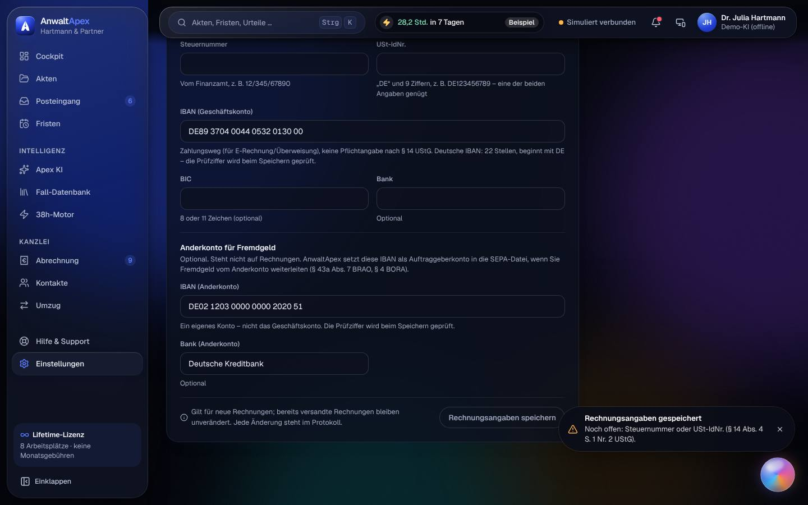 | **Nachgeholt (B-04)** – Rechnungsangaben mit Block „Anderkonto für Fremdgeld“ (D dunkel). |
