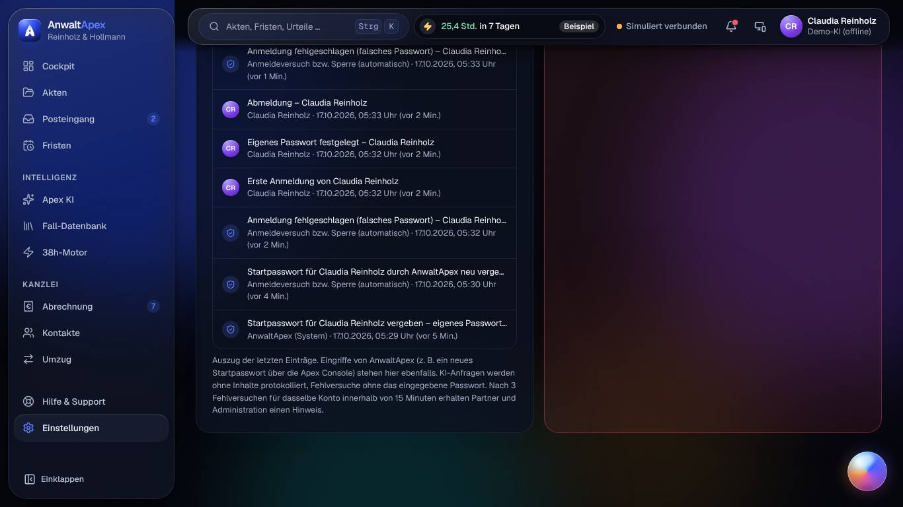
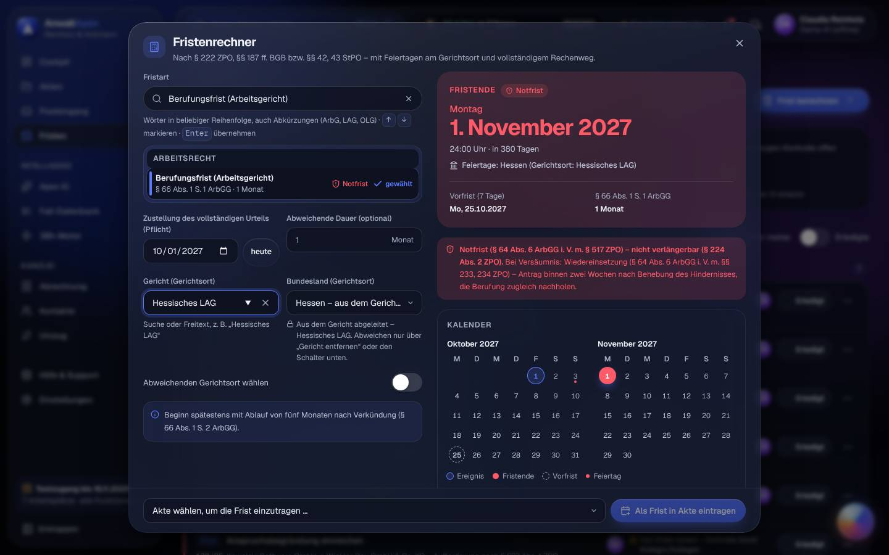
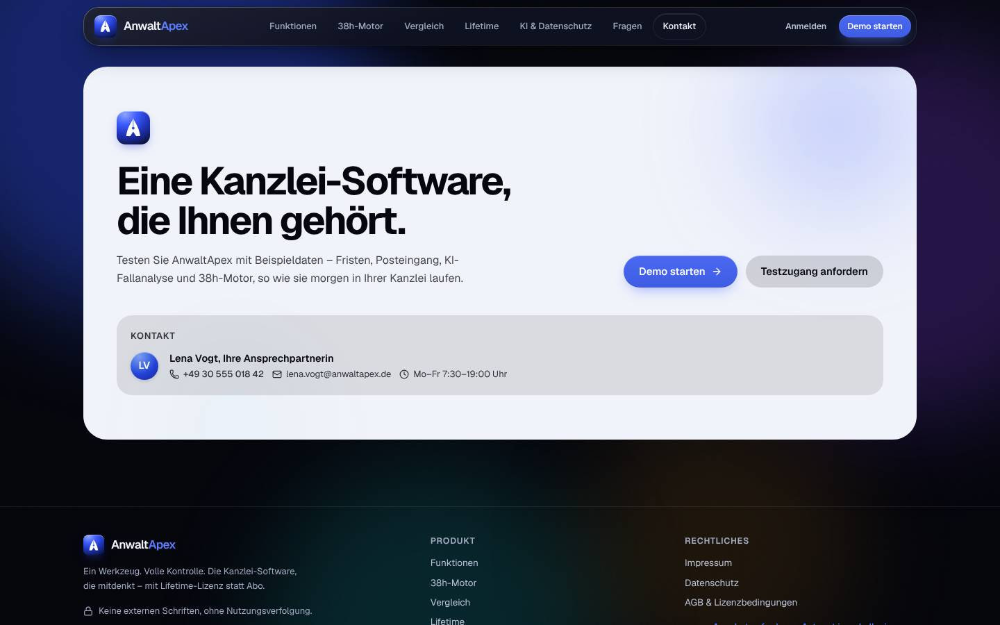

## Iteration 4 – Feedback Claudia Reinholz · Block A (Erstkontakt, Verwaltung, Hilfe & 38h-Motor)

**Datum:** Sa, 17.10.2026, ca. 05:24–05:50 Uhr Ortszeit (Systemuhr 03:24–03:50 UTC) · **Betriebsmodus:** Browser-Demo („Demo-Modus: Ihre Änderungen bleiben in diesem Browser gespeichert“, Demo-KI offline) · **Browser:** Chromium (Playwright, `de-DE`, Europe/Berlin; Datumsfelder weiter im US-Format → Testumgebung, kein Befund) · **Testleitung:** Avatar-Werkzeug, frisches Profil `i4-A`

**Schwerpunkt Iteration 4:** alle Aufgaben **dunkel**, **reduzierte Bewegung an**, axe-core je Ansicht. Viewports: T00 D + M + Reflow 320 px (Gegenprobe 360 px) · T21 D · T16 L · T18-3b D · T10 L · T12 L (+ M für den Nachtest) · T13 D (Schriftgröße 112 %/125 % zusätzlich auf L). Tastatur: Anmeldung mit Enter, Fristart-Auswahl mit Enter, Escape in Rückfragen.

> Eine einzige simulierte Person: SUS, UEQ-S und Noten sind **Trendwerte**. Wie in Iteration 3 lief der Test am Samstag vor 6 Uhr – also außerhalb der Servicezeit. Die Situation „16:50 Uhr an einem Werktag“ aus T12 ließ sich mit dem Werkzeug nicht einstellen.

> **Werkzeughinweis (kein Befund):** Das Avatar-Werkzeug öffnet je Aufruf einen neuen Browserkontext. Dadurch gehen Inhalte aus dem Sitzungsspeicher (Assistent-Verlauf, Formularentwürfe, Scrollstellung) zwischen zwei Aufrufen verloren. Ich habe zusammenhängende Abläufe deshalb in einem Aufruf ausgeführt.

### Nachtest Vorrunde (Befunde meiner Aufgaben)

| ID | Status | Beobachtung in Iteration 4 |
|---|---|---|
| I1-T00-02 | teilweise | Impressum ist weiter ein gekennzeichneter Platzhalter („Anbieterkennzeichnung (§ 5 DDG) … noch nicht hinterlegt“). Entscheidung des Auftraggebers. |
| I3-T00-01 | behoben | M dunkel: Das aufgeklappte Menü ist deckend, die Hero-Schrift scheint nicht durch; axe 0. |
| I3-T00-02 | behoben | „45 bis 60 Minuten in der Telefon-Warteschleife“ hat jetzt Fußnote ¹; im Vergleich steht nur noch „Lange Telefon-Warteschleifen“. |
| I3-T00-03 | behoben | Vorschau-Rechenweg: „Feiertage am Gerichtsort geprüft: Berlin (Kammergericht, Berufungsgericht)“ → Mo 16.11.2026. |
| I3-T21-01 | nicht prüfbar | Angezeigt wird „seit 17.10.2026“, das stimmt. Angelegt habe ich den Zugang aber um 05:29 Uhr Ortszeit; die Fehlerbedingung (Anlage zwischen 0 und 2 Uhr) lässt sich mit dem Werkzeug nicht nachstellen. |
| I3-T21-02 | teilweise | „Neues Startpasswort“ verlangt „Angefordert von“ und „Anlass“, „Vergeben durch“ ist mit Lena Vogt vorbelegt. Ohne Angaben erscheint „Bitte angeben, wer in der Kanzlei das neue Passwort angefordert hat (Name).“ Der Protokolltext nennt Person und Anlass. **Aber:** In der Kanzlei-Ansicht ist die Zeile so gekürzt, dass Person und Anlass nicht zu lesen sind, und als Urheber steht „Anmeldeversuch bzw. Sperre (automatisch)“ → Rest als **I4-T16-01**. |
| I3-T16-01 | behoben | L: „Spalten wählen“ zeigt alle 8 Einträge frei und klickbar (y 459–714). „Gericht“ ist eingeblendet, Tabelle 1.036 px = Container 1.036 px. |
| I3-T18-01 | behoben | Die vormarkierte Zeile hat einen Balken und den Haken „gewählt“. Nach Enter steht „Berufungsfrist (Arbeitsgericht)“ im Suchfeld, der Fokus springt ins Datum. |
| I3-T18-02 | behoben | „Zustellung des vollständigen Urteils (Pflicht)“ ist leer. Statt eines Ergebnisses steht „Bitte das Datum eintragen … – oder ‚heute‘ wählen“; „Als Frist in Akte eintragen“ ist gesperrt. |
| I3-T10-01 | behoben | „Fristen aus Posteingang erkennen“ pausieren → Rückfrage mit Folge, Fokus auf „Abbrechen“, Escape bricht ab. Nach „Pausieren“ steht im Cockpit „Fristerkennung pausiert seit 17.10.2026, 05:39 Uhr (Dr. Julia Hartmann)“ und im Briefing „Achtung: …“; das Protokoll hat den Eintrag. Die Rollenprobe (Mia) gehört nicht zu meinem Block. |
| I3-T10-02 | behoben | Überschrift „Lifetime-Lizenz oder Abo – Kosten über 5 Jahre“, kein „vs.“ mehr. |
| I3-T12-01 | behoben | M: `tel:+493055501842`, 122×44 px. Die Assistent-Antworten nennen die Durchwahl als Link. |
| I3-T12-02 | behoben | M: Knopf „Systemstatus: beA und E-Mail simuliert verbunden – öffnen“ in der Kopfleiste → `/hilfe#status`, der Abschnitt beginnt bei y = 180. |
| I3-T12-03 | behoben | M: Die Plakette „Jetzt nicht erreichbar · wieder Mo, 19.10.2026 ab 7:30 Uhr“ endet bei x = 353 von 390, nichts ist abgeschnitten. |
| I3-T12-04 | behoben | Rückruf-Dialog: „Zusage: Rückruf am Mo, 19.10.2026 bis spätestens 8:30 Uhr“ mit Erklärung „in der ersten Stunde nach Beginn (bis 8:30 Uhr); in der Servicezeit innerhalb von 30 Minuten“. |
| I3-T12-05 | behoben | Um 05:49 Uhr steht „Letzte Sicherung heute, 03:00 Uhr“, also in der Vergangenheit. Die Antwortzeit heißt „Lena Vogt (Ø in der Servicezeit) 4 Min.“ und ist als Beispielwert gekennzeichnet. |
| I3-T12-06 | behoben | Durchgängig „Ihre feste Ansprechpartnerin“; im Assistenten heißt der Chip „Ansprechpartnerin abgerufen“. |
| I3-T06-05 | behoben (Systemstatus L) | Systemstatus auf L: Die Kugel steht am rechten Rand und liegt nicht über Text oder Messwerten. Neue Stelle bei 125 % → I4-T13-01. |
| I3-T13-01 | behoben | 112 % und 125 % auf D **und** L: alle 12 Bereiche bis „Einstellungen“ sichtbar und frei. |
| I3-T13-02 | behoben | Datenschutz → „Passwort ändern“: Dialog mit drei Feldern (`current-password`, `new-password` ×2) und „Passwörter anzeigen“; axe 0. |

**Ergebnis Nachtest:** 20 IDs geprüft · **17 behoben · 2 teilweise** (I1-T00-02 Impressum – Auftraggeber; I3-T21-02 → Anzeige im Protokoll, I4-T16-01) · **1 nicht prüfbar** (I3-T21-01) · 0 nicht behoben.

### Aufgaben

| Aufgabe | Ergebnis | Erfolgskriterium (Messwert) | Prüfpunkte x/y | Aktionen/Soll | Fehlaktionen | fachlich korrekt | SEQ | O-Ton |
|---|---|---|---|---|---|---|---|---|
| T00 Landing (D, M, Reflow 320; dunkel) | erledigt | **erfüllt**: Mein Satz nach 5 s: „Kanzleisoftware für Akten, beA, Fristen und Abrechnung mit KI, als Kauflizenz statt Abo.“ Ziele **5 von 5** in je ≤ 2 Aktionen (Preismodell 1 · Datenstandort 1 · Kontakt 1 · Impressum 2 · „Testzugang anfordern“ 1) | 3/3 (+ Anglizismen: 2 – „Lifetime“, „Live-KI“) | 6 / 10 | 0 | ja (Vorschau: Zustellung Mi 14.10.2026 → Sa 14.11. → **Mo 16.11.2026**, Vorfrist Mo 09.11.; Fußnote: 38 × 48 × 19,74 € = 36.005,76 € ≈ 36.000 €; 38 × 48 × 26,04 € = 47.497 € ≈ 47.500 €) | 6 | „In fünf Sekunden ist klar, was das ist, und jede Zahl hat ihre Fußnote. Lesen kann ich die Fußnoten abends aber kaum, und die weiße Kontaktkarte blendet.“ |
| T21 Apex Console (als Lena Vogt, D) | erledigt | **erfüllt (knapp)**: angelegt; „Neues Startpasswort erzeugen“ mit Angaben zu Person und Anlass ausgeführt; Einladung und Passwort getrennt kopiert, Kopieren je bestätigt. **19** Aktionen ohne Anmeldung (Soll 18; davon die freiwillige Anrede und die zwei neuen Pflichtangaben aus I3-T21-02), 22 mit Anmeldung. Einzige Fehlermeldung (leeres Startpasswort-Formular) nennt Ursache und nächsten Schritt. | 5/5 | 19 / 18 | 0 | ja (Testende 16.11.2026 = 17.10. + 30 Tage, „noch 30 Tage“, „seit 17.10.2026“; NRW aus „Paderborn“ mit Hinweis „Aus der Stadt übernommen“) | 6 | „Gut: Frau Vogt muss jetzt angeben, wer das Passwort wollte und warum. Unglücklich: Die zwei Meldungen liegen genau über dem Hinweis, dass das Passwort nur einmal angezeigt wird.“ |
| T16 Erste Anmeldung eigener Zugang (L) | erledigt | **erfüllt**: Einladung → Cockpit in **6 / 8** Aktionen. Fehlermeldungen **3 von 3** mit Ursache und nächstem Schritt („zu kurz (5 von mindestens 10 Zeichen). Bitte verlängern Sie es – z. B. mit einem weiteren Wort.“, „Die beiden Eingaben stimmen nicht überein …“, „E-Mail-Adresse oder Passwort stimmen nicht … über ‚Passwort vergessen?‘“). Zusätzlich wird das ungültig gewordene erste Startpasswort abgewiesen. | 6/6 | 6 / 8 (+ 5 für die provozierten Fehler) | 0 | ja (Gerichte der ersten 10 Akten: ArbG Paderborn, AG Paderborn, AG Hagen – Zentrales Mahngericht → **0 falsche**; Lizenz „Testzugang bis 16.11.2026“; Bußgeld-Einspruch § 67 Abs. 1 OWiG, 2 Wochen bis Do 22.10., „Tag 9 von 14“) | 6 | „Anmeldung, eigenes Passwort, Fehlermeldungen – so muss das sein. Im Protokoll lese ich aber ‚… durch AnwaltApex neu verge…‘ und dann nichts mehr. Genau den Rest will ich lesen.“ |
| T18 Fall 3b (NRW-Kanzlei, Hess. LAG, D) | erledigt | **erfüllt**: **Mo 01.11.2027**. Rechenweg: „01.11.2027 Allerheiligen – in Nordrhein-Westfalen Feiertag, in Hessen (Gerichtsort) nicht – keine Verschiebung“; Bundesland „Hessen – aus dem Gericht abgeleitet“ ist gesperrt. | 2/2 | 7 / – | 0 | **ja** (Fr 01.10.2027 + 1 Monat, § 188 Abs. 2 BGB = Mo 01.11.2027; Vorfrist Mo 25.10.2027; „in 380 Tagen“ ab 17.10.2026 stimmt; Wiedereinsetzung binnen zwei Wochen, § 234 ZPO) | 7 | „Allerheiligen steht beim Namen im Rechenweg, mit Hessen als Gerichtsort. Genau so. Und ohne Datum rechnet er nicht mehr einfach mit heute.“ |
| T10 38h-Motor verstehen (L) | erledigt | **erfüllt**: eigene Zahl **19,8 Std./Woche** (19,78) aus 11 Automatiken (Minuten je Vorgang aus der Oberfläche × meine Mengen; Mandanten-Update = 0) → **24.723,42 €/Jahr** zu 26,04 €/Std.; 2 Std. Anwaltszeit × 48 × 240 € = 23.040 € | 6/6 | 19 / – | 0 | ja (1.187 Min. = 19,78 Std.; 19,78 × 48 = 949,44 Std.; × 26,04 € = 24.723,42 €; 50.000 € ÷ 1.920 Std. = 26,04 €; Demo-Kopf 28,20 × 26,04 € = 734,33 €, × 48 = 35.247,74 €) | 6 | „Bei uns sind es knapp 20 Stunden, nicht 38 – und das Ding rechnet mir das offen vor. Das kann ich Hollmann zeigen. Dass die Beschreibungen nach drei Zeilen abbrechen, kann ich ihm nicht zeigen.“ |
| T12 Störung, Hilfe, Ansprechpartnerin (L, M) | erledigt | **erfüllt**: LAG → **§ 46g S. 3, 4 ArbGG**, OLG → **§ 130d S. 2, 3 ZPO**; Lena Vogt mit Durchwahl und „Rückruf anfordern“ in **1 Aktion** (Hilfe & Support) | 6/6 | 11 / – | 0 | **ja** (Ersatzeinreichung nach den allgemeinen Vorschriften; Glaubhaftmachung bei der Ersatzeinreichung oder unverzüglich danach; Dokumentation mit Screenshot und BRAK-Störungsmeldung; Ausgangskontrolle erst nach Sendebericht) | 6 | „Die Normen stimmen, und der Rat führt nicht in die Fristversäumung. Aber ‚Lena Vogt anrufen‘ um Viertel vor sechs am Samstag? Dann soll da stehen, dass sie nicht da ist.“ |
| T13 Einstellungen, Team, Lizenz, Datenschutz (D) | erledigt | **erfüllt: 7 von 7** in ≤ 3 Aktionen | 9/12 | 16 / 21 | 0 | ja (§ 50 Abs. 1 S. 2, 3 BRAO ab Jahresende; § 147 Abs. 3 AO 10/8/6 Jahre; § 43e Abs. 4 BRAO als Voraussetzung; Art. 28 DSGVO) | 6 | „Sieben von sieben, und bei 125 % bleibt ‚Einstellungen‘ endlich in der Leiste. Übertragbarkeit ‚im Angebot‘, Escrow ‚auf Anfrage‘ – das muss Hollmann schriftlich sehen.“ |

**Prüfpunkte im Einzelnen**

- **T00:** Zahlenaussagen gekennzeichnet – ja („Ø 38 Std.“ ¹, „≈ 36.000 €“ ², „Sekunden“ ³, „45 bis 60 Minuten“ ¹, „0 €“ erklärt) · Vergleich sachlich, ohne Wettbewerbernamen, mit Vermerk „Zusammenfassung typischer Erfahrungsberichte“ – ja · M: kein Querscrollen; Botschaft und „Testzugang anfordern“ im ersten Bildschirm – ja · Anglizismen: 2. Reflow 320 px: Seite selbst ohne Querscrollen, aber die Rechnerkarte ist abgeschnitten (I4-T00-01); bei 360 px ist nichts Relevantes abgeschnitten.
- **T21:** NRW aus „Paderborn“ mit Hinweis – ja · Einladung 4 von 4 (Anmeldeadresse, E-Mail, Lena Vogt mit Durchwahl, Testende), Kopieren bestätigt – ja · „Neues Passwort“ erklärt Protokoll und Pflicht zum Wechsel – ja · **K-Probe Datenschutz:** Die Console zeigt nur Kanzleiname, Ort, Lizenz, Plätze, Schwerpunkte, Nutzer mit E-Mail sowie die Zahl der Akten, Fristen und Nachrichten – **keine Akteninhalte, keine Mandantennamen** – bestanden · meine zwei Sätze – ja: „Der Anbieter sieht, wer bei uns einen Zugang hat und wie viele Akten und Fristen es gibt, aber keinen Inhalt. Ein neues Passwort vergibt er nur mit Namen des Anfordernden und Anlass, und das steht in unserem Protokoll.“
- **T16:** Einfügen und Passwort-Manager möglich (`autocomplete` username/current-password/new-password, Einfügen nicht gesperrt) – ja · MFA angeboten (Zwei-Faktor per Authenticator-App, „für alle Pflicht“ schaltbar) – ja · Lizenz „Testzugang bis 16.11.2026“ – ja · Anbieter-Passwort im Protokoll – ja (aber gekürzt, I4-T16-01) · falsche Gerichtsorte – 0 · Abmelden in 2 Aktionen, Browser-Zurück zeigt nur die Anmeldung – ja.
- **T18-3b:** Gerichtsort wählbar und im Ergebnis genannt – ja · Feiertag beim Namen – ja (Allerheiligen).
- **T10:** In 3 Sätzen erklärbar – ja: „Der Motor liest Post, ordnet zu, schlägt Fristen vor und bereitet Schreiben vor. Fristen gehen in die Vier-Augen-Kontrolle, alles, was die Kanzlei verlässt, erst nach unserer Freigabe. Intern setzt er nur Vorfristen, Zuordnungen und Zeitvorschläge.“ · Demowerte gekennzeichnet (Banner „Demo-Daten“, „Beispielwerte“, „simuliert“) – ja · Was/Wann/Freigabe bei **12 von 12** Automatiken (das „Was“ ist gekürzt, I4-T10-01) · Rechner übernimmt meine Zahlen – ja · Abschalten in 1 Aktion mit sichtbarer Bestätigung („Pausiert – ruht, bis Sie sie einschalten“); fristrelevante Automatiken nur mit Rückfrage – ja · 38 Std. ≈ 36.000 € nachvollziehbar („interner Richtwert 19,74 €/Std.“, 48 Wochen) – ja.
- **T12:** Systemstatus in ≤ 2 Aktionen (1 über die Kopfleiste) – ja · Rat umfasst Dokumentation (Screenshot, BRAK-Störungsmeldung) – ja · verweist nicht nur an den beA-Support – ja · Rückruf binnen 30 Minuten (in der Servicezeit) sichtbar zugesagt – ja · Schnellhilfe öffnet passend („Schnellhilfe: Hilfe & Support“) – ja · Wiki-Animation pausierbar („Anhalten“ → „Abspielen“) – ja (läuft aber trotz reduzierter Bewegung von selbst, I4-T12-01).
- **T13:** Folgen erklärt („Fachangestellte/-r: … kein eEB, keine Lizenz- und Teamdaten …“) – ja · Darstellung wirkt sofort – ja · KI-Anbieter, Ort und Trainingsverbot im Klartext – ja · Übereinstimmung mit „EU-Verarbeitung“ aus dem Masterprompt – **nein** (Live-KI in den USA, „EU auf Anfrage“; bekannt, Entscheidung des Auftraggebers) · Lizenz ohne Wartung – ja · übertragbar – **nein** („im Angebot geregelt“) · Escrow – **nein** („auf Anfrage“) · MFA – ja · Sperre bei Inaktivität (5/10/15/30 Min.) – ja · Bundesland änderbar und erklärt – ja · Unterauftragnehmer – ja · Löschkonzept – ja. Ich zähle Übertragbarkeit und Escrow streng als „nein“; inhaltlich ist das unverändert zur Vorrunde (offene Entscheidungen des Auftraggebers). Rechte der Auszubildenden: Die Rechtetabelle zeigt schon als Standard kein Fremdgeld, keine Lizenz- und keine Teamdaten – Haken und Strich, nicht nur Farbe.

### Befunde

| ID | S | Kategorie | Ansicht · Viewport · Modus | Beobachtung → Erwartung → Vorschlag | Datei (Zuordnung nach dem Test) | Bild |
|---|---|---|---|---|---|---|
| **I4-T16-01** | **M** | Vertrauen | Einstellungen → Datenschutz → Protokoll · L · dunkel | **Beobachtung:** Der Eintrag zum Anbieter-Eingriff ist auf eine Zeile gekürzt: „Startpasswort für Claudia Reinholz durch AnwaltApex neu verge…“. Der Text ist 1.099 px breit, sichtbar sind 393 px. Person („Lena Vogt“), Anforderer und Anlass sind nicht zu lesen – kein Tooltip, kein Aufklappen, Klick ohne Wirkung. Die Zeile darunter nennt als Urheber „Anmeldeversuch bzw. Sperre (automatisch)“ statt des Anbieters. **Erwartung:** Ein Eingriff des Anbieters ist der wichtigste Eintrag im Protokoll. Er muss vollständig lesbar sein und klar „AnwaltApex – Lena Vogt (Apex Console)“ als Urheber nennen. **Vorschlag:** Einträge umbrechen statt kürzen (oder 2–3 Zeilen plus „mehr“). Eigene Urheberzeile und eigenes Symbol für Anbieter-Eingriffe, Filter „Anbieter“ neben „Alle · Anmeldungen“. Gilt sinngemäß für lange Einträge wie „Automatik … pausiert – durch …“. | `src/pages/einstellungen/DatenschutzTab.tsx:254` (Urheber „Anmeldeversuch bzw. Sperre (automatisch)“ für `akteur === "system"` bei Anmelde-Einträgen), `:266` (`truncate`) | [Bild](bilder/block-A-T16-protokoll-anbietereingriff-abgeschnitten-L-dunkel.jpg) |
| **I4-T10-01** | **M** | Verständlichkeit | 38h-Motor → Automatiken (Karten) · L · dunkel | **Beobachtung:** Die Beschreibung jeder Automatik ist auf 3 Zeilen gekürzt (13 px, grau), z. B. „… über das…“ (Mandanten-Update) oder „… erinnert die…“ (Vorfristen). Es gibt weder „mehr“ noch einen Tooltip; der abgeschnittene Teil enthält Fachliches wie „versendet nach Ihrer Freigabe“ oder „mit Eskalation an die Vertretung“. **Erwartung:** Das „Was“ einer Automatik ist der Kern meines Prüfpunkts und muss ganz lesbar sein. **Vorschlag:** Beschreibung voll anzeigen (die Karten haben Platz) oder „Mehr anzeigen“; Schrift mindestens in der Stufe des Fließtexts (fg-2). | `src/pages/motor/AutomationKarte.tsx:177` (`line-clamp-3 text-[13px] … text-fg-3`); gleiche Bauart in `src/pages/cockpit/KartenKanzlei.tsx:228` | – |
| **I4-T12-01** | **M** | Barrierefreiheit | Hilfe → Wiki „beA-Störung – was tun?“ · L · dunkel · reduzierte Bewegung | **Beobachtung:** Trotz „reduzierter Bewegung“ (`prefers-reduced-motion: reduce` = true) schaltet die Anleitung selbst weiter: Nach etwa 9 Sekunden springt „Schritt 1 von 4“ auf „Schritt 2 von 4“. Anhalten geht, ist aber Handarbeit. Die Darstellung-Einstellungen sagen selbst „AnwaltApex blendet nur noch sanft über“, und die Apex Island ruht in diesem Fall. **Erwartung:** Bei reduzierter Bewegung startet das Wiki angehalten; weiter geht es nur auf Klick. Ich lese langsam, und der Text darf mir nicht weglaufen. **Vorschlag:** `WikiPlayer` startet bei reduzierter Bewegung pausiert; Hinweis „Weiter mit →“. | `src/components/wiki/WikiPlayer.tsx` (keine Abfrage reduzierter Bewegung gefunden) | – |
| **I4-T00-02** | **M** | Look & Feel | Landing → Abschlusskarte „Eine Kanzlei-Software, die Ihnen gehört.“ mit Kontakt · D · dunkel | **Beobachtung:** Im Dunkelmodus ist die Abschlusskarte eine große helle Fläche (≈ 1.200 × 540 px, hellgrau mit dunkler Schrift) mitten auf dunkler Seite. Beim Scrollen am Abend blendet sie. **Erwartung:** Der Dunkelmodus ist durchgängig dunkel; Hervorhebung über Rahmen oder Akzentfarbe, nicht über eine invertierte Fläche. **Vorschlag:** Die Karte im Dunkelmodus mit dunkler Fläche (z. B. `--bg-elevated`) und Akzentrand gestalten. | `src/pages/public/landing/Abschluss.tsx:147` (`bg-[var(--fg)] … text-[var(--bg)]`, invertiert) | [Bild](bilder/block-A-T00-helle-abschlusskarte-D-dunkel.jpg) |
| **I4-T00-01** | **M** | Barrierefreiheit | Landing → „Ihre Ersparnis“ (Beispielrechnung) · Reflow 320×640 · dunkel | **Beobachtung:** Bei 320 px ragt die Rechnerkarte etwa 12 px über den Rand und wird abgeschnitten (Container `overflow-x: hidden`). Sichtbar ist „38 Std“ statt „38 Std.“ und „19,74 €“ angeschnitten; die Skala endet bei „12…“, die Erklärzeile bei „… bewusst“. Der Schieberegler reicht bis x = 332. Bei 360 px ist nichts Relevantes abgeschnitten. **Erwartung:** WCAG 1.4.10 – bei 320 CSS-px ohne Verlust. Zugesagt sind laut Masterprompt 360 px, ein Befund war hier erwartet. **Vorschlag:** Wertzeile unter das Etikett umbrechen, Innenabstand der Karte bei < 360 px verringern, Regler `w-full` im Kartenrahmen. | `src/pages/public/landing/Motor.tsx` (`#roi-stunden`) | Aufnahme im Testprofil (`017-T00-reflow320-rechner-dunkel.jpg`) |
| I4-T00-03 | N | Barrierefreiheit | Landing → Fußnoten unter den Kennzahlen · D · dunkel | **Beobachtung:** Die Fußnoten ¹ ² ³ (Herleitung von 38 Std. und 36.000 €) stehen in kleiner grauer Schrift in einer einzigen Zeile über ≈ 1.170 px Breite, also rund 190 Zeichen je Zeile. Mit Gleitsichtbrille verliere ich die Zeile. **Erwartung:** Gerade die Herleitung soll man gut lesen können. **Vorschlag:** Fußnoten als Liste mit begrenzter Zeilenlänge (≈ 75 Zeichen), eine Stufe größer und heller. | `src/pages/public/landing/Hero.tsx` | – |
| I4-T21-01 | N | Look & Feel | Console → „Testzugang ist bereit“ / „Neues Startpasswort erzeugt“ → Einladungstext · D · dunkel | **Beobachtung:** Der Einladungstext steht im Dunkelmodus auf einer weißen Fläche – ein heller Block im dunklen Dialog. **Erwartung:** Dunkle Textfläche wie die übrigen Felder; eine „Papier“-Vorschau ist bei einer E-Mail nicht nötig. **Vorschlag:** Token für Eingabe- bzw. Vorschaufläche verwenden. | `src/pages/console/NeuerZugang.tsx` (um Z. 308), Startpasswort-Dialog der Console | – |
| I4-T21-02 | N | Bedienbarkeit | Console → „Neues Startpasswort erzeugt“ · D · dunkel | **Beobachtung:** Nach „Einladung kopieren“ und „Startpasswort kopieren“ liegen die beiden Meldungen oben mittig über dem Dialogtitel und über dem Hinweis „Das bisherige Passwort ist ab sofort ungültig …“. Im schmaleren Dialog ist zudem die E-Mail auf „claudia.reinholz+i4@reinholz-hollmann.exam…“ gekürzt. **Erwartung:** Meldungen verdecken keinen Dialoginhalt (so in I3-T03-03 für andere Ansichten gelöst); die E-Mail ist ganz zu lesen, weil Lena sie am Telefon vorliest. **Vorschlag:** Meldungen bei offenem Dialog unterhalb bzw. seitlich des Dialogs oder als Bestätigung direkt am Knopf („✓ kopiert“); E-Mail umbrechen statt kürzen. | `src/pages/console/Console.tsx`, `src/pages/console/helfer.ts`, `src/components/StartpasswortKarte.tsx` | – |
| I4-T21-03 | N | Barrierefreiheit | Console → Kundenkarten, Knopf „Neues Passwort“ · D | **Beobachtung:** Es gibt zehn Knöpfe „Neues Passwort“, deren zugänglicher Name nur „Neues Passwort“ ist; die Person steht nur im `title` („Neues Passwort für Claudia Reinholz erzeugen“). „Einladung kopieren“ hat dagegen ein `aria-label` mit Namen. Ein Screenreader liest zehnmal dasselbe. **Erwartung:** Gleiche Bauart wie „Einladung für … kopieren“. **Vorschlag:** `aria-label` „Neues Passwort für ‹Name› erzeugen“ (wie beim `title`). | `src/pages/console/KundenKarte.tsx:149` | – |
| I4-T12-02 | N | Vertrauen | Apex Assistent → Notfallantwort beA-Störung · L · dunkel · Sa 05:45 Uhr | **Beobachtung:** Die Notfallantwort sagt „Ihre feste Ansprechpartnerin Lena Vogt anrufen: +49 30 555 018 42 (Mo–Fr 7:30–19:00 Uhr) – prüft mit Ihnen den beA-Status.“ Dass Lena gerade nicht erreichbar ist, steht dort nicht; die Hilfe-Seite und die nächste Antwort sagen es. **Erwartung:** Im Notfall außerhalb der Servicezeit: „Lena Vogt ist jetzt nicht erreichbar (wieder Mo, 19.10. ab 7:30 Uhr) – warten Sie nicht, reichen Sie jetzt ersatzweise ein.“ **Vorschlag:** Dieselbe Erreichbarkeitsprüfung wie in der Antwort auf „Ich brauche meine Ansprechpartnerin“ verwenden. | `src/ai/assistent.ts:967` | – |
| I4-T13-01 | N | Look & Feel | Einstellungen → Darstellung, Karte „Gut zu wissen“ · D · dunkel · Schriftgröße 125 % | **Beobachtung:** Die an den Rand ausgewichene Assistent-Kugel liegt bei 125 % über dem Zeilenende „… weicht nur dort von“. Laut zugänglichem Namen ist sie „an den Rand ausgewichen, damit sie nichts verdeckt“. **Erwartung:** Auch bei 112/125 % verdeckt die Kugel keinen Text. **Vorschlag:** Die Ausweichprüfung mit der skalierten Kugelgröße rechnen bzw. bei größerer Schrift weiter einklappen. | `src/components/assistant/AssistantDock.tsx` | – |
| I4-T18-01 | N | Bedienbarkeit | Fristenrechner → „Als Frist in Akte eintragen“ · D · dunkel | **Beobachtung:** Der gesperrte Knopf ist im Dunkelmodus kaum von einem aktiven zu unterscheiden (blaue Fläche, nur leicht gedämpft). Den Grund nennt nur der Platzhalter der Aktenwahl daneben. **Erwartung:** Ein gesperrter Hauptknopf sieht deutlich gesperrt aus. **Vorschlag:** Gesperrt als Umriss-Knopf mit grauer Schrift, darunter „Erst Akte wählen“. | `src/pages/fristen/Fristenrechner.tsx` | [Bild](bilder/block-A-T18-fall3b-allerheiligen-D-dunkel.jpg) (unten rechts) |

**Summe neue Befunde:** 0 K · 0 H · 5 M · 7 N.

### axe-core (WCAG 2.2 A/AA, Stufen serious/critical)

| Ansicht · Viewport · Modus | serious | critical |
|---|---|---|
| Landing · D · dunkel | 0 | 0 |
| Landing, Dialog „Testzugang anfordern“ · D · dunkel | 0 | 0 |
| Landing · M · dunkel | 0 | 0 |
| Landing, mobiles Menü offen · M · dunkel | 0 | 0 |
| Landing · Reflow 320 · dunkel | 0 | 0 |
| Anmeldung (`/login`) · D · dunkel | 0 | 0 |
| Apex Console, Übersicht · D · dunkel | 0 | 0 |
| Apex Console, Formular „Neuen Testzugang anlegen“ · D · dunkel | 0 | 0 |
| Fristenrechner mit Ergebnis Fall 3b · D · dunkel | 0 | 0 |
| Cockpit · L · dunkel | 0 | 0 |
| Akten · L · dunkel | 0 | 0 |
| 38h-Motor oben und gescrollt (Rechner) · L · dunkel | 0 | 0 |
| Hilfe & Support · L · dunkel | 0 | 0 |
| Hilfe → Systemstatus · L · dunkel | 0 | 0 |
| Schnellhilfe offen · L · dunkel | 0 | 0 |
| Wiki „beA-Störung – was tun?“ · L · dunkel | 0 | 0 |
| Hilfe → Systemstatus · M · dunkel | 0 | 0 |
| Einstellungen → Kanzlei, Lizenz, KI, Darstellung · L · dunkel | 0 | 0 |
| Einstellungen → Team & Zugänge · D · dunkel | 0 | 0 |
| Einstellungen → Datenschutz · D · dunkel | 0 | 0 |
| Dialog „Passwort ändern“ · D · dunkel | 0 | 0 |

axe findet nichts. Was ich als Befund notiere (Kürzungen, helle Flächen, Reflow-Abschnitt, Selbstlauf trotz reduzierter Bewegung), erkennt axe nicht.

### Fragebögen (Gesamtsystem nach Block A)

**SUS:** 4 · 2 · 4 · 1 · 5 · 2 · 4 · 2 · 4 · 2 = **80,0** (Trendwert; Iteration 3 Block A: 77,5). Aussage 5 steigt auf „5“: Der pausierte Motor meldet sich im Cockpit, der Assistent verlinkt den Systemstatus, und jede Änderung landet im Protokoll – das greift ineinander. Aussage 9 bleibt bei „4“, solange ich den Anbieter-Eingriff im Protokoll nicht lesen kann.

**UEQ-S:** pragmatisch **+1,75** (unterstützend +2, einfach +1, effizient +2, übersichtlich +2) · hedonisch **+1,25** (spannend +1, interessant +2, originell +1, neuartig +1)

| Dimension | Note | Begründung |
|---|---|---|
| Look & Feel | 2 | Dunkel ruhig und hochwertig. Zwei helle Flächen stören (Abschlusskarte der Landing, Einladungstext in der Console). |
| Lesbarkeit | 2,5 | 125 % ohne Verluste in der Seitenleiste. Gekürzt werden aber ausgerechnet Protokolleinträge und Automatik-Beschreibungen. Die Fußnoten sind klein und laufen über die ganze Breite, und bei 320 px ist die Rechnerkarte abgeschnitten. |
| Verständlichkeit | 2 | Fehlermeldungen mit Ursache und nächstem Schritt, Rückfragen mit Folgen, Rollenfolgen erklärt. |
| Vertrauen | 2 | Anbieter-Eingriff nur mit Person und Anlass, Rückfrage vor dem Abschalten der Fristerkennung, ehrliche Kennzeichnung. Offen bleiben Impressum, Preis, Übertragbarkeit, Escrow und KI in den USA, und der Protokolleintrag ist nicht lesbar. |
| Tempo | 2 | Login in 6 Aktionen, Systemstatus in 1, Fall 3b in 7. Die Console braucht eine Aktion mehr als vorher, für mehr Sicherheit – das nehme ich hin. |
| Fachliche Korrektheit | 1 | Fall 3b mit Allerheiligen, § 46g und § 130d, Löschfristen, Bußgeld-Einspruch, Vorschau-Rechenweg und alle Rechnungen im 38h-Motor exakt. |
| Mobil | 2 | Status-Knopf in der Kopfleiste, antippbare Durchwahl, Plakette passt, Landing am iPhone gut. Abzug nur für 320 px. |

**Empfehlung (0–10):** 8

**Kauf heute:** unter Bedingungen:

- schriftliches Angebot mit Lizenz- und Wartungspreis für 7 Arbeitsplätze, Übertragbarkeit und Escrow verbindlich geregelt;
- KI-Verarbeitung in der EU oder eine nach § 43e Abs. 4 BRAO tragfähige Lösung (bis dahin nur Offline-KI);
- echtes Impressum;
- Eingriffe des Anbieters im Kanzleiprotokoll vollständig lesbar und dem Anbieter zugeordnet (I4-T16-01).

**Top 3 Verbesserungen:**

1. Den Anbieter-Eingriff im Protokoll vollständig zeigen und richtig zuordnen – mit Person, Anlass und eigener Urheberzeile (I4-T16-01, Rest von I3-T21-02).
2. Nichts abschneiden, was ich lesen muss, und nichts laufen lassen, was ich lesen will: Automatik-Beschreibungen ganz zeigen, das Wiki bei reduzierter Bewegung anhalten, Fußnoten lesbar setzen (I4-T10-01, I4-T12-01, I4-T00-03).
3. Den Dunkelmodus konsequent umsetzen und Reflow bei 320 px schaffen: keine hellen Flächen, gesperrte Knöpfe als gesperrt erkennbar, Rechnerkarte ohne Abschnitt (I4-T00-02, I4-T21-01, I4-T18-01, I4-T00-01).

### Bilder

| Bild | Was es zeigt |
|---|---|
|  | **I4-T16-01 (M)** – Datenschutz → Protokoll im eigenen Paderborner Zugang (L dunkel): „Startpasswort für Claudia Reinholz durch AnwaltApex neu verge…“, Urheber „Anmeldeversuch bzw. Sperre (automatisch)“. |
|  | **gut** – Fall 3b (D dunkel): Mo 01.11.2027, Feiertage Hessen aus dem Gericht abgeleitet und gesperrt, Vorfrist Mo 25.10.2027. Unten rechts der gesperrte Knopf „Als Frist in Akte eintragen“ (I4-T18-01). |
|  | **gut** – Nachtest I3-T10-01 (L dunkel): Rückfrage vor dem Pausieren der Fristerkennung mit Folge und Hinweis auf Cockpit und Fristen, Fokus auf „Abbrechen“. |
|  | **I4-T00-02 (M)** – Landing (D dunkel): Die Abschlusskarte mit Kontakt ist eine große helle Fläche auf dunkler Seite. |
