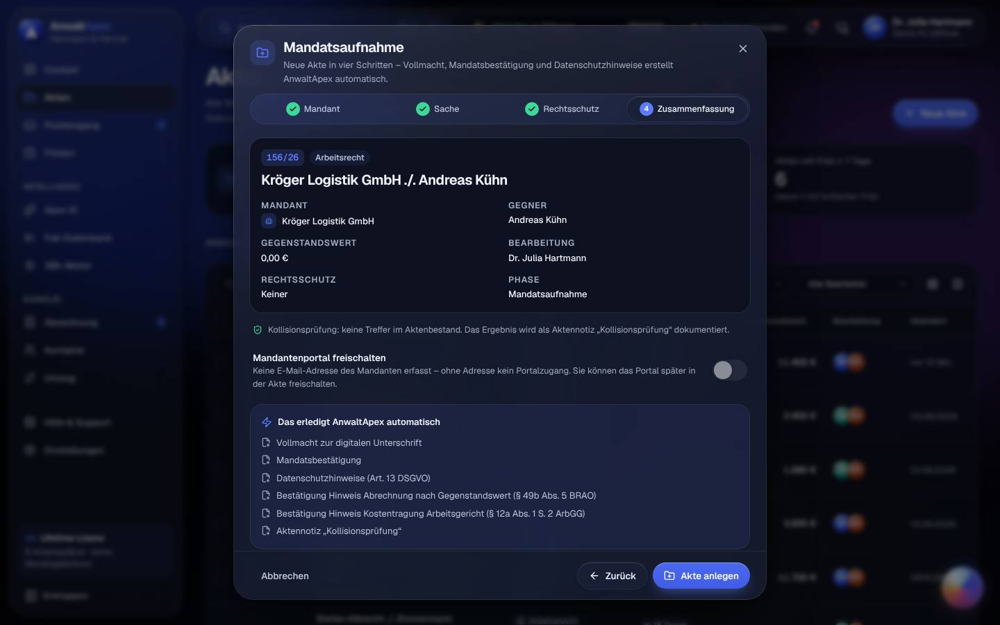
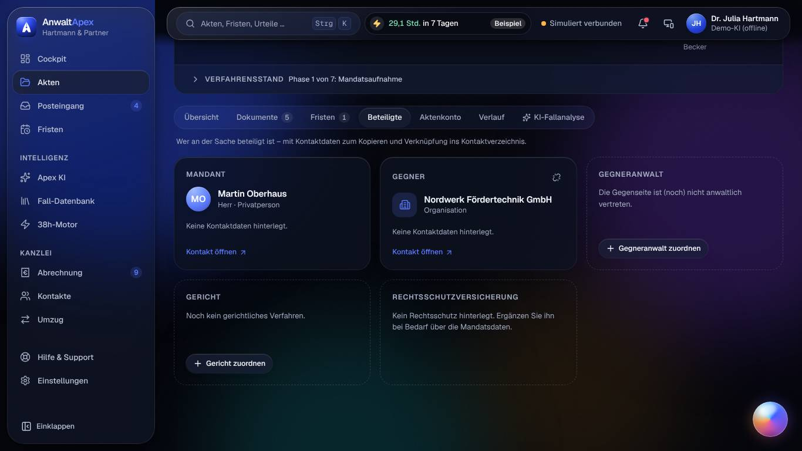
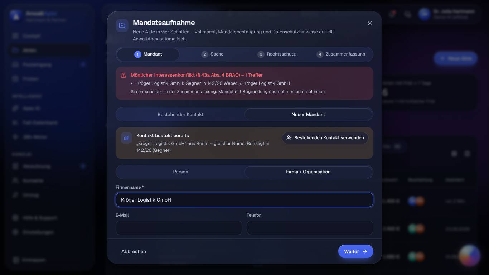
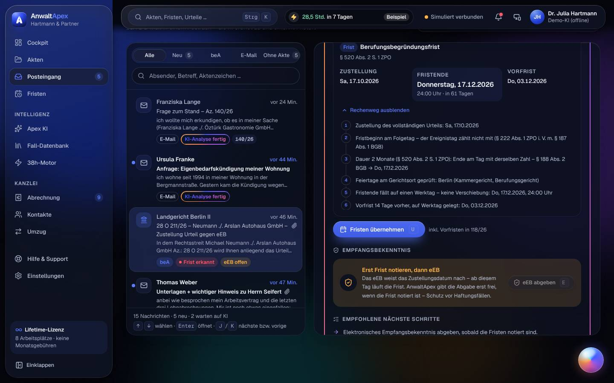

## Iteration 4 – Feedback Claudia Reinholz · Block B (Alltag Mandatsarbeit)

**Datum:** Sa, 17.10.2026, ca. 05:25–06:15 Uhr Ortszeit · **Betriebsmodus:** Browser-Demo (Anmeldeseite „Demo-Modus: Ihre Änderungen bleiben in diesem Browser gespeichert“, Kopfleiste „Demo-KI (offline)“, „Simuliert verbunden“) · **Browser:** Chromium (Playwright, `de-DE`, Europe/Berlin; Datumsfelder weiter im US-Format `10/17/2026` → Testumgebung, kein Befund) · **Testleitung:** Avatar-Werkzeug, frisches Profil `i4-B`, Präsentationszugang Dr. Julia Hartmann (Anmeldung per E-Mail und Passwort)

**Reihenfolge und Viewports:** T01 (D hell, D dunkel, D dunkel + Deuteranopie, 200 %, 320 px) → T02 (D, 200 %, 320 px, M) → T03 (D nur Tastatur, D + Deuteranopie, M) → T04 (L nur Tastatur) → T05 (D, M) → T17 (D) → T23 (D, Tq).
**Schwerpunkt Iteration 4 (Lesbarkeit, Dunkelmodus, Barrierefreiheit):** alle Aufgaben dunkel (T01 zusätzlich hell), „Bewegung reduzieren“ ab der zweiten T01-Messung an, Deuteranopie-Simulation für T01 und T03, 200 % (720×450 @2x) und Reflow 320×640 für T01 und T02, T03 und T04 nur mit Tastatur, axe-core in 18 Ansichten.

> Eine einzige simulierte Person: SUS, UEQ-S und Noten sind **Trendwerte**.

> **Hinweis an die Testleitung (kein Befund):** Auch diese Runde lief am Samstagmorgen; das Werkzeug kann die Seitenuhr nicht setzen. Werktagssituationen bleiben offen (vgl. Iteration 3, Abschnitt 10.6).

> Mein Eindruck in einem Satz: *Dunkel, mit 200 % und am iPad ist das jetzt ein ruhiges, lesbares Werkzeug, und die Fristen stimmen auf den Tag – aber ich habe eine Kollisionsprüfung erlebt, die „keine Treffer“ protokolliert, obwohl die Firma in meiner eigenen Akte Gegner ist. Das darf nicht passieren.*

### Nachtest Vorrunde (Befunde meiner Aufgaben T01–T05, T17, T23)

| Befund | Status | Was ich gesehen habe |
|---|---|---|
| I3-T01-01 (→ I3-T12-02) | behoben (Cockpit-Teil) | 320 px und 200 %: „beA ✓ · E-Mail ✓ · letzte Abfrage 05:32 Uhr (simuliert)“ steht als erste Zeile im KI-Briefing; in der mobilen Kopfleiste gibt es ein Statussymbol („Systemstatus: beA und E-Mail simuliert verbunden – öffnen“). |
| I3-T02-01 | behoben | M: „Andere Akte wählen“ 142×44 px, „Rechenweg anzeigen“ 160×44 px. |
| I3-T02-02 | behoben | M: Filter „Alle · Neu 5 · beA · E-Mail · Ohne Akte 4“, alle 44 px hoch, „Ohne Akte“ endet bei x = 378 (12 px Rand). |
| I3-T02-03 | behoben | Verlauf 118/26: „… 2 Anhänge: Urteil_28O211-26.pdf in ‚Gericht‘ abgelegt · Zustellungsnachricht.xml (Strukturdaten) nicht abgelegt – vorher 150/26“. |
| I3-T03-01 (H) | behoben | M dunkel, Filter Vier-Augen: kein Bedienelement außerhalb der 390 px; „Erledigt“ 90×44 px. |
| I3-T03-02 | behoben | Korrektur der Berufungsfrist 118/26: Feld „Gerichtsort (Bundesland): Berlin (Kammergericht, Berufungsgericht)“, Erklärung „Wie bei der ursprünglichen Berechnung …“, Schalter „Abweichender Gerichtsort“; Rechenweg Schritt 4 wie im Posteingang. |
| I3-T03-03 | behoben, Folgebefund | Bei offenem Korrektur-Dialog liegt „Kontrolle bestätigt“ jetzt oben mittig; „Korrektur speichern“ ist frei (`elementFromPoint` = Knopf). Die Meldung verdeckt dafür Titel und „bisher Di, 17.11.2026“ → **I4-T03-03 (N)**. |
| I3-T03-04 | behoben | Eigene Fristen: „Vier-Augen offen – bestätigt eine zweite Person“ direkt an der Zeile (D und M). |
| I3-T03-05 | behoben | M: Kennzahlen als eine Reihe („0 Heute · 6 7 Tage · 5 Kritisch · 6 Vier-Augen“), „Liste · Woche · Monat · Ausgang“ vollständig, erste Zeile „Heute Sa, 17.10.2026“ bei y ≈ 425. |
| I3-T04-01 | behoben | „Neuer Mandant“ → „Firma / Organisation“ → schließen → erneut öffnen: kein „Entwurf fortsetzen?“; in der Aktenliste kein „fortsetzen“. Mit Eingabe fragt Escape „Eingaben verwerfen?“ mit Fokus auf „Weiter bearbeiten“. |
| I3-T04-02 | behoben | Kröger, „Mandat ablehnen“: „Abgelehnt – keine Akte … Bei Ablehnung: keine Akte, kein Portal, Vermerk im Protokoll“; kein Portal- und kein Automatik-Kasten. |
| I2-T04-01 | behoben | Akte 155/26 → Fristen: Pille „Frist · nicht verlängerbar“ an der Klagefrist. |
| I3-T05-01 | behoben | M, 142/26 → Dokumente: keine Schnellaktionsleiste; Auswahlleiste „2 ausgewählt · Verschieben · Löschen · ד über der Tab-Leiste, beide gewählten Zeilen sichtbar; axe 0/0. |
| I3-T23-01 | behoben | Tq dunkel: beschriftete schmale Leiste, Tabelle 858 px in 858 px, kein Querscrollen, Bearbeitung als „JH/MB“ unter der Akte, Kennzahlen vollständig, erste Zeile bei y = 447. |
| I3-T23-02 | behoben | Meldung „Petra Schneider erhält die Zugangs-E-Mail an petra.schneider@posteo.de (im Prototyp nicht versendet).“ |
| I3-T23-03 | behoben | 107/26 und 122/26: „Mandantenportal nach dem Abschluss – Das Mandantenportal ist aktiv – was soll damit geschehen? Portal sperren (empfohlen) · Offen lassen bis …“; danach „Aufbewahrung bis 31.12.2032 vorgemerkt (§ 50 BRAO) · Mandantenportal gesperrt“. |
| I3-T15-02 (mitgeprüft) | behoben | Vorschau „Kündigungsschreiben“ 142/26 dunkel: Schalter „Seite abdunkeln · Original“, Blatt gedimmt grau statt papierweiß. |
| I3-T06-05 / I2-T01-02 (mitgeprüft) | behoben in meinen Ansichten | Kugel im Cockpit, in Fristen und in der Akte als Griff am Rand („an den Rand ausgewichen“); im Posteingang D liegt sie auf dem Kartenrand, nicht auf Text. |
| I1-T07-07 | nicht prüfbar | Datumsfelder weiter `mm/dd/yyyy` – Testumgebung. |

**Summe:** 18 IDs geprüft – 17 behoben (eine mit Folgebefund), 0 teilweise, 0 nicht behoben, 1 nicht prüfbar.

### Aufgaben

| Aufgabe | Ergebnis | Erfolgskriterium (Messwert) | Prüfpunkte x/y | Aktionen/Soll | Fehlaktionen | fachlich korrekt | SEQ | O-Ton |
|---|---|---|---|---|---|---|---|---|
| T01 Morgenroutine Cockpit (D hell, D dunkel, Deuteranopie, 200 %, 320 px) | erledigt | **erfüllt:** 4 von 4 ohne Scrollen auf D hell und dunkel – Fristen heute **0** („Heute ist keine Frist fällig, nur eine Wiedervorlage“), Termine heute **keine** (nächster: Gütetermin 151/26, Di 20.10., 9:00 Uhr), **6 neue Nachrichten**, **beA ✓ · E-Mail ✓ (simuliert)**. Abgleich: Fristen „Heute fällig 0 · dazu 1 Wiedervorlage“, Posteingang „Neu 6“ | 8/8 | 0 / 0 | 0 | ja – Briefing, Karten und Detailansichten decken sich | 6 | „Dunkel ist das jetzt angenehm, nichts grellt. Nur das bunte Ding unten rechts pulsiert weiter, obwohl ich Bewegung abgestellt habe.“ |
| T02 beA-Posteingang mit Urteil (D, 200 %, 320 px, M) | erledigt | **erfüllt:** 118/26 zu 99 % „erkannt über Gerichtsaktenzeichen 28 O 211/26“; Berufung **Di 17.11.2026** (§ 517 ZPO), Begründung **Do 17.12.2026** (§ 520 Abs. 2 S. 1 ZPO), beide Rechenwege in **3 Aktionen** (Nachricht öffnen – Analyse startet selbst –, 2 × „Rechenweg anzeigen“) | 5/5 (Umzuordnung hin 4 Aktionen wegen Pflichtbestätigung, zurück 3) | 3 / 3 | 0 | ja – Zustellung Sa 17.10.; +1 Monat = Di 17.11., +2 Monate = Do 17.12. (§ 188 Abs. 2 BGB), werktags, keine Verschiebung; Vorfristen Di 10.11. und Do 03.12. | 7 | „Tenor, 4.650 € Abweisung, 25/75 – stimmt. Mit 200 % und auf 320 px bricht der Rechenweg sauber um. So muss das.“ |
| T03 Frist übernehmen, eEB, Vier-Augen (D nur Tastatur, Deuteranopie, M) | erledigt | **erfüllt:** „eEB abgeben“ vorher gesperrt („Erst Frist notieren, dann eEB“), danach aktiv; Fristübernahme **1 Aktion** (Taste U); Protokoll **4/4** („eEB abgegeben von Dr. Julia Hartmann am 17.10.2026, 05:37 Uhr · Zustellungsdatum 17.10.2026 · erstmals geöffnet am 17.10.2026, 05:32 Uhr“) | 4/4 | 4 / 4 (U, E, Häkchen, Abgeben) + 1 Kontrolle; Wege per Tab lang (36 Tabs bis zur Berufungsfrist) | 1 (Leertaste im Datumsfeld öffnete den Browser-Kalender) | ja – Fristbeginn = eEB-Datum 17.10.2026; Vorfristen werktags; Abweichung nicht provozierbar (Datum 17.10.–heute) | 5 | „Mit der Tastatur geht alles – aber nach ‚Kontrolle bestätigen‘ stehe ich wieder ganz oben auf der Seite. Das ist kein Arbeiten, das ist Suchen.“ |
| T04 Mandatsaufnahme KSchG + Kollision (L nur Tastatur) | erledigt mit Umweg | **erfüllt:** Akte **155/26** in **15 / 25 Aktionen** (ohne RSV; mit RSV wären es 19); Klagefrist **Mo 02.11.2026** mit Rechenweg (7 Schritte, § 193 BGB, § 222 Abs. 2 ZPO); Gegenstandswert **11.400,00 €** („3 × 3.800,00 € = 11.400,00 € (§ 42 Abs. 2 S. 1 GKG)“) | 8/8 (RSV in der Aufnahme erfassbar; nachträglich nicht → I4-T04-01) | 15 / 25 | 1 (ein Enter zu viel: „Ohne Rechtsschutz weiter“ und „Akte anlegen“ ausgelöst) | ja – 3 Wochen ab Sa 10.10. → Sa 31.10.; So 01.11. → Mo 02.11.; Vorfrist Mo 26.10.; 3 × 3.800 € = 11.400 € | 4 | „Kröger wird schon im ersten Schritt erkannt – sehr gut. Dass ich aber die Rechtsschutzversicherung nicht mehr nachtragen kann, nachdem die Akte steht, ist bei uns jeden zweiten Tag der Fall.“ |
| T05 E-Akte aufräumen und schreiben (D, M) | erledigt | **erfüllt:** Umbenennen 2, Verschieben 4 (3 Häkchen + „Gericht“), Suche 1 Feld (2 Treffer, 3 Markierungen im Dokument), E-Mail 3 (E-Mail schreiben, Anlage, Senden – Empfänger vorbelegt); „Gesendet – Sie bleiben in der Akte“, Verlauf „E-Mail an Thomas Weber gesendet“ (4 von 4 + ja) | 6/6 | 10 / 12 | 0 | ja – Anlage „Kündigungsschreiben vom 11.10.2026 (Version 1)“ in Liste und Versand | 6 | „Doppelklick auf Senden, ein Eintrag im Verlauf. Und die Vorschau blendet abends nicht mehr. Gut.“ |
| T17 Kontakte (D) | erledigt | **erfüllt (2/2):** Dublettenwarnung „Kontakt besteht bereits: ‚Kröger Logistik GmbH‘ aus Berlin …“ vor dem Speichern; Löschen Weber gesperrt: „Aufbewahrung der Handakte 6 Jahre nach Mandatsende (§ 50 Abs. 1 BRAO) – löschbar erst nach Abschluss der Akten (1 Akte noch offen)“ | 5/5 – aber: die Dublette hebelt die Kollisionsprüfung aus → **I4-T17-01 (K)** | 12 / – | 1 (Dublette tatsächlich angelegt – ein Klick, keine Rückfrage) | **nein** – Kollisionsprüfung meldet für die Dublette „keine widerstreitende Rolle“, obwohl Kröger Gegner in 142/26 ist | 4 | „Die Warnung ist ein Hinweis, kein Riegel. Und danach sagt mir dieselbe Software schriftlich ‚keine Treffer‘. Das unterschreibe ich nicht.“ |
| T23 Aktenübersicht, Portal, Nachfolge (D, Tq) | erledigt | **erfüllt:** Offen + Verkehrsrecht + Jonas Brandt = 3 Akten (131/26, 130/26, 107/26); umgehängt in **4 Aktionen** (Alle wählen, Bearbeiter ändern, Dr. Julia Hartmann, Übergeben); Verlauf **3/3** „Bearbeitung von Jonas Brandt an Dr. Julia Hartmann übergeben · durch Dr. Julia Hartmann“ | 6/6 | 4 / 4 (+ Portal 3, Abschluss 3) | 0 | ja – Aufbewahrung „bis 31.12.2032“: Mandatsende 2026, Frist ab Jahresende + 6 Jahre (§ 50 Abs. 1 BRAO) | 7 | „Übergabe, Portal, Ablage – jetzt auch am iPad ohne Abschneiden. Hier habe ich nichts zu meckern.“ |

**Aktionen gezählt** nach 1.6 (Texteingaben = 1 je Feld; reine Tab-Schritte bei Tastaturbedienung nicht als Aktion gezählt, aber in den Befunden genannt). Fehlaktionen gesamt: **3**. SEQ-Mittel: **5,6**.

**Prüfpunkte im Einzelnen**

- **T01:** Notfrist durch Farbe + Text („Nicht verlängerbar“) + Symbol – ja, auch mit Deuteranopie (Rot wird Oliv, Text und Symbol bleiben) · KI-Briefing gekennzeichnet („KI-Briefing · Aus Ihren Kanzleidaten erstellt“), 0 Abweichungen – ja · Island verdeckt weder Inhalt noch Fokus (Kopfleiste, y = 22) – ja · Bewegung: in 3 Minuten 2 Wechselereignisse (47/48 s „28,3 Std.“ → „Vorfrist gesetzt – Akte 104/26 · +4 Min. Beispiel“, 152 s) – ja · abschaltbar mit 1 Aktion („Apex Island ausblenden“) – ja · reduzierte Bewegung: Island ohne Animation, nur Zahlenwechsel – ja (aber Kugel → I4-T01-02) · Name per Tooltip erklärt („Apex Island – zeigt, was der 38h-Motor zuletzt erledigt hat (Beispielwerte) …“) – ja · dunkel ruhig, keine grellen Flächen – ja. Zusatz: 200 % – alle 4 Angaben im Briefing, kein Querscrollen; 320 px – kein Querscrollen der Seite, Kartentitel abgeschnitten (I4-T01-01).
- **T02:** Zusammenfassung als „KI-Analyse · Urteil · Demo-KI (offline)“, 0 Abweichungen (14.250,00 € Zug um Zug, Abweisung 4.650,00 €, 25/75) – ja · „Die KI erkennt – berechnet wird mit dem geprüften Fristenrechner.“ – ja · Kammergericht + „Feiertage am Gerichtsort geprüft: Berlin (Kammergericht, Berufungsgericht)“ – ja · Umzuordnung 118 → 150 (Warnung „28 O 211/26 gehört laut Bestand zu 118/26 – trotzdem 150/26?“, Pflichthäkchen) und zurück („Nach 118/26 umhängen“ → „Jetzt 118/26 statt 150/26 · 2 Dokumente verschoben – in beiden Verläufen protokolliert“) – ja · Nachricht ohne Akte (Ursula Franke) → „Mandat anlegen“ – ja · Petra ohne Schulung – ja, die Warnung bei fremdem Gerichts-Az. fängt ihren typischen Fehler ab; nur die Aktenauswahl als lange Liste ohne Suche wird bei 650 Akten mühsam (I4-T02-01).
- **T03:** Fristbeginn = eEB-Datum 17.10.2026 – ja · Frist und Vorfrist im Kalender, Vorfristen Di 10.11. und Do 03.12. werktags – ja · „Kontrolle bestätigen“ mit 1 Aktion (137/26 und 133/26, Jonas Brandt) – ja; Korrektur mit Pflichtgrund, Zeile „korrigiert“, Verlauf „Notfrist ‚Berufungsfrist‘ korrigiert: ohne Datumsänderung – Grund: … · Vier-Augen-Kontrolle wieder offen“ – ja · doppeltes Enter auf „eEB abgeben“ → genau 1 Verlaufseintrag – ja. Tastatur: Fokusrahmen überall sichtbar (2 px), „Zum Inhalt springen“ funktioniert, Fokusfalle in Dialogen, Menüs mit Pfeiltasten; Mängel I4-T03-01, -02, -05.
- **T04:** § 12a Abs. 1 S. 2 ArbGG (Dokument „Hinweis Kostentragung Arbeitsgericht“ und Hinweis in der Zusammenfassung) – ja · Versicherung (Pflicht), Versicherungsnummer, Schadennummer, Selbstbeteiligung erfassbar (Kröger-Probe: „Nordlicht · RS-5518302 · 150,00 €“) – ja · Deckungsanfrage-Entwurf „wartet auf Ihre Freigabe“ – ja (am Bestand 142/26; bei 155/26 wegen fehlender RSV nicht entstanden) · Schadennummer nachtragbar („Angaben bearbeiten“, 142/26) – ja · „Vorschuss anfordern (§ 9 RVG)“ im Aktenkonto – ja · drebis „im Prototyp nicht angebunden – Versand per E-Mail oder Brief“ – ja · Kollision vor der Anlage, schon in Schritt 1: „Möglicher Interessenkonflikt (§ 43a Abs. 4 BRAO) – 1 Treffer · Kröger Logistik GmbH: Gegner in 142/26 Weber ./. Kröger Logistik GmbH“, Ablehnung mit Vermerk → „Mandat abgelehnt – keine Akte angelegt“ – ja ([Bild](bilder/block-B-T04-positiv-kollisionswarnung-schritt1-L-dunkel.jpg)) · Tab-Reihenfolge Person/Firma → Anrede → Vorname → Nachname* → E-Mail → Telefon → Straße → PLZ → Ort → Abbrechen → Weiter, Pflichtfelder mit * – ja; Abbruch fragt nach, Entwurf überlebt den Neustart – ja.
- **T05:** Verschieben ohne Ziehen (Auswahlleiste „Verschieben nach: … Gericht …“, Menü „Verschieben nach ‚Gericht‘“) – ja · Mehrfachauswahl per Häkchen, „Tipp: Umschalt-Klick wählt einen Bereich“ – ja · Treffer im Dokument markiert (3 × `mark`) – ja · Anlage „(Version 1)“ – ja · „Umbenannt … Rückgängig“, „3 Dokumente nach ‚Gericht‘ verschoben · Rückgängig“ – ja · „Diktieren“ im E-Mail-Dialog und in der Notiz – ja.
- **T17:** Auskunft in 3 Aktionen (Kontakt, „Auskunft (Art. 15)“, „Datei speichern“; dazu „Export (JSON, Art. 20)“, Prüfhinweis Art. 15 Abs. 4 DSGVO / § 43a Abs. 2 BRAO) – ja · 142/26 aus dem Kontakt in 2 Aktionen – ja · Kollisionsprüfung aus dem Kontakt (Original: „Konflikt: Gegner in 142/26 … Ergebnis im Protokoll vermerkt“) – ja, an der Dublette falsch negativ (I4-T17-01) · Versicherungsfelder (Schadenabteilung, Postfach Schaden, Ansprechpartner, drebis-Kennung „im Prototyp nicht angebunden“) – ja · Schadennummer nur an der Akte – ja.
- **T23:** Filter kombinierbar (Status + Sachgebiet + Bearbeitung, in der Adresse `?sg=Verkehrsrecht&ra=…`) – ja · Portal-Freischaltung 107/26 im Verlauf („Mandantenportal freigeschaltet für Petra Schneider …“), Vorschau „Als Mandant ansehen“ 142/26 („Nicht sichtbar für den Mandanten: …“) – ja · Ablage nennt § 50 BRAO und das Datum 31.12.2032 – ja · Deaktivieren Jonas Brandt: „15 offene Akten (Bearbeitung) · 8 offene Fristen (verantwortlich) · Bearbeitung und Fristverantwortung übertragen an … · Jede Akte erhält im Verlauf den Eintrag …“ – ja (abgebrochen) · Tq bedienbar, nichts abgeschnitten – ja.

### Schwerpunkt Iteration 4: Lesbarkeit, Dunkelmodus, Barrierefreiheit

| Probe | Ansicht · Viewport | Ergebnis |
|---|---|---|
| Dunkelmodus | alle Ansichten | Ruhig, keine grellen Flächen; Notfrist-Rot, Vier-Augen-Gelb und KI-Rahmen gut unterscheidbar; Dokumentvorschau gedimmt. Rechenweg-Schrift (≈ 13 px, hellgrau) mit Gleitsichtbrille noch gut lesbar. |
| Deuteranopie | Cockpit D, Fristen „Kritische Fristen“ D | Rot wird Oliv/Ocker; „Nicht verlängerbar“ / „Frist · nicht verlängerbar“ / „Notfrist“ jeweils mit Text und Schild-Symbol – Farbe ist nie allein Bedeutungsträger. beA-Punkt grau, aber mit ✓. |
| 200 % (720×450 @2x) | Cockpit, Nachricht 118/26 | Mobile Darstellung, kein Querscrollen, alle Angaben erreichbar; Kopf- und Tab-Leiste belegen zusammen ≈ 30 % der Höhe – zulässig, aber eng. |
| Reflow 320 px | Cockpit, Nachricht mit Rechenweg | Kein Querscrollen der Seite; Rechenweg bricht sauber um. Abgeschnitten: „Cock…“, „Poste…“, „Heute & M…“, „Heute keine Frist, dazu 1…“ (I4-T01-01). Schnellaktionen als waagerechte Leiste mit sichtbar angeschnittener zweiter Karte. |
| Nur Tastatur | Posteingang, eEB-Dialog, Fristen, Korrektur-Dialog, Mandatsaufnahme | Alles erreichbar, Fokusrahmen sichtbar, Fokusfalle in Dialogen, Menüs mit Pfeiltasten, Kürzel U/E/W/F, Strg+K. Mängel: doppelte Tab-Stopps an Schaltern (I4-T03-01), Fokusverlust nach Aktionen (I4-T03-02, I4-T04-02), keine Listennavigation in Fristen (I4-T03-05). |
| Reduzierte Bewegung | Cockpit, 200 %, 320 px | Island ohne Animation; Kugel-Glühen läuft als Endlosanimation (4 s) weiter (I4-T01-02). |
| Fokus nie verdeckt (2.4.11) | eEB-Dialog, Fristen, Mandatsaufnahme | Keine Verdeckung durch Island oder Kugel beobachtet. |

### Befunde

- **I4-T17-01 [K] [Kontakte → Neuer Kontakt, danach Kontakt → „Kollisionsprüfung für neues Mandat“ und Mandatsaufnahme → Bestehender Kontakt · D 1440×900 · dunkel]** Schritte: Kontakte → „Neuer Kontakt“ → „Firma / Organisation“ → Firmenname „Kröger Logistik GmbH“ → Hinweis „Kontakt besteht bereits: ‚Kröger Logistik GmbH‘ aus Berlin (gleicher Name) …“ → Rolle „Mandant“ → „Kontakt anlegen“: Die Dublette wird **ohne Rückfrage** angelegt. Im neuen Kontakt „als Mandant“ → „Prüfen“: **„Keine widerstreitende Rolle für ‚Mandant‘ gefunden. Ergebnis im Protokoll vermerkt.“** Mandatsaufnahme → „Bestehender Kontakt“ → „Kröger“ → zweiter Treffer (Mandant, „Keine Kontaktdaten“) → Gegner „Andreas Kühn“ → „Ohne Rechtsschutz weiter“: Zusammenfassung **„Kollisionsprüfung: keine Treffer im Aktenbestand. Das Ergebnis wird als Aktennotiz ‚Kollisionsprüfung‘ dokumentiert.“**, „Akte anlegen“ 1 Klick entfernt (nicht ausgelöst). Dieselbe Firma ist Gegner in 142/26. Die Prüfung arbeitet nur über die Kontakt-ID (`kollisionFuerNeuesMandat` → `aktenVonKontakt`), die Namensprüfung greift nur bei „Neuer Mandant“. → Erwartet: Eine Kollisionsprüfung findet die gleichnamige Firma unabhängig davon, welcher Kontaktdatensatz gewählt ist, und dokumentiert nie ein falsches „keine Treffer“ (§ 43a Abs. 4 BRAO, § 3 BORA). → Vorschlag: (1) Kollisionsprüfung zusätzlich über normalisierten Namen (Rechtsform, Umlaute, Groß/Klein), Anschrift und E-Mail-Domain über alle Kontakte; (2) Dublette nur mit Pflichtbegründung anlegen („Andere Firma, weil …“) oder direkt „Bestehenden Kontakt verwenden“; (3) Dubletten zusammenführen können; (4) Testfall: Dublette von Kröger → Mandatsaufnahme und Kontakt-Prüfung melden „Gegner in 142/26“. · Screenshot: [block-B-T17-dublette-kollision-keine-treffer-D-dunkel.jpg](bilder/block-B-T17-dublette-kollision-keine-treffer-D-dunkel.jpg) · Dateien: `src/core/kontaktpruefung.ts` (Z. 106), `src/pages/akten/Mandatsaufnahme.tsx` (Z. 1272), `src/pages/kontakte/NeuerKontakt.tsx`, `src/pages/kontakte/auskunft.ts`
- **I4-T04-01 [H] [Akte 155/26 → Beteiligte → Rechtsschutzversicherung · L 1366×768 · dunkel]** Schritt 3 der Mandatsaufnahme verspricht: „Kein Rechtsschutz? Dann überspringen Sie diesen Schritt einfach. Sie können die Versicherung später in der Akte ergänzen.“ In der angelegten Akte steht nur „Kein Rechtsschutz hinterlegt. Ergänzen Sie ihn bei Bedarf über die Mandatsdaten.“ – ohne Knopf. Weder Übersicht, Beteiligte, Aktenkonto noch „Weitere Aktionen“ (Notiz, Wiedervorlage, ruhen lassen, abschließen, Portal, Als Mandant ansehen, Aktenzeichen kopieren) bieten „Mandatsdaten“ oder „Rechtsschutz ergänzen“; „Gegneranwalt zuordnen“ und „Gericht zuordnen“ gibt es daneben. Damit entstehen für die Akte auch keine Deckungsanfrage, keine Selbstbeteiligung und kein § 9-Vorschuss an den Versicherer. → Erwartet: RSV jederzeit in der Akte nachtragen (Mandanten bringen die Police oft erst zum zweiten Termin), danach automatisch Deckungsanfrage-Entwurf und Wiedervorlage wie bei der Aufnahme. → Vorschlag: In der RSV-Karte „Rechtsschutz ergänzen“ mit denselben Feldern wie Schritt 3; Hinweistext auf das tatsächliche Bedienelement ändern. · Screenshot: [block-B-T04-rsv-nicht-nachtragbar-L-dunkel.jpg](bilder/block-B-T04-rsv-nicht-nachtragbar-L-dunkel.jpg) · Dateien: `src/pages/akten/TabBeteiligte.tsx` (Z. 154), `src/pages/akten/Mandatsaufnahme.tsx` (Z. 1012)
- **I4-T04-02 [M] [Mandatsaufnahme · L · dunkel · nur Tastatur]** Beim Schrittwechsel bleibt der Fokus auf dem Fußknopf an derselben Stelle: „Weiter“ wird in Schritt 3 zu „Ohne Rechtsschutz weiter“ und in Schritt 4 zu „Akte anlegen“. Ich habe zweimal Enter gedrückt und die Akte damit **ohne Blick auf Schritt 3 und 4** angelegt (meine Fehlaktion, aber die Falle ist gebaut). Außerdem fällt der Fokus nach „Übernehmen“ (Gegenstandswert-Vorschlag) und nach „Zurück“ auf `BODY`; der nächste Tab beginnt wieder bei „Schließen“ und der Schrittleiste. Nach „Entwurf fortsetzen“ steht der Fokus ebenfalls auf dem Fußknopf. → Erwartet: Nach jedem Schrittwechsel steht der Fokus auf der Schrittüberschrift oder dem ersten Feld; ein verschwindender Knopf gibt den Fokus an das zugehörige Feld ab. → Vorschlag: Fokus beim Schrittwechsel auf `h2`/erstes Feld setzen; nach „Übernehmen“ Fokus ins Feld Gegenstandswert; „Akte anlegen“ nicht durch ein Enter erreichbar, das noch für „Weiter“ gedacht war. · Datei: `src/pages/akten/Mandatsaufnahme.tsx`
- **I4-T03-01 [M] [Fristen „Nur meine“ / „Erledigte“, Korrektur-Dialog „Abweichender Gerichtsort“, Mandatsaufnahme „Mandant ist rechtsschutzversichert“ · D/L · dunkel · nur Tastatur]** Jeder Schalter hat zwei Tab-Stopps: den `button[role=switch]` mit Namen und danach den Knopf `` ohne Namen und ohne sichtbaren Fokusrahmen (Fokus nicht erkennbar, Screenshot Fristen). axe meldet es nicht. → Erwartet: Ein Schalter, ein Tab-Stopp, sichtbarer Fokus (WCAG 2.4.3, 2.4.7). → Vorschlag: Knopf-Span ohne `tabindex` (vermutlich durch `motion.span layout` gesetzt) bzw. `tabIndex={-1}`/`aria-hidden`. · Datei: `src/components/ui/Switch.tsx`
- **I4-T03-02 [M] [Fristen → Filter „Vier-Augen-Kontrolle offen“ → „Kontrolle bestätigen“ · D · dunkel · nur Tastatur]** Nach Enter auf „Kontrolle bestätigen“ verschwindet die Zeile aus dem Filter, und der Fokus fällt auf `BODY` (Seitenanfang). Für die nächste Kontrolle sind wieder „Zum Inhalt springen“ + 22 Tabs nötig. → Erwartet: Fokus springt auf die nächste Zeile bzw. deren „Kontrolle bestätigen“ (WCAG 2.4.3). → Vorschlag: Fokus nach dem Bestätigen auf die folgende Fristzeile setzen, sonst auf die Filterüberschrift. · Datei: `src/pages/fristen/FristZeile.tsx`
- **I4-T01-02 [M] [Assistent-Kugel · Cockpit 320 px, 200 %, Posteingang D · dunkel · „Bewegung reduzieren“ an]** Mit `prefers-reduced-motion: reduce` läuft am Glühen der Kugel (`absolute inset-[-6%] rounded-full blur-[10px]`) weiter eine Web-Animation mit 4 s Dauer und unendlicher Wiederholung; sie ist sichtbar, sobald die Kugel nicht an den Rand eingeklappt ist (z. B. 320 px: bei x 251, y 570). Die Island hält sich an die Einstellung. → Erwartet: Bei „Bewegung reduzieren“ bewegt sich nichts von selbst. → Vorschlag: Glüh-Animation bei `useReducedMotion()` abschalten. · Datei: `src/components/assistant/ApexOrb.tsx` (Z. 20)
- **I4-T02-01 [M] [Posteingang → Nachricht → „Andere Akte wählen“ · D · dunkel]** Die Aktenwahl ist eine native Auswahlliste mit allen Akten (hier 35 Einträge) ohne Suchfeld. Bei uns wären das ≈ 650 laufende Akten; Petra müsste scrollen statt „Weber“ oder „142“ zu tippen. → Erwartet: Aktenwahl mit Suche nach Aktenzeichen, Partei und Gerichts-Az., KI-Vorschlag oben. → Vorschlag: dieselbe Suchauswahl wie „Bestehender Kontakt“ in der Mandatsaufnahme (↑/↓, Enter). · Datei: `src/pages/posteingang/KiKarte.tsx`
- **I4-T01-01 [N] [Cockpit, Posteingang · Reflow 320×640 · dunkel]** Ohne Querscrollen, aber abgeschnitten: Kopfleiste „Cock…“ / „Poste…“, Kartentitel „Heute & M…“ und Untertitel „Heute keine Frist, dazu 1…“. Die Information steht zwar auch im Briefing, auf der Karte geht sie aber verloren (WCAG 1.4.10). → Vorschlag: Unter 360 px Titel umbrechen statt kürzen; in der Kopfleiste nur das Symbol oder den vollen Titel. · Dateien: `src/pages/cockpit/KartenArbeit.tsx`, Kopfleiste
- **I4-T03-03 [N] [Fristen → „Kontrolle bestätigen“, sofort danach „Korrigieren …“ · D · dunkel]** Folgebefund zu I3-T03-03: Die Meldung „Kontrolle bestätigt – Vier-Augen-Kontrolle erfüllt: …“ liegt jetzt oben mittig (x 510–930, y 12–91) und verdeckt den Dialogtitel „Notfrist korr…“ und die Zeile „Berufungsfrist · bisher Di, 17.11.2026“ – genau das Datum, das ich korrigieren will. → Vorschlag: Bei offenem Dialog Meldung unterhalb des Dialogkopfs bzw. im Dialog selbst anzeigen, oder Dialog-Kopf freihalten. · Datei: `src/components/ui/Toaster.tsx`
- **I4-T03-04 [N] [Fristen → Berufungsfrist 118/26 → Details → „Korrekturen“ · D · dunkel]** Der Eintrag lautet „17. Okt.: vorher 17. Nov. – Probe: …“. Es fehlt, **wer** korrigiert hat und was der neue Wert ist; der Akten-Verlauf nennt beides („… korrigiert: ohne Datumsänderung … · JH Dr. Julia Hartmann“). → Vorschlag: „17.10.2026, 05:42 Uhr · Dr. Julia Hartmann · 17.11.2026 → 17.11.2026 · Grund: …“. · Datei: `src/pages/fristen/FristDetail.tsx` (Z. 148)
- **I4-T03-05 [N] [Fristen → Liste · D · dunkel · nur Tastatur]** Keine Listennavigation wie im Posteingang (J/K, Pfeiltasten): Von der Kennzahl „Vier-Augen-Kontrolle offen“ bis zum „⋯“ der Berufungsfrist 118/26 sind es 36 Tabs, weil jede Zeile 4–6 Tab-Stopps hat. → Vorschlag: J/K bzw. ↑/↓ zwischen Fristzeilen, Aktionen per Kürzel an der gewählten Zeile (wie Posteingang). · Datei: `src/pages/fristen/Fristen.tsx`
- **I4-T04-03 [N] [Mandatsaufnahme → Rechtsschutz → Versicherung · L · dunkel · nur Tastatur]** „Nordlicht“ getippt, ↓ und Enter: keine sichtbare Vorschlagsliste, gespeichert wird „Nordlicht“; die Zusammenfassung zeigt „Nordlicht · RS-5518302“, obwohl „Nordlicht Rechtsschutz AG“ als Versicherungskontakt existiert. → Erwartet: Auswahl aus den Versicherungskontakten per Tastatur, damit Deckungsanfrage und drebis-Kennung am richtigen Kontakt hängen. → Vorschlag: Suchauswahl wie „Bestehender Kontakt“, Freitext nur mit Hinweis „neuer Versicherer“. · Datei: `src/pages/akten/Mandatsaufnahme.tsx`
- **I4-T05-01 [N] [Akte 142/26 und 118/26 → Verlauf · D · dunkel]** Kopfchip „57 Min. Routinearbeit in dieser Akte automatisch erledigt“ und Einträge „3 / 4 / 6 / 15 / 25 Min. gespart“ ohne Kennzeichnung als Schätzung bzw. Beispielwert; die Island sagt dagegen „Beispiel“ (vgl. I3-T08-04 im Bankabgleich). → Vorschlag: „≈ 57 Min. (Schätzwerte, Beispiel)“ mit Tooltip zur Annahme je Vorgang. · Datei: `src/pages/akten/TabVerlauf.tsx` (Z. 84–86)
- **I4-T23-01 [N] [Akte 142/26 → Weitere Aktionen → „Als Mandant ansehen“ · D · dunkel]** „Nicht sichtbar für den Mandanten: 1 Entwurf, 3 Eingänge, 1 internes Dokument“ – es gibt aber nur 2 Eingänge (Arbeitsvertrag, Kündigungsschreiben); der dritte ist meine **ausgehende** E-Mail an Herrn Weber. → Vorschlag: Ausgänge getrennt zählen („1 gesendete E-Mail“). · Datei: `src/pages/akten/Mandantenportal.tsx`

**Befunde dieser Runde:** 14 neu – K 1 · H 1 · M 5 · N 7.

### axe-core

| Ansicht · Viewport · Modus | serious | critical |
|---|---|---|
| Cockpit · D · dunkel | 0 | 0 |
| Cockpit · 200 % · dunkel | 0 | 0 |
| Cockpit · 320 px · dunkel | 0 | 0 |
| Posteingang, Nachricht n-1 mit Rechenwegen · D · dunkel | 0 | 0 |
| Posteingang, Nachricht n-1 · 200 % · dunkel | 0 | 0 |
| Posteingang, Nachricht n-1 mit Rechenweg · 320 px · dunkel | 0 | 0 |
| Posteingang, Nachricht n-1 · M · dunkel | 0 | 0 |
| Fristen (Liste) · D · dunkel | 0 | 0 |
| Fristen (Filter Vier-Augen) · D · dunkel | 0 | 0 |
| Fristen (Filter Vier-Augen) · M · dunkel | 0 | 0 |
| Mandatsaufnahme Schritt 1 (Bestehender Kontakt) · L · dunkel | 0 | 0 |
| Mandatsaufnahme Schritt 1 (Neuer Mandant) · L · dunkel | 0 | 0 |
| Akte 142/26 Dokumentvorschau · D · dunkel | 0 | 0 |
| Akte 142/26 Dokumente mit Auswahl · M · dunkel | 0 | 0 |
| Kontakte, Kontakt Thomas Weber · L · dunkel | 0 | 0 |
| Akten (Liste) · D · dunkel | 0 | 0 |
| Akten (Liste) · Tq · dunkel | 0 | 0 |
| Einstellungen → Team · L · dunkel | 0 | 0 |

axe ist in allen 18 Ansichten sauber; die Tastaturmängel I4-T03-01 und I4-T03-02 findet es nicht.

### Was gut war

- **Fachkern exakt, auch dunkel und bei 200 %:** Berufung 17.11.2026, Begründung 17.12.2026, Klagefrist 02.11.2026, 11.400 €, Vorfristen werktags, Aufbewahrung bis 31.12.2032 – alles nachgerechnet, nichts falsch ([Bild](bilder/block-B-T02-positiv-rechenweg-eeb-sperre-D-dunkel.jpg)).
- **Alle Nachtest-Befunde meiner Aufgaben sind zu**, einschließlich der iPhone-Fristkarte (früher H) und der iPad-Aktenliste.
- **Kollisionswarnung bei neuer Firma schon in Schritt 1**, mit Treffer, Norm und Pflichtentscheidung; Ablehnung ohne Akte, mit Protokoll.
- **eEB per Tastatur:** U, E, Häkchen, Abgeben – mit Hinweis „Vier-Augen-Kontrolle steht noch aus“ und Protokoll 4/4; doppeltes Enter harmlos.
- **Dunkelmodus ruhig**, Vorschau gedimmt, Farbfehlsicht sicher durch Text + Symbol.
- **Reflow und 200 %:** keine Seite scrollt quer, Rechenwege bleiben vollständig lesbar.
- **Nachfolge:** Übergabe in 4 Aktionen mit Fristen, Wiedervorlage und Verlauf je Akte; Portal beim Abschluss bewusst sperren.

### Fragebögen

**SUS:** 4 · 2 · 4 · 1 · 4 · 2 · 4 · 2 · 3 · 2 = **75,0** (Trendwert; Iteration 3 Block B: 77,5)

**UEQ-S:** pragmatisch **+1,5** (unterstützend +2, einfach +1, effizient +1, übersichtlich +2) · hedonisch **+1,25** (spannend +1, interessant +1, originell +1, neuartig +2)

**Noten:**

| Dimension | Note | Begründung |
|---|---|---|
| Look & Feel | 2 | Dunkel ruhig und seriös, am iPad jetzt aufgeräumt; die pulsierende Kugel stört bei „Bewegung reduzieren“. |
| Lesbarkeit | 2 | Dunkel, 200 % und Farbfehlsicht gut; bei 320 px abgeschnittene Titel, Rechenweg-Schrift klein, aber lesbar. |
| Verständlichkeit | 2 | Warnungen sagen, was passiert; „über die Mandatsdaten“ verweist auf etwas, das es nicht gibt. |
| Vertrauen und Seriosität | 3 | Rechenwege, eEB-Protokoll und Portal überzeugen – aber eine Kollisionsprüfung, die per Dublette „keine Treffer“ dokumentiert, kostet mich viel Vertrauen. |
| Tempo | 2,5 | Mit Maus schnell (Übernahme 1, Übergabe 4, Akte 15); mit Tastatur lange Tab-Wege und Fokusverlust nach jeder Kontrolle. |
| Fachliche Korrektheit | 2 | Alle Fristen und Werte exakt; das falsche Kollisionsergebnis ist ein berufsrechtlicher Fehler. |
| Mobil | 2 | iPhone-Fristen und iPad-Liste jetzt vollständig bedienbar; 320 px mit kleinen Abschnitten. |

**Empfehlung (0–10):** 7 · **Kauf heute:** unter Bedingungen – Kollisionsprüfung findet gleichnamige Firmen unabhängig vom Kontaktdatensatz, Dublette nur mit Begründung (I4-T17-01); RSV in der Akte nachtragbar (I4-T04-01); Tastaturfokus nach Aktionen und Schrittwechsel sowie Schalter mit einem Tab-Stopp (I4-T03-02, I4-T04-02, I4-T03-01); dazu schriftliches Angebot mit Preis (Auftraggeber) und die Ergebnisse der Blöcke A, C und D.

**Top 3 Verbesserungen (nach Dringlichkeit):**
1. Kollisionsprüfung darf nicht an einer Dublette scheitern und nie ein falsches „keine Treffer“ protokollieren (I4-T17-01).
2. Rechtsschutzversicherung jederzeit in der Akte nachtragen – mit Deckungsanfrage und Wiedervorlage (I4-T04-01).
3. Tastaturbedienung fertigmachen: Fokus nach „Kontrolle bestätigen“, „Übernehmen“ und Schrittwechsel; Schalter mit einem Tab-Stopp; Listennavigation in Fristen (I4-T03-02, I4-T04-02, I4-T03-01, I4-T03-05).

### Bilder

| Bild | Was es zeigt |
|---|---|
|  | **I4-T17-01 (K)** – Mandatsaufnahme mit der Dublette „Kröger Logistik GmbH“ als Mandant: „Kollisionsprüfung: keine Treffer im Aktenbestand“, „Akte anlegen“ einen Klick entfernt (D dunkel). |
|  | **I4-T04-01 (H)** – Akte 155/26 → Beteiligte: „Kein Rechtsschutz hinterlegt. Ergänzen Sie ihn bei Bedarf über die Mandatsdaten.“ – kein Knopf, daneben „Gericht zuordnen“ (L dunkel). |
|  | **Positiv T04** – Neue Firma „Kröger Logistik GmbH“: Interessenkonflikt § 43a Abs. 4 BRAO mit Treffer 142/26 und Dublettenhinweis schon in Schritt 1 (L dunkel). |
|  | **Positiv T02/T03** – Berufungsbegründungsfrist Do 17.12.2026 mit sechsstufigem Rechenweg (Kammergericht, Berlin) und gesperrtem „eEB abgeben“ mit Grund (D dunkel). |
