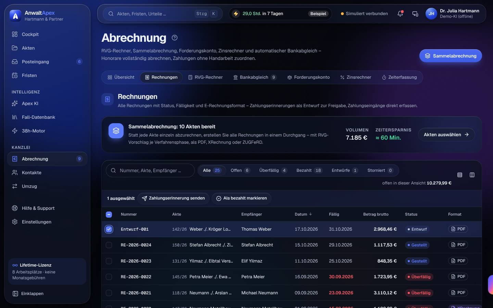
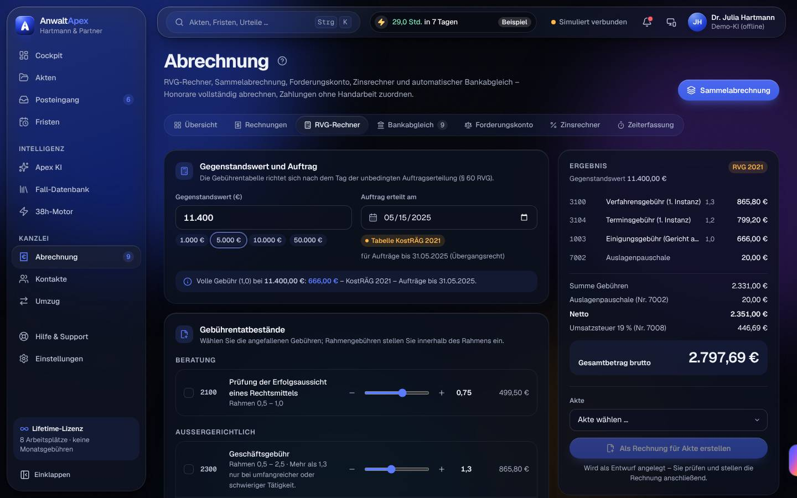
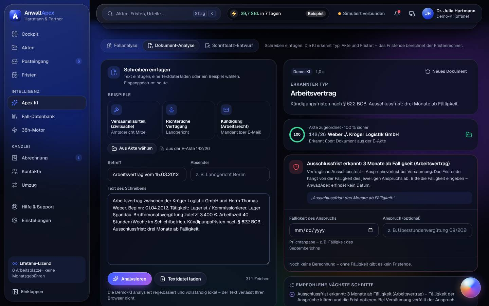

## Iteration 4 – Feedback Claudia Reinholz · Block C (Kanzlei, Geld & KI)

**Datum:** Sa, 17.10.2026, ca. 05:53–06:27 Uhr Ortszeit · **Betriebsmodus:** Browser-Demo („Demo-Modus: Ihre Änderungen bleiben in diesem Browser gespeichert“, Demo-KI offline) · **Browser:** Chromium (Playwright, `de-DE`, Europe/Berlin; Datumsfelder weiter im US-Format → Testumgebung, kein Befund) · **Testleitung:** Avatar-Werkzeug, frisches Profil `i4-C` · **Zugang:** Präsentationszugang Dr. Julia Hartmann (Anmeldung von Hand mit E-Mail und Passwort)

**Schwerpunkt Iteration 4:** alle Ansichten **dunkel**, **reduzierte Bewegung an**, axe-core je Ansicht. Viewports: T06 D (Nachtest zusätzlich M und Tq) · T07 D (Nachtest RVG zusätzlich M) · T08 L · T09 D (Gegenprobe hell) · T19 D. **T07 nur mit Tastatur** bis zu der Stelle, an der es nicht mehr ging (Rechnung öffnen), danach mit der Maus; Fokus bei jedem Schritt gemessen (sichtbar, nicht verdeckt).

> Eine einzige simulierte Person: SUS, UEQ-S und Noten sind **Trendwerte**.

> **Werkzeughinweise (kein Befund):** (1) Das Werkzeug lädt die Seite je Aufruf neu. Der RVG-Rechner merkt sich seine Eingaben im Browser – meine Leertasten aus zwei Aufrufen haben sich deshalb addiert; das ist richtiges Verhalten der Software. (2) Beim ersten Strg+K drückte das Werkzeug Escape, bevor die Akte fertig geladen war; danach landete das „f“ aus „pfandbon“ als Kürzel im Fristenrechner. In drei sauberen Wiederholungen (Dokument offen → Esc/Strg+K → tippen) trat das nicht auf. Ich werte es nicht als Befund.

### Nachtest Vorrunde (Befunde meiner Aufgaben)

| ID | Status | Beobachtung in Iteration 4 |
|---|---|---|
| I3-T06-01 | behoben | M dunkel: Die drei KI-Grundsätze stehen untereinander, „Demo-KI: keine Daten an einen KI-Anbieter“ im ersten Bildschirm (y = 401, 250 px breit); axe 0. |
| I3-T06-02 | behoben | Tq dunkel: Fallanalyse-Kopf einspaltig, „Gute Aussichten“ oben, Zusammenfassung über die volle Breite; beschriftete schmale Leiste; axe 0. |
| I3-T06-03 | behoben | Dokumentansicht in der E-Akte offen → Strg+K schließt sie und öffnet die Suche, „pf“ bzw. „pfandbon kündigung“ landet vollständig im Suchfeld (3 Wiederholungen). |
| I3-T03-03 (Teil I3-T06-04) | behoben | „Zitat kopiert“ liegt bei x 488–816 links neben dem Drawer, „An Akte heften“ bei x 1.240 bleibt frei. |
| I3-T06-05 | behoben | D: In Fallanalyse und Forderungskonto ist die Kugel an den rechten Rand eingeklappt („ausgewichen, damit sie nichts verdeckt“); in Dokument-Analyse und Zinsrechner liegt sie frei neben dem Text. |
| I3-T06-06 | behoben | Kopf der Fall-Datenbank: „33 Leitentscheidungen · Demo-Auszug · jüngste vom 16.02.2023 · + OLG, LG, AG, LAG und ArbG in der Produktivversion“. |
| I3-T19-01 | behoben | Deckungsanfrage 142/26: „Kündigungsschutzantrag 10.200,00 € … + Weiterbeschäftigungsantrag 3.400,00 € = 13.600,00 € [Berechnung prüfen]“ mit Hinweis „Gegenstandswert der Akte (10.200 €) ohne Weiterbeschäftigungsantrag“; Klageentwurf ebenfalls 13.600 €. |
| I3-T07-01 | behoben | Sammelabrechnung, Filter „Deckung erteilt“: „5 von 5 sichtbaren Akten ausgewählt“ → 146/26 ab → „4 von 5 sichtbaren“, „Summe der Auswahl (Deckung erteilt) 2.281,89 €“, Knopf „4 Entwürfe anlegen – Deckung erteilt“. Ausgeblendete Akten wurden nicht abgerechnet. |
| I3-T07-02 | behoben | M dunkel, RVG-Rechner gescrollt (y 1.200 / 1.500 / 2.700): Summenleiste deckend über der Tab-Leiste, axe 0 in allen drei Stellungen. |
| I3-T07-03 | behoben | „RE-2026-0025 stellen?“ nennt Folgen, fehlende Pflichtangaben (§ 14 Abs. 4 UStG, IBAN) und verlangt das Häkchen „Präsentationskanzlei – Platzhalter bleiben … gekennzeichnet“; Fokus auf „Abbrechen“. |
| I3-T07-04 | behoben | Zeiterfassung 125/26: „280 €/Std. – Satz von Dr. Julia Hartmann, keine Vergütungsvereinbarung (§ 3a RVG) · Vereinbarung erfassen“; nach dem Speichern „240 €/Std. lt. Vergütungsvereinbarung vom 01.10.2026“. |
| I3-T07-05 | behoben | Stempel „STORNIERT AM 17.10.2026“ steht neben dem Titelblock, „Gegenstandswert 12.900,00 €“ ist frei lesbar. |
| I3-T07-06 | behoben | „Schadennummer: S26-88412 (Schadenmeldung durch Ihren Versicherungsnehmer)“ in der Deckungsanfrage. |
| I3-T08-01 | behoben | Handzuordnung Albrecht → 150/26: „Buchungsart (Pflicht)“, „Zahlung der Mandantschaft auf Honorar/Vorschuss … · vorgeschlagen“, Fremdgeld nur als zweite Wahl. |
| I3-T08-02 | behoben | „RE-2026-0024 ist storniert (Storno RE-2026-0025) – Korrekturentwurf Entwurf-002 offen“ mit „Korrekturrechnung stellen und Zahlung zuordnen“ und „Entwurf öffnen“; erster Knopf stellt RE-2026-0026 (mit Rückfrage) und ordnet 1.117,53 € zu. |
| I3-T08-03 | behoben | L dunkel: erste offene Umsatzzeile bei y ≈ 525 im ersten Bildschirm, Erklärkarte einklappbar. |
| I3-T08-04 | behoben | „≈ 15 Min. gespart · Schätzung · Annahme: 3 Min. je zugeordnetem Umsatz“; Sammelabrechnung „Schätzung · Annahme: 6 Min. je Einzelrechnung“. |
| I3-T09-01 | behoben | Zinsabschnitte mit Spalte „Neuer Abschnitt wegen“ (Verzugsbeginn, Kostenbuchung, Basiszinssatz geändert, Zahlung, Teilzahlung); Summe 155,77 € unverändert. |
| I1-T07-07 | nicht prüfbar | Datumsfelder weiter `mm/dd/yyyy` – Testumgebung (Werkzeug), kein Produktbefund. |

**Ergebnis Nachtest:** 19 IDs geprüft · **18 behoben** · 0 teilweise · 0 nicht behoben · **1 nicht prüfbar** (I1-T07-07, Testumgebung).

### Aufgaben

| Aufgabe | Ergebnis | Erfolgskriterium (Messwert) | Prüfpunkte x/y | Aktionen/Soll | Fehlaktionen | fachlich korrekt | SEQ | O-Ton |
|---|---|---|---|---|---|---|---|---|
| T06 Fallanalyse, Fall-Datenbank, Suche (D; M, Tq Nachtest) | erledigt | **erfüllt: 3 von 3 = 100 %** der zitierten Entscheidungen öffnen sich mit Gericht, Datum, Az.: BAG, Urt. v. 10.06.2010 – 2 AZR 541/09 („Emmely“), BAG, Urt. v. 23.08.2018 – 2 AZR 133/18, BAG, Urt. v. 27.07.2017 – 2 AZR 681/16. Strg+K „pfandbon kündigung“: **3 Treffer · 7 ms** | 7/7 | 16 / – | 0 | ja (Daten der drei BAG-Urteile stimmen; Klagefrist 12.10. + 3 Wochen = Mo 02.11.2026; § 38 Abs. 1 S. 2 SGB III und Sperrzeit § 159 Abs. 1 S. 2 Nr. 7, Abs. 6 SGB III richtig; Abfindungsspanne 0,5–1,0 × 3.400 € × 14 = 23.800–47.600 €; Streitwert 4 × 3.400 € = 13.600 €) | 6 | „Drei Aktenzeichen, drei echte Urteile, jedes mit Datum. Dass das Gewicht ‚gering‘ nur von der Reihenfolge kommt, sage ich Ihnen aber gleich: Die Duldung durch den Schichtleiter ist mein bestes Argument.“ |
| T07 Abrechnung (D, nur Tastatur bis „Rechnung öffnen“) | erledigt mit Umweg | **erfüllt: 16 von 16 Werten exakt** (2025: 707,00 · 919,10 · 848,40 · 707,00 · 20,00 · 2.494,50 · 473,96 · **2.968,46 €**; 2021: 666,00 · 865,80 · 799,20 · 666,00 · 20,00 · 2.351,00 · 446,69 · **2.797,69 €**); Zeithonorar **360,00 € + 68,40 € = 428,40 €** | 7/7 (Tastatur-Probe: nicht bestanden) | ≈ 90 Tastendrücke für RVG 2025/2021 + Rechnung aus dem Rechner; danach Maus: Storno + Korrektur 5, Sammelabrechnung **4**, Zeithonorar 15 | 5 | ja (Tabellenwerte nachgerechnet; RSV-Split 2.968,46 − 150,00 = 2.818,46 €; Storno −1.117,53 € = 919,10 + 20,00 + 178,43; Sammelabrechnung 1.117,53 + 480,17 + 388,12 + 296,07 = 2.281,89 €; 1,5 × 240 = 360,00; 19 % = 68,40) | 4 | „Gerechnet wird auf den Cent, und der Rechner nennt § 60 RVG. Aber eine Rechnung, die ich mit der Tastatur nicht aufbekomme, kann ich auch nicht stornieren. Das ist kein Schönheitsfehler.“ |
| T08 Bankabgleich und Fremdgeld (L) | erledigt | **erfüllt:** 0 Buchungen unter 90 % ohne Bestätigung (2 × 88 % und der Fremdgeld-Vorschlag warteten); **5 von 5** automatischen Buchungen zeigen Grund (93 %, 93 %, 99 % Rechnungszahlung; 2 × 97 % Kanzleikosten) mit Merkmal, „38h-Motor (automatisch)“ und Zeit | 4/4 | 19 / – | 0 (falsche IBAN absichtlich) | ja (Zuordnungen richtig; 5.670,00 € und 6.120,00 € Fremdgeld; aber Kontobezeichnung ungenau → I4-T08-01) | 6 | „Honorar ist Honorar, Fremdgeld ist Fremdgeld – das fragt er jetzt. Nur liegt das Geld der Versicherung auf unserem Geschäftskonto, nicht auf dem Anderkonto. Das muss die Software auseinanderhalten.“ |
| T09 Forderungskonto und Zinsen (D; Gegenprobe hell) | erledigt | **erfüllt: 0,00 € Abweichung** in allen 6 Zinsabschnitten (Summe 155,77 €), Satzwechsel 6,27 % → **6,52 %** zum 01.07.2026 als eigener Abschnitt; Zinsrechner **A 43,23 € · B 26,79 € · C 21,10 € + 21,62 € = 42,72 €** | 5/5 | 7 / – | 0 | **ja** (Handrechnung unten) | 7 | „Sechs Abschnitte, sechs Mal auf den Cent. Und die Halbjahresgrenze sieht man in der Tabelle. Lesen kann ich die blaue Zinssatz-Plakette abends allerdings schlecht.“ |
| T19 Dokument-Analyse und Schriftsatz-Entwurf (D) | erledigt | **erfüllt:** Ausschlussfrist erkannt, **Fälligkeit wird erfragt** („AnwaltApex erfindet kein Datum“); mit Fälligkeit 30.09.2026 → **Mi 30.12.2026** vom Fristenrechner, Vorfrist Mi 16.12.2026, Angebot als Frist mit Vier-Augen-Kontrolle oder Wiedervorlage. **„Vorschlag verwerfen“ ändert 0 Daten** (Akte 142/26 vorher und nachher: Dokumente 7, Fristen 2) | 5/5 (7 Einzelwerte) | 13 / – | 0 | ja (Fälligkeit 30.09. + 3 Monate, §§ 187 Abs. 1, 188 Abs. 2 BGB = Mi 30.12.2026; „in 74 Tagen“ ab 17.10.; Mandant, Gegner, RS-4471209: 3 von 3) | 6 | „Das ist der Satz, den ich hören will: ‚erfindet kein Datum‘. Und Nein heißt Nein – nichts gespeichert, ich habe nachgezählt.“ |

**Prüfpunkte im Einzelnen**

- **T06:**
  - ≥ 3 benannte Faktoren mit Quelle – **ja** (8 Faktoren: 5 dafür, 3 dagegen, jeder mit Quelle: BAG-Urteil, Kündigungsschreiben, Gesprächsnotiz, § 626 Abs. 1 BGB; ein Faktor ehrlich „ohne Beleg – anwaltlich prüfen“).
  - Meine zwei Sätze: „Nach ‚Emmely‘ wiegt das Vertrauen aus 14 Jahren ohne Abmahnung schwerer als 8,97 € Bruchware, zumal der Schichtleiter die Mitnahme geduldet hat. Risiken sind eine klare Betriebsanweisung und mögliche Videoaufnahmen; formell ist die Betriebsratsanhörung zu prüfen.“
  - Entwurf als Entwurf in der E-Akte, nicht versendet – **ja** („Kündigungsschutzklage (Entwurf)“, Schriftsätze, Version 1, „Mandantenportal: Entwurf – erst nach Freigabe“, „Von der KI-Fallanalyse erstellter Entwurf – bitte prüfen“).
  - KI-Kennzeichnung und Datenhinweis sichtbar – **ja** („Demo-KI“, „78 % – KI-Schätzwert, keine Wahrscheinlichkeit“, „Demo-KI: keine Daten an einen KI-Anbieter“).
  - Strg+K mit Treffern aus Akten, Dokumenten (Volltext) und Fall-Datenbank – **ja**; Antwortzeit **7 ms**; „Lokaler Index – Mandantendaten verlassen das Gerät nicht“.
  - Zitat in Zitierform kopieren – **ja** („BAG, Urt. v. 10.06.2010 – 2 AZR 541/09“, Meldung bestätigt den Text).
  - Abdeckung genannt – **ja**; LAG und ArbG ehrlich als nicht enthalten benannt – **ja**. Inhaltlich dünn: Stichwort „Bagatellkündigung“ liefert **1** Entscheidung, die KI-Recherche ergänzt zwei BAG-Urteile zur Beweisverwertung mit 68 % „nur“ wegen des Wortes „Kündigung“ (I4-T06-03).
- **T07:**
  - Fassung angezeigt und nach Auftragsdatum begründet – **ja** („Die Gebührentabelle richtet sich nach dem Tag der unbedingten Auftragserteilung (§ 60 RVG)“, „Tabelle KostBRÄG 2025 – für Aufträge ab 01.06.2025“ bzw. „KostRÄG 2021 – für Aufträge bis 31.05.2025 (Übergangsrecht)“).
  - Selbstbeteiligung getrennt – **ja**, auf der Rechnung selbst: „Nordlicht Rechtsschutz AG … 2.818,46 €; Ihre Selbstbeteiligung: 150,00 €“, „Vergütungsschuldner bleiben Sie“, Vorsteuerhinweis, Zahlungsziel für die 150,00 €. Der RVG-Rechner zeigt die SB nicht – sie erscheint erst im Rechnungsentwurf der Akte.
  - Storno erzeugt Stornorechnung und löscht nichts – **ja** (RE-2026-0025 über −1.117,53 €, RE-2026-0024 bleibt mit Nummer und Stempel, Rückfrage vorab; „Korrekturentwurf anlegen“ → Entwurf-002).
  - Sammelabrechnung 4 Akten in einem Durchgang mit Vorschau in ≤ 8 Aktionen – **ja, 4 Aktionen** (Sammelabrechnung · Filter „Deckung erteilt“ · 146/26 abwählen · „4 Entwürfe anlegen“), Vorschau je Akte mit RSV-Anteil und SB, 151/26 als „Vorschuss § 9 … Terminsgebühr erst nach dem Termin“.
  - Zeithonorar 360,00 / 68,40 / 428,40 € mit vereinbartem Satz statt 280 € – **ja** („Aus Zeiten abrechnen“: Einträge einzeln wählbar, „Vergütungsvereinbarung · § 3a RVG, Textform vom 01.10.2026 · 240,00 €/Std. netto“).
  - E-Rechnung als XRechnung oder ZUGFeRD wählbar, Hinweis 01.01.2027 / 800.000 € / 01.01.2028 – **ja** (Entwurf-007 automatisch XRechnung, weil Empfänger GmbH).
  - Petras Blick – **ja mit der Maus, nein nur mit Tastatur**: Rechner, Sammelabrechnung, Storno und „Aus Zeiten abrechnen“ erklären sich selbst; Frau Schulte arbeitet aber viel mit der Tastatur, und dann kommt sie an keine Rechnung heran (I4-T07-01).
  - **Tastaturprobe (Schwerpunkt I4):** Fokus in 120 gemessenen Schritten **immer sichtbar und nie verdeckt**. Aber: Rechnungen nicht per Tastatur zu öffnen (I4-T07-01), lange Wege und Fokusverlust im RVG-Rechner (I4-T07-02), Doppel-Tabstopps an Schaltern (I4-T07-03).
- **T08:** Rücknahme jeder automatischen Buchung – **ja** („Zuordnung lösen“ mit Rückfrage und Folge: „ein gebuchter Fremdgeld-Eingang wird storniert … protokolliert“, Fokus auf „Abbrechen“) · Korrektur einer unsicheren Zuordnung in ≤ 4 Aktionen – **ja, 3** (Ablehnen → „Wird bei künftigen Abgleichen nicht erneut vorgeschlagen“ · RE-2026-0017 wählen · Zuordnen) · Fremdgeld getrennt mit Hinweis auf unverzügliche Weiterleitung – **ja** (§ 43a Abs. 7 BRAO und § 4 BORA im Dialog; Liegezeit als Text „eingegangen vor 4 Tagen“ rot, „gestern“ gelb; „AnwaltApex leitet nie selbstständig weiter“; IBAN mit Prüfziffer, falsche IBAN abgewiesen) · Petras Blick – **ja** (Buchungsart als Klartext-Auswahl mit Vorschlag nach Zahler; einzig die Kontobezeichnung „Anderkonto“ würde sie verunsichern).
- **T09 – Handrechnung (Betrag × Satz × Tage / 365):** 4.860,00 × 6,27 % × 62 = 51,76 € · × 12 = 10,02 € · 4.860,00 × 6,52 % × 46 = 39,93 € · × 17 = 14,76 € · × 30 = 26,04 € · 4.639,51 × 6,52 % × 16 = 13,26 € → **155,77 €**, 183 Tage, **0,00 € Abweichung**. § 367 BGB: 1.000,00 € → Kosten 637,00 € (85,25 + 374,50 + 177,25), Zinsen 142,51 € (Summe der ersten fünf Abschnitte), Hauptforderung 220,49 € → 4.639,51 €.
  - Tageszählung angezeigt – **ja** („Taggenau (act/365)“, Beginn und Ende „jeweils einschließlich“).
  - § 288 Abs. 1 oder Abs. 2 erkennbar – **ja** („§ 288 Abs. 1 BGB: 5 Prozentpunkte“, Begründung zu Abs. 2, Vergleichswert „ohne Verbraucherbeteiligung 253,26 €“).
  - § 367 BGB – **ja** (Verrechnungsbalken und Verlaufstabelle).
  - 40-€-Pauschale nur, wo zulässig – **ja** (gegenüber dem Verbraucher Lenz nicht angesetzt; einen B2B-Fall mit Pauschale gab es in den Demodaten nicht).
  - Vorschau der Forderungsaufstellung – **ja** (jeder Zinsabschnitt als eigene Zeile mit Satz, Kapital und Tagen, Titel und Gerichtsaktenzeichen).
- **T19:** KI gekennzeichnet und Demo-KI erkennbar – **ja / ja** („Demo-KI“, „Demo-Vorlage“, „Berechnet vom Fristenrechner – nicht von der KI“) · nicht auffindbare Zitate – **0** · Entwurf mit Version gespeichert, nichts versandt – **ja** (Rückfrage „Als Version 2 von ‚Deckungsanfrage Nordlicht Rechtsschutz AG‘ speichern? … es entsteht keine zweite Datei“; in der E-Akte „Entwurf · Version 2“, „3 Platzhalter offen – vor Freigabe und Versand ausfüllen“) · Mandant (Thomas Weber), Gegner (Kröger Logistik GmbH), Versicherungsnummer RS-4471209 – **3 von 3** · Datenhinweis – **ja** („Die Demo-KI analysiert regelbasiert und vollständig lokal – der Text verlässt Ihren Browser nicht“).

### Befunde

| ID | S | Ort (Ansicht · Viewport · Modus) | Beobachtung → Erwartung → Vorschlag | Beleg |
|---|---|---|---|---|
| **I4-T07-01** | **H** | Abrechnung → Rechnungen · D · dunkel · nur Tastatur | **Beobachtung:** Eine Rechnung lässt sich mit der Tastatur nicht öffnen. Die Zeile ist nur per Maus klickbar (`tr.cursor-pointer` ohne `tabindex`/Rolle). Einziger Tabstopp je Zeile ist das 18×18-px-Häkchen mit dem Namen „Auswählen“ – ohne Rechnungsnummer. Enter öffnet nichts. Pfeil rechts schiebt die Tabelle seitlich (x 309 → 281). Leertaste wählt aus; die Leiste bietet dann nur „Zahlungserinnerung senden“ und „Als bezahlt markieren“. Strg+K findet „RE-2026-0024“ und „Entwurf-001“ nicht (0 Treffer). Damit sind Stellen, Storno und Korrektur nur mit der Maus erreichbar (WCAG 2.1.1). **Erwartung:** Jede Rechnung per Tab + Enter öffnen. **Vorschlag:** Rechnungsnummer als Knopf bzw. Link in der Zeile, Häkchen-Name „RE-2026-0024 auswählen“, Rechnungs- und Entwurfsnummern in den Strg+K-Index. | [Bild](bilder/block-C-T07-rechnungsliste-nur-haekchen-tastatur-D-dunkel.jpg) |
| **I4-T09-01** | **H** | Abrechnung → Forderungskonto, Karte „Zinssatz“ · D · dunkel | **Beobachtung:** axe **serious** `color-contrast` an der Plakette „Zinssatz p. a. 6,52 %“ (`.bg-ink.text-white > .font-semibold.num`): Weiß auf rgb(92, 123, 255), nachgerechnet ≈ 3,7 : 1. Nötig sind 4,5 : 1. Gegenprobe hell: rgb(36, 64, 216), axe 0 – betroffen ist nur der Dunkelmodus. **Erwartung:** Kontrast ≥ 4,5 : 1. **Vorschlag:** Token `bg-ink` im Dunkelmodus dunkler setzen oder dunkle Schrift. Primärknöpfe mit gleicher Farbe mitprüfen; axe kann sie wegen Verlauf und Schatten nicht messen. | [Bild](bilder/block-C-T09-kontrast-zinssatz-plakette-D-dunkel.jpg) |
| I4-T08-01 | M | Bankabgleich → „Als Fremdgeld buchen“, Fremdgeld-Wächter, „Fremdgeld weiterleiten“ · L · dunkel | **Beobachtung:** Der Umsatz der Hanseatischen Kraftfahrt-Versicherung (5.670,00 €) steht in derselben Kontoliste wie Büromiete und Telekom, also auf dem Geschäftskonto. Die Meldung lautet trotzdem „5.670,00 € **auf dem Anderkonto** · 107/26“. Der Weiterleitungsdialog erzeugt „pain.001 – Freigabe im Online-Banking **des Anderkontos**“. Fachlich gilt: Fremdgeld auf dem Geschäftskonto ist unverzüglich weiterzuleiten oder auf ein Anderkonto einzuzahlen (§ 43a Abs. 7 BRAO, § 4 BORA, (F)). **Erwartung:** Die Software nennt das Konto, auf dem das Geld wirklich liegt. **Vorschlag:** Je Kontoauszug das Konto führen (Geschäfts- oder Anderkonto). Meldung „auf dem Geschäftskonto eingegangen – weiterleiten oder auf das Anderkonto umbuchen“; SEPA-Datei vom Quellkonto. | – |
| I4-T07-02 | M | RVG-Rechner · D · dunkel · nur Tastatur | **Beobachtung:** (1) Nach Strg+K → „RVG-Gebühren berechnen“ liegt der Fokus auf `body`; bis zum Gegenstandswert braucht es 12 Tastendrücke. (2) Vom Auftragsdatum bis zur Aktenwahl sind es 29 Tabstopps, von Seitenanfang 46. (3) Nach der Aktenwahl erscheint „Werte der Akte übernehmen (10.200 €, Auftrag …)“. Mein Enter traf diesen Knopf, er verschwand, und der Fokus fiel auf `body` (WCAG 2.4.3). (4) Die Kugel hat zwei Tabstopps; nach jedem Neuladen ist die Shift+Tab-Folge anders. Ein Enter öffnete so den Assistenten. **Erwartung:** Nach dem Sprung steht der Fokus im ersten Feld; nach „Werte übernehmen“ landet er auf „Als Rechnung für Akte erstellen“. **Vorschlag:** Fokus setzen und eine Sprungmarke „Zum Ergebnis“ anbieten; Kugel mit einem Tabstopp. | – |
| I4-T06-01 | M | Apex KI → Fallanalyse → „Kündigungsschutzklage (Entwurf)“; Abrechnung → Rechnungsentwurf/Rechnung · D · dunkel | **Beobachtung:** Entwurf und Rechnungsvorschau sind im Dunkelmodus grellweiße Blätter über die halbe Bildschirmbreite. In der E-Akte ist dasselbe Schriftstück mit „Seite abdunkeln“ (Standard an) angenehm grau – also uneinheitlich. **Erwartung:** Abends im Dunkelmodus blendet keine Seite. **Vorschlag:** „Seite abdunkeln“ aus der Dokumentvorschau auch in Fallanalyse, Schriftsatz-Entwurf und Rechnungsvorschau, im Dunkelmodus standardmäßig an. | – |
| I4-T19-01 | M | Apex KI → Schriftsatz-Entwurf · D · dunkel · reduzierte Bewegung an | **Beobachtung:** Der Entwurf erscheint als Schreibmaschinen-Animation („schreibt …“, nach 4 s noch unvollständig). Das passiert, obwohl `prefers-reduced-motion: reduce` aktiv ist (geprüft: `matchMedia` = true). „Sofort anzeigen“ hilft, ist aber ein Klick mehr. Gleiches Muster wie I4-T12-01 (Block A, Wiki). **Erwartung:** Bei reduzierter Bewegung steht der Text sofort vollständig da. **Vorschlag:** Animation an `prefers-reduced-motion` und an die Einstellung „Darstellung“ koppeln. | – |
| I4-T06-02 | N | Apex KI → Fallanalyse → „Wie entsteht die Einschätzung?“ · D · dunkel | **Beobachtung:** Das „Gewicht“ (stark/mittel/gering) folgt laut Fußnote nur der Reihenfolge der KI-Begründung. Die Duldung durch den Schichtleiter steht damit als „gering“ da, ist aber fachlich das tragende Argument. **Erwartung:** Ein Gewicht muss einen Grund haben – sonst weglassen. **Vorschlag:** Spalte „Rang 1/2/3“ statt „stark/gering“ oder Gewicht ganz weglassen. | – |
| I4-T06-03 | N | Fall-Datenbank → Stichwortsuche / KI-Recherche · D · dunkel | **Beobachtung:** „Bagatellkündigung“ liefert 1 Treffer (Emmely). Die KI-Recherche („Fristlose Kündigung wegen Mitnahme geringwertiger Sachen …“) setzt Keylogger- und Video-Urteil mit **68 %** dazu, Begründung: „Übereinstimmung beim Merkmal ‚kündigung‘“. Ehrlich begründet, aber der Prozentwert wirkt nach Relevanz. **Erwartung:** Schwache Treffer als solche erkennbar. **Vorschlag:** Unter einer Schwelle „schwacher Treffer – nur Stichwort“ statt Prozentbalken. | – |
| I4-T07-03 | N | RVG-Rechner, Schalter „Anrechnung“, „Auslagenpauschale 7002“, „Umsatzsteuer 7008“ · D · dunkel · Tastatur | **Beobachtung:** Jeder Schalter hat zwei Tabstopps: den Knopf und ein namenloses `SPAN` (26×26 px). Für drei Schalter sind das sechs Tastendrücke, der Screenreader liest beim zweiten Stopp nichts. **Erwartung:** Ein Schalter, ein Tabstopp. **Vorschlag:** `tabindex` am Daumen-Element des Switch entfernen. | – |
| I4-T07-04 | N | Rechnungen → Auswahl eines Entwurfs · D · dunkel | **Beobachtung:** „Zahlungserinnerung senden“ und „Als bezahlt markieren“ sind auch bei einem ausgewählten **Entwurf** aktiv. Erst der Klick meldet „Keine offenen Rechnungen ausgewählt – Erinnerungen gibt es nur für gestellte oder teilbezahlte Rechnungen“; es passiert nichts. **Erwartung:** Nicht mögliche Aktionen sind vorher als gesperrt erkennbar. **Vorschlag:** Knöpfe sperren und den Grund daneben anzeigen. | – |
| I4-T07-05 | N | Zeiterfassung, Wochenliste vs. „Aus Zeiten abrechnen“ · D · dunkel | **Beobachtung:** Nach Erfassen der Vergütungsvereinbarung (01.10.2026, 240 €) zeigt die Wochenliste für 125/26 „Aktenstudium 0:36 Std. **168 €**“ (280 €). Die Abrechnungskarte nennt für denselben Eintrag **144,00 €** (240 €); der Wochenwert 1.912 € rechnet mit den alten Sätzen. **Erwartung:** Ein Eintrag hat einen Wert. **Vorschlag:** Werte nach Satzänderung neu berechnen oder „Satz geändert – abgerechnet wird mit 240 €“ anzeigen. | – |
| I4-T08-02 | N | Bankabgleich, Statuszeile · L · dunkel | **Beobachtung:** Nach normalem Seitenwechsel steht „Letzter Abgleich 17.10.2026, 06:15 Uhr: … **Die Anzeige wurde unterbrochen** – Buchungen und Vorschläge sind trotzdem vollständig gespeichert.“ Das liest sich wie ein Fehler. **Erwartung:** Neutraler Text, solange nichts schiefging. **Vorschlag:** „unterbrochen“ nur bei echtem Abbruch zeigen. | – |
| I4-T08-03 | N | Abrechnung → Übersicht · L · dunkel | **Beobachtung:** „1 Rechnungen offen“, „1 Kontoumsätze offen“, „1 Rechnungen überfällig“. **Erwartung:** Richtiger Singular. **Vorschlag:** Zahlwort-Hilfsfunktion (Singular/Plural) in `Uebersicht.tsx` Z. 236, 244, 265. | – |
| I4-T08-04 | N | „Fremdgeld weiterleiten“ · L · dunkel | **Beobachtung:** Bei falscher IBAN erscheint die Meldung, der Fokus bleibt aber auf „Buchen und SEPA-Datei erzeugen“. Mit Tastatur oder Screenreader merkt man den Fehler nicht sofort. **Erwartung:** Fokus springt ins fehlerhafte Feld. **Vorschlag:** Fokus auf das erste ungültige Feld setzen, `aria-invalid` und `aria-describedby` setzen. | – |
| I4-T09-02 | N | Zinsrechner, RVG-Rechner · D · dunkel | **Beobachtung:** Der Zinsrechner öffnet mit 5.000 €, 01.07.–30.07.2026, 9 PP – exakt meinem Prüfwert A. Der RVG-Rechner öffnet mit 10.000 € und Geschäftsgebühr. Nirgends steht „Beispiel“. **Erwartung:** Vorbelegte Werte sind als Beispiel erkennbar. **Vorschlag:** Hinweis „Beispielwerte – bitte überschreiben“ oder leere Felder mit Platzhalter. | – |
| I4-T06-04 | N | Fallanalyse → „Im Ordner ‚Schriftsätze‘ öffnen“ · D · dunkel | **Beobachtung:** Der Link öffnet das Dokument, links ist aber „Alle Dokumente“ markiert, nicht „Schriftsätze“. **Erwartung:** Der Ordner aus dem Linktext ist gewählt. **Vorschlag:** Ordnerfilter mitgeben. | – |

**Zuordnung zu Dateien (grep, nach dem Test):** I4-T07-01 → `src/components/ui/DataTable.tsx`, `src/pages/abrechnung/Abrechnung.tsx`, `src/components/shell/CommandPalette.tsx` · I4-T09-01 → `src/pages/abrechnung/Forderungskonto.tsx`, `src/styles/index.css` · I4-T08-01 → `src/pages/abrechnung/Bankabgleich.tsx` (Z. 358), `src/pages/abrechnung/abgleich.ts` (Z. 245), `src/pages/abrechnung/WeiterleitungsDialog.tsx` · I4-T07-02 → `src/pages/abrechnung/RvgRechner.tsx`, `CommandPalette.tsx` · I4-T06-01 → `src/components/ki/FallanalysePanel.tsx`, `src/pages/ki/SchriftsatzTab.tsx`, `src/pages/abrechnung/RechnungVorschau.tsx` (Vorbild `src/pages/akten/DokumentVorschau.tsx`) · I4-T19-01 → `src/pages/ki/SchriftsatzTab.tsx` · I4-T06-02 → `FallanalysePanel.tsx`, `src/core/einschaetzung.ts` · I4-T06-03 → `src/pages/falldb/recherche.ts`, `KiRecherche.tsx` · I4-T07-03 → `src/components/ui/Switch.tsx` · I4-T07-05 → `src/pages/abrechnung/Zeiterfassung.tsx` · I4-T08-02 → `Bankabgleich.tsx` · I4-T08-03 → `src/pages/abrechnung/Uebersicht.tsx` · I4-T08-04 → `WeiterleitungsDialog.tsx` · I4-T09-02 → `src/pages/abrechnung/Zinsrechner.tsx`, `RvgRechner.tsx`.

### axe-core (WCAG 2.2 A/AA, serious/critical)

| Ansicht · Viewport · Modus | serious | critical |
|---|---|---|
| Apex KI Start · D · dunkel | 0 | 0 |
| Fallanalyse 142/26 Ergebnis · D · dunkel | 0 | 0 |
| Entscheidungs-Drawer „Emmely“ · D · dunkel | 0 | 0 |
| Strg+K „pfandbon kündigung“ · D · dunkel | 0 | 0 |
| Fall-Datenbank · D · dunkel | 0 | 0 |
| Apex KI · M · dunkel | 0 | 0 |
| Fallanalyse · Tq · dunkel | 0 | 0 |
| RVG-Rechner · D · dunkel | 0 | 0 |
| RVG-Rechner gescrollt (3 Stellungen) · M · dunkel | 0 | 0 |
| Rechnungen + Entwurf-001 · D · dunkel | 0 | 0 |
| Rückfrage „RE-2026-0025 stellen?“ · D · dunkel | 0 | 0 |
| Sammelabrechnung (2 Zustände) · D · dunkel | 0 | 0 |
| Entwurf-007 (XRechnung) · D · dunkel | 0 | 0 |
| Bankabgleich · L · dunkel | 0 | 0 |
| Übersicht / Fremdgeld-Wächter · L · dunkel | 0 | 0 |
| Dialog „Fremdgeld weiterleiten“ · L · dunkel | 0 | 0 |
| **Forderungskonto · D · dunkel** | **1** (color-contrast, I4-T09-01) | 0 |
| Forderungskonto · D · hell (Gegenprobe) | 0 | 0 |
| Forderungsaufstellung (Vorschau) · D · dunkel | 0 | 0 |
| Zinsrechner · D · dunkel | 0 | 0 |
| Dokument-Analyse (leer + Ergebnis) · D · dunkel | 0 | 0 |
| Schriftsatz-Entwurf · D · dunkel | 0 | 0 |

**Summe:** 22 Ansichten bzw. Zustände · **serious 1 · critical 0**.

### Fragebögen

**SUS** (Gesamtsystem nach meinem Block, 1–5): 4 · 2 · 4 · 2 · 5 · 2 · 4 · 2 · 4 · 2 = **77,5 Punkte** (Trendwert; Block C in Iteration 3: 72,5)

**UEQ-S** (−3 … +3): unterstützend +2 · einfach +1 · effizient +1 · übersichtlich +2 → **pragmatisch +1,5** · spannend +1 · interessant +2 · originell +1 · neuartig +1 → **hedonisch +1,25**

**Noten** (1 = sehr gut … 6 = ungenügend):

| Dimension | Note | Begründung |
|---|---|---|
| Look & Feel | 2 | Ruhig und seriös; im Dunkelmodus stören die grellweißen Blätter in Fallanalyse und Rechnung. |
| Lesbarkeit | 2,5 | Gleich breite Ziffern, klare Tabellen; aber die Zinssatz-Plakette ist zu kontrastarm, und die weißen Vorschauen blenden abends. |
| Verständlichkeit | 2 | Rückfragen sagen, was passiert („es entsteht keine zweite Datei“, „Nichts gespeichert“); kleine Ausrutscher („1 Rechnungen“, „Anzeige unterbrochen“). |
| Vertrauen und Seriosität | 2 | Rechenwege, „erfindet kein Datum“, „leitet nie selbstständig weiter“ – sehr gut. Abzug für die Anderkonto-Formulierung. |
| Tempo | 2,5 | Mit der Maus zügig (Sammelabrechnung 4 Aktionen, Korrektur 3); mit der Tastatur zu lange Wege, Rechnungen gar nicht erreichbar. |
| Fachliche Korrektheit | 1,5 | 16/16 RVG, 360,00 €, 0,00 € Zinsabweichung, A–C exakt, 30.12.2026 richtig – nur die Kontobezeichnung beim Fremdgeld stimmt nicht. |
| Mobil | 2 | Nur Stichproben (Apex KI, RVG-Rechner am iPhone; Fallanalyse am iPad): sauber, axe 0. |

**Empfehlung (0–10):** 8 · **Kauf heute:** unter Bedingungen – Rechnungen per Tastatur bedienbar, Kontrast im Dunkelmodus, Fremdgeld-Konten sauber benannt; dazu wie bisher Angebot mit Preis und Wartung, KI-Verarbeitung in der EU, Escrow und Übertragbarkeit (Auftraggeber).

**Top 3 Verbesserungen (nach Dringlichkeit):**

1. **Rechnungen per Tastatur öffnen** (Nummer als Knopf, Häkchen mit Rechnungsnummer, Rechnungsnummern in Strg+K) – I4-T07-01.
2. **Dunkelmodus nachziehen:** Kontrast der Zinssatz-Plakette ≥ 4,5 : 1 (I4-T09-01) und „Seite abdunkeln“ auch für KI-Entwurf und Rechnungsvorschau (I4-T06-01); Schreibmaschinen-Effekt bei reduzierter Bewegung abschalten (I4-T19-01).
3. **Fremdgeld kontogenau buchen:** Geschäfts- und Anderkonto unterscheiden, Meldung und SEPA-Datei vom tatsächlichen Konto (I4-T08-01).

### Was gut war

- **Fachkern wieder exakt:** RVG 16/16, Zeithonorar 360,00 €, Zinsen 0,00 € Abweichung über sechs Abschnitte, A–C auf den Cent, Ausschlussfrist Mi 30.12.2026 – alles mit sichtbarem Rechenweg.
- **KI mit Grenzen:** Ausschlussfrist erkannt, Fälligkeit erfragt, „AnwaltApex erfindet kein Datum“; Verwerfen ändert nachweislich nichts; Version 2 statt zweiter Datei.
- **Keine erfundene Fundstelle:** 3 von 3 Entscheidungen echt, mit Datum, Zitierform per Klick; die Abdeckung der Fall-Datenbank steht ehrlich oben.
- **Bankabgleich mit Verstand:** Buchungsart ist Pflicht, Honorar wird nicht mehr Fremdgeld; Storno-Hinweis mit Korrekturrechnung in einem Zug; jede Buchung mit Grund, Urheber und „Zuordnung lösen“.
- **RSV-Abrechnung wie aus dem Lehrbuch:** Versichereranteil, Selbstbeteiligung mit Zahlungsziel, „Vergütungsschuldner bleiben Sie“, Vorsteuerhinweis; Sammelabrechnung respektiert den Filter.
- **Fokus bei Tastaturbedienung** in allen gemessenen 120 Schritten sichtbar und nie verdeckt.

### Bilder

| Bild | Was es zeigt |
|---|---|
|  | **I4-T07-01 (H)** – Fokus auf dem Häkchen von Entwurf-001; „1 ausgewählt“ bietet nur Erinnerung und „bezahlt“, kein Öffnen (D dunkel). |
|  | **I4-T09-01 (H)** – Forderungskonto 126/26; unten rechts die Plakette „Zinssatz p. a. 6,52 %“ (Weiß auf Blau, ≈ 3,7 : 1) (D dunkel). |
|  | **positiv** – RVG-Rechner per Tastatur: 11.400 €, Auftrag 15.05.2025 → „Tabelle KostRÄG 2021“, 2.797,69 € auf den Cent (D dunkel). |
|  | **positiv** – Dokument-Analyse Arbeitsvertrag 142/26: „Bitte die Fälligkeit eingeben – AnwaltApex erfindet kein Datum“ (D dunkel). |
