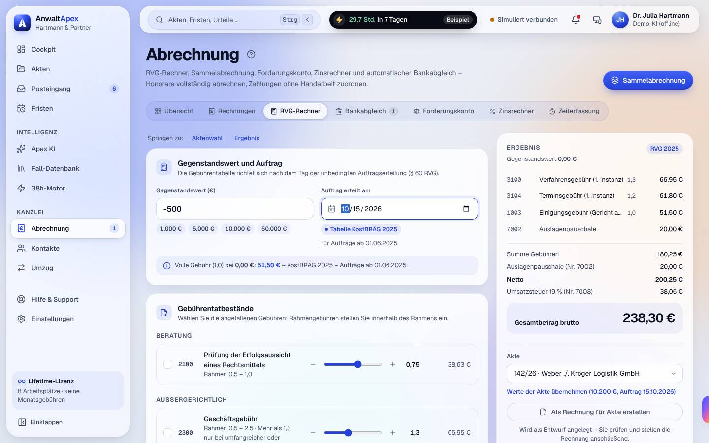
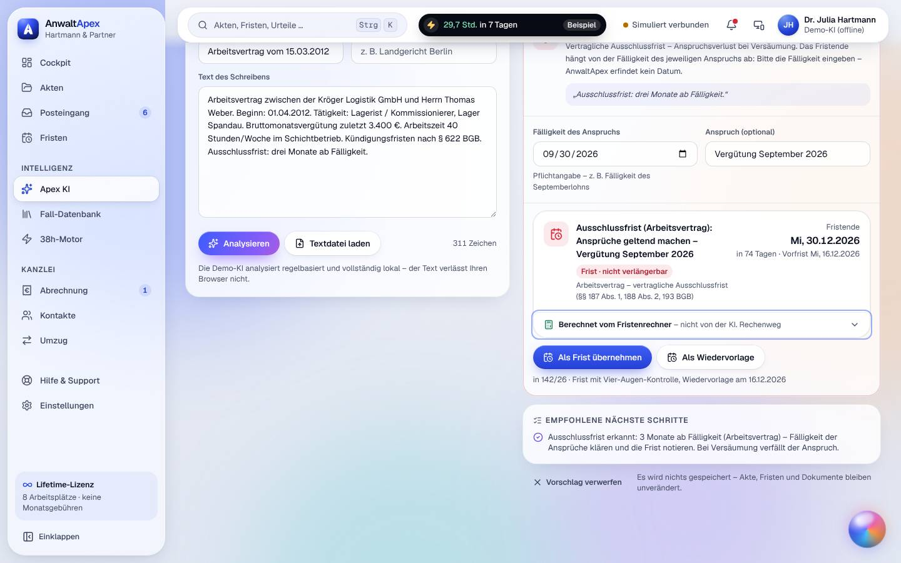
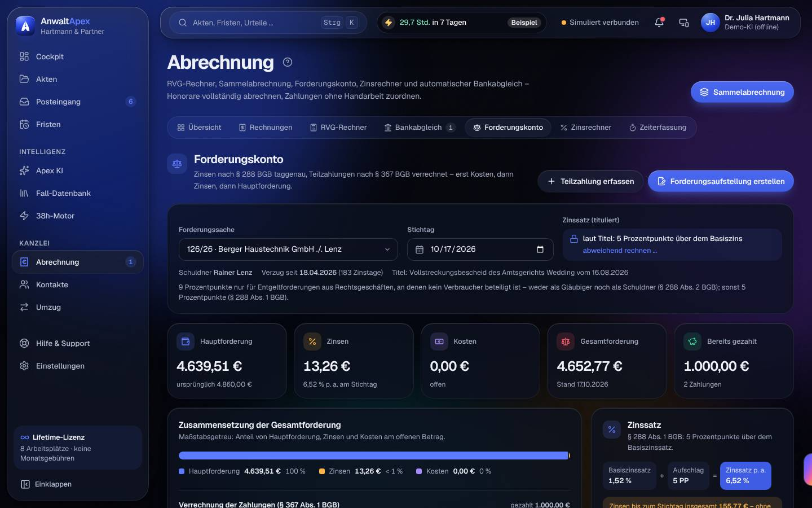
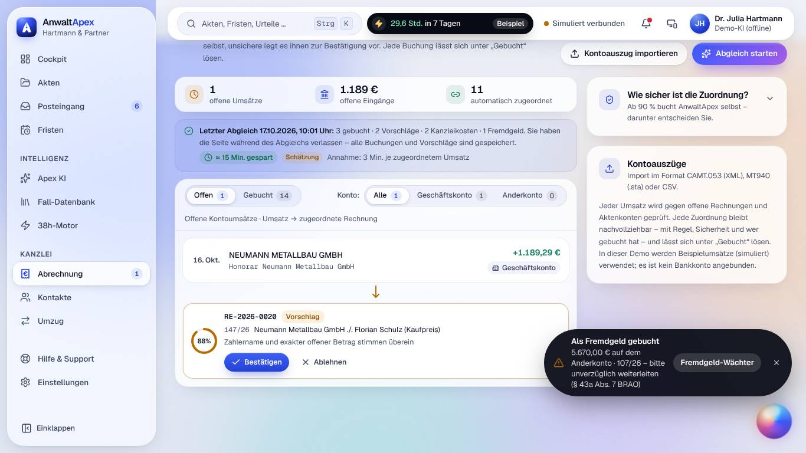

## Iteration 5 – Feedback Claudia Reinholz · Block C (Kanzlei, Geld & KI)

**Datum:** Sa, 17.10.2026, ca. 09:48–10:13 Uhr Ortszeit (Systemuhr 07:48–08:13 UTC) · **Betriebsmodus:** Browser-Demo („Demo-Modus: Ihre Änderungen bleiben in diesem Browser gespeichert“, Demo-KI offline) · **Browser:** Chromium (Playwright, `de-DE`, Europe/Berlin; Datumsfelder im US-Format → Testumgebung, kein Befund) · **Testleitung:** Avatar-Werkzeug, frisches Profil `i5-C`, Präsentationszugang Dr. Julia Hartmann

**Schwerpunkt Iteration 5:** Abnahme und Kaufentscheidung. Viewports wie je Aufgabe vorgegeben, **hell**: T06 D · T07 D · T08 L · T09 D · T19 D. Für den Nachtest zusätzlich: Forderungskonto, Rechnungsvorschau und Fallanalyse-Entwurf **dunkel** (D), Schriftsatz-Entwurf mit **„Bewegung reduzieren“**, Rechnungsliste und RVG-Rechner **per Tastatur**. Fehlerprobe (Regel 10): negativer Gegenstandswert, falsche IBAN. axe-core je Ansicht.

---

### Nachtest Vorrunde (Befunde meiner Aufgaben)

| ID | S | Status | Was ich gesehen habe |
|---|---|---|---|
| I4-T07-01 | H | **behoben** | Rechnungsliste D hell: Jede Zeile hat zwei benannte Tab-Stopps – „Entwurf-007 auswählen“ und „Entwurf Entwurf-007 öffnen“ bzw. „Rechnung RE-2026-0024 öffnen“. Strg+K „Entwurf-001“ → Enter öffnet den Entwurf. Storno per Tastatur: „Stornieren“ → Rückfrage mit Fokus auf „Abbrechen“ → Tab, Enter → Stornorechnung RE-2026-0025. |
| I4-T09-01 | H | **behoben** | Forderungskonto D **dunkel**: axe 0 in zwei Scrolllagen. Plakette „Zinssatz p. a. 6,52 %“ Weiß auf rgb(63, 92, 228), nachgerechnet ≈ 5,4 : 1. Abends gut lesbar ([Bild](bilder/block-C-T09-forderungskonto-plakette-D-dunkel.jpg)). |
| I4-T08-01 | M | **behoben** | Bankabgleich L: Chip je Umsatz („Geschäftskonto“/„Anderkonto“), Filter „Alle 9 · Geschäftskonto 8 · Anderkonto 1“. Die Hanseatische (5.670,00 €) steht auf dem Anderkonto; Meldung „5.670,00 € auf dem Anderkonto · 107/26 – bitte unverzüglich weiterleiten (§ 43a Abs. 7 BRAO)“; Weiterleitung „Auszahlung vom Anderkonto – dort ist das Fremdgeld eingegangen“. Bei 131/26 ehrlich: „Eingang ohne Bankumsatz gebucht; bitte das Konto prüfen“. |
| I4-T07-02 | M | **behoben** | Strg+K „RVG“ → Enter: Fokus im Feld „Gegenstandswert (€)“. „Springen zu: Aktenwahl · Ergebnis“ vorhanden. Nach „Werte der Akte übernehmen“ steht der Fokus auf „Als Rechnung für Akte erstellen“. (Die feste Tab-Reihenfolge der Kugel über mehrere Neuladungen habe ich nicht eigens geprüft.) |
| I4-T06-01 | M | **behoben** | D dunkel: Rechnungsvorschau Entwurf-001 und Fallanalyse-Entwurf „Kündigungsschutzklage“ mit `brightness(0.87)`, in der Vorschau der Umschalter „Seite abdunkeln · Original“. Kein grellweißes Blatt mehr. |
| I4-T19-01 | M | **behoben** | „Bewegung reduzieren“ an: Deckungsanfrage steht sofort vollständig da (kein „schreibt …“, 1.914 Zeichen nach 2,5 s). |
| I4-T06-02 | N | **behoben** | „Faktoren der Einschätzung mit Rang und Quelle“: „1 von 5 dafür … 3 von 3 dagegen“, Fußnote „Rang = Reihenfolge in der KI-Begründung – keine Gewichtung. Die Gewichtung nehmen Sie vor.“ |
| I4-T06-03 | N | **behoben** | KI-Recherche „Fristlose Kündigung“: Emmely 96 %, Keylogger- und Video-Urteil mit Etikett „schwacher Treffer – nur Stichwort ‚Kündigung‘“ statt Prozentbalken. |
| I4-T06-04 | N | **behoben** | „Im Ordner ‚Schriftsätze‘ öffnen“ → E-Akte mit Ordner „Schriftsätze“ gewählt (1 Dokument). |
| I4-T07-03 | N | **behoben** | (zusammengeführt mit I4-T03-01) RVG-Rechner: 35 fokussierbare Elemente, **0 ohne Namen**; die Schalter „Anrechnung“, „Auslagenpauschale 7002“, „Umsatzsteuer 7008“ je ein Stopp. |
| I4-T07-04 | N | **behoben** | Nur Entwurf gewählt: „Zahlungserinnerung senden“ und „Als bezahlt markieren“ gesperrt, Grund daneben „Nur für gestellte oder teilbezahlte Rechnungen – die Auswahl enthält nur Entwürfe“. Gemischte Auswahl: „1 als bezahlt markieren“. |
| I4-T07-05 | N | **behoben** | Nach Erfassen der Vereinbarung (01.10.2026, 240 €) zeigt die Wochenliste 125/26 „Aktenstudium 0:36 Std. **144 €**“ – derselbe Wert wie „Aus Zeiten abrechnen“ (144,00 €). |
| I4-T08-02 | N | **behoben** | Text jetzt neutral: „Sie haben die Seite während des Abgleichs verlassen – alle Buchungen und Vorschläge sind gespeichert.“ Er erschien bei mir aber, obwohl die Meldung vorher „Bankabgleich abgeschlossen“ sagte → neuer Befund I5-T08-01 (N). |
| I4-T08-03 | N | **behoben** | Übersicht: „1 Rechnung offen“, „1 Kontoumsatz offen“, „1 Rechnung überfällig“, „1 Akte · § 43a Abs. 7 BRAO“. |
| I4-T08-04 | N | **behoben** | Falsche IBAN → Fokus im Feld `wl-iban`, `aria-invalid="true"`, Meldung „Die IBAN ist ungültig – Prüfziffer oder Länge stimmen nicht.“ |
| I4-T09-02 | N | **behoben** | RVG-Rechner und Zinsrechner: „Beispielwerte – bitte überschreiben. Das Ergebnis gilt erst für Ihre eigenen Angaben.“ |

**Ergebnis Nachtest:** 16 IDs geprüft · **16 behoben** · 0 teilweise · 0 nicht behoben · 0 nicht prüfbar.

---

### Aufgaben

| Aufgabe | Ergebnis | Erfolgskriterium (Messwert) | Prüfpunkte x/y | Aktionen/Soll | Fehlaktionen | fachlich korrekt | SEQ | O-Ton |
|---|---|---|---|---|---|---|---|---|
| T06 Fallanalyse, Fall-Datenbank, Suche (D) | erledigt | **erfüllt: 3 von 3 = 100 %** der zitierten Entscheidungen öffnen sich mit Gericht, Datum, Az.: BAG, Urt. v. 10.06.2010 – 2 AZR 541/09 („Emmely“), BAG, Urt. v. 23.08.2018 – 2 AZR 133/18, BAG, Urt. v. 27.07.2017 – 2 AZR 681/16. Strg+K „pfandbon kündigung“: **3 Treffer · 8 ms** | 7/7 | 19 / – | 0 | ja (Daten der drei BAG-Urteile stimmen; Klagefrist: Zugang 12.10. + 3 Wochen = Mo 02.11.2026, § 4 KSchG; § 38 Abs. 1 S. 2 und § 159 Abs. 1 S. 2 Nr. 7, Abs. 6 SGB III richtig; Abfindung 0,5–1,0 × 3.400 € × 14 = 23.800–47.600 €; Streitwert 3 × 3.400 + 3.400 = 13.600 €) | 6 | „Drei Aktenzeichen, drei echte BAG-Urteile, jedes mit Datum – und ‚Rang‘ statt einer Gewichtung, die keine war. Dass die Datenbank 2023 aufhört, steht wenigstens dran.“ |
| T07 Abrechnung (D) | erledigt | **erfüllt: 16 von 16 Werten exakt** (2025: 707,00 · 919,10 · 848,40 · 707,00 · 20,00 · 2.494,50 · 473,96 · **2.968,46 €**; 2021: 666,00 · 865,80 · 799,20 · 666,00 · 20,00 · 2.351,00 · 446,69 · **2.797,69 €**); Zeithonorar **360,00 € + 68,40 € = 428,40 €** | 7/7 | ≈ 44 (RVG 2025/2021 + Rechnung 10 · Storno + Korrektur 6 · Sammelabrechnung **4** · Zeithonorar 16 · Kontrollen 8) / – | 1 | ja (Tabellenwerte und RSV-Split nachgerechnet, siehe unten) | 6 | „Sechzehn von sechzehn auf den Cent, Storno mit eigener Nummer und die Sammelabrechnung in vier Klicks. Aber minus 500 Euro Gegenstandswert rechnet er mir ohne Murren als null – da muss eine Meldung kommen.“ |
| T08 Bankabgleich und Fremdgeld (L) | erledigt | **erfüllt:** 0 Buchungen unter 90 % ohne Bestätigung (2 × 88 % und der Fremdgeld-Vorschlag warteten); **11 von 11** automatischen Buchungen zeigen Sicherheit und Merkmal (5 aus diesem Abgleich mit „38h-Motor (automatisch) · 17.10.2026, 10:01 Uhr“, 6 als „Beispieldaten – Zuordnung vor Beginn des Protokolls“) | 4/4 | ≈ 20 / – | 0 (falsche IBAN absichtlich) | ja (5.670,00 € Anderkonto 107/26; 6.120,00 € an Elif Yilmaz; Albrecht 1.117,53 € auf Korrekturrechnung RE-2026-0026) | 6 | „Das Geld der Versicherung liegt jetzt da, wo es hingehört, und so steht es auch in der Meldung. Dass er die Zahlung auf die stornierte Rechnung erkennt und mir die Korrekturrechnung anbietet – das kenne ich so nicht.“ |
| T09 Forderungskonto und Zinsen (D; Gegenprobe dunkel) | erledigt | **erfüllt: 0,00 € Abweichung** in allen 6 Zinsabschnitten (Summe 155,77 €), Satzwechsel 6,27 % → **6,52 %** zum 01.07.2026 als eigener Abschnitt; Zinsrechner **A 43,23 € · B 26,79 € · C 21,10 € + 21,62 € = 42,72 €** | 5/5 | 12 / – | 0 | **ja** (Handrechnung unten) | 7 | „Sechs Abschnitte, sechs Mal auf den Cent, der Satzwechsel zum 1. Juli als eigene Zeile. Und die blaue Plakette kann ich abends jetzt lesen.“ |
| T19 Dokument-Analyse und Schriftsatz-Entwurf (D) | erledigt | **erfüllt:** Ausschlussfrist erkannt, **Fälligkeit wird erfragt** („AnwaltApex erfindet kein Datum“); mit Fälligkeit 30.09.2026 → **Mi 30.12.2026** „Berechnet vom Fristenrechner – nicht von der KI“, Vorfrist Mi 16.12.2026, Angebot als Frist mit Vier-Augen-Kontrolle oder Wiedervorlage. **„Vorschlag verwerfen“ ändert 0 Daten** (142/26 vorher und nachher: Dokumente 7, Fristen 2) | 5/5 (7 Einzelwerte) | ≈ 18 / – | 0 | ja (30.09. + 3 Monate, §§ 187 Abs. 1, 188 Abs. 2 BGB = Mi 30.12.2026, Werktag, § 193 BGB greift nicht; 74 Tage ab 17.10.; Mandant, Gegner, RS-4471209: 3 von 3) | 6 | „‚Erfindet kein Datum‘, Fristenrechner statt KI, und Nein heißt Nein – sieben Dokumente, zwei Fristen, vorher wie nachher. Nur ‚Automatisch erstellt‘ stimmt nicht: Gespeichert habe ich.“ |

**Prüfpunkte im Einzelnen**

- **T06:**
  - ≥ 3 benannte Faktoren mit Quelle – **ja** (5 dafür, 3 dagegen, jeder mit Quelle: BAG 2 AZR 541/09, Kündigungsschreiben vom 11.10.2026, Gesprächsnotiz Erstberatung, § 626 Abs. 1 BGB; einer ehrlich „ohne Beleg – anwaltlich prüfen“). Meine zwei Sätze: „Nach ‚Emmely‘ wiegt das Vertrauen aus 14 Jahren ohne Abmahnung schwerer als 8,97 € Bruchware, zumal der Schichtleiter die Mitnahme geduldet hat. Risiken sind eine klare Betriebsanweisung und mögliche Videoaufnahmen; formell ist die Betriebsratsanhörung zu prüfen.“
  - Entwurf als Entwurf in der E-Akte, nicht versendet – **ja** („Entwurf in der E-Akte gespeichert · Ordner ‚Schriftsätze‘“, Version 1, „Mandantenportal: Entwurf – erst nach Freigabe“).
  - KI-Kennzeichnung und Datenhinweis – **ja** („Demo-KI“, „78 % – KI-Schätzwert, keine Wahrscheinlichkeit“, „Demo-KI: keine Daten an einen KI-Anbieter“, „Entwurf der KI – vor Verwendung anwaltlich prüfen. Zitierte Entscheidungen stammen ausschließlich aus der Fall-Datenbank.“).
  - Strg+K mit Treffern aus Akten, Dokumenten (Volltext) und Fall-Datenbank – **ja**; Antwortzeit **8 ms**; „Lokaler Index – Mandantendaten verlassen das Gerät nicht“. Zitat in Zitierform kopiert – **ja** („Zitat kopiert · BAG, Urt. v. 10.06.2010 – 2 AZR 541/09“).
  - Abdeckung genannt – **ja** („33 Leitentscheidungen · Demo-Auszug · jüngste vom 16.02.2023“); LAG und ArbG ehrlich als nicht enthalten benannt – **ja** („+ OLG, LG, AG, LAG und ArbG in der Produktivversion“). Stichwort „Bagatellkündigung“: 1 Treffer (Emmely). Inhaltlich bleibt das ein Auszug – für die Kaufentscheidung zählt, was die Produktivversion liefert.
- **T07:**
  - Fassung angezeigt und nach Auftragsdatum begründet – **ja** („Die Gebührentabelle richtet sich nach dem Tag der unbedingten Auftragserteilung (§ 60 RVG)“; Plakette „RVG 2025“ bzw. „RVG 2021“, Hinweis „KostBRÄG 2025 – für Aufträge ab 01.06.2025“).
  - Selbstbeteiligung getrennt – **ja**, im Rechnungsentwurf Entwurf-001 (142/26): „Vorbehaltlich der Deckungszusage übernimmt Nordlicht Rechtsschutz AG (Vers.-Nr. RS-4471209, Schaden-Nr. S26-88412): 2.818,46 €; Ihre Selbstbeteiligung: 150,00 €“; Rechnung an Thomas Weber als Leistungsempfänger (§ 14 UStG). 2.968,46 − 150,00 = 2.818,46 €.
  - Storno erzeugt Stornorechnung und löscht nichts – **ja** (RE-2026-0024 → Stornorechnung RE-2026-0025 über −1.117,53 €, Original bleibt mit Stempel „STORNIERT AM 17.10.2026“; „Korrekturentwurf anlegen“ → Entwurf-002 „Korrektur zu RE-2026-0024 (storniert)“, RSV-Split Isarwerk 867,53 € + SB 250,00 €).
  - Sammelabrechnung 4 Akten in einem Durchgang mit Vorschau in ≤ 8 Aktionen – **ja, 4 Aktionen** (Sammelabrechnung · Filter „Deckung erteilt“ · 146/26 abwählen · „4 Entwürfe anlegen – Deckung erteilt“), Vorschau je Akte mit RSV-Anteil und SB, 151/26 als „Vorschuss § 9 … Terminsgebühr erst nach dem Termin“; Summe 1.117,53 + 480,17 + 388,12 + 296,07 = **2.281,89 €**.
  - Zeithonorar 360,00 / 68,40 / 428,40 € mit vereinbartem Satz – **ja** (Hinweis „280 €/Std. – Satz von Dr. Julia Hartmann, keine Vergütungsvereinbarung (§ 3a RVG) · Vereinbarung erfassen“ → Vereinbarung 01.10.2026, 240 €; „Aus Zeiten abrechnen“ mit Einzelauswahl; Entwurf-007 mit Anlage „Tätigkeitsnachweis“).
  - E-Rechnung als XRechnung oder ZUGFeRD wählbar, Hinweis 01.01.2027 / 800.000 € / 01.01.2028 – **ja** (Entwurf-007 automatisch XRechnung, weil Empfängerin eine GmbH ist; „Diese Rechnung wird als XRechnung (EN 16931) übermittelt“).
  - Petras Blick – **ja**: Rechner, Sammelabrechnung, Storno-Rückfrage und „Aus Zeiten abrechnen“ erklären sich selbst, der Satzhinweis führt sie zur Vereinbarung. Tastatur geht jetzt, aber 29 Tab-Stopps bis zur ersten Rechnung (I5-T07-04) – Frau Schulte nimmt Strg+K.
  - **Fehlerprobe:** Gegenstandswert „−500“ → keine Meldung am Feld, das Ergebnis rechnet still mit „Gegenstandswert 0,00 €“ und zeigt 238,30 € brutto; „Als Rechnung für Akte erstellen“ ist gesperrt, ohne Grund (I5-T07-01).
- **T08:**
  - Rücknahme jeder automatischen Buchung – **ja** (13 × „Zuordnung lösen“; Rückfrage nennt die Folge: „wird im Aktenkonto gegengebucht, die Rechnung ist wieder offen … Der Vorgang wird protokolliert“, Fokus „Abbrechen“).
  - Korrektur einer unsicheren Zuordnung in ≤ 4 Aktionen – **ja, 3** (Sebastian Wolf 88 %: Ablehnen → „Vorschlag abgelehnt – von Hand zuordnen“ → RE-2026-0017 wählen → Zuordnen; Ergebnis „manuell – Dr. Julia Hartmann, 10:04 Uhr“). Zusätzlich die Zahlung Albrecht auf die stornierte RE-2026-0024: „Korrekturrechnung stellen und Zahlung zuordnen“ → Rückfrage mit fehlenden Pflichtangaben → RE-2026-0026 gestellt, 1.117,53 € zugeordnet (3 Aktionen).
  - Fremdgeld getrennt mit Hinweis auf unverzügliche Weiterleitung – **ja** (Chip „Anderkonto“, Meldung mit § 43a Abs. 7 BRAO; Dialog „§ 43a Abs. 7 BRAO, § 4 BORA. AnwaltApex leitet nie selbstständig weiter“; Liegezeit „eingegangen vor 4 Tagen“ bzw. „gestern“; IBAN mit Prüfziffer, Fokus ins Feld bei Fehler; SEPA-Datei pain.001 „vom Anderkonto“, „Rückgängig“ in der Meldung).
  - Petras Blick – **ja** (Buchungsart, Konto und nächste Schritte im Klartext; die Statuszeile nach dem Abgleich würde sie kurz verunsichern, I5-T08-01).
- **T09 – Handrechnung (Betrag × Satz × Tage / 365):** 4.860,00 × 6,27 % × 62 = 51,76 € · × 12 = 10,02 € · 4.860,00 × 6,52 % × 46 = 39,93 € · × 17 = 14,76 € · × 30 = 26,04 € · 4.639,51 × 6,52 % × 16 = 13,26 € → **155,77 €**, 183 Tage (18.04.–17.10.2026), **0,00 € Abweichung**. § 367 BGB: 2 × 500,00 € → Kosten 637,00 € (85,25 + 374,50 + 177,25), Zinsen 142,51 € (Summe der ersten fünf Abschnitte), Hauptforderung 220,49 € → 4.639,51 €. Kostenpositionen plausibel (1100 KV GKG 0,5 aus 4.860 € = 85,25 €; 3305 + 7002 = 354,50 + 20,00 €; 3308 0,5 = 177,25 €).
  - Tageszählung angezeigt – **ja** („Taggenau (act/365)“, „Beginn und Ende jeweils einschließlich“).
  - § 288 Abs. 1 oder Abs. 2 erkennbar – **ja** („§ 288 Abs. 1 BGB: 5 Prozentpunkte über dem Basiszinssatz“, Erklärung zu Abs. 2, Vergleichswert „ohne Verbraucherbeteiligung 253,26 € (+97,49 €)“).
  - § 367 BGB – **ja** (Verlaufstabelle mit Spalten „auf Kosten / auf Zinsen / auf Hauptforderung“).
  - 40-€-Pauschale nur, wo zulässig – **ja** (gegenüber dem Verbraucher Lenz nicht angesetzt).
  - Vorschau der Forderungsaufstellung – **ja** (jeder Zinsabschnitt eigene Zeile mit Satz, Kapital, Zeitraum und Tagen; Titel „Vollstreckungsbescheid des Amtsgerichts Wedding vom 16.08.2026“, Gerichtsaktenzeichen).
- **T19:** KI gekennzeichnet und Demo-KI erkennbar – **ja / ja** („Demo-KI · 1,4 s“, „Demo-Vorlage“, „Berechnet vom Fristenrechner – nicht von der KI“) · nicht auffindbare Zitate – **0** · Entwurf mit Version gespeichert, nichts versandt – **ja** (Rückfrage „Als Version 2 von ‚Deckungsanfrage Nordlicht Rechtsschutz AG‘ speichern? … es entsteht keine zweite Datei“; E-Akte „Brief · Entwurf · Version 2“, „Mandantenportal: Entwurf – erst nach Freigabe“, „3 Platzhalter offen – vor Freigabe und Versand ausfüllen“) · Mandant (Thomas Weber), Gegner (Kröger Logistik GmbH), Versicherungsnummer RS-4471209 – **3 von 3**, dazu Schaden-Nr. S26-88412 und die laufende Klagefrist bis 02.11.2026 · Datenhinweis – **ja** („Die Demo-KI analysiert regelbasiert und vollständig lokal – der Text verlässt Ihren Browser nicht“).

---

### Befunde

| ID | S | Ort (Ansicht · Viewport · Modus) | Beobachtung → Erwartung → Vorschlag | Beleg |
|---|---|---|---|---|
| **I5-T07-01** | **M** | Abrechnung → RVG-Rechner, Feld „Gegenstandswert (€)“ · D · hell | **Schritte:** RVG-Rechner, Gegenstandswert „-500“ eintippen, Tab, Akte 142/26 wählen. **Beobachtung:** Das Feld zeigt weiter „-500“, keine Meldung, kein `aria-invalid`. Die Ergebnis-Karte rechnet still mit „Gegenstandswert 0,00 €“: 3100 66,95 € · 3104 61,80 € · 1003 51,50 € · … **Gesamtbetrag brutto 238,30 €**; der Hinweis lautet „Volle Gebühr (1,0) bei 0,00 €: 51,50 €“. „Als Rechnung für Akte erstellen“ ist gesperrt, aber ohne Grund. Ein Tippfehler ergibt so eine plausibel aussehende Kostennote. **Erwartung:** Ein Wert ≤ 0 € wird am Feld abgewiesen, mit Handlungsempfehlung; es entsteht kein Ergebnis. **Vorschlag:** Meldung am Feld („Bitte einen Gegenstandswert über 0 € eingeben“) mit `aria-invalid`/`aria-describedby`, Ergebnis-Karte bis dahin leer, Grund unter dem gesperrten Knopf. Gleiches für den Betrag im Zinsrechner prüfen. | [Bild](bilder/block-C-T07-rvg-negativer-gegenstandswert-D-hell.jpg) |
| I5-T07-02 | N | Rechnungen → Rückfragen „Rechnung … stornieren?“ und „Rechnung … korrigieren?“ · D · hell · Tastatur | **Beobachtung:** Beim Storno steht der Fokus auf „Abbrechen“ (gut), beim Korrekturentwurf auf dem Bestätigungsknopf „Korrekturentwurf anlegen“. Mit der Gewohnheit aus dem Storno (Tab, Enter) lande ich auf dem namenlosen „ד, Enter schließt die Rückfrage – es passiert nichts, ohne Meldung. **Erwartung:** Gleiche Rückfragen verhalten sich gleich. **Vorschlag:** Einheitlicher Startfokus in allen Bestätigungsdialogen (bei nicht zerstörenden Aktionen ruhig auf „Bestätigen“, dann aber überall so), „ד mit Namen „Schließen“. | – |
| I5-T07-03 | N | Rechnungen → Entwurf-002 „Korrektur zu RE-2026-0024 (storniert)“ · D · hell | **Beobachtung:** Die Korrektur übernimmt die Positionen, ändert aber den **Leistungszeitraum** von „22.08.2026 – 15.10.2026“ (Original) auf „22.08.2026 – 17.10.2026“ und die **Bearbeitung** von „Jonas Brandt“ auf „Dr. Julia Hartmann“. Es ist dieselbe Leistung. **Erwartung:** Die Korrekturrechnung nennt denselben Leistungszeitraum wie die stornierte Rechnung (§ 14 Abs. 4 Nr. 6 UStG, (F)); die Bearbeitung bleibt beim Dezernat. **Vorschlag:** Leistungszeitraum und Bearbeiter aus der stornierten Rechnung übernehmen; Änderung nur bewusst im Entwurf. | – |
| I5-T07-04 | N | Abrechnung → Rechnungen · D · hell · Tastatur | **Beobachtung:** Von „Zum Inhalt springen“ bis „Entwurf Entwurf-007 öffnen“ sind es **29 Tab-Stopps** (Reiter, Filter, Spaltenköpfe). Der RVG-Rechner hat „Springen zu: Aktenwahl · Ergebnis“, die Rechnungsliste nicht. **Erwartung:** Eine tägliche Routine braucht keine 30 Tasten. **Vorschlag:** Sprungmarke „Zur Rechnungsliste“ oder Fokus nach Filterwahl in die erste Zeile. | – |
| I5-T07-05 | N | Abrechnung → Zeiterfassung, Karte „Aus Zeiten abrechnen“ · D · hell | **Beobachtung:** In derselben Karte stehen „0:12 Std.“, „0:36 Std.“, „1:30 Std.“ (Einträge) und „0,2 Std. · Jonas Brandt“, „2,1 Std. · Dr. Julia Hartmann“ (Summen) sowie im Aktenwähler „125/26 · 2,3 Std.“ und darunter „3 Einträge · 2:18 Std.“. **Erwartung:** Ein Zeitformat. **Vorschlag:** Durchgehend Std:Min oder durchgehend Dezimalstunden, auf der Rechnung ist „1,5 Std.“ in Ordnung. | – |
| I5-T08-01 | N | Abrechnung → Bankabgleich, Statuszeile · L · hell | **Beobachtung:** Nach „Abgleich starten“ meldet die Meldung „Bankabgleich abgeschlossen – 3 gebucht · 2 Vorschläge · 2 Kanzleikosten · 1 Fremdgeld“. Nach dem nächsten Seitenwechsel steht in der Statuszeile „Sie haben die Seite während des Abgleichs verlassen – alle Buchungen und Vorschläge sind gespeichert“. Was denn nun – abgeschlossen oder unterbrochen? (Die Liste lief beim Wechsel offenbar noch in der Anzeige.) **Erwartung:** Ist der Abgleich fertig, sagt die Statuszeile das. **Vorschlag:** Den Satz nur zeigen, wenn die Buchung selbst noch lief, nicht wenn nur die Anzeige-Animation lief. | [Bild](bilder/block-C-T08-fremdgeld-anderkonto-status-L-hell.jpg) |
| I5-T19-01 | N | E-Akte 142/26 → „Kündigungsschutzklage (Entwurf)“ und „Deckungsanfrage Nordlicht Rechtsschutz AG“ (Version 2) · D · hell | **Beobachtung:** Beide KI-Entwürfe habe ich selbst mit „In E-Akte speichern“ bzw. „Als Version 2 speichern“ abgelegt. In der E-Akte steht „Automatisch erstellt · Dr. Julia Hartmann“. Das vermischt Maschine und Mensch – „Wer hat das gemacht – ich oder die Maschine?“ **Erwartung:** Herkunft eindeutig. **Vorschlag:** „KI-Entwurf (Demo-KI), gespeichert von Dr. Julia Hartmann“; „Automatisch erstellt“ nur für das, was der 38h-Motor ohne Klick anlegt. | – |
| I5-T19-02 | N | Apex KI → Dokument-Analyse · D · hell | **Beobachtung:** Das Ergebnis der Dokument-Analyse (Ausschlussfrist, eingegebene Fälligkeit) ist nach einem Seitenwechsel weg; Akte und Text muss ich neu wählen. Die Fallanalyse bleibt dagegen erhalten. **Erwartung:** Ein kurzer Blick in die Akte kostet die Analyse nicht. **Vorschlag:** Letztes Analyseergebnis je Akte bis zum Verwerfen oder Übernehmen halten (wie bei der Fallanalyse). | – |

**Zuordnung zu Dateien (grep, nach dem Test):** I5-T07-01 → `src/pages/abrechnung/RvgRechner.tsx` (Feld `rvg-wert`) · I5-T07-02 und I5-T07-03 → `src/pages/abrechnung/RechnungVorschau.tsx` (Rückfrage „korrigieren?“, Z. ~398/522), `src/pages/abrechnung/aktionen.ts`, `src/pages/abrechnung/lib.ts` („Korrektur zu“) · I5-T07-04 → `src/pages/abrechnung/Rechnungen.tsx`, `src/components/ui/DataTable.tsx` · I5-T07-05 → `src/pages/abrechnung/Zeiterfassung.tsx` · I5-T08-01 → `src/pages/abrechnung/Bankabgleich.tsx` · I5-T19-01 → `src/pages/akten/helfer.tsx` („Automatisch erstellt“) · I5-T19-02 → `src/pages/ki/DokumentAnalyseTab.tsx`.

---

### axe-core (WCAG 2.2 A/AA, serious/critical)

| Ansicht · Viewport · Modus | serious | critical |
|---|---|---|
| Apex KI Start · D · hell | 0 | 0 |
| Strg+K „pfandbon kündigung“ (über der E-Akte) · D · hell | 0 | 0 |
| Fall-Datenbank · D · hell | 0 | 0 |
| Fall-Datenbank KI-Recherche (Ergebnis) · D · hell | 0 | 0 |
| Abrechnung Übersicht · D · hell | 0 | 0 |
| RVG-Rechner · D · hell | 0 | 0 |
| Rechnungen · D · hell | 0 | 0 |
| Entwurf-001 (Rechnungsvorschau) · D · hell | 0 | 0 |
| Sammelabrechnung, Vorschau 4 Akten · D · hell | 0 | 0 |
| Zeiterfassung · D · hell | 0 | 0 |
| Bankabgleich (Offen) · L · hell | 0 | 0 |
| Bankabgleich (Gebucht) · L · hell | 0 | 0 |
| Übersicht / Fremdgeld-Wächter · L · hell | 0 | 0 |
| Dialog „Fremdgeld weiterleiten“ · L · hell | 0 | 0 |
| Forderungskonto · D · hell | 0 | 0 |
| Forderungsaufstellung (Vorschau) · D · hell | 0 | 0 |
| Zinsrechner · D · hell | 0 | 0 |
| Dokument-Analyse mit Ergebnis · D · hell | 0 | 0 |
| Schriftsatz-Entwurf Deckungsanfrage · D · hell | 0 | 0 |
| Forderungskonto (2 Scrolllagen) · D · dunkel | 0 | 0 |
| Entwurf-001 (Rechnungsvorschau) · D · dunkel | 0 | 0 |
| Apex KI mit Fallanalyse-Entwurf · D · dunkel | 0 | 0 |
| Abrechnung Übersicht · D · dunkel | 0 | 0 |

**Summe:** 23 Ansichten · **0 serious · 0 critical**.

---

### Fragebögen

**SUS (Gesamtsystem nach Block C):** 4 · 2 · 4 · 1 · 5 · 2 · 4 · 2 · 4 · 2 = **80,0** (Trendwert)
(ungerade: 3 + 3 + 4 + 3 + 3 = 16; gerade: 3 + 4 + 3 + 3 + 3 = 16; 32 × 2,5)

**UEQ-S:** pragmatisch **+1,5** (unterstützend +2 · einfach +1 · effizient +2 · übersichtlich +1) · hedonisch **+1,5** (spannend +1 · interessant +2 · originell +1 · neuartig +2)

**Noten (1–6):**

| Dimension | Note | Begründung |
|---|---|---|
| Look & Feel | 2 | Ruhig und seriös, Rechnung und Forderungsaufstellung sehen aus wie Kanzleipost. Das Glas bleibt mir etwas zu verspielt. |
| Lesbarkeit | 2 | Hell und dunkel gut lesbar, Papier dunkel gedimmt, Plakette lesbar. Die kleinen grauen Hinweiszeilen unter Feldern und Knöpfen strengen mit Gleitsichtbrille noch an. |
| Verständlichkeit | 2 | Rückfragen nennen die Folge, Fehlermeldungen den nächsten Schritt. Abzug: gemischte Zeitformate, „Automatisch erstellt“, widersprüchliche Statuszeile. |
| Vertrauen und Seriosität | 1 | Rechenwege mit Norm, Fristen vom Fristenrechner, KI und Beispielwerte gekennzeichnet, Verwerfen ändert nichts, Fremdgeld kontogenau, jede Buchung lösbar und protokolliert. |
| Tempo | 2 | Sammelabrechnung in 4 Aktionen, Strg+K findet Rechnungen und Entwürfe direkt (Suche „pfandbon kündigung“: 8 ms). 29 Tab-Stopps bis zur ersten Rechnung sind zu viel. |
| Fachliche Korrektheit | 1 | 16 von 16 RVG-Werten, Zeithonorar, 6 Zinsabschnitte, Prüfwerte A–C, Ausschlussfrist – alles exakt. Die Eingabeprüfung (I5-T07-01) und der Leistungszeitraum der Korrektur (I5-T07-03) sind Nachbesserungen, keine Rechenfehler. |
| Mobil | – | In Block C nicht geprüft (Viewports D und L laut Aufgabe). |

Mittel der sechs vergebenen Noten: **1,67**.

---

### Gesamturteil

- **Empfehlung an eine Kollegin (0–10):** **8**
- **Kauf heute:** **unter Bedingungen** – Produktseitig nur noch I5-T07-01 (Eingabeprüfung Gegenstandswert); alles Übrige betrifft Vertrag und Preis: schriftliches Angebot mit Gesamtkosten über 5 Jahre für 7 Arbeitsplätze inklusive Wartung, KI-Verarbeitung in der EU vertraglich zugesichert, Escrow bzw. offenes Exportformat, echtes Impressum.
- **Top 3 Verbesserungen (nach Dringlichkeit):**
  1. RVG-Rechner: Gegenstandswert ≤ 0 € am Feld abweisen, kein Ergebnis anzeigen, gesperrten Knopf begründen (I5-T07-01).
  2. Korrekturrechnung: Leistungszeitraum und Bearbeitung aus der stornierten Rechnung übernehmen; einheitlicher Startfokus in Rückfragen (I5-T07-03, I5-T07-02).
  3. Herkunft und Status ehrlich benennen: „KI-Entwurf, gespeichert von …“ statt „Automatisch erstellt“, keine Statuszeile „verlassen“ nach „abgeschlossen“; Dokument-Analyse beim Seitenwechsel behalten (I5-T19-01, I5-T08-01, I5-T19-02).

### Nur Iteration 5: Preisfragen (Lifetime-Lizenz, 7 Arbeitsplätze, netto)

1. **Zu billig, Zweifel an der Qualität:** unter 5.000 € – dann frage ich, wer in drei Jahren noch die beA-Schnittstelle pflegt.
2. **Günstig, gutes Angebot:** 12.000 €.
3. **Teuer, aber ich kaufe noch:** 20.000 €.
4. **Zu teuer, ich kaufe nicht:** ab 30.000 € – das sind über drei Jahre meiner heutigen Kosten (rund 6.500 € Software plus 3.000 € Systemhaus im Jahr).
5. **Wartung pro Jahr:** bis 2.000 € netto (etwa 10–15 % des Lizenzpreises). Sie muss enthalten: beA- und eEB-Anpassungen, RVG-, GKG- und Basiszins-Aktualisierungen ohne Aufpreis, Sicherheitsupdates, E-Rechnung nach jeweils gültigem Standard, Telefonsupport mit fester Ansprechpartnerin und Rückruf, und eine Zusage, dass Fristenrechner und Abrechnung ohne Wartung nicht abgeschaltet werden.

*(Gegenlegen gegen Abschnitt 6.5 übernimmt die Testleitung.)*

### Empfehlung an Bernd Hollmann (3 Sätze)

„Bernd, ich empfehle den Kauf, sobald das schriftliche Angebot mit Wartung, EU-Verarbeitung der KI und Escrow vorliegt: In meinem Block stimmten alle 16 RVG-Werte, das Zeithonorar, sechs Zinsabschnitte und die Ausschlussfrist auf den Cent bzw. den Tag. Stornos, Sammelabrechnung, Bankabgleich und Fremdgeld laufen sauber, nachvollziehbar und lassen sich zurücknehmen – das ist mehr, als wir heute in RA-MICRO haben. Offen ist produktseitig nur eine fehlende Eingabeprüfung im RVG-Rechner, die vor dem Vertrag behoben sein muss.“

---

### Was gut war

- **Rechnet auf den Cent:** 16/16 RVG-Werte in beiden Fassungen, Zeithonorar 428,40 €, Zinsrechner A–C und sechs Zinsabschnitte im Forderungskonto ohne Abweichung.
- **Bankabgleich erkennt die Zahlung auf die stornierte Rechnung** und bietet „Korrekturrechnung stellen und Zahlung zuordnen“ an – mit Rückfrage, die fehlende Pflichtangaben nennt.
- **Fremdgeld kontogenau:** Chip und Filter je Konto, Meldung „auf dem Anderkonto“, Weiterleitung „vom Anderkonto“, IBAN-Prüfung mit Fokus ins Feld, „nie automatisch“.
- **KI ohne erfundene Daten:** Ausschlussfrist erkannt, Fälligkeit erfragt, Fristende vom Fristenrechner; „Vorschlag verwerfen – es wird nichts gespeichert“ hält, was es sagt.
- **Versionen statt Dubletten:** Die Deckungsanfrage wird als Version 2 desselben Dokuments gespeichert, mit Platzhalter-Warnung vor dem Versand.
- **Sammelabrechnung in 4 Aktionen** mit Vorschau je Akte, RSV-Anteil, SB und § 9-Vorschuss.
- **Dunkelmodus abends:** gedimmtes Papier mit Umschalter, lesbare Ink-Flächen, axe 0 in allen 23 Ansichten.
- **Alle 16 Nachtest-Befunde behoben**, darunter beide H-Befunde (Tastatur in der Rechnungsliste, Kontrast der Ink-Flächen).

### Bilder

| Bild | Was es zeigt |
|---|---|
|  | **I5-T07-01 (M)** – „-500“ im Feld, keine Meldung, Ergebnis „Gegenstandswert 0,00 €“ mit 238,30 € brutto (D hell). |
|  | **positiv, T19** – Fälligkeit erfragt, Fristende Mi, 30.12.2026 „Berechnet vom Fristenrechner – nicht von der KI“, „Vorschlag verwerfen – es wird nichts gespeichert“ (D hell). |
|  | **Nachtest I4-T09-01 behoben** – Forderungskonto 126/26 dunkel, Plakette „Zinssatz p. a. 6,52 %“ lesbar, axe 0 (D dunkel). |
|  | **Nachtest I4-T08-01 behoben** – Meldung „5.670,00 € auf dem Anderkonto · 107/26 – bitte unverzüglich weiterleiten“; darüber die widersprüchliche Statuszeile „während des Abgleichs verlassen“ (**I5-T08-01**, L hell). |
